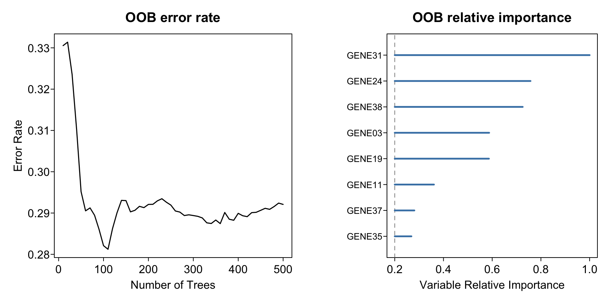

随机生存森林（**RSF**）按 OOB 置换对预测的破坏程度排序变量，给出生存组学的筛选路径：单变量 Cox 预筛 → RSF → 相对重要性 → signature 截断 \[1\]。参考的两幅面板回答不同问题——(A) OOB 误差率 vs 树数（森林收敛了吗？）与 (B) 相对重要性（哪些变量带预测权重？）——原文引擎 `randomSurvivalForest::rsf()` 已从 CRAN 归档，本教程改用其维护中的后继 `randomForestSRC::rfsrc()`，对象携带相同的 `$err.rate` 与 `$importance` 槽位：

## Example

{fig-alt="随机生存森林变量筛选 DEMO" fig-align="center" width="60%"}

## Setup

-   系统要求：跨平台（Linux/MacOS/Windows）

-   编程语言：R

-   依赖包：`survival`; `randomForestSRC`

```{r packages setup, message=FALSE, warning=FALSE, output=FALSE}
suppressPackageStartupMessages({
  library(survival)
})
```

```{r}
sessioninfo::session_info("attached")
```

## 数据准备

200 个模拟患者 × 40 基因，6 个植入预后基因（系数对齐到植入位置，弱到 OOB 误差在数百棵树上可见下降）。参考流水线在森林前按单变量 Cox p < 0.05 预筛——此处相同，RSF 只见预筛后的变量：

```{r load data}
suppressPackageStartupMessages({library(survival)})
if (!requireNamespace("randomForestSRC", quietly = TRUE)) {
  install.packages("randomForestSRC", repos = "https://cloud.r-project.org")
}
set.seed(18201)
## 200 patients x 40 genes; 6 genes planted as prognostic
n <- 200; n_gene <- 40
genes <- sprintf("GENE%02d", 1:n_gene)
expr <- matrix(rnorm(n * n_gene, 4, 1.2), n, n_gene, dimnames = list(NULL, genes))
prognostic <- c("GENE03", "GENE11", "GENE19", "GENE24", "GENE31", "GENE38")
coef <- c(0.32, -0.28, 0.34, 0.28, -0.32, 0.38)
## align coefficients with the PLANTED positions (a positional c(coef, 0, 0, ...)
## here silently makes columns 1-6 the prognostic genes instead)
full_coef <- rep(0, n_gene); full_coef[match(prognostic, genes)] <- coef
lp <- as.vector(scale(as.vector(expr %*% full_coef)))
lam <- exp(lp)
OS.time <- pmin(3000, pmax(30, qweibull(runif(n), 1, 1200 / lam)))
OS <- rbinom(n, 1, pmin(0.9, pmax(0.05, 0.5 + 0.25 * lp)))
dt.rf <- data.frame(OS.time = OS.time, OS = OS, expr)
## univariate Cox pre-filter (p < 0.05), as in the reference pipeline
cox_p <- vapply(genes, function(g)
  summary(coxph(Surv(OS.time, OS) ~ get(g), data = dt.rf))$coefficients[, "Pr(>|z|)"], numeric(1))
gene.sel <- names(cox_p)[cox_p < 0.05]
```

## Visualization

### 误差率曲线与重要性棒棒糖

参考的两面板：OOB 误差率急剧下降后在约 100 棵树后趋稳（面板 A——这就是选 ntree 的依据），重标定的相对重要性棒棒糖相对首位基因排序、0.2 截断虚线（面板 B——六个植入基因居首，另有两条弱噪声基因刚过线，真实筛选正是如此）：

```{r}
#| label: fig-1.1RfSurv
#| fig-cap: "200 个模拟患者的随机生存森林筛选：OOB 误差率 vs 树数（左）与 Cox 预筛基因相对重要性按首位基因重标定、0.2 截断（右）；六个植入预后基因居首。"
#| out.width: "95%"
#| warning: false
#| message: false
#| fig-width: 9
#| fig-height: 4.5

suppressPackageStartupMessages(library(randomForestSRC))
## randomForestSRC::rfsrc() replaces the archived randomSurvivalForest::rsf()
surv.rf <- rfsrc(Surv(OS.time, OS) ~ ., data = dt.rf[, c("OS.time", "OS", gene.sel)],
                 ntree = 500, importance = TRUE, seed = 12345678)
## Panel A: OOB error rate vs number of trees (rfsrc records the trace
## only every 10th tree — plot the recorded positions)
err.rate <- as.vector(surv.rf$err.rate)
err.idx <- which(!is.na(err.rate))
## Panel B: relative importance (rescaled to the top gene) lollipop
raw.imp <- surv.rf$importance
rel.imp <- raw.imp / max(abs(raw.imp))
imp.cutoff <- 0.2
sel <- sort(rel.imp[rel.imp > imp.cutoff])

par(mfrow = c(1, 2))
par(bty = "o", mgp = c(1.5, .33, 0), mar = c(3.5, 4, 2.5, 1), las = 1, tcl = -0.25)
plot(err.idx, err.rate[err.idx], type = "l", lwd = 1.5,
     xlab = "Number of Trees", ylab = "", main = "OOB error rate")
mtext("Error Rate", side = 2, line = 2.2, las = 3)
par(bty = "o", mgp = c(1.5, .33, 0), mar = c(3.5, 6, 2.5, 1), las = 1, tcl = -0.25)
xrange <- range(pretty(range(sel)))
plot(NA, NA, xlim = xrange, ylim = c(0.5, length(sel) + 0.5),
     xlab = "Variable Relative Importance", ylab = "", yaxt = "n",
     main = "OOB relative importance")
abline(v = imp.cutoff, lty = 2, col = "grey55")
for (i in seq_along(sel)) lines(c(xrange[1], sel[i]), c(i, i), col = "steelblue", lwd = 2.5)
axis(2, at = seq_along(sel), labels = gsub("_", "-", names(sel)), las = 1, cex.axis = 0.8)
```


::: callout-tip
**实践提示**

-   `rfsrc()` 的 err.rate 每 10 棵树才记录一次（其余为 `NA`）——画曲线须取 `which(!is.na(err.rate))`，否则线会静默消失。
-   模拟（或真实）系数要对准正确的变量**位置**：按位置写 `c(coef, 0, 0, ...)` 而植入基因在别处，会产出一幅内部自洽但生物学错误的图。
-   相对重要性重标定到 `max(abs(importance))`，截断值（此处 0.2；参考论文用 0.65）是**相对**阈值——连同原始 importance 一起报告，仅作排序依据而非证据。
:::

## 应用场景

::: {#fig-RfSurvApplications1}
{fig-alt="RSF 变量筛选" fig-align="center" width="60%"}

RSF 变量筛选
:::

同样的双面板读数适用于任何删失结局森林：纯临床风险模型、影像组学特征筛选、或多变量建模前的 CNV 基因 signature 选择。

## 参考文献

\[1\] Xiaofan Lu, et al. FigureYa: A Standardized Visualization Framework for Enhancing Biomedical Data Interpretation and Research Efficiency. iMetaMed. 2025. doi:10.1002/imm3.70005

\[2\] Ishwaran H, Kogalur UB, Blackstone EH, Lauer MS. Random survival forests. Ann Appl Stat. 2008;2(3):841-860. doi:10.1214/08-AOAS169