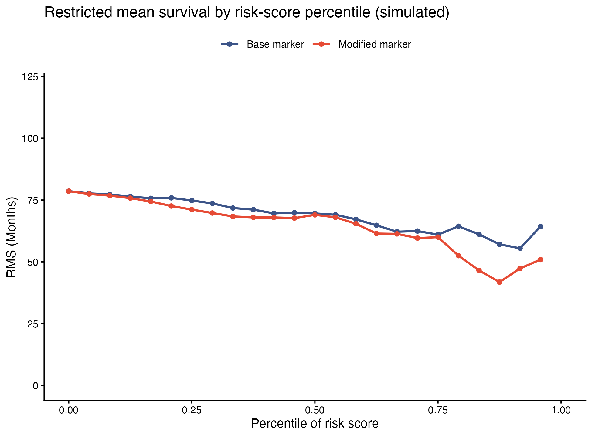

The hazard ratio hides magnitude; the **restricted mean survival time (RMST)** — the area under the survival curve up to a horizon `tau` — states it in months \[1\]. The reference sweeps the risk-score percentile, computing the RMS of each cumulative subgroup for a base and an improved (modified) marker: the vertical gap between the two curves is the months gained by the modification \[2\]. This tutorial reproduces that sweep with a dependency-free KM integration (`survRM2::rmst2()` gives the same quantity for two-group comparisons with CIs):

## Example

{fig-alt="Restricted Mean Survival by Risk Percentile DEMO" fig-align="center" width="60%"}

## Setup

-   System Requirements: Cross-platform (Linux/MacOS/Windows)

-   Programming language: R

-   Dependent packages: `survival`; `ggplot2`

```{r packages setup, message=FALSE, warning=FALSE, output=FALSE}
suppressPackageStartupMessages({
  library(survival)
  library(ggplot2)
})
```

```{r}
sessioninfo::session_info("attached")
```

## Data Preparation

250 simulated patients with a base marker and a modified marker (base + informative noise), survival generated from the modified marker at a 120-month horizon — the modified curve must sit below the base one at high percentiles:

```{r load data}
suppressPackageStartupMessages({library(survival); library(ggplot2)})
set.seed(18701)
n <- 250
base.marker <- rnorm(n)
modified.marker <- base.marker + rnorm(n, 0, 0.6)   # improved marker
lam <- exp(0.55 * scale(modified.marker)[, 1])
survdt <- data.frame(OS.time = pmin(180, pmax(2, qweibull(runif(n), 1, 90 / lam))),
                     OS = rbinom(n, 1, 0.62))
tau <- 120  # months
```

## Visualization

### 1. RMS Curve per Marker

RMS of every cumulative risk-percentile subgroup for both markers: both decline toward poor-prognosis percentiles, and the modified marker's curve sits measurably lower where the added information bites:

```{r}
#| label: fig-1.1RmsCurve
#| fig-cap: "Restricted mean survival (months, tau = 120) of cumulative risk-percentile subgroups for a base and a modified marker (250 simulated patients): the modified marker's curve sits below the base at high percentiles."
#| out.width: "85%"
#| warning: false
#| message: false
#| fig-width: 6.5
#| fig-height: 4.8

## RMS per marker percentile: integrate the KM curve of the >= percentile
## subgroup over [0, tau] (equivalent to survRM2::rmst2's RMST for one arm)
rms2curve <- function(marker, n.grid = 25) {
  pp <- seq(0, 1, length = n.grid)
  sapply(pp, function(p) {
    q <- quantile(marker, p)
    d <- survdt[marker >= q, ]
    if (nrow(d) < 10) return(NA)
    km <- survfit(Surv(OS.time, OS) ~ 1, data = d)
    s <- summary(km, times = 0:tau, extend = TRUE)$surv
    sum(head(s, -1) + tail(s, -1)) / 2 * (tau / (length(s) - 1))   # trapezoid RMST
  })
}
rms1 <- rms2curve(base.marker)
rms2 <- rms2curve(modified.marker)
pp <- seq(0, 1, length = 25)
df <- data.frame(pp = rep(pp, 2),
                 rms = c(rms1, rms2),
                 marker = rep(c("Base marker", "Modified marker"), each = 25))
ggplot(df, aes(pp, rms, colour = marker)) +
  geom_line(linewidth = 0.8) + geom_point(size = 1.4) +
  scale_colour_manual(values = c("#3C5488", "#E64B35"), name = NULL) +
  coord_cartesian(ylim = c(0, tau)) +
  labs(x = "Percentile of risk score", y = "RMS (Months)",
       title = "Restricted mean survival by risk-score percentile (simulated)") +
  theme_classic(base_size = 10) + theme(legend.position = "top")
```

::: callout-tip
**Practice tips**

-   RMST = the integral of S(t) over [0, tau]: sum the KM survival at a fine grid times the grid width. `survRM2::rmst2()` wraps the same computation for two arms with log-log CIs — state the horizon `tau` every time, since RMST values are meaningless without it.
-   Percentile sweeps make subgroups shrink at the tails — keep groups ≥ 10 patients (the page returns NA below that) or the curve ends in noise spikes.
-   Convert survival time to months before comparing against a `tau` given in months; the reference prints a reminder for exactly this reason.
:::

## Applications

::: {#fig-RmsApplications1}
{fig-alt="RMS percentile sweep" fig-align="center" width="60%"}

RMS percentile sweep
:::

The percentile-RMS sweep fits any base-vs-modified marker question: clinical vs clinical+genomic scores, model v1 vs v2, or a marker with and without a correction factor.

## Reference

\[1\] Xiaofan Lu, et al. FigureYa: A Standardized Visualization Framework for Enhancing Biomedical Data Interpretation and Research Efficiency. iMetaMed. 2025. doi:10.1002/imm3.70005

\[2\] Royston P, Parmar MKB. The use of restricted mean survival time to estimate the treatment effect in randomized clinical trials when the proportional hazards assumption is in doubt. BMC Med Res Methodol. 2013;13:152. doi:10.1186/1471-2288-13-152