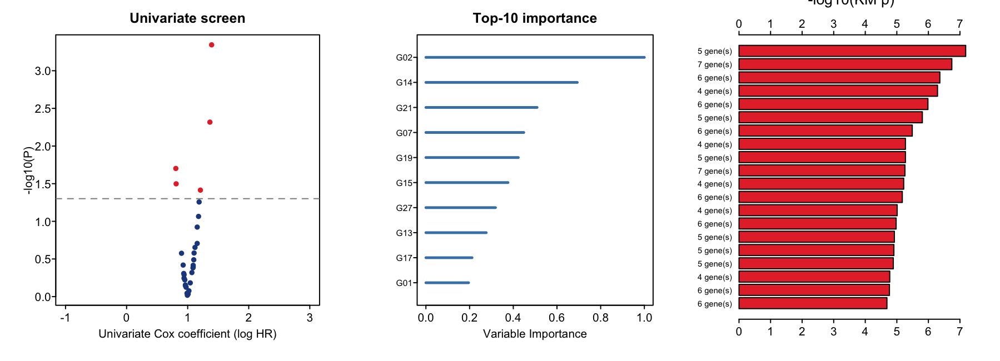

在预筛的小基因面板（此处重要性 top-10）上，参考文档**穷举测试全部 2^10 − 1 = 1023 种组合**：每种组合构建等权 Cox 风险评分、按中位数切高低风险、记录 log-rank P——获胜 signature 以最少基因最大化 −log10(P) \[1\]。参考用 `randomForestSRC::rfsrc()` importance 排序面板（见 `RfSurvivalPlot`）；本教程仅用 `survival` 按单变量 −log10(P) 排序并复现全部三个读数：

## Example

{fig-alt="signature 组合搜索 DEMO" fig-align="center" width="60%"}

## Setup

-   系统要求：跨平台（Linux/MacOS/Windows）

-   编程语言：R

-   依赖包：`survival`

```{r packages setup, message=FALSE, warning=FALSE, output=FALSE}
suppressPackageStartupMessages({
  library(survival)
})
```

```{r}
sessioninfo::session_info("attached")
```

## 数据准备

180 个模拟患者 × 30 基因、五个植入预后基因。单变量筛选、top-10 排序与 1013 组合扫描须一致认为植入基因主导获胜组合：

```{r load data}
suppressPackageStartupMessages({library(survival)})
set.seed(19801)
n <- 180; n_gene <- 30
genes <- sprintf("G%02d", 1:n_gene)
expr <- matrix(rnorm(n * n_gene), n, n_gene, dimnames = list(NULL, genes))
sig_genes <- c("G02", "G07", "G14", "G21", "G27")
sig_coef <- c(0.5, -0.45, 0.4, -0.35, 0.55)
full <- rep(0, n_gene); full[match(sig_genes, genes)] <- sig_coef
lp <- as.vector(scale(as.vector(expr %*% full)))
lam <- exp(0.8 * lp)
OS.time <- pmin(180, pmax(2, qweibull(runif(n), 1, 80 / lam)))
OS <- rbinom(n, 1, 0.6)
surv <- data.frame(OS = OS, OS.time = OS.time)
## univariate Cox per gene
uv <- do.call(rbind, lapply(genes, function(g) {
  m <- coxph(Surv(OS.time, OS) ~ expr[, g])
  ci <- summary(m)$conf.int
  data.frame(gene = g, HR = ci[1, 1], p = summary(m)$coefficients[1, 5])
}))
# NOTE: name the importance vector explicitly - summary(m)$coefficients rownames
# are all "expr[, g]" duplicates and would poison names(imp)
imp <- -log10(pmax(uv$p, 1e-16))
names(imp) <- uv$gene
imp <- imp / max(imp)
top10 <- head(names(sort(imp, decreasing = TRUE)), 10)
stopifnot(length(top10) == 10)
```

## Visualization

### 筛选、排序与组合扫描

三个参考读数：单变量 Cox 火山（红 = p < 0.05）、top-10 重要性棒棒糖（五个植入基因居首）与 top-20 组合的 −log10(log-rank P)——5 基因组合胜出，正是参考搜索的简约性：

```{r}
#| label: fig-1.1SigComb
#| fig-cap: "180 个模拟患者的 signature 组合搜索：单变量 Cox 火山（左）、top-10 重要性棒棒糖（中，五个植入基因居首）与按 -log10(log-rank P) 排序的 top-20 基因组合（右）——5 基因组合胜出。"
#| out.width: "100%"
#| warning: false
#| message: false
#| fig-width: 9.5
#| fig-height: 3.5

results <- list(); k <- 0
for (m in 2:10) {
  combs <- combn(top10, m)
  for (j in seq_len(ncol(combs))) {
    cg <- combs[, j]
    cv <- scale(expr[, cg]) %*% rep(1, length(cg))   # equal-weight risk score
    grp <- ifelse(cv > median(cv), "HRisk", "LRisk")
    fitd <- survdiff(Surv(OS.time, OS) ~ grp)
    p <- 1 - pchisq(fitd$chisq, length(fitd$n) - 1)
    k <- k + 1
    results[[k]] <- data.frame(ngene = length(cg), p = p)
  }
}
res <- do.call(rbind, results)
res$lp <- -log10(pmax(res$p, 1e-16))
top20 <- head(res[order(-res$lp), ], 20)

par(mfrow = c(1, 3))
par(bty = "o", mgp = c(1.5, .33, 0), mar = c(4, 4, 2.5, 1), las = 1, tcl = -0.25)
plot(uv$HR, -log10(pmax(uv$p, 1e-16)), pch = 19,
     col = ifelse(uv$p < 0.05, "#E53435", "#21498D"), cex = 0.8,
     xlim = c(-1, 3), xlab = "Univariate Cox coefficient (log HR)",
     ylab = "-log10(P)", main = "Univariate screen")
abline(h = -log10(0.05), lty = 2, col = "grey55")
par(mar = c(4, 6, 2.5, 1))
imp10 <- sort(imp[top10], decreasing = FALSE)
plot(NA, NA, xlim = c(0, max(imp10)), ylim = c(0.5, 10.5), yaxt = "n",
     xlab = "Variable Importance", ylab = "", main = "Top-10 importance")
for (i in seq_along(imp10)) lines(c(0, imp10[i]), c(i, i), col = "steelblue", lwd = 2.5)
axis(2, at = seq_along(imp10), labels = names(imp10), las = 1, cex.axis = 0.75)
par(mar = c(3, 5, 2.5, 2.5))
top20o <- top20[order(top20$lp), ]
barplot(top20o$lp, horiz = TRUE, col = "#E53435",
        names.arg = paste0(top20o$ngene, " gene(s)"), las = 1, cex.names = 0.7, xlab = "")
axis(3, las = 1)
mtext("-log10(KM p)", side = 3, line = 2, cex = 0.85)
```


::: callout-tip
**实践提示**

-   显式命名中间向量：`summary(coxph(~ expr[, g]))$coefficients` 的行名全是字面量 `"expr[, g]"`，会污染 `names(imp)` 并静默破坏 `combn()`。
-   扫描是 2^k − 1 次模型拟合——超过约 15 个基因就爆炸（参考把面板限在 10）；循环前先严格预筛。
-   在**同一数据**上构建评分再中位数切分 + log-rank 有最大的乐观偏倚——获胜组合要在独立队列上验证后才可信。
:::

## 应用场景

::: {#fig-SigCombApplications1}
{fig-alt="穷举 signature 扫描" fig-align="center" width="60%"}

穷举 signature 扫描
:::

筛选 → 排序 → 扫描循环适用于任何小候选面板：免疫评分基因集、lncRNA 面板、或代谢物比值。

## 参考文献

\[1\] Xiaofan Lu, et al. FigureYa: A Standardized Visualization Framework for Enhancing Biomedical Data Interpretation and Research Efficiency. iMetaMed. 2025. doi:10.1002/imm3.70005

\[2\} Simon RM, Subramanian J, Li MC, Mancuso S. Using cross-validation to evaluate multivariate prediction procedures. Nat Rev Genet. 2011;12(10):743. doi:10.1038/nrg2731 (why the winning combination needs external validation)