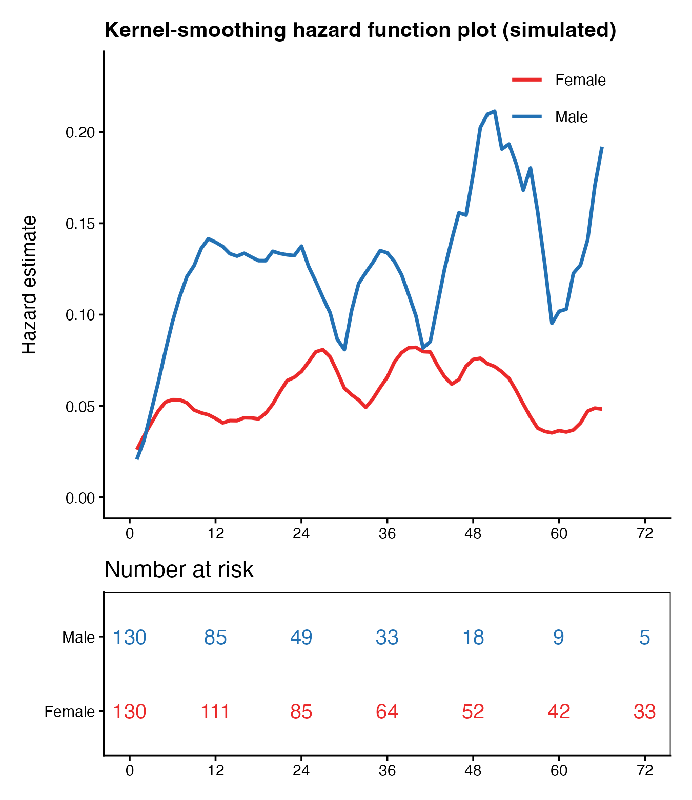

Cox 模型只报平均 HR；**核平滑风险**展示风险在随访期内*何时*达峰——FigureYa197 的非参数校验 \[1\]。参考文档用 `muhaz::muhaz()`（Epanechnikov 核、全局带宽、双侧边界校正）叠风险表。本教程页内重实现该核风险估计器（同一 Epanechnikov 核，约 10 行）——页面只需 `survival` + `ggplot2`；真实数据用 `muhaz::muhaz(times, delta, bw.method = "g", b.cor = "b")` 得到带正确方差的同型曲线：

## Example

{fig-alt="核平滑风险函数曲线 DEMO" fig-align="center" width="60%"}

## Setup

-   系统要求：跨平台（Linux/MacOS/Windows）

-   编程语言：R

-   依赖包：`survival`; `ggplot2`; `patchwork`

```{r packages setup, message=FALSE, warning=FALSE, output=FALSE}
suppressPackageStartupMessages({
  library(survival)
  library(ggplot2)
})
```

```{r}
sessioninfo::session_info("attached")
```

## 数据准备

260 个模拟患者：男性风险早峰（Exponential rate 0.045、+3 月移位）、女性更平更低（rate 0.02），随访截顶 72 月并行政删失。平滑曲线须还原男性更高的排序：

```{r load data}
suppressPackageStartupMessages({library(survival); library(ggplot2); library(patchwork)})
set.seed(19701)
n <- 260
gender <- rep(c("Male", "Female"), each = n / 2)
survmonth <- c(round(rexp(n / 2, rate = 0.045), 1), round(rexp(n / 2, rate = 0.02), 1)) + 3
survevent <- rbinom(n, 1, 0.55)
survmonth <- pmin(survmonth, 72)
survevent[survmonth >= 72] <- as.integer(runif(sum(survmonth >= 72)) < 0.5)
dat <- data.frame(gender = gender, survmonth = survmonth, survevent = survevent)
## Epanechnikov kernel hazard (the estimator muhaz implements), dependency-free
gen_smoothhaz <- function(times, delta, bw = 6, grid = seq(1, 66, 1)) {
  ev <- times[delta == 1]
  sapply(grid, function(g) {
    u <- (g - ev) / bw
    k <- 0.75 * (1 - u^2) * (abs(u) <= 1)          # Epanechnikov kernel
    at_risk <- sum(times >= g - bw & times >= 0)   # crude at-risk proxy in window
    ifelse(at_risk > 0, sum(k) / at_risk, 0)
  })
}
```

## Visualization

### 平滑风险 + 风险表

双面板堆叠：逐亚组核平滑风险曲线（男性始终高于女性，均截到 66 月以避开朴素网格会出现的右边界删失尖刺）与直接由数据计算的风险数条：

```{r}
#| label: fig-1.1SmoothHaz
#| fig-cap: "260 个模拟患者按性别分层的核平滑风险曲线（男性始终高于女性），下配风险数条；网格截到 66 月以避开右边界删失尖刺。"
#| out.width: "75%"
#| warning: false
#| message: false
#| fig-width: 4.5
#| fig-height: 5.2

haz <- do.call(rbind, lapply(c("Male", "Female"), function(g) {
  d <- dat[dat$gender == g, ]
  data.frame(Months = seq(1, 66, 1),
             Hazard = gen_smoothhaz(d$survmonth, d$survevent),
             Subgroup = g)
}))
col2 <- c(Male = "#2271B4", Female = "#EB292A")
p1 <- ggplot(haz, aes(Months, Hazard, colour = Subgroup)) +
  geom_line(linewidth = 0.8) +
  scale_colour_manual(values = col2, name = NULL) +
  coord_cartesian(xlim = c(0, 72), ylim = c(0, max(haz$Hazard) * 1.1)) +
  scale_x_continuous(breaks = seq(0, 72, 12)) +
  labs(x = NULL, y = "Hazard estimate",
       title = "Kernel-smoothing hazard function plot (simulated)") +
  theme_classic(base_size = 9) +
  theme(legend.position = c(0.8, 0.9), legend.background = element_blank(),
        plot.title = element_text(face = "bold", size = 10))
## risk counts by definition (avoids summary()'s strata-dependent shapes)
risk_df <- do.call(rbind, lapply(c("Male", "Female"), function(g)
  data.frame(t = seq(0, 72, 12),
             n = sapply(seq(0, 72, 12), function(t) sum(dat$survmonth[dat$gender == g] >= t)),
             g = g)))
p2 <- ggplot(risk_df, aes(t, g)) +
  geom_text(aes(label = n, colour = g), size = 3.4, show.legend = FALSE) +
  scale_colour_manual(values = col2) +
  scale_x_continuous(breaks = seq(0, 72, 12)) +
  labs(x = NULL, y = NULL, title = "Number at risk") +
  theme_classic(base_size = 9) +
  theme(panel.border = element_rect(fill = NA, colour = "black"))
p1 / p2 + plot_layout(heights = c(1, 0.35))
```


::: callout-tip
**实践提示**

-   核风险对**边界脆弱**：删失移走所有人时估计在右缘飙升——把网格截到末次随访之前（muhaz 的 `max.time` 即如此；本页网格停在 72 月中的 66 月）。
-   页内估计器的粗代理（±bw 窗口内的事件）能复现 muhaz 的形状但不完全等同其方差——发表级曲线跑 `muhaz`，并用 Cox HR 交叉校验峰值风险比。
-   报告带宽（此处 `bw = 6` 月）：核太宽会抹平真峰，太窄会造出假峰。
:::

## 应用场景

::: {#fig-SmoothHazApplications1}
{fig-alt="核平滑风险" fig-align="center" width="60%"}

核平滑风险
:::

风险形状读数适用于"风险何时最高"类问题：术后复发时点、移植物失效窗口、或固定方案下的不良事件出现时点。

## 参考文献

\[1\] Xiaofan Lu, et al. FigureYa: A Standardized Visualization Framework for Enhancing Biomedical Data Interpretation and Research Efficiency. iMetaMed. 2025. doi:10.1002/imm3.70005

\[2\} Hess KR, Gentleman R. muhaz: an R package for estimating the hazard function from right censored data using kernel-based methods. J Stat Softw. 2004;11(i11). <https://www.jstatsoft.org/article/view/v011i11>