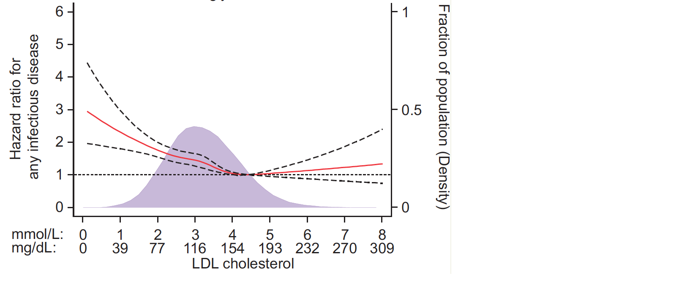

A continuous covariate's effect on survival is rarely log-linear: the smoothed-HR workflow fits a Cox model with the covariate **spline-transformed** (restricted cubic splines), picks the knot count by AIC, and draws HR(v) relative to a reference value with pointwise confidence bands — revealing U-shapes and thresholds a single coefficient would hide \[1\]. The `smoothHR` package is not in this repository's lockfile; the same computation — Hmisc's `rcspline.eval` basis, `survival::coxph`, knot selection by AIC and the HR(v) curve with variance-derived bands — runs in-page on simulated data with a planted non-linear BMI effect:

## Example

{fig-alt="Smoothed Hazard Ratio via RCS DEMO" fig-align="center" width="70%"}

## Setup

-   System Requirements: Cross-platform (Linux/MacOS/Windows)

-   Programming language: R

-   Dependent packages: `survival`; `Hmisc`; `ggplot2`

```{r packages setup, message=FALSE, warning=FALSE, output=FALSE}
suppressPackageStartupMessages({
  library(survival); library(Hmisc); library(ggplot2)
})
```

```{r}
sessioninfo::session_info("attached")
```

## Data Preparation

500 patients with BMI, gender and follow-up survival. Planted non-linearity: the hazard is lowest around BMI 25 (U-shaped — both underweight and obese carry excess risk), and gender is an independent covariate:

```{r load data}
suppressPackageStartupMessages({
  library(survival); library(Hmisc); library(ggplot2)
})
set.seed(52345)
n_pat <- 500
bmi <- pmin(pmax(rnorm(n_pat, 26.5, 4), 15), 45)
gender <- factor(sample(c("Female", "Male"), n_pat, TRUE))

## U-shaped log-hazard around the reference bmi = 25
haz <- 0.05 * exp(0.02 * (bmi - 25)^2 - 0.10 * (gender == "Male"))
dat <- data.frame(bmi = bmi, gender = gender,
                  lenfol = round(rexp(n_pat, rate = pmax(haz, 0.008)), 1),
                  fstat = rbinom(n_pat, 1, 0.65))
```

## Matching the Reference: AIC Knot Selection

The reference picks the spline knot count by AIC over 3-6 knots; the winner here is nk = 4:

```{r}
#| warning: false
#| label: fig-1.1SmoothHrAic
#| fig-cap: "AIC across spline knot counts (nk = 3-6) for the rcs-Cox model: nk = 4 wins — the model-selection step the reference runs before drawing the HR curve."
#| out.width: "70%"
#| fig-width: 6
#| fig-height: 4.4

knot_probs_all <- list(`3` = c(.10, .50, .90), `4` = c(.05, .35, .65, .95),
                       `5` = c(.05, .275, .50, .725, .95),
                       `6` = c(.05, .23, .41, .59, .77, .95))
aic_tab <- do.call(rbind, lapply(3:6, function(nk) {
  bs <- rcspline.eval(dat$bmi, knots = as.numeric(quantile(dat$bmi, knot_probs_all[[as.character(nk)]])),
                      inclx = TRUE)
  colnames(bs) <- paste0("rcs", seq_len(ncol(bs)))
  d2 <- cbind(dat, bs)
  fit <- coxph(Surv(lenfol, fstat) ~ . - bmi - lenfol - fstat,
               data = d2, x = TRUE)
  data.frame(nk = nk, AIC = as.numeric(extractAIC(fit)[2]))
}))
best_nk <- aic_tab$nk[which.min(aic_tab$AIC)]
cat("best nk:", best_nk, "\n")
ggplot(aic_tab, aes(nk, AIC)) +
  geom_line(linewidth = 0.9, colour = "#2166AC") +
  geom_point(size = 3, colour = "#2166AC") +
  geom_point(data = aic_tab[which.min(aic_tab$AIC), ], size = 5,
             shape = 21, fill = "#B2182B", colour = "black", stroke = 1) +
  scale_x_continuous(breaks = 3:6) +
  labs(x = "Knot count (nk)", y = "AIC") +
  theme_bw(base_size = 11) +
  theme(panel.grid.minor = element_blank())
```

## Visualization

### 1. Smoothed HR Curve vs BMI

The reference's deliverable: HR(bmi) relative to the reference value (bmi 25) with pointwise 95% bands — the U-shape is the point:

```{r}
#| label: fig-2.1SmoothHrCurve
#| fig-cap: "Smoothed hazard ratio of BMI relative to the reference (bmi = 25, dashed line at HR 1), from the AIC-selected 4-knot rcs-Cox model: both tails of the BMI distribution carry excess risk while the 24-26 band sits near HR 1 — the U-shape a single linear coefficient would average away; the log-scale y axis keeps the pointwise 95% CI band readable even in the sparse tails."
#| out.width: "90%"
#| fig-width: 8.5
#| fig-height: 5

## Hmisc's default knot placement per nk — pass explicit knots everywhere
## so the single reference value and the curve share the same basis
knot_probs <- list(`3` = c(.10, .50, .90), `4` = c(.05, .35, .65, .95),
                   `5` = c(.05, .275, .50, .725, .95),
                   `6` = c(.05, .23, .41, .59, .77, .95))
knots_loc <- as.numeric(quantile(dat$bmi, knot_probs[[as.character(best_nk)]]))

## build the spline basis once with clean names, used by fit and curve alike
basis <- rcspline.eval(dat$bmi, knots = knots_loc, inclx = TRUE)
kn <- paste0("rcs", seq_len(ncol(basis)))
colnames(basis) <- kn
d2 <- cbind(dat, basis)
fit <- coxph(Surv(lenfol, fstat) ~ rcs1 + rcs2 + rcs3 + gender,
             data = d2, x = TRUE)

## HR(v) vs reference 25: beta' (rcs(v) - rcs(25)) with variance from vcov
beta <- coef(fit)[kn]
V <- vcov(fit)[kn, kn]
ref <- 25
## never extrapolate past the observed covariate range (the rcs tail beyond
## the boundary knot explodes) — trim to the central 99% of the data
v_lo <- as.numeric(quantile(dat$bmi, 0.01))
v_hi <- as.numeric(quantile(dat$bmi, 0.99))
v_seq <- seq(v_lo, v_hi, by = 0.25)
b_seq <- rcspline.eval(v_seq, knots = knots_loc, inclx = TRUE)
colnames(b_seq) <- kn
b_ref <- rcspline.eval(ref, knots = knots_loc, inclx = TRUE)
colnames(b_ref) <- kn
dlo <- b_seq - b_ref[rep(1, nrow(b_seq)), , drop = FALSE]
loghr <- as.numeric(dlo %*% beta)
## CI of the contrast vs the reference: (b(v) - b(ref))' V (b(v) - b(ref))
se <- sqrt(diag(dlo %*% V %*% t(dlo)))
hr_df <- data.frame(bmi = v_seq, hr = exp(loghr),
                    lo = exp(loghr - 1.96 * se), hi = exp(loghr + 1.96 * se))

ggplot(hr_df, aes(bmi, hr)) +
  geom_hline(yintercept = 1, linetype = "dashed", colour = "grey45") +
  geom_vline(xintercept = 25, linetype = "dotted", colour = "grey55") +
  geom_ribbon(aes(ymin = lo, ymax = hi), fill = "#B2182B", alpha = 0.15) +
  geom_line(colour = "#B2182B", linewidth = 1.1) +
  annotate("text", x = 25, y = 1.02, label = "reference (HR = 1)",
           size = 3, colour = "grey35", hjust = 0, vjust = -0.4) +
  scale_y_log10(breaks = c(0.5, 1, 2, 5, 10, 20)) +
  labs(x = "BMI (kg/m2)", y = "Smoothed hazard ratio (95% CI, log scale)") +
  theme_bw(base_size = 11) +
  theme(panel.grid.minor = element_blank())
```

::: callout-tip
**Practice tips**
-   Pick knots by **AIC over 3-6 knots** — too few knots miss the U-shape, too many chase noise; the reference's extractAIC loop is the standard.
-   The HR curve needs a **reference value** (HR = 1 there) — pick a clinically meaningful one (norm, cohort median) and mark it on the plot.
-   Bands are **pointwise 95% CI** from the spline covariance — they widen at the data-sparse BMI tails; don't over-read the far edges.
-   Keep the covariate adjustment (gender here) in the spline model — the curve shows the adjusted effect.
-   Report the non-linearity test (e.g. likelihood-ratio of spline vs linear) alongside: a U-shape with p-nonlinear < 0.05 is the evidence the figure exists to show.
:::

## Application

::: {#fig-SmoothHrApplications1}
{fig-alt="Smoothed Hazard Ratio via RCS" fig-align="center" width="70%"}

Smoothed hazard ratio via restricted cubic splines
:::

Smoothed-HR curves apply to any continuous predictor in survival analysis: BMI, blood pressure, tumour marker levels, or gene-expression signatures against relapse time.

## Reference

\[1\] Xiaofan Lu, et al. FigureYa: A Standardized Visualization Framework for Enhancing Biomedical Data Interpretation and Research Efficiency. iMetaMed. 2025. doi:10.1002/imm3.70005
