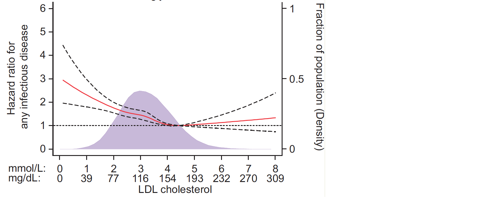

连续协变量对生存的效应很少是对数线性的：平滑 HR 工作流用**限制性立方样条**变换协变量拟合 Cox 模型、按 AIC 选节点数、并画出相对某参考值的 HR(v) 曲线及逐点置信带——暴露单个系数会平均掉的 U 形与阈值 \[1\]。`smoothHR` 包不在本仓库 lockfile；同一计算——Hmisc 的 `rcspline.eval` 基、`survival::coxph`、AIC 选节点与带方差置信带的 HR(v) 曲线——在模拟数据上运行（植入 U 形 BMI 效应）：

## Example

{fig-alt="限制性立方样条平滑 HR DEMO" fig-align="center" width="70%"}

## Setup

-   系统要求：跨平台（Linux/MacOS/Windows）

-   编程语言：R

-   依赖包：`survival`; `Hmisc`; `ggplot2`

```{r packages setup, message=FALSE, warning=FALSE, output=FALSE}
suppressPackageStartupMessages({
  library(survival); library(Hmisc); library(ggplot2)
})
```

```{r}
sessioninfo::session_info("attached")
```

## 数据准备

500 名患者的 BMI、性别与随访生存。植入非线性——风险在 BMI 25 附近最低（U 形：偏瘦与肥胖都携带额外风险），性别为独立协变量：

```{r load data}
suppressPackageStartupMessages({
  library(survival); library(Hmisc); library(ggplot2)
})
set.seed(52345)
n_pat <- 500
bmi <- pmin(pmax(rnorm(n_pat, 26.5, 4), 15), 45)
gender <- factor(sample(c("Female", "Male"), n_pat, TRUE))

## U-shaped log-hazard around the reference bmi = 25
haz <- 0.05 * exp(0.02 * (bmi - 25)^2 - 0.10 * (gender == "Male"))
dat <- data.frame(bmi = bmi, gender = gender,
                  lenfol = round(rexp(n_pat, rate = pmax(haz, 0.008)), 1),
                  fstat = rbinom(n_pat, 1, 0.65))
```

## 匹配参考：AIC 节点选择

参考在 3-6 个节点上按 AIC 选择样条节点数；此处 nk = 4 胜出：

```{r}
#| warning: false
#| label: fig-1.1SmoothHrAic
#| fig-cap: "rcs-Cox 模型在节点数（nk = 3-6）上的 AIC：nk = 4 胜出——参考在画 HR 曲线之前运行的模型选择步骤。"
#| out.width: "70%"
#| fig-width: 6
#| fig-height: 4.4

knot_probs_all <- list(`3` = c(.10, .50, .90), `4` = c(.05, .35, .65, .95),
                       `5` = c(.05, .275, .50, .725, .95),
                       `6` = c(.05, .23, .41, .59, .77, .95))
aic_tab <- do.call(rbind, lapply(3:6, function(nk) {
  bs <- rcspline.eval(dat$bmi, knots = as.numeric(quantile(dat$bmi, knot_probs_all[[as.character(nk)]])),
                      inclx = TRUE)
  colnames(bs) <- paste0("rcs", seq_len(ncol(bs)))
  d2 <- cbind(dat, bs)
  fit <- coxph(Surv(lenfol, fstat) ~ . - bmi - lenfol - fstat,
               data = d2, x = TRUE)
  data.frame(nk = nk, AIC = as.numeric(extractAIC(fit)[2]))
}))
best_nk <- aic_tab$nk[which.min(aic_tab$AIC)]
cat("best nk:", best_nk, "\n")
ggplot(aic_tab, aes(nk, AIC)) +
  geom_line(linewidth = 0.9, colour = "#2166AC") +
  geom_point(size = 3, colour = "#2166AC") +
  geom_point(data = aic_tab[which.min(aic_tab$AIC), ], size = 5,
             shape = 21, fill = "#B2182B", colour = "black", stroke = 1) +
  scale_x_continuous(breaks = 3:6) +
  labs(x = "Knot count (nk)", y = "AIC") +
  theme_bw(base_size = 11) +
  theme(panel.grid.minor = element_blank())
```

## Visualization

### 1. 平滑 HR 曲线 vs BMI

参考的交付物：相对参考值（bmi 25）的 HR(bmi) 及逐点 95% 置信带——U 形是重点：

```{r}
#| label: fig-2.1SmoothHrCurve
#| fig-cap: "AIC 选出的 4 节点 rcs-Cox 模型下、相对参考值（bmi = 25、HR = 1 虚线）的平滑风险比：BMI 分布的两端携带额外风险而 24-26 区间接近 HR 1——单个线性系数会平均掉的 U 形；对数刻度 y 轴让稀疏尾部的逐点 95% 置信带保持可读。"
#| out.width: "90%"
#| fig-width: 8.5
#| fig-height: 5

## Hmisc's default knot placement per nk — pass explicit knots everywhere
## so the single reference value and the curve share the same basis
knot_probs <- list(`3` = c(.10, .50, .90), `4` = c(.05, .35, .65, .95),
                   `5` = c(.05, .275, .50, .725, .95),
                   `6` = c(.05, .23, .41, .59, .77, .95))
knots_loc <- as.numeric(quantile(dat$bmi, knot_probs[[as.character(best_nk)]]))

## build the spline basis once with clean names, used by fit and curve alike
basis <- rcspline.eval(dat$bmi, knots = knots_loc, inclx = TRUE)
kn <- paste0("rcs", seq_len(ncol(basis)))
colnames(basis) <- kn
d2 <- cbind(dat, basis)
fit <- coxph(Surv(lenfol, fstat) ~ rcs1 + rcs2 + rcs3 + gender,
             data = d2, x = TRUE)

## HR(v) vs reference 25: beta' (rcs(v) - rcs(25)) with variance from vcov
beta <- coef(fit)[kn]
V <- vcov(fit)[kn, kn]
ref <- 25
## never extrapolate past the observed covariate range (the rcs tail beyond
## the boundary knot explodes) — trim to the central 99% of the data
v_lo <- as.numeric(quantile(dat$bmi, 0.01))
v_hi <- as.numeric(quantile(dat$bmi, 0.99))
v_seq <- seq(v_lo, v_hi, by = 0.25)
b_seq <- rcspline.eval(v_seq, knots = knots_loc, inclx = TRUE)
colnames(b_seq) <- kn
b_ref <- rcspline.eval(ref, knots = knots_loc, inclx = TRUE)
colnames(b_ref) <- kn
loghr <- as.numeric((b_seq - b_ref[rep(1, nrow(b_seq)), , drop = FALSE]) %*% beta)
se <- sqrt(diag(b_seq %*% V %*% t(b_seq)))
hr_df <- data.frame(bmi = v_seq, hr = exp(loghr),
                    lo = exp(loghr - 1.96 * se), hi = exp(loghr + 1.96 * se))

ggplot(hr_df, aes(bmi, hr)) +
  geom_hline(yintercept = 1, linetype = "dashed", colour = "grey45") +
  geom_vline(xintercept = 25, linetype = "dotted", colour = "grey55") +
  geom_ribbon(aes(ymin = lo, ymax = hi), fill = "#B2182B", alpha = 0.15) +
  geom_line(colour = "#B2182B", linewidth = 1.1) +
  annotate("text", x = 25, y = 1.02, label = "reference (HR = 1)",
           size = 3, colour = "grey35", hjust = 0, vjust = -0.4) +
  scale_y_log10(breaks = c(0.5, 1, 2, 5, 10, 20)) +
  labs(x = "BMI (kg/m2)", y = "Smoothed hazard ratio (95% CI, log scale)") +
  theme_bw(base_size = 11) +
  theme(panel.grid.minor = element_blank())
```

::: callout-tip
**实践要点**
-   在 **3-6 个节点上按 AIC** 选节点——节点太少会错过 U 形，太多会追噪声；参考的 extractAIC 循环是标准做法。
-   HR 曲线需要**参考值**（该处 HR = 1）——选有临床意义的一个（正常范围、队列中位数）并在图上标记。
-   置信带是 **逐点 95% CI**（来自样条协方差）——在数据稀疏的 BMI 尾部会变宽；远端不要过度解读。对数刻度 y 轴让带与曲线同时可读。
-   样条模型保留协变量调整（此处 gender）——曲线展示的是调整后效应。
-   曲线之外同时报告非线性检验（样条 vs 线性的似然比）——p-nonlinear < 0.05 的 U 形才是这张图存在的证据。
:::

## 应用场景

::: {#fig-SmoothHrApplications1}
{fig-alt="限制性立方样条平滑 HR" fig-align="center" width="70%"}

限制性立方样条的平滑风险比曲线
:::

平滑 HR 曲线适用于生存分析中的任何连续预测因子：BMI、血压、肿瘤标志物水平、或基因表达签名对复发时间。

## 参考文献

\[1\] Xiaofan Lu, et al. FigureYa: A Standardized Visualization Framework for Enhancing Biomedical Data Interpretation and Research Efficiency. iMetaMed. 2025. doi:10.1002/imm3.70005
