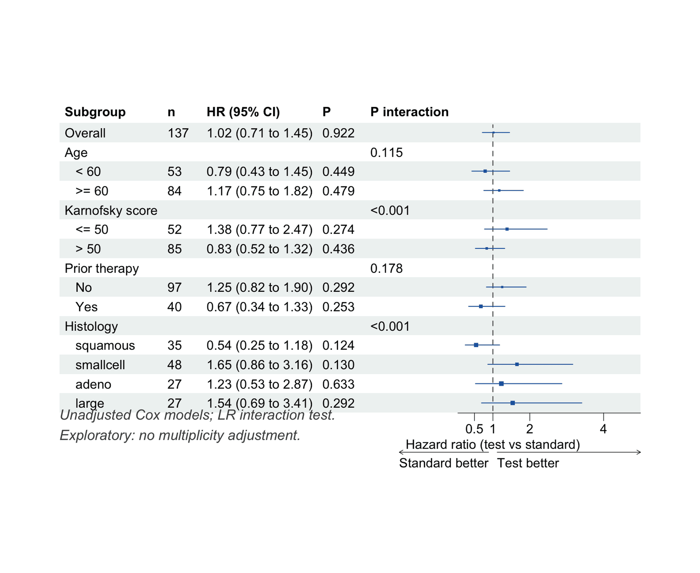
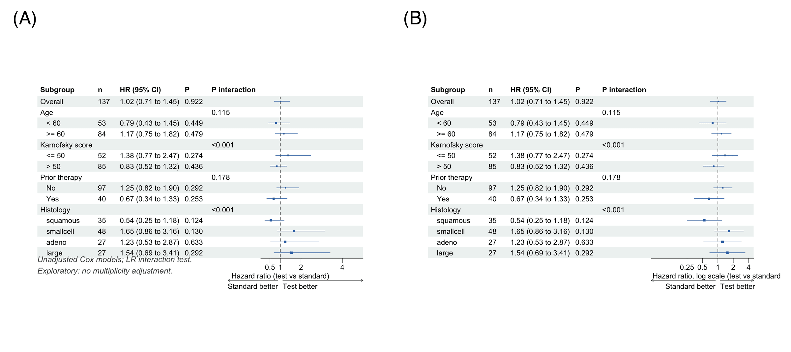

The subgroup forest plot summarizes a treatment effect (or any exposure effect) estimated *within each level of baseline covariates* — age groups, histology, disease severity — underneath the overall estimate. Each row shows the effect (e.g., a hazard ratio) with its 95% confidence interval as a square-and-whisker symbol; columns report the number of patients, the formatted estimate, and the within-subgroup p-value. A dedicated **P interaction** column tests whether the effect *differs between* subgroup levels \[1\].

Two statistical principles structure the plot. First, the *interaction test* — not the within-subgroup p-values — is the formal test of effect modification; a common reading error is to declare a subgroup effect from confidence intervals that merely cross the null line in one subgroup but not the other \[2\]. Second, subgroup findings are exploratory: they generate hypotheses for confirmation, and multiplicity across many subgroup variables should temper interpretation \[1\].

This tutorial builds a publication-grade subgroup forest plot with `forestploter` \[3\]:

1. A basic subgroup forest of a survival treatment effect;
2. The full publishable version — indented subgroup headers, interaction p-values, arrows and axis labels;
3. A log-scale axis variant for strongly skewed hazard ratios.

## Example

{fig-alt="SubgroupForestPlot DEMO" fig-align="center" width="60%"}

## Setup

-   System Requirements: Cross-platform (Linux/MacOS/Windows)

-   Programming language: R

-   Dependent packages: `survival`; `dplyr`; `forestploter`; `grid`

```{r packages setup, message=FALSE, warning=FALSE, output=FALSE}
# Installing necessary packages
if (!requireNamespace("forestploter", quietly = TRUE)) {
  install.packages("forestploter")
}

# Load packages
library(survival)
library(dplyr)
library(forestploter)
library(grid)
```

```{r}
sessioninfo::session_info("attached")
```

## Data Preparation

We use the built-in `veteran` data from the `survival` package \[4\]: a randomized trial of 137 lung-cancer patients comparing a standard versus a test chemotherapy (`trt`), with follow-up time, survival status and five baseline covariates. We dichotomize age (≥/< 60 years) and Karnofsky performance score (≤/> 50), keep prior therapy as a binary factor, and treat histology as a four-level factor. For each subgroup level we fit a Cox model of the treatment effect; for each subgroup *variable* we test the treatment × subgroup interaction by comparing models with and without the interaction term (likelihood-ratio test).

```{r load data, message=FALSE, warning=FALSE}
data(veteran, package = "survival")

vet <- veteran |>
  mutate(
    Age       = factor(ifelse(age >= 60, ">= 60", "< 60"), levels = c("< 60", ">= 60")),
    Karnofsky = factor(ifelse(karno <= 50, "<= 50", "> 50"), levels = c("<= 50", "> 50")),
    PriorTx   = factor(ifelse(prior == 0, "No", "Yes"), levels = c("No", "Yes")),
    Histology = relevel(factor(celltype), ref = "squamous")
  )

# Hazard ratio of the test vs standard arm within a subset of patients
sub_haz <- function(df) {
  fit <- coxph(Surv(time, status) ~ trt, data = df)
  s <- summary(fit)
  c(est = unname(s$coefficients["trt", "exp(coef)"]),
    lo  = unname(s$conf.int["trt", "lower .95"]),
    hi  = unname(s$conf.int["trt", "upper .95"]),
    n   = nrow(df),
    p   = unname(s$coefficients["trt", "Pr(>|z|)"]))
}

# Interaction p-value per subgroup variable: likelihood-ratio test of
# Cox(Surv ~ trt) vs Cox(Surv ~ trt * subgroup)
int_p <- function(var) {
  a <- anova(coxph(Surv(time, status) ~ trt, data = vet),
             coxph(as.formula(paste("Surv(time, status) ~ trt *", var)), data = vet))
  unname(a[2, "Pr(>|Chi|)"])
}

subgroups <- data.frame(
  label  = c("Age", "Karnofsky score", "Prior therapy", "Histology"),
  column = c("Age", "Karnofsky", "PriorTx", "Histology"),
  stringsAsFactors = FALSE
)
```

## Visualization

### 1. Basic Subgroup Forest

Rows with `NA` estimates render as plain header rows, so we assemble the table with the overall row first, then each subgroup variable followed by its indented levels.

```{r}
#| label: fig-1.1BasicSubgroupForest
#| fig-cap: "Subgroup forest plot of the treatment effect (hazard ratio, test vs standard arm)."
#| out.width: "95%"
#| fig-width: 8
#| fig-height: 6.5
#| warning: false
#| message: false

rows <- list(); hdr_p <- c()
add_row <- function(name, est = NA_real_, lo = NA_real_, hi = NA_real_,
                    n = NA_real_, p = NA_real_) {
  rows[[length(rows) + 1]] <<- data.frame(Subgroup = name, est = est, lo = lo, hi = hi,
                                          n = n, p = p, stringsAsFactors = FALSE)
}

r <- sub_haz(vet); add_row("Overall", r[["est"]], r[["lo"]], r[["hi"]], r[["n"]], r[["p"]])
for (i in seq_len(nrow(subgroups))) {
  v <- subgroups$column[i]
  add_row(subgroups$label[i])                       # header row: no estimate
  for (l in levels(vet[[v]])) {
    rr <- sub_haz(vet[vet[[v]] == l, ])
    add_row(paste0("   ", l), rr[["est"]], rr[["lo"]], rr[["hi"]], rr[["n"]], rr[["p"]])
  }
  hdr_p <- c(hdr_p, int_p(v))
}
sg <- dplyr::bind_rows(rows)

# Interaction p-values sit on the variable header rows
hdr_idx <- which(is.na(sg$est) & seq_len(nrow(sg)) > 1)
sg$`P interaction` <- ""
sg$`P interaction`[hdr_idx] <- ifelse(hdr_p < 0.001, "<0.001", sprintf("%.3f", hdr_p))

sg$`HR (95% CI)` <- ifelse(is.na(sg$est), "",
                           sprintf("%.2f (%.2f to %.2f)", sg$est, sg$lo, sg$hi))
sg$P <- ifelse(is.na(sg$p), "", ifelse(sg$p < 0.001, "<0.001", sprintf("%.3f", sg$p)))
sg$n <- ifelse(is.na(sg$n), "", as.character(sg$n))
sg$se <- (log(sg$hi) - log(sg$lo)) / (2 * 1.96)   # box size ~ CI width
sg$`  ` <- paste(rep(" ", 24), collapse = " ")     # blank spacer column for the CI

p <- forest(sg[, c("Subgroup", "n", "HR (95% CI)", "P", "P interaction", "  ")],
            est = sg$est, lower = sg$lo, upper = sg$hi,
            sizes = sg$se,
            ci_column = 6,
            ref_line = 1,
            xlim = c(0.05, 5),
            ticks_at = c(0.5, 1, 2, 4))
p
```

The overall hazard ratio is 1.02 (0.71 to 1.45): no evidence that the test chemotherapy changes mortality overall. The subgroup rows are where hypotheses live — but only the interaction column tells us whether any of the differences between subgroup levels are more than noise (see the next figure).

### 2. Publication Style: Interaction P, Arrows and Footnote

```{r}
#| label: fig-2.1PubStyle
#| fig-cap: "Publishable variant with axis annotations, a footnote and the interaction p-value column; an interaction P < 0.001 appears for Karnofsky score and histology."
#| out.width: "95%"
#| fig-width: 8
#| fig-height: 6.5
#| warning: false
#| message: false

tm <- forest_theme(base_size = 11,
                   ci_pch = 15,
                   ci_col = "#2166AC",
                   ci_fill = "#2166AC",
                   refline_gp = gpar(col = "grey30", lty = 2),
                   footnote_gp = gpar(col = "grey30", fontface = "italic"))

p2 <- forest(sg[, c("Subgroup", "n", "HR (95% CI)", "P", "P interaction", "  ")],
             est = sg$est, lower = sg$lo, upper = sg$hi,
             sizes = sg$se,
             ci_column = 6,
             ref_line = 1,
             xlim = c(0.05, 5),
             ticks_at = c(0.5, 1, 2, 4),
             arrow_lab = c("Standard better", "Test better"),
             xlab = "Hazard ratio (test vs standard)",
             footnote = "Unadjusted Cox models; LR interaction test.\nExploratory: no multiplicity adjustment.",
             theme = tm)
p2
```

The strongly significant interactions for Karnofsky score (P < 0.001) and histology (P < 0.001) say the treatment effect *differs across* those subgroups. The point estimates suggest harm among patients with poor performance status (HR 1.38, 95% CI 0.77 to 2.47) and benefit in squamous histology (HR 0.54, 95% CI 0.25 to 1.18) — but both intervals include 1, which is exactly why the inference rests on the interaction test, not on the within-subgroup estimates. These are hypothesis-generating signals in a 137-patient trial, not confirmatory findings.

::: callout-tip
## Reading pitfalls

-   **Crossing confidence intervals are not an interaction test.** "Significant in one subgroup, not in the other" is the null expectation whenever the true effect is identical in both — quote the P interaction instead \[2\].
-   **Multiplicity.** Every added subgroup variable is another chance for a false positive; prespecify subgroups and report all of them, not only the significant ones.
-   **Interaction tests have low power.** A non-significant P interaction does not prove homogeneous effects.
-   **Adjust or not, but say which.** This example uses unadjusted within-subgroup models; many journals expect covariate-adjusted estimates, which change the numbers but not the workflow.
:::

### 3. Log-Scale Axis for Skewed Intervals

```{r}
#| label: fig-3.1LogAxis
#| fig-cap: "The same forest on a log-scale axis: confidence intervals appear symmetric around the estimate, and distant subgroups compress gracefully."
#| out.width: "95%"
#| fig-width: 8
#| fig-height: 6.5
#| warning: false
#| message: false

p3 <- forest(sg[, c("Subgroup", "n", "HR (95% CI)", "P", "P interaction", "  ")],
             est = sg$est, lower = sg$lo, upper = sg$hi,
             sizes = sg$se,
             ci_column = 6,
             ref_line = 1,
             x_trans = "log",
             xlim = c(0.05, 5),
             ticks_at = c(0.25, 0.5, 1, 2, 4),
             arrow_lab = c("Standard better", "Test better"),
             xlab = "Hazard ratio, log scale (test vs standard)",
             theme = tm)
p3
```

Hazard ratios are ratio measures, so a log axis is the geometrically honest display: a doubling (HR 2) and a halving (HR 0.5) get equal visual weight, and intervals appear symmetric around their estimate.

### 4. Stratified KM Curves Across Clinical Subgroups

The subgroup-forest workflow loops over clinical features, splits the cohort by each feature's levels, fits a KM curve per level, and collects the HR / p values into the forest plot \[5\]. The underlying KM curves are the evidence behind each forest row:

```{r}
#| label: fig-4.1StratifiedKM
#| fig-cap: "Stratified KM curves by clinical subgroup (age group and stage), with log-rank p values."
#| out.width: "95%"
#| warning: false
#| message: false
#| fig-width: 8
#| fig-height: 4.5

set.seed(1901)
n <- 200
clin <- data.frame(
  age_group = rep(c("Age <= 60", "Age > 60"), each = n / 2),
  stage     = rep(c("Stage I-II", "Stage III-IV"), times = n / 2),
  time      = rexp(n, 0.05),
  event     = sample(0:1, n, replace = TRUE, prob = c(0.4, 0.6)))
# event times differ by age group (younger patients live longer here)
clin$time[clin$age_group == "Age > 60" & clin$event == 1] <-
  clin$time[clin$age_group == "Age > 60" & clin$event == 1] * 0.6

library(survival)
library(survminer)

fit1 <- survfit(Surv(time, event) ~ age_group, data = clin)
fit2 <- survfit(Surv(time, event) ~ stage, data = clin)

p1 <- ggsurvplot(fit1, data = clin, pval = TRUE, legend.title = "Age",
                 palette = c("#2874C5", "#B2182B"), risk.table = FALSE,
                 xlab = "Time (months)", break.time.by = 6)
p2 <- ggsurvplot(fit2, data = clin, pval = TRUE, legend.title = "Stage",
                 palette = c("#4D9342", "#EABF00"), risk.table = FALSE,
                 xlab = "Time (months)", break.time.by = 6)
patchwork::wrap_plots(p1$plot, p2$plot, ncol = 2)
```

::: callout-tip
**Practice tips**

-   The stratified KM is the visual evidence behind each forest-plot row; always present both — the forest for the numeric summary and the KM for the shape.
-   Loop over subgroup variables with `survfit(Surv(time, event) ~ var, data = subset(...))` and collect `summary(fit)$table["median"]` for the forest rows.
-   Consistent colours across the forest and KM panels (same palette per subgroup level) help readers connect the two.

-   **Publication subgroup table (FigureYa6rHRsV2)**: the `forestplot` package (in the lockfile) draws the WYSIWYG journal layout — `tabletext <- cbind(subgroup, "N (%)", "HR (95% CI)", P)` with `NA` spacer rows per subgroup header, `mean/lower/upper` aligned to data rows only, `fn.ci_norm = "fpDrawDiamondCI"`, `boxsize` proportional to the subgroup's sample fraction, `hrzl_lines` for the header rule, and a dashed `grid` at the overall HR — a good companion to the survminer panel above when the journal wants numbers in-line.
:::-   **Batch subgroup sweeps (FigureYa90)**: loop every subgrouping variable (cohort, stage, ...) against the same binary marker and stack the rows `P / HR / CI_low / CI_up` into one data frame feeding the forest above — the reference's `Subgroup_survival_analysis()` accepts multiple `variable` columns in one call. Two traps: if a row's HR points the "wrong" way, first reverse the category coding (high↔low, 0↔1) rather than quoting the flipped estimate; and a continuous `object` switches to a per-unit HR branch, so keep binary and continuous results in separate tables.
:::

## Application

Subgroup forest plots are a fixture of clinical trial reports (primary-paper Figure 1 in most NEJM/Lancet oncology trials), observational etiology papers, and biomarker-driven studies where the question is *for whom* the treatment works. The panel below mirrors that publication layout: (A) the standard subgroup forest and (B) the log-scale presentation used when intervals span an order of magnitude.

{fig-alt="SubgroupForestPlot Application" fig-align="center" width="60%"}

## Reference

\[1\] Ballarini NM, Rosenkranz GK, Jaki T, König F, Posch M. A critical review of graphics for subgroup analyses in clinical trials. Pharm Stat. 2020;19(2):100-120. doi:10.1002/pst.2012

\[2\] Wang R, Lagakos SW, Ware JH, Hunter DJ, Drazen JM. Statistics in medicine — reporting of subgroup analyses in clinical trials. N Engl J Med. 2007;357(21):2189-2194. doi:10.1056/NEJMsr077003

\[3\] Dayimu A. forestploter: create a flexible forest plot. R package version 1.1.3. 2025. doi:10.32614/CRAN.package.forestploter

\[4\] Kalbfleisch JD, Prentice RL. The Statistical Analysis of Failure Time Data. New York: Wiley; 1980. (Veterans Administration lung cancer trial data)

\[5\] Xiaofan Lu, et al. FigureYa: A Standardized Visualization Framework for Enhancing Biomedical Data Interpretation and Research Efficiency. iMetaMed. 2025. doi:10.1002/imm3.70005
