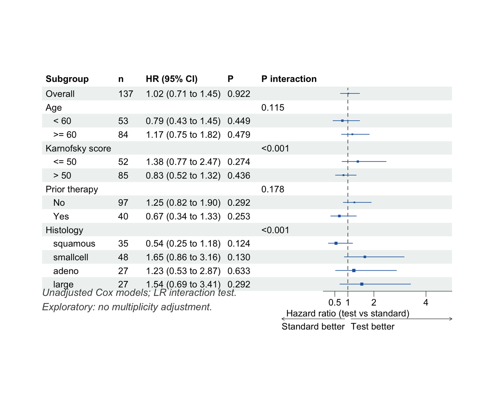
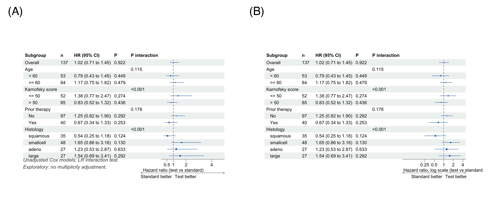

亚组森林图把在每个基线协变量水平内估计的处理（或暴露）效应汇总在总体效应之下——如年龄组、组织学类型、疾病严重程度。每一行用"方块+横线"符号展示效应（如风险比 HR）及其 95% 置信区间；列报告患者数、格式化的估计值和亚组内 p 值。专门的 **P interaction** 列检验效应是否*在亚组之间存在差异* \[1\]。

两个统计原则决定了这张图的正确读法。其一，检验效应修饰（effect modification）的正规方法是*交互作用检验*，而非亚组内 p 值——常见误读是"一个亚组置信区间跨 1、另一个不跨 1"就宣称存在亚组效应 \[2\]。其二，亚组分析属于探索性分析：它提出待验证的假设，多个亚组变量带来的多重性问题应当约束解读 \[1\]。

本教程用 `forestploter` \[3\] 构建出版级亚组森林图：

1. 生存处理效应的基础亚组森林图；
2. 完整出版版式——缩进的亚组标题行、交互 p 值列、箭头与坐标轴标注；
3. 适用于强偏态风险比的对数坐标轴版本。

## Example

{fig-alt="SubgroupForestPlot DEMO" fig-align="center" width="60%"}

## Setup

-   系统要求：跨平台（Linux/MacOS/Windows）

-   编程语言：R

-   依赖包：`survival`；`dplyr`；`forestploter`；`grid`

```{r packages setup, message=FALSE, warning=FALSE, output=FALSE}
# 安装必要的包
if (!requireNamespace("forestploter", quietly = TRUE)) {
  install.packages("forestploter")
}

# 加载包
library(survival)
library(dplyr)
library(forestploter)
library(grid)
```

```{r}
sessioninfo::session_info("attached")
```

## Data Preparation

使用 `survival` 包内置的 `veteran` 数据 \[4\]：137 例肺癌患者的随机对照试验，比较标准化疗与试验化疗（`trt`），含随访时间、生存状态和五个基线协变量。我们将年龄二分（≥/< 60 岁）、Karnofsky 评分二分（≤/> 50），保留既往治疗为二分类因子，组织学类型作为四水平因子。对每个亚组水平拟合 Cox 模型估计处理效应；对每个亚组*变量*，用带与不带交互项的模型比较（似然比检验）检验处理 × 亚组交互。

```{r load data, message=FALSE, warning=FALSE}
data(veteran, package = "survival")

vet <- veteran |>
  mutate(
    Age       = factor(ifelse(age >= 60, ">= 60", "< 60"), levels = c("< 60", ">= 60")),
    Karnofsky = factor(ifelse(karno <= 50, "<= 50", "> 50"), levels = c("<= 50", "> 50")),
    PriorTx   = factor(ifelse(prior == 0, "No", "Yes"), levels = c("No", "Yes")),
    Histology = relevel(factor(celltype), ref = "squamous")
  )

# 患者子集内试验组 vs 对照组的风险比
sub_haz <- function(df) {
  fit <- coxph(Surv(time, status) ~ trt, data = df)
  s <- summary(fit)
  c(est = unname(s$coefficients["trt", "exp(coef)"]),
    lo  = unname(s$conf.int["trt", "lower .95"]),
    hi  = unname(s$conf.int["trt", "upper .95"]),
    n   = nrow(df),
    p   = unname(s$coefficients["trt", "Pr(>|z|)"]))
}

# 各亚组变量的交互 p 值：Cox(Surv ~ trt) 与 Cox(Surv ~ trt * 亚组) 的似然比检验
int_p <- function(var) {
  a <- anova(coxph(Surv(time, status) ~ trt, data = vet),
             coxph(as.formula(paste("Surv(time, status) ~ trt *", var)), data = vet))
  unname(a[2, "Pr(>|Chi|)"])
}

subgroups <- data.frame(
  label  = c("年龄", "Karnofsky 评分", "既往治疗", "组织学类型"),
  column = c("Age", "Karnofsky", "PriorTx", "Histology"),
  stringsAsFactors = FALSE
)
```

## Visualization

### 1. 基础亚组森林图

估计值为 `NA` 的行会渲染为普通标题行，因此表格按"总体行 + 各亚组变量标题行 + 缩进的亚组水平行"组装。

```{r}
#| label: fig-1.1BasicSubgroupForest
#| fig-cap: "处理效应的亚组森林图（风险比，试验组 vs 标准组）。"
#| out.width: "95%"
#| fig-width: 8
#| fig-height: 6.5
#| warning: false
#| message: false

rows <- list(); hdr_p <- c()
add_row <- function(name, est = NA_real_, lo = NA_real_, hi = NA_real_,
                    n = NA_real_, p = NA_real_) {
  rows[[length(rows) + 1]] <<- data.frame(Subgroup = name, est = est, lo = lo, hi = hi,
                                          n = n, p = p, stringsAsFactors = FALSE)
}

r <- sub_haz(vet); add_row("总体", r[["est"]], r[["lo"]], r[["hi"]], r[["n"]], r[["p"]])
for (i in seq_len(nrow(subgroups))) {
  v <- subgroups$column[i]
  add_row(subgroups$label[i])                       # 标题行：无估计值
  for (l in levels(vet[[v]])) {
    rr <- sub_haz(vet[vet[[v]] == l, ])
    add_row(paste0("   ", l), rr[["est"]], rr[["lo"]], rr[["hi"]], rr[["n"]], rr[["p"]])
  }
  hdr_p <- c(hdr_p, int_p(v))
}
sg <- dplyr::bind_rows(rows)

# 交互 p 值放在变量标题行上
hdr_idx <- which(is.na(sg$est) & seq_len(nrow(sg)) > 1)
sg$`P interaction` <- ""
sg$`P interaction`[hdr_idx] <- ifelse(hdr_p < 0.001, "<0.001", sprintf("%.3f", hdr_p))

sg$`HR (95% CI)` <- ifelse(is.na(sg$est), "",
                           sprintf("%.2f (%.2f to %.2f)", sg$est, sg$lo, sg$hi))
sg$P <- ifelse(is.na(sg$p), "", ifelse(sg$p < 0.001, "<0.001", sprintf("%.3f", sg$p)))
sg$n <- ifelse(is.na(sg$n), "", as.character(sg$n))
sg$se <- (log(sg$hi) - log(sg$lo)) / (2 * 1.96)   # 方块大小随 CI 宽度变化
sg$`  ` <- paste(rep(" ", 24), collapse = " ")     # 置信区间用的空白列

p <- forest(sg[, c("Subgroup", "n", "HR (95% CI)", "P", "P interaction", "  ")],
            est = sg$est, lower = sg$lo, upper = sg$hi,
            sizes = sg$se,
            ci_column = 6,
            ref_line = 1,
            xlim = c(0.05, 5),
            ticks_at = c(0.5, 1, 2, 4))
p
```

总体风险比为 1.02（0.71 至 1.45）：没有证据表明试验化疗改变总体死亡率。亚组行承载着假设——但只有交互列能告诉我们亚组水平之间的差异是否超出噪声（见下一图）。

### 2. 出版级版式：交互 P、箭头与脚注

```{r}
#| label: fig-2.1PubStyle
#| fig-cap: "带坐标轴标注、脚注和交互 p 值列的出版级版本；Karnofsky 评分与组织学类型的交互 P < 0.001。"
#| out.width: "95%"
#| fig-width: 8
#| fig-height: 6.5
#| warning: false
#| message: false

tm <- forest_theme(base_size = 11,
                   ci_pch = 15,
                   ci_col = "#2166AC",
                   ci_fill = "#2166AC",
                   refline_gp = gpar(col = "grey30", lty = 2),
                   footnote_gp = gpar(col = "grey30", fontface = "italic"))

p2 <- forest(sg[, c("Subgroup", "n", "HR (95% CI)", "P", "P interaction", "  ")],
             est = sg$est, lower = sg$lo, upper = sg$hi,
             sizes = sg$se,
             ci_column = 6,
             ref_line = 1,
             xlim = c(0.05, 5),
             ticks_at = c(0.5, 1, 2, 4),
             arrow_lab = c("标准组更优", "试验组更优"),
             xlab = "风险比（试验组 vs 标准组）",
             footnote = "未调整的 Cox 模型；似然比交互检验。\n探索性分析：未做多重性调整。",
             theme = tm)
p2
```

Karnofsky 评分（P < 0.001）与组织学类型（P < 0.001）的强显著交互说明处理效应*在这些亚组间存在差异*。点估计提示体力状态差的患者中试验组有害（HR 1.38，95% CI 0.77 至 2.47）、鳞癌患者中获益（HR 0.54，95% CI 0.25 至 1.18）——但两个区间都包含 1，这正说明推断依据是交互检验而非亚组内估计。在 137 例的试验中这些只是产生假设的信号，而非确证性发现。

::: callout-tip
## 阅读陷阱

-   **置信区间"交叉"不是交互检验。** 当真实效应在两个亚组中完全相同时，"一个亚组显著、另一个不显著"恰是零假设下的预期结果——请引用 P interaction \[2\]。
-   **多重性。** 每增加一个亚组变量就多一次假阳性机会；应预先设定亚组并报告全部结果，而不是只报显著的。
-   **交互检验功效低。** P interaction 不显著并不能证明效应同质。
-   **是否调整要说清楚。** 本例使用未调整的亚组内模型；许多期刊要求协变量调整后的估计——数字会变，工作流不变。
:::

### 3. 针对偏态区间的对数坐标轴

```{r}
#| label: fig-3.1LogAxis
#| fig-cap: "同一森林图的对数坐标轴版本：置信区间围绕估计值对称显示，远离 1 的亚组也能优雅收纳。"
#| out.width: "95%"
#| fig-width: 8
#| fig-height: 6.5
#| warning: false
#| message: false

p3 <- forest(sg[, c("Subgroup", "n", "HR (95% CI)", "P", "P interaction", "  ")],
             est = sg$est, lower = sg$lo, upper = sg$hi,
             sizes = sg$se,
             ci_column = 6,
             ref_line = 1,
             x_trans = "log",
             xlim = c(0.05, 5),
             ticks_at = c(0.25, 0.5, 1, 2, 4),
             arrow_lab = c("标准组更优", "试验组更优"),
             xlab = "风险比，对数刻度（试验组 vs 标准组）",
             theme = tm)
p3
```

风险比是比值度量，对数轴才是几何上诚实的展示：翻倍（HR 2）与减半（HR 0.5）获得相等的视觉权重，区间围绕估计值对称显示。

## Application

亚组森林图是临床试验报告的标配（多数 NEJM/Lancet 肿瘤试验正文的第 1 张图），也常见于观察性病因学研究与生物标志物驱动的研究——核心问题是治疗*对谁*有效。下图模拟典型论文版式：(A) 标准亚组森林图，(B) 区间跨越一个数量级时使用的对数坐标展示。

{fig-alt="SubgroupForestPlot Application" fig-align="center" width="60%"}

## Reference

\[1\] Ballarini NM, Rosenkranz GK, Jaki T, König F, Posch M. A critical review of graphics for subgroup analyses in clinical trials. Pharm Stat. 2020;19(2):100-120. doi:10.1002/pst.2012

\[2\] Wang R, Lagakos SW, Ware JH, Hunter DJ, Drazen JM. Statistics in medicine — reporting of subgroup analyses in clinical trials. N Engl J Med. 2007;357(21):2189-2194. doi:10.1056/NEJMsr077003

\[3\] Dayimu A. forestploter: create a flexible forest plot. R package version 1.1.3. 2025. doi:10.32614/CRAN.package.forestploter

\[4\] Kalbfleisch JD, Prentice RL. The Statistical Analysis of Failure Time Data. New York: Wiley; 1980. (Veterans Administration lung cancer trial data)
