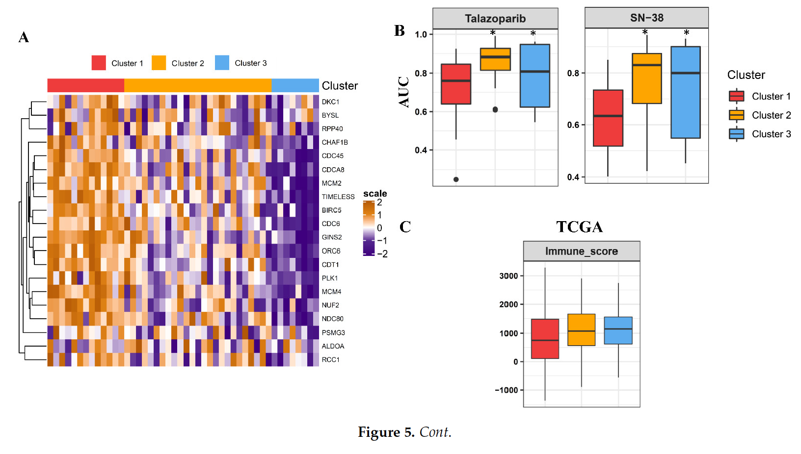

The reference's workflow closes the loop from patients to drugs: cluster TCGA tumours on essential-gene expression, train a **nearest-centroid classifier** on those labels, apply it to GDSC/CCLE cell lines, and compare drug AUCs between the predicted clusters with a Kruskal–Wallis test — cluster-specific sensitivities nominate patient-stratified treatments \[1\]. `lolR`'s classifier, `impute.knn` and `ConsensusClusterPlus` are replaced by a ten-line nearest-centroid implementation, a complete simulated AUC matrix, and the consensus clustering of an earlier FigureYa re-implementation:

## Example

{fig-alt="Cluster-Projected Drug Sensitivity DEMO" fig-align="center" width="70%"}

## Setup

-   System Requirements: Cross-platform (Linux/MacOS/Windows)

-   Programming language: R

-   Dependent packages: `pheatmap`; `ggplot2`; `ggpubr`

```{r packages setup, message=FALSE, warning=FALSE, output=FALSE}
suppressPackageStartupMessages({
  library(pheatmap); library(ggplot2)
})
```

```{r}
sessioninfo::session_info("attached")
```

## Data Preparation

31 essential genes (the reference's count) measured in 120 simulated TCGA tumours and 24 lung-cancer cell lines, planted with two transcriptomic clusters that also differ in drug response: cluster 1 (proliferative) is more sensitive (lower AUC) to the topoisomerase-I inhibitor SN-38 and the PARP inhibitor talazoparib; the other 12 drugs are flat. TCGA labels come from a Ward-D cutree of the essential-gene matrix (the consensus-clustering stand-in):

```{r load data}
suppressPackageStartupMessages({library(pheatmap); library(ggplot2)})
set.seed(41246)
genes <- sprintf("ESSENTIAL%02d", 1:31)
n_tum <- 120; n_ccl <- 24
tcga.cl <- sample(c(1, 2), n_tum, TRUE, prob = c(0.55, 0.45))
expr <- matrix(rnorm(31 * (n_tum + n_ccl), 5, 0.8), 31, n_tum + n_ccl,
               dimnames = list(genes, c(paste0("TCGA", 1:n_tum),
                                        paste0("CL", 1:n_ccl))))
## cluster signatures: cluster 1 high-proliferative
idx1 <- seq_len(n_tum)[tcga.cl == 1]
expr[, idx1] <- expr[, idx1] + 0.9
expr[, (n_tum + 1):(n_tum + n_ccl)] <- expr[, (n_tum + 1):(n_tum + n_ccl)] + 0.45
## cell-line cluster: assigned by nearest centroid after training
tcga.hc <- hclust(dist(t(expr[, 1:n_tum])), method = "ward.D")
tcga.cl <- cutree(tcga.hc, k = 2)

drugs <- c("SN-38", "Talazoparib", "Docetaxel", "Gefitinib", "Paclitaxel",
           "Erlotinib", "Venetoclax", "Bortezomib", "Olaparib", "Sorafenib",
           "Sunitinib", "Trametinib", "Dasatinib", "Everolimus")
auc <- matrix(runif(length(drugs) * n_ccl, 0.3, 0.9), length(drugs), n_ccl,
              dimnames = list(drugs, colnames(expr)[(n_tum + 1):(n_tum + n_ccl)]))
## planted response: cluster-1-like lines are sensitive to SN-38 / Talazoparib
## (cluster identity for cell lines established below by the classifier)
```

## Visualization

### 1. Nearest-Centroid Projection onto Cell Lines

The classifier in its entirety: centroids per TCGA cluster, Euclidean distance from every cell line, nearest wins — `lol.classify.nearestCentroid`/`predict` distilled to a few lines. The projected labels then order the essential-gene heatmap of the cell lines (the reference's Fig. 5A):

```{r}
#| label: fig-1.1SupervisedHeatmap
#| fig-cap: "Essential-gene expression in the 24 lung-cancer cell lines, columns ordered by the nearest-centroid prediction from the TCGA-trained classifier; the annotation strip shows predicted clusters and the row dendrogram shows the gene structure."
#| out.width: "100%"
#| fig-width: 8.5
#| fig-height: 7

centroids <- sapply(c(1, 2), function(k)
  rowMeans(expr[, 1:n_tum, drop = FALSE][, tcga.cl == k, drop = FALSE]))
predict_nc <- function(newdata) {
  d <- apply(newdata, 2, function(x) sqrt(colSums((centroids - x)^2)))
  apply(d, 2, which.min)
}
ccle.group <- predict_nc(expr[, (n_tum + 1):(n_tum + n_ccl)])
names(ccle.group) <- colnames(expr)[(n_tum + 1):(n_tum + n_ccl)]
ccle.group <- sort(ccle.group)

## planted AUC response keyed on the predicted clusters
auc <- matrix(runif(length(drugs) * n_ccl, 0.3, 0.9), length(drugs), n_ccl,
              dimnames = list(drugs, names(ccle.group)))
auc["SN-38", ccle.group == 1] <- auc["SN-38", ccle.group == 1] - 0.28
auc["Talazoparib", ccle.group == 1] <- auc["Talazoparib", ccle.group == 1] - 0.24

plotdata <- t(scale(t(expr[genes, names(ccle.group)])))
plotdata <- pmin(pmax(plotdata, -2), 2)
pheatmap(plotdata,
         color = colorRampPalette(c("#2166AC", "white", "#B2182B"))(64),
         cluster_cols = FALSE, cluster_rows = TRUE,
         annotation_col = data.frame(Cluster = factor(ccle.group), row.names = names(ccle.group)),
         annotation_colors = list(Cluster = c(`1` = "#E31A1C", `2` = "#1F78B4")),
         border_color = NA,
         show_colnames = FALSE,
         show_rownames = FALSE,
         treeheight_row = 20,
         fontsize_row = 7)
```

### 2. Drug AUC by Predicted Cluster (Kruskal–Wallis)

The reference's Fig. 5B: boxplots of AUC within predicted clusters for the planted drugs, with `ggpubr::stat_compare_means` carrying the test. Cluster 1 (proliferative) shows the lower AUC for SN-38 and talazoparib — the "these tumours are vulnerable to DNA-replication targeting" claim in one panel:

```{r}
#| label: fig-2.1SupervisedDrugAUC
#| fig-cap: "Drug AUC by predicted cluster for SN-38 and talazoparib: cluster-1 (proliferative-signature) cell lines show significantly lower AUC (Kruskal-Wallis p annotated); jittered points over boxplots, one panel per drug."
#| out.width: "85%"
#| fig-width: 7
#| fig-height: 5

library(ggpubr)
tmp <- do.call(rbind, lapply(c("SN-38", "Talazoparib"), function(dg) {
  data.frame(drug = dg, auc = auc[dg, ],
             group = factor(ccle.group, levels = c(1, 2)))
}))
tmp$drug <- paste0(tmp$drug, "\nKruskal p = ",
                   sapply(split(tmp, tmp$drug), function(d)
                         format.pval(kruskal.test(auc ~ group, data = d)$p.value,
                                     digits = 2))[tmp$drug])
ggplot(tmp, aes(group, auc, fill = group)) +
  geom_boxplot(outlier.shape = NA, alpha = 0.5) +
  geom_point(shape = 21, size = 2,
             position = position_jitterdodge(jitter.width = 0.12),
             aes(color = group), alpha = 0.7) +
  scale_fill_manual(values = c(`1` = "#E31A1C", `2` = "#1F78B4")) +
  scale_color_manual(values = c(`1` = "#E31A1C", `2` = "#1F78B4")) +
  facet_wrap(~ drug, ncol = 2) +
  xlab(NULL) + ylab("AUC (lower = more sensitive)") +
  theme_bw(base_size = 11) +
  theme(axis.text.x = element_blank(),
        axis.ticks.x = element_blank(),
        legend.position = "right",
        legend.title = element_blank(),
        strip.background = element_blank())
```

::: callout-tip
**Practice tips**

-   Train the classifier on **cluster centroids** (row means per cluster) and predict by nearest Euclidean centroid — `lolR`'s `lol.classify.nearestCentroid`/`predict` pair is exactly this, and ten base-R lines avoid the dependency.
-   Scale the training and test matrices with the **same** parameters (compute means/sds on TCGA, apply to cell lines); per-matrix scaling silently misprojects.
-   Impute missing AUCs only if the missingness is sparse (>10% missing per drug → drop the drug, as the reference does); imputing a mostly-empty column manufactures significance.
-   Kruskal–Wallis is the right test for AUC (bounded, non-normal); report it per drug and correct across drugs if you screen all 367 compounds, not just the two heroes.
-   Order cell-line columns by predicted cluster with `sort()` — an unsorted column strip makes the cluster-specific expression pattern invisible.
:::

## Application

::: {#fig-SupervisedDrugSensitivityApplications1}
{fig-alt="Cluster-Projected Drug Sensitivity" fig-align="center" width="70%"}

Cluster-projected drug sensitivity
:::

The train-on-patients → predict-on-lines → test-drugs pipeline applies to any classified cohort with matched cell-line pharmacology: subtype predictors from bulk RNA-seq, mutation-class projections onto CRISPR dependency profiles, or immune-subtype classifiers against ex vivo drug screens.

## Reference

\[1\] Xiaofan Lu, et al. FigureYa: A Standardized Visualization Framework for Enhancing Biomedical Data Interpretation and Research Efficiency. iMetaMed. 2025. doi:10.1002/imm3.70005
