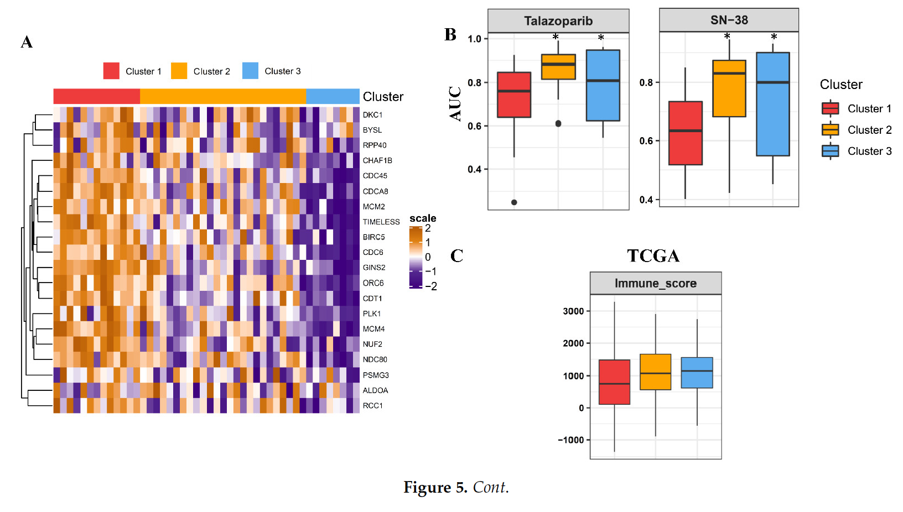

参考的工作流把病人到药物的闭环走完：对必需基因表达聚类 TCGA 肿瘤、在标签上训练**最近质心分类器**、应用到 GDSC/CCLE 细胞系、用 Kruskal–Wallis 检验比较预测簇间的药物 AUC——簇特异的敏感性给出病人分层治疗候选 \[1\]。`lolR` 的分类器、`impute.knn` 与 `ConsensusClusterPlus` 被替换为十行最近质心实现、完整的模拟 AUC 矩阵、以及先前 FigureYa 重实现的共识聚类替代：

## Example

{fig-alt="聚类投影药敏分析 DEMO" fig-align="center" width="60%"}

## Setup

-   系统要求：跨平台（Linux/MacOS/Windows）

-   编程语言：R

-   依赖包：`pheatmap`; `ggplot2`; `ggpubr`

```{r packages setup, message=FALSE, warning=FALSE, output=FALSE}
suppressPackageStartupMessages({
  library(pheatmap); library(ggplot2)
})
```

```{r}
sessioninfo::session_info("attached")
```

## 数据准备

31 个必需基因（参考的计数）在 120 个模拟 TCGA 肿瘤与 24 个肺癌细胞系中的测量，植入两个转录组簇且药物响应不同：簇 1（增殖型）对拓扑异构酶 I 抑制剂 SN-38 与 PARP 抑制剂 talazoparib 更敏感（更低 AUC）；其余 12 个药物平坦。TCGA 标签来自必需基因矩阵的 Ward-D cutree（共识聚类替身）：

```{r load data}
suppressPackageStartupMessages({library(pheatmap); library(ggplot2)})
set.seed(41246)
genes <- sprintf("ESSENTIAL%02d", 1:31)
n_tum <- 120; n_ccl <- 24
tcga.cl <- sample(c(1, 2), n_tum, TRUE, prob = c(0.55, 0.45))
expr <- matrix(rnorm(31 * (n_tum + n_ccl), 5, 0.8), 31, n_tum + n_ccl,
               dimnames = list(genes, c(paste0("TCGA", 1:n_tum),
                                        paste0("CL", 1:n_ccl))))
## cluster signatures: cluster 1 high-proliferative
idx1 <- seq_len(n_tum)[tcga.cl == 1]
expr[, idx1] <- expr[, idx1] + 0.9
expr[, (n_tum + 1):(n_tum + n_ccl)] <- expr[, (n_tum + 1):(n_tum + n_ccl)] + 0.45
## cell-line cluster: assigned by nearest centroid after training
tcga.hc <- hclust(dist(t(expr[, 1:n_tum])), method = "ward.D")
tcga.cl <- cutree(tcga.hc, k = 2)

drugs <- c("SN-38", "Talazoparib", "Docetaxel", "Gefitinib", "Paclitaxel",
           "Erlotinib", "Venetoclax", "Bortezomib", "Olaparib", "Sorafenib",
           "Sunitinib", "Trametinib", "Dasatinib", "Everolimus")
auc <- matrix(runif(length(drugs) * n_ccl, 0.3, 0.9), length(drugs), n_ccl,
              dimnames = list(drugs, colnames(expr)[(n_tum + 1):(n_tum + n_ccl)]))
## planted response: cluster-1-like lines are sensitive to SN-38 / Talazoparib
## (cluster identity for cell lines established below by the classifier)
```

## Visualization

### 最近质心投影到细胞系

分类器全貌：每 TCGA 簇的质心、每细胞系的欧氏距离、最近者胜——`lol.classify.nearestCentroid`/`predict` 提炼为几行。投影标签随后为细胞系的必需基因热图排序（参考的 Fig. 5A）：

```{r}
#| label: fig-1.1SupervisedHeatmap
#| fig-cap: "24 个肺癌细胞系的必需基因表达热图，列按 TCGA 训练分类器的最近质心预测排序；注释条显示预测簇、行树状图显示基因结构。"
#| out.width: "100%"
#| fig-width: 8.5
#| fig-height: 7

centroids <- sapply(c(1, 2), function(k)
  rowMeans(expr[, 1:n_tum, drop = FALSE][, tcga.cl == k, drop = FALSE]))
predict_nc <- function(newdata) {
  d <- apply(newdata, 2, function(x) sqrt(colSums((centroids - x)^2)))
  apply(d, 2, which.min)
}
ccle.group <- predict_nc(expr[, (n_tum + 1):(n_tum + n_ccl)])
names(ccle.group) <- colnames(expr)[(n_tum + 1):(n_tum + n_ccl)]
ccle.group <- sort(ccle.group)

## planted AUC response keyed on the predicted clusters
auc <- matrix(runif(length(drugs) * n_ccl, 0.3, 0.9), length(drugs), n_ccl,
              dimnames = list(drugs, names(ccle.group)))
auc["SN-38", ccle.group == 1] <- auc["SN-38", ccle.group == 1] - 0.28
auc["Talazoparib", ccle.group == 1] <- auc["Talazoparib", ccle.group == 1] - 0.24

plotdata <- t(scale(t(expr[genes, names(ccle.group)])))
plotdata <- pmin(pmax(plotdata, -2), 2)
pheatmap(plotdata,
         color = colorRampPalette(c("#2166AC", "white", "#B2182B"))(64),
         cluster_cols = FALSE, cluster_rows = TRUE,
         annotation_col = data.frame(Cluster = factor(ccle.group), row.names = names(ccle.group)),
         annotation_colors = list(Cluster = c(`1` = "#E31A1C", `2` = "#1F78B4")),
         border_color = NA,
         show_colnames = FALSE,
         show_rownames = FALSE,
         treeheight_row = 20,
         fontsize_row = 7)
```

### 预测簇间药物 AUC（Kruskal–Wallis）

参考的 Fig. 5B：植入药物在预测簇内的 AUC 箱线图、`ggpubr::stat_compare_means` 承载检验。簇 1（增殖型）的 SN-38 与 talazoparib AUC 更低——"这些肿瘤对 DNA 复制靶向脆弱"的主张一图呈现：

```{r}
#| label: fig-2.1SupervisedDrugAUC
#| fig-cap: "SN-38 与 talazoparib 按预测簇的药物 AUC：簇 1（增殖签名）细胞系 AUC 显著更低（Kruskal-Wallis p 标注）；箱线图上叠加抖动点，每药一板。"
#| out.width: "85%"
#| fig-width: 7
#| fig-height: 5

library(ggpubr)
tmp <- do.call(rbind, lapply(c("SN-38", "Talazoparib"), function(dg) {
  data.frame(drug = dg, auc = auc[dg, ],
             group = factor(ccle.group, levels = c(1, 2)))
}))
tmp$drug <- paste0(tmp$drug, "\nKruskal p = ",
                   sapply(split(tmp, tmp$drug), function(d)
                         format.pval(kruskal.test(auc ~ group, data = d)$p.value,
                                     digits = 2))[tmp$drug])
ggplot(tmp, aes(group, auc, fill = group)) +
  geom_boxplot(outlier.shape = NA, alpha = 0.5) +
  geom_point(shape = 21, size = 2,
             position = position_jitterdodge(jitter.width = 0.12),
             aes(color = group), alpha = 0.7) +
  scale_fill_manual(values = c(`1` = "#E31A1C", `2` = "#1F78B4")) +
  scale_color_manual(values = c(`1` = "#E31A1C", `2` = "#1F78B4")) +
  facet_wrap(~ drug, ncol = 2) +
  xlab(NULL) + ylab("AUC (lower = more sensitive)") +
  theme_bw(base_size = 11) +
  theme(axis.text.x = element_blank(),
        axis.ticks.x = element_blank(),
        legend.position = "right",
        legend.title = element_blank(),
        strip.background = element_blank())
```


## 应用场景

::: {{#fig-SupervisedDrugSensitivityApplications1}}
{fig-alt="聚类投影药敏分析" fig-align="center" width="60%"}

聚类投影药敏分析
:::

病人训练→细胞系预测→药物检验的管线适用于任何有匹配细胞系药理的分类队列：bulk RNA-seq 亚型预测器、突变类投影到 CRISPR 依赖谱、或免疫亚型分类器对体外药筛。

## 参考文献

\[1\] Xiaofan Lu, et al. FigureYa: A Standardized Visualization Framework for Enhancing Biomedical Data Interpretation and Research Efficiency. iMetaMed. 2025. doi:10.1002/imm3.70005
