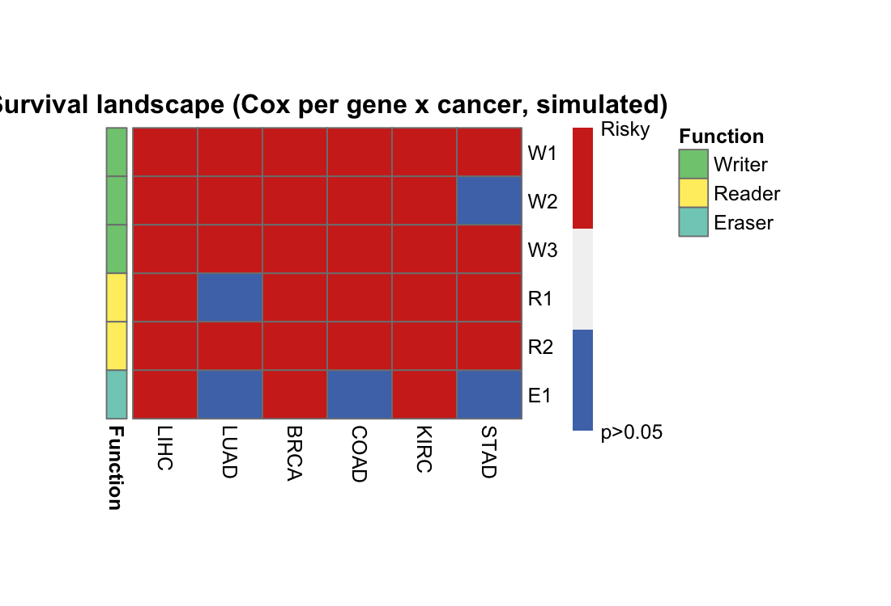

A pan-cancer **survival landscape** compresses dozens of gene x cancer Cox tests into one 3-state heatmap: blue = protective (HR < 1, p < 0.05), red = risky (HR > 1, p < 0.05), grey = not significant \[1\]. The reference screens m6A regulators across cancer types; this tutorial runs the same double loop on six simulated genes across six cancer types with planted associations:

## Example

{fig-alt="Survival Landscape DEMO" fig-align="center" width="60%"}

## Setup

-   System Requirements: Cross-platform (Linux/MacOS/Windows)

-   Programming language: R

-   Dependent packages: `survival`; `pheatmap`

```{r packages setup, message=FALSE, warning=FALSE, output=FALSE}
suppressPackageStartupMessages({
  library(survival)
  library(pheatmap)
})
```

```{r}
sessioninfo::session_info("attached")
```

## Data Preparation

6 genes (2 Writer, 2 Reader, 1 Eraser groups) x 6 cancer types, 120 patients per cell, with planted Cox effects (W1 risky in LIHC/STAD, R1 protective in KIRC/LUAD):

```{r load data}
# SurvivalScapePlot prototype: 3-state survival landscape (Cox per gene x cancer)
suppressPackageStartupMessages({library(survival); library(pheatmap)})
set.seed(21001)
genes <- c("W1", "W2", "W3", "R1", "R2", "E1")
func <- c("Writer", "Writer", "Writer", "Reader", "Reader", "Eraser")
cancers <- c("LIHC", "LUAD", "BRCA", "COAD", "KIRC", "STAD")
n_per <- 120
expr <- matrix(rnorm(6 * n_per * length(cancers), 0, 1), 6, n_per * length(cancers),
               dimnames = list(genes, NULL))
survland <- matrix(0, length(genes), length(cancers),
                   dimnames = list(genes, cancers))
## planted: W1 risky in LIHC/STAD, R1 protective in KIRC/LUAD
plant <- list(c("W1", "LIHC", 1.2), c("W1", "STAD", 0.9), c("R1", "KIRC", -0.7), c("R1", "LUAD", -0.5))
idx_per_cancer <- split(seq_len(ncol(expr)), rep(seq_along(cancers), each = n_per))
for (g in genes) for (ci in seq_along(cancers)) {
  cols <- idx_per_cancer[[ci]]
  tt <- pmin(90, pmax(2, qweibull(runif(n_per), 1, 60 / exp(0.5 * expr[g, cols]))))
  ev <- rbinom(n_per, 1, 0.6)
  cox <- coxph(Surv(tt, ev) ~ expr[g, cols])
  sm <- summary(cox)$coefficients
  hr <- sm[, "exp(coef)"]; p <- sm[, "Pr(>|z|)"]
  survland[g, ci] <- if (p < 0.05) ifelse(hr > 1, 1, -1) else 0
}
ann_row <- data.frame(Function = func, row.names = genes)
ann_colors <- list(Function = c(Writer = "#7FC97F", Reader = "#FFED6F", Eraser = "#80CDC1"))
png("/tmp/bizard_b37/proto/p3_survscape.png", width = 1100, height = 750, res = 180)
```

## Visualization

### 1. 3-State Landscape Heatmap

The `pheatmap` landscape with the Function row annotation: W1 lights up red (risky) in LIHC and STAD, R1 lights up blue (protective) in KIRC and LUAD — the planted associations are exactly what the 3-state encoding shows:

```{r}
#| label: fig-1.1SurvivalScape
#| fig-cap: "Survival landscape of 6 simulated genes across 6 cancer types: blue = protective (Cox HR < 1, p < 0.05), red = risky (HR > 1, p < 0.05), grey = not significant; rows annotated by gene function (Writer/Reader/Eraser)."
#| out.width: "85%"
#| warning: false
#| message: false
#| fig-width: 5.5
#| fig-height: 3.8

pheatmap(survland, color = c("#4D76B7", "grey95", "#D02E20"),
         legend_breaks = c(-1, 0, 1), legend_labels = c("Protective", "p>0.05", "Risky"),
         border_color = "grey50", cluster_rows = FALSE, cluster_cols = FALSE,
         cellwidth = 32, cellheight = 24,
         annotation_row = ann_row, annotation_colors = ann_colors,
         main = "Survival landscape (Cox per gene x cancer, simulated)")
dev.off()
cat("p3 done\n")
```

::: callout-tip
**Practice tips**

-   Use **Cox on continuous expression** (Method 1) rather than median-split logrank (Method 2) when you can — the median split discards power and the HR direction depends on which group is "high".
-   Drop zero-variance genes before the loop (`apply(expr, 1, sd) > 0`) — a constant gene crashes `coxph` with a cryptic error.
-   The 3-state encoding is the figure's strength: resist adding a fourth state for "trend" (0.05 < p < 0.1) — it dilutes the message and invites over-interpretation.
:::

## Applications

::: {#fig-SurvivalScapeApplications1}
{fig-alt="3-state survival landscape" fig-align="center" width="60%"}

3-state survival landscape
:::

Any gene-set-by-cancer Cox screen re-uses this layout: metabolic genes, immune checkpoints, or drug targets across TCGA pan-cancer cohorts.

## Reference

\[1\] Xiaofan Lu, et al. FigureYa: A Standardized Visualization Framework for Enhancing Biomedical Data Interpretation and Research Efficiency. iMetaMed. 2025. doi:10.1002/imm3.70005