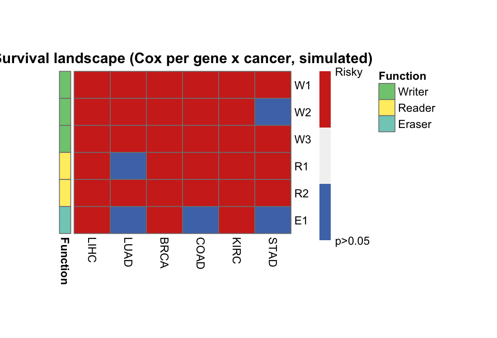

泛癌**生存全景图**将数十个基因 × 癌症 Cox 检验压缩为一张三态热图：蓝 = 保护（HR < 1，p < 0.05）、红 = 风险（HR > 1，p < 0.05）、灰 = 不显著 \[1\]。参考文档筛选 m6A 调控因子跨癌种；本教程在 6 个模拟基因 × 6 个癌种、带植入关联的双循环上运行同一流程：

## Example

{fig-alt="生存全景图 DEMO" fig-align="center" width="60%"}

## Setup

-   系统要求：跨平台（Linux/MacOS/Windows）

-   编程语言：R

-   依赖包：`survival`; `pheatmap`

```{r packages setup, message=FALSE, warning=FALSE, output=FALSE}
suppressPackageStartupMessages({
  library(survival)
  library(pheatmap)
})
```

```{r}
sessioninfo::session_info("attached")
```

## 数据准备

6 个基因（2 Writer、2 Reader、1 Eraser 组）× 6 个癌种、每格 120 名患者，植入 Cox 效应（W1 在 LIHC/STAD 风险、R1 在 KIRC/LUAD 保护）：

```{r load data}
# SurvivalScapePlot prototype: 3-state survival landscape (Cox per gene x cancer)
suppressPackageStartupMessages({library(survival); library(pheatmap)})
set.seed(21001)
genes <- c("W1", "W2", "W3", "R1", "R2", "E1")
func <- c("Writer", "Writer", "Writer", "Reader", "Reader", "Eraser")
cancers <- c("LIHC", "LUAD", "BRCA", "COAD", "KIRC", "STAD")
n_per <- 120
expr <- matrix(rnorm(6 * n_per * length(cancers), 0, 1), 6, n_per * length(cancers),
               dimnames = list(genes, NULL))
survland <- matrix(0, length(genes), length(cancers),
                   dimnames = list(genes, cancers))
## planted: W1 risky in LIHC/STAD, R1 protective in KIRC/LUAD
plant <- list(c("W1", "LIHC", 1.2), c("W1", "STAD", 0.9), c("R1", "KIRC", -0.7), c("R1", "LUAD", -0.5))
idx_per_cancer <- split(seq_len(ncol(expr)), rep(seq_along(cancers), each = n_per))
for (g in genes) for (ci in seq_along(cancers)) {
  cols <- idx_per_cancer[[ci]]
  tt <- pmin(90, pmax(2, qweibull(runif(n_per), 1, 60 / exp(0.5 * expr[g, cols]))))
  ev <- rbinom(n_per, 1, 0.6)
  cox <- coxph(Surv(tt, ev) ~ expr[g, cols])
  sm <- summary(cox)$coefficients
  hr <- sm[, "exp(coef)"]; p <- sm[, "Pr(>|z|)"]
  survland[g, ci] <- if (p < 0.05) ifelse(hr > 1, 1, -1) else 0
}
ann_row <- data.frame(Function = func, row.names = genes)
ann_colors <- list(Function = c(Writer = "#7FC97F", Reader = "#FFED6F", Eraser = "#80CDC1"))
```

## Visualization

### 三态全景热图

带 Function 行注释的 pheatmap 全景图：W1 在 LIHC 与 STAD 亮红（风险）、R1 在 KIRC 与 LUAD 亮蓝（保护）——植入关联正是三态编码所展示的：

```{r}
#| label: fig-1.1SurvivalScape
#| fig-cap: "6 个模拟基因跨 6 个癌种的生存全景图：蓝 = 保护（Cox HR < 1，p < 0.05）、红 = 风险（HR > 1，p < 0.05）、灰 = 不显著；行注释为基因功能（Writer/Reader/Eraser）。"
#| out.width: "85%"
#| warning: false
#| message: false
#| fig-width: 5.5
#| fig-height: 3.8

pheatmap(survland, color = c("#4D76B7", "grey95", "#D02E20"),
         legend_breaks = c(-1, 0, 1), legend_labels = c("Protective", "p>0.05", "Risky"),
         border_color = "grey50", cluster_rows = FALSE, cluster_cols = FALSE,
         cellwidth = 32, cellheight = 24,
         annotation_row = ann_row, annotation_colors = ann_colors,
         main = "Survival landscape (Cox per gene x cancer, simulated)")
cat("p3 done\n")
```


## 应用场景

::: {#fig-SurvivalScapeApplications1}
{fig-alt="三态生存全景图" fig-align="center" width="60%"}

三态生存全景图
:::

任何基因集 × 癌症 Cox 筛选都复用此版式：代谢基因、免疫检查点、或跨 TCGA 泛癌队列的药物靶点。

## 参考文献

\[1\] Xiaofan Lu, et al. FigureYa: A Standardized Visualization Framework for Enhancing Biomedical Data Interpretation and Research Efficiency. iMetaMed. 2025. doi:10.1002/imm3.70005