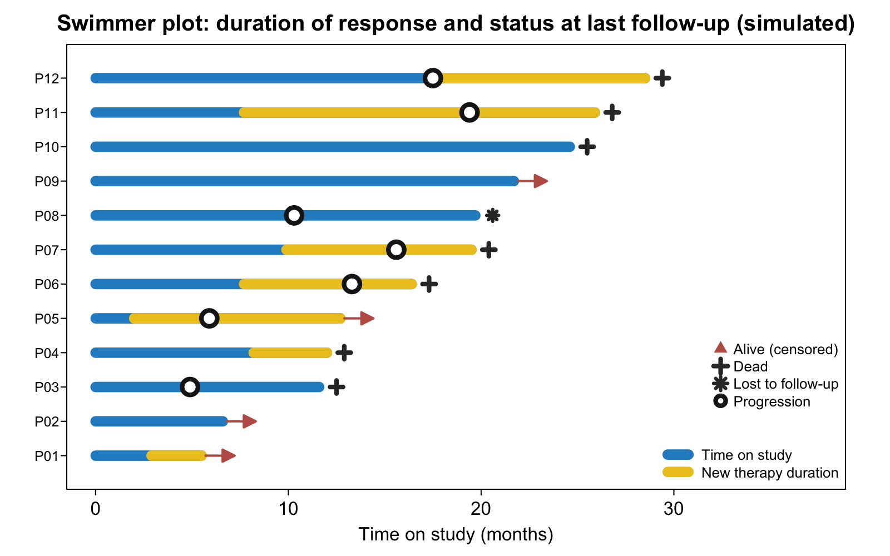

**泳道图**给每位患者一条泳道：泳道长 = 研究内时间，标记形状 = 末次随访状态（存活箭头、死亡叉、失访星）、开放圆圈为进展、颜色叠加段为二线治疗持续时间 \[1\]。它是肿瘤 waterfall 图的标准搭档——响应深度与响应*持续时间*同图。本教程在 12 个模拟患者上复现参考的 base graphics + `shape` 配方：

## Example

{fig-alt="泳道图 DEMO" fig-align="center" width="60%"}

## Setup

-   系统要求：跨平台（Linux/MacOS/Windows）

-   编程语言：R

-   依赖包：`shape`

```{r packages setup, message=FALSE, warning=FALSE, output=FALSE}
suppressPackageStartupMessages(library(shape))
```

```{r}
sessioninfo::session_info("attached")
```

## 数据准备

12 位患者：研究内时间（升序排列让图例落进空白角）、末次随访状态、进展时间与二线治疗叠加窗。参考文档自己的警告在此兑现：所有 `PFS.time`/`Therapy_time` 比较都包 `!is.na()` 以消除其 "NAs introduced by coercion" 噪声：

```{r load data}
suppressPackageStartupMessages(library(shape))
set.seed(18601)
n <- 12
dat <- data.frame(
  ID = sprintf("P%02d", 1:n),
  OS.time = sort(round(runif(n, 4, 30), 1)),
  OS = sample(c("Alive", "Dead", "Missing"), n, TRUE, prob = c(0.55, 0.3, 0.15)),
  PFS.time = NA, PFS = "DS", New_therapy = sample(c("Yes", "No"), n, TRUE, prob = c(0.4, 0.6)))
dat$PFS.time <- round(dat$OS.time * runif(n, 0.25, 0.95), 1)
## about half the patients progress before last follow-up
dat$PFS <- ifelse(runif(n) < 0.5, "DP", "DS")
dat$Therapy_time <- ifelse(dat$New_therapy == "Yes", round(dat$OS.time * runif(n, 0.1, 0.7), 1), NA)
dat <- dat[order(dat$OS.time), ]
rownames(dat) <- dat$ID
```

## Visualization

### 每位患者一条泳道

组合图：蓝泳道 = 研究内时间（升序）、黄色叠加 = 二线治疗时长、红箭头 = 末次随访存活、叉 = 死亡、星 = 失访、开放圆 = 进展——参考的 JCO 风格标记集落在 base graphics 框架上：

```{r}
#| label: fig-1.1Swimmer
#| fig-cap: "12 位模拟患者的泳道图：蓝泳道为研究内时间，黄色叠加为二线治疗时长，红箭头标末次随访存活，叉为死亡，星为失访，开放圆为进展。"
#| out.width: "90%"
#| warning: false
#| message: false
#| fig-width: 8
#| fig-height: 5

suppressPackageStartupMessages(library(shape))
jcoBlue <- "#248EC9"; jcoYellow <- "#EDC622"; jcoRed <- "#BE5D54"
par(bty = "o", mgp = c(1.5, .33, 0), mar = c(3, 3, 2, 2), las = 1, tcl = -0.25)
plot(NULL, NULL, xlim = c(0, max(dat$OS.time) + max(dat$OS.time) / 3.2),
     ylim = c(0.5, nrow(dat) + 0.5), xlab = "Time on study (months)", ylab = "", yaxt = "n",
     main = "Swimmer plot: duration of response and status at last follow-up (simulated)")
axis(side = 2, at = seq_len(nrow(dat)), labels = rownames(dat), cex.axis = 0.75)
for (p in seq_len(nrow(dat))) {
  lines(c(0, dat[p, "OS.time"]), c(p, p), lwd = 9, col = jcoBlue)
  if (!is.na(dat[p, "Therapy_time"]))
    lines(c(dat[p, "Therapy_time"], dat[p, "OS.time"]), c(p, p), lwd = 9, col = jcoYellow)
  if (dat[p, "OS"] == "Alive")
    Arrows(dat[p, "OS.time"] + 0.2, p, dat[p, "OS.time"] + 1.4, p,
           arr.type = "triangle", arr.length = 0.22, arr.width = 0.22, lwd = 2, col = jcoRed)
  else if (dat[p, "OS"] == "Dead")
    points(dat[p, "OS.time"] + 0.9, p, pch = 3, lwd = 4, cex = 1.1, col = "grey20")
  else
    points(dat[p, "OS.time"] + 0.9, p, pch = 8, lwd = 3, cex = 1, col = "grey20")
  if (!is.na(dat[p, "PFS.time"]) && dat[p, "PFS"] == "DP")
    points(dat[p, "PFS.time"], p, pch = 21, lwd = 4, bg = "white", cex = 1.9, col = "grey10")
}
legend("bottomright", bty = "n", cex = 0.78, lwd = c(9, 9), col = c(jcoBlue, jcoYellow),
       legend = c("Time on study", "New therapy duration"), seg.len = 1.6)
legend("bottomright", inset = c(0, 0.16), bty = "n", cex = 0.78, pch = c(17, 3, 8, 21),
       pt.lwd = c(2, 4, 3, 4), col = c(jcoRed, "grey20", "grey20", "grey10"),
       legend = c("Alive (censored)", "Dead", "Lost to follow-up", "Progression"), pt.cex = 1.2)
```


::: callout-tip
**实践提示**

-   绘制前按**研究内时间升序**排泳道：最长的泳道在顶部，右下角空白区放图例。
-   图例放在**计算出的数据坐标**处（此处为 `max(OS.time)` 之后的角落）——参考文档手工调固定坐标后再进 Illustrator。
-   每个标记位置都包 `!is.na()`——无进展/无治疗的患者会产生 `NA` 的 x 位置，不守卫则每行都告警。
:::

## 应用场景

::: {#fig-SwimmerApplications1}
{fig-alt="患者级治疗时间线" fig-align="center" width="60%"}

患者级治疗时间线
:::

任何患者级时间线都可复用泳道语法：CAR-T 持续时间配清淋叠加、妊娠时间线配暴露窗、或器械植入配不良事件标记。

## 参考文献

\[1\] Xiaofan Lu, et al. FigureYa: A Standardized Visualization Framework for Enhancing Biomedical Data Interpretation and Research Efficiency. iMetaMed. 2025. doi:10.1002/imm3.70005

\[2\] Chau I, et al. Nivolumab in previously treated patients with metastatic colorectal cancer (reference of the swim-plot style). J Clin Oncol. <https://ascopubs.org/doi/full/10.1200/JCO.2017.76.9901>