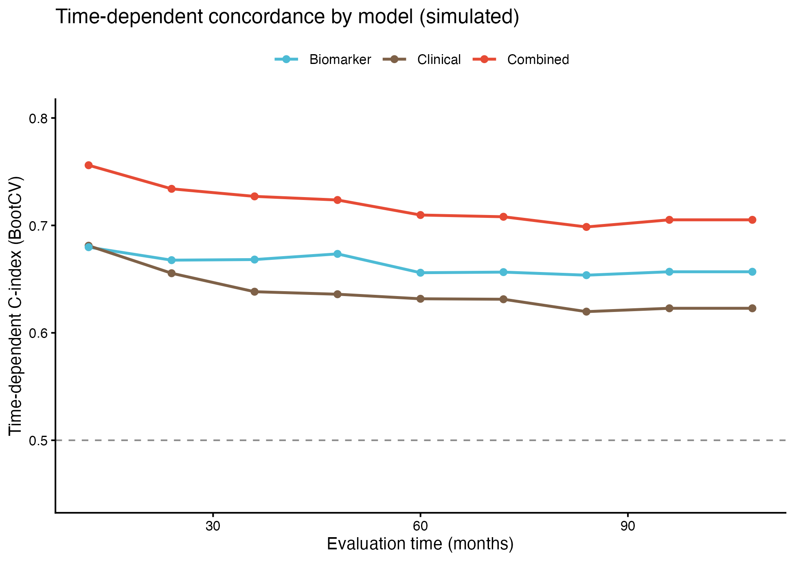

A fixed-horizon C-index hides that discrimination drifts with follow-up: the **time-dependent C-index** re-evaluates each model's concordance at a grid of horizons, so a model that wins at 12 months can lose by 108 \[1\]. The reference fits competing Cox models and draws one BootCV C-index curve per model with `pec::cindex()`; this tutorial reproduces the layout with clinical, biomarker, and combined models on simulated data:

## Example

{fig-alt="Time-Dependent C-index DEMO" fig-align="center" width="60%"}

## Setup

-   System Requirements: Cross-platform (Linux/MacOS/Windows)

-   Programming language: R

-   Dependent packages: `survival`; `pec`; `ggplot2`

```{r packages setup, message=FALSE, warning=FALSE, output=FALSE}
suppressPackageStartupMessages({
  library(survival)
  library(pec)
  library(ggplot2)
})
```

```{r}
sessioninfo::session_info("attached")
```

## Data Preparation

220 simulated patients with an age covariate and two biomarkers; three nested Cox models (clinical / biomarker / combined) whose planted strengths make the combined model dominate at every horizon. `pec::cindex()` with `splitMethod = "BootCv"` gives the bootstrap-crossvalidated curve the reference draws:

```{r load data}
suppressPackageStartupMessages({library(survival); library(pec); library(ggplot2)})
set.seed(18901)
n <- 220
age <- rnorm(n, 60, 10)
marker1 <- rnorm(n); marker2 <- rnorm(n)
lp_clin <- 0.04 * age
lp_bio <- 0.6 * marker1 - 0.4 * marker2
lp_both <- lp_clin + lp_bio
lam <- exp(0.9 * scale(lp_both)[, 1])
OS.time <- pmin(120, pmax(2, qweibull(runif(n), 1, 60 / lam)))
OS <- rbinom(n, 1, 0.6)
dat <- data.frame(OS.time = OS.time, OS = OS, age = age, marker1 = marker1, marker2 = marker2)
models <- list(
  Clinical = coxph(Surv(OS.time, OS) ~ age, data = dat, x = TRUE, y = TRUE),
  Biomarker = coxph(Surv(OS.time, OS) ~ marker1 + marker2, data = dat, x = TRUE, y = TRUE),
  Combined = coxph(Surv(OS.time, OS) ~ age + marker1 + marker2, data = dat, x = TRUE, y = TRUE))
```

## Visualization

### 1. One Curve per Model

BootCV C-index curves across the 12-108 month grid: the combined model stays above its components everywhere and all models lose discrimination as the horizon grows — the drift is the information a fixed-horizon C-index throws away:

```{r}
#| label: fig-1.1TimeCindex
#| fig-cap: "BootCV time-dependent C-index of three nested Cox models (clinical / biomarker / combined) over a 12-108 month grid on 220 simulated patients: the combined model dominates and discrimination decreases with follow-up."
#| out.width: "85%"
#| warning: false
#| message: false
#| fig-width: 6.5
#| fig-height: 4.6

eval.times <- seq(12, 108, 12)
set.seed(18901)   # BootCV resampling must be reproducible
timeC <- pec::cindex(object = models, formula = Surv(OS.time, OS) ~ ., data = dat,
                     eval.times = eval.times, splitMethod = "BootCv", B = 40)
cmat <- do.call(cbind, timeC$BootCvCindex)
df <- do.call(rbind, lapply(seq_along(models), function(i)
  data.frame(t = eval.times, cindex = cmat[, i], model = names(models)[i])))
ggplot(df, aes(t, cindex, colour = model)) +
  geom_line(linewidth = 0.8) + geom_point(size = 1.6) +
  geom_hline(yintercept = 0.5, linetype = 2, colour = "grey55") +
  scale_colour_manual(values = c(Clinical = "#7E6148", Biomarker = "#4DBBD5", Combined = "#E64B35")) +
  coord_cartesian(ylim = c(0.45, 0.8)) +
  labs(x = "Evaluation time (months)", y = "Time-dependent C-index (BootCV)",
       title = "Time-dependent concordance by model (simulated)", colour = NULL) +
  theme_classic(base_size = 10) + theme(legend.position = "top")
```

::: callout-tip
**Practice tips**

-   `pec::cindex()` accepts a **named list of models** and evaluates them on common bootstrap splits — the pairwise comparison is then internally consistent; set the seed (the reference prints this reminder) or the curves wobble between runs.
-   Choose `eval.times` inside the observed follow-up: horizons where fewer than ~10 events remain produce unstable C-index spikes.
-   0.5 is the chance line, 1 perfect concordance — a model "wins" only while its curve stays above its competitors; a crossing pair means the ranking is horizon-dependent and should be reported as such.
:::

## Applications

::: {#fig-TimeCindexApplications1}
{fig-alt="Time-dependent concordance" fig-align="center" width="60%"}

Time-dependent concordance
:::

Any set of nested risk models re-uses the curves: clinical vs molecular staging, panel vs WES signatures, or pre- vs post-treatment models.

## Reference

\[1\] Xiaofan Lu, et al. FigureYa: A Standardized Visualization Framework for Enhancing Biomedical Data Interpretation and Research Efficiency. iMetaMed. 2025. doi:10.1002/imm3.70005

\[2\] Gerds TA, Kattan MW, Schumacher M, Yu C. Estimating a time-dependent concordance index for survival prediction models with covariate dependent censoring. Stat Med. 2013;32(13):2173-2184. doi:10.1002/sim.5681 (the time-dependent concordance estimator behind pec::cindex)