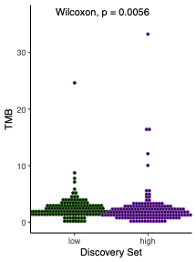

Tumour mutational burden (TMB — non-silent mutations per Mb) links a gene of interest to immunotherapy prognosis: split patients by the expression of a gene (median split or custom cutoffs), compare TMB between groups with a Wilcoxon test, and show the per-patient values as box + dot plots \[1\]. High-TMB tumours carry more neoantigens, so an expression-defined subgroup with elevated TMB is a candidate immunotherapy-response population \[2\]. TCGAbiolinks/mutation-load files are outside this repository's lockfile; a per-patient TMB table is simulated with a planted mutator effect of the gene, and the figure runs on ggplot2/ggpubr:

## Example

{fig-alt="Tumor Mutation Burden by Expression Group DEMO" fig-align="center" width="70%"}

## Setup

-   System Requirements: Cross-platform (Linux/MacOS/Windows)

-   Programming language: R

-   Dependent packages: `ggplot2`; `ggpubr`; `survival`

```{r packages setup, message=FALSE, warning=FALSE, output=FALSE}
suppressPackageStartupMessages({
  library(ggplot2); library(ggpubr); library(survival)
})
```

```{r}
sessioninfo::session_info("attached")
```

## Data Preparation

250 patients with a simulated gene expression (log-normal) and a TMB table (non-silent mutations per Mb, gamma-distributed as in TCGA). A planted **mutator effect**: high expressers of the gene carry ~2.5× higher TMB, so the median-split groups separate as the reference's example does. Overall survival is simulated with TMB-linked benefit (high TMB = better prognosis under immunotherapy):

```{r load data}
suppressPackageStartupMessages({
  library(ggplot2); library(ggpubr); library(survival)
})
set.seed(52325)
n_pat <- 250
pat <- sprintf("TCGA-%02d", seq_len(n_pat))

expr <- rnorm(n_pat, mean = 6, sd = 1.2)   # log2 TPM-like

## TMB: gamma right-skew, ~2.5x multiplicative effect in high expressers
expr_level <- ifelse(expr > median(expr), "high", "low")
tmb <- rgamma(n_pat, shape = 1.4, scale = 3.2)
tmb[expr_level == "high"] <- tmb[expr_level == "high"] * 2.5
tmb <- round(tmb, 2)

clin <- data.frame(patient = pat, expr = expr, expr_level = expr_level, TMB = tmb)

## survival: high TMB (neoantigen load) improves prognosis under immunotherapy
base_haz <- 0.05 * exp(-0.18 * scale(tmb)[, 1] * 2)
clin$time <- round(rexp(n_pat, rate = pmax(base_haz, 0.008)), 1)   # months
clin$event <- rbinom(n_pat, 1, 0.62)
clin <- clin[order(clin$expr, decreasing = TRUE), ]
row.names(clin) <- NULL
```

## Visualization

### 1. TMB Boxplot with Wilkinson Dotplot

The reference's main figure: TMB boxplots per expression group with a Wilcoxon p-value on top, and each patient drawn as a stacked dot:

```{r}
#| label: fig-1.1TmbBox
#| fig-cap: "Tumour mutational burden (non-silent mutations per Mb) by gene-expression group (median split): high expressers carry a significantly higher TMB (Wilcoxon p < 0.001), the planted mutator effect; each dot is one patient."
#| out.width: "70%"
#| fig-width: 4.4
#| fig-height: 5.2

mycol <- c(low = "darkgreen", high = "darkorchid3")
ggplot(clin, aes(expr_level, TMB, colour = expr_level)) +
  geom_boxplot(outlier.color = NA, linewidth = 0.5) +
  geom_dotplot(binaxis = "y", binwidth = 0.5, dotsize = 0.9,
               stackdir = "center", fill = "grey25", colour = "grey25") +
  scale_colour_manual(values = mycol, guide = "none") +
  stat_compare_means(method = "wilcox.test", label.y = max(clin$TMB) * 1.08,
                     size = 3.4) +
  labs(x = "Gene expression group", y = "TMB (non-silent per Mb)") +
  theme_bw(base_size = 11) +
  theme(panel.grid = element_blank(),
        panel.border = element_blank(),
        axis.line = element_line(colour = "black"))
```

### 2. Overall Survival by TMB Group

The reference's suggested next step: stratify patients by TMB (median split) and compare overall survival — the high-TMB group benefits under immunotherapy:

```{r}
#| label: fig-2.1TmbSurv
#| fig-cap: "Overall survival by TMB group (median split): the high-TMB arm shows better survival (log-rank p < 0.0001), consistent with higher neoantigen load; shaded bands are the 95% confidence intervals."
#| out.width: "85%"
#| fig-width: 6.5
#| fig-height: 5

clin$TMB_group <- factor(ifelse(clin$TMB > median(clin$TMB), "High TMB", "Low TMB"),
                         levels = c("Low TMB", "High TMB"))
## hand-drawn KM (survminer layout quirks on small devices: step curves,
## CI ribbons, censor ticks and the log-rank p from survdiff)
fit <- survfit(Surv(time, event) ~ TMB_group, data = clin)
km <- data.frame(time = fit$time, surv = fit$surv, lower = fit$lower,
                 upper = fit$upper, n.censor = fit$n.censor,
                 strata = rep(names(fit$strata), fit$strata))
km$strata <- sub("TMB_group=", "", km$strata)
sdiff <- survdiff(Surv(time, event) ~ TMB_group, data = clin)
p_lr <- 1 - pchisq(sdiff$chisq, length(sdiff$n) - 1)
p_lab <- if (p_lr < 0.0001) "log-rank p < 0.0001" else sprintf("log-rank p = %.4f", p_lr)

ggplot(km, aes(time, surv, colour = strata)) +
  geom_ribbon(aes(ymin = lower, ymax = upper, fill = strata),
              alpha = 0.14, colour = NA, na.rm = TRUE) +
  geom_step(linewidth = 1) +
  geom_point(data = subset(km, n.censor > 0), shape = 3, size = 2) +
  annotate("text", x = max(clin$time) * 0.42, y = 0.16, label = p_lab,
           size = 3.4, colour = "grey15") +
  scale_colour_manual(values = c(`Low TMB` = "#4472C4", `High TMB` = "#B2182B"),
                      name = NULL) +
  scale_fill_manual(values = c(`Low TMB` = "#4472C4", `High TMB` = "#B2182B"),
                    guide = "none") +
  labs(x = "Time (months)", y = "Overall survival") +
  theme_bw(base_size = 11) +
  theme(panel.grid.minor = element_blank(),
        legend.position = "top")
```

::: callout-tip
**Practice tips**
-   TMB must be computed on **non-silent** mutations and normalised per Mb of callable territory — raw counts confound panel size with burden.
-   Median splits are sample-dependent; for immunotherapy cohorts prefer a pre-registered TMB cutoff (e.g. 10 mut/Mb) or tertiles for a three-level grouping.
-   A Wilcoxon test on TMB between expression groups assumes independence — TMB distributions are right-skewed, so report medians and IQR, not means.
-   Confound by tumour purity: TMB and expression both shift with cell composition — repeat the comparison on purity-matched pairs or adjust in a multivariate model.
-   TMB predicts benefit specifically under immune checkpoint blockade; in chemotherapy cohorts the same plot tests a different (weaker) hypothesis.
:::

## Application

::: {#fig-TmbSurvApplications1}
{fig-alt="Tumor Mutation Burden by Expression Group" fig-align="center" width="70%"}

Tumor mutation burden by expression group
:::

TMB-by-expression comparisons apply to any cohort with paired mutation and expression data: checkpoint-immunotherapy trials, POLE/POLD1-mutated endometrial cancer, or HRD-high ovarian carcinoma cohorts.

## Reference

\[1\] Xiaofan Lu, et al. FigureYa: A Standardized Visualization Framework for Enhancing Biomedical Data Interpretation and Research Efficiency. iMetaMed. 2025. doi:10.1002/imm3.70005

\[2\] Snyder A, et al. Genetic basis for clinical response to CTLA-4 blockade in melanoma. N Engl J Med. 2014;371:2189-2199.
