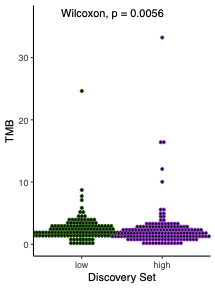

肿瘤突变负荷（TMB——每 Mb 非同义突变数）把目的基因与免疫治疗预后联系起来：按某基因的表达量分组（中位数分割或自定义截断），用 Wilcoxon 检验比较各组 TMB，并以箱线 + 点图展示逐患者取值 \[1\]。高 TMB 肿瘤携带更多新抗原，因此表达定义的 TMB 升高亚群是免疫治疗应答候选人群 \[2\]。TCGAbiolinks 与 mutation-load 文件不在本仓库 lockfile；模拟逐患者 TMB 表并植入该基因的诱变效应，图形在 ggplot2/ggpubr 上运行：

## Example

{fig-alt="按表达分组比较肿瘤突变负荷 DEMO" fig-align="center" width="70%"}

## Setup

-   系统要求：跨平台（Linux/MacOS/Windows）

-   编程语言：R

-   依赖包：`ggplot2`; `ggpubr`; `survival`

```{r packages setup, message=FALSE, warning=FALSE, output=FALSE}
suppressPackageStartupMessages({
  library(ggplot2); library(ggpubr); library(survival)
})
```

```{r}
sessioninfo::session_info("attached")
```

## 数据准备

250 名患者：模拟基因表达（log 正态）与 TMB 表（每 Mb 非同义突变数，gamma 右偏分布，同 TCGA）。植入**诱变效应**：高表达者 TMB 约为 2.5 倍，使中位数分割的两组分离，复现参考例文的模式。总生存按 TMB 相关获益模拟（免疫治疗下高 TMB 预后更好）：

```{r load data}
suppressPackageStartupMessages({
  library(ggplot2); library(ggpubr); library(survival)
})
set.seed(52325)
n_pat <- 250
pat <- sprintf("TCGA-%02d", seq_len(n_pat))

expr <- rnorm(n_pat, mean = 6, sd = 1.2)   # log2 TPM-like

## TMB: gamma right-skew, ~2.5x multiplicative effect in high expressers
expr_level <- ifelse(expr > median(expr), "high", "low")
tmb <- rgamma(n_pat, shape = 1.4, scale = 3.2)
tmb[expr_level == "high"] <- tmb[expr_level == "high"] * 2.5
tmb <- round(tmb, 2)

clin <- data.frame(patient = pat, expr = expr, expr_level = expr_level, TMB = tmb)

## survival: high TMB (neoantigen load) improves prognosis under immunotherapy
base_haz <- 0.05 * exp(-0.18 * scale(tmb)[, 1] * 2)
clin$time <- round(rexp(n_pat, rate = pmax(base_haz, 0.008)), 1)   # months
clin$event <- rbinom(n_pat, 1, 0.62)
clin <- clin[order(clin$expr, decreasing = TRUE), ]
row.names(clin) <- NULL
```

## Visualization

### 1. TMB 箱线图与 Wilkinson 点图

参考图主图：按表达分组的 TMB 箱线图、顶部 Wilcoxon p 值、每名患者一个堆叠点：

```{r}
#| label: fig-1.1TmbBox
#| fig-cap: "按基因表达分组（中位数分割）的肿瘤突变负荷（每 Mb 非同义突变数）：高表达组的 TMB 显著更高（Wilcoxon p < 0.001），即植入的诱变效应；每个点为一名患者。"
#| out.width: "70%"
#| fig-width: 4.4
#| fig-height: 5.2

mycol <- c(low = "darkgreen", high = "darkorchid3")
ggplot(clin, aes(expr_level, TMB, colour = expr_level)) +
  geom_boxplot(outlier.color = NA, linewidth = 0.5) +
  geom_dotplot(binaxis = "y", binwidth = 0.5, dotsize = 0.9,
               stackdir = "center", fill = "grey25", colour = "grey25") +
  scale_colour_manual(values = mycol, guide = "none") +
  stat_compare_means(method = "wilcox.test", label.y = max(clin$TMB) * 1.08,
                     size = 3.4) +
  labs(x = "Gene expression group", y = "TMB (non-silent per Mb)") +
  theme_bw(base_size = 11) +
  theme(panel.grid = element_blank(),
        panel.border = element_blank(),
        axis.line = element_line(colour = "black"))
```

### 2. 按 TMB 分组的总生存

参考图建议的下一步：按 TMB（中位数分割）分层比较总生存——免疫治疗下高 TMB 组获益：

```{r}
#| label: fig-2.1TmbSurv
#| fig-cap: "按 TMB 组（中位数分割）的总生存：高 TMB 组生存更好（log-rank p < 0.0001），与新抗原负荷更高一致；阴影带为 95% 置信区间。"
#| out.width: "85%"
#| fig-width: 6.5
#| fig-height: 5

clin$TMB_group <- factor(ifelse(clin$TMB > median(clin$TMB), "High TMB", "Low TMB"),
                         levels = c("Low TMB", "High TMB"))
fit <- survfit(Surv(time, event) ~ TMB_group, data = clin)
km <- data.frame(time = fit$time, surv = fit$surv, lower = fit$lower,
                 upper = fit$upper, n.censor = fit$n.censor,
                 strata = rep(names(fit$strata), fit$strata))
km$strata <- sub("TMB_group=", "", km$strata)
sdiff <- survdiff(Surv(time, event) ~ TMB_group, data = clin)
p_lr <- 1 - pchisq(sdiff$chisq, length(sdiff$n) - 1)
p_lab <- if (p_lr < 0.0001) "log-rank p < 0.0001" else sprintf("log-rank p = %.4f", p_lr)

ggplot(km, aes(time, surv, colour = strata)) +
  geom_ribbon(aes(ymin = lower, ymax = upper, fill = strata),
              alpha = 0.14, colour = NA, na.rm = TRUE) +
  geom_step(linewidth = 1) +
  geom_point(data = subset(km, n.censor > 0), shape = 3, size = 2) +
  annotate("text", x = max(clin$time) * 0.42, y = 0.16, label = p_lab,
           size = 3.4, colour = "grey15") +
  scale_colour_manual(values = c(`Low TMB` = "#4472C4", `High TMB` = "#B2182B"),
                      name = NULL) +
  scale_fill_manual(values = c(`Low TMB` = "#4472C4", `High TMB` = "#B2182B"),
                    guide = "none") +
  labs(x = "Time (months)", y = "Overall survival") +
  theme_bw(base_size = 11) +
  theme(panel.grid.minor = element_blank(),
        legend.position = "top")
```

::: callout-tip
**实践要点**
-   TMB 必须基于**非同义**突变并按可捕获区每 Mb 归一——原始计数会把 panel 大小与负荷混淆。
-   中位数分割依赖样本；免疫治疗队列应优先使用预注册的 TMB 截断（如 10 mut/Mb）或三分位做三组。
-   表达组间 TMB 的 Wilcoxon 检验假设独立——TMB 分布右偏，应报告中位数与 IQR 而非均值。
-   警惕肿瘤纯度混淆：TMB 与表达都随细胞组成漂移——在纯度配对的样本上重复比较，或在多变量模型中校正。
-   TMB 预测的获益特指免疫检查点阻断；在化疗队列中同一张图检验的是另一个（更弱的）假设。
:::

## 应用场景

::: {#fig-TmbSurvApplications1}
{fig-alt="按表达分组比较肿瘤突变负荷" fig-align="center" width="70%"}

按表达分组比较肿瘤突变负荷
:::

TMB-表达比较适用于任何配对突变与表达数据的队列：检查点免疫治疗试验、POLE/POLD1 突变的子宫内膜癌、或 HRD 高的卵巢癌队列。

## 参考文献

\[1\] Xiaofan Lu, et al. FigureYa: A Standardized Visualization Framework for Enhancing Biomedical Data Interpretation and Research Efficiency. iMetaMed. 2025. doi:10.1002/imm3.70005

\[2\] Snyder A, et al. Genetic basis for clinical response to CTLA-4 blockade in melanoma. N Engl J Med. 2014;371:2189-2199.
