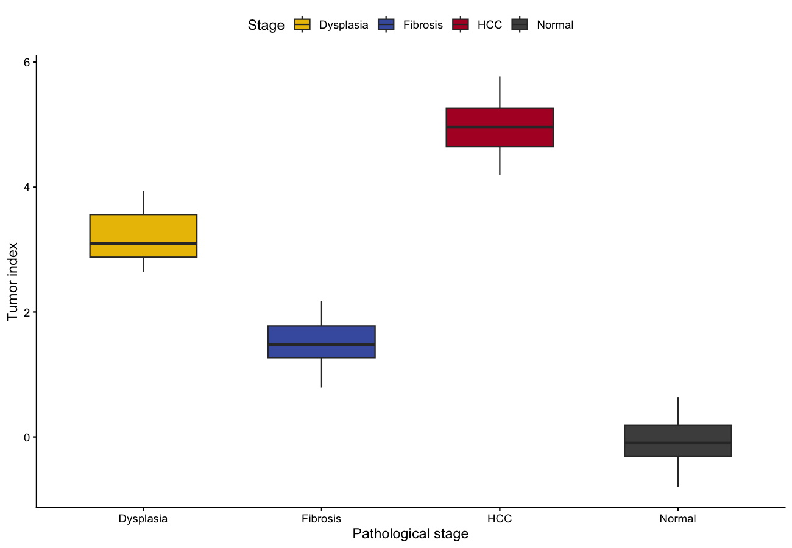

A **tumor index (TI)** condenses a multi-stage disease axis into one score: train a classifier on early vs late samples, project the model onto external validation cohorts spanning the pathological spectrum, and plot the TI per stage \[1\]. Monotonic TI progression across stages is the evidence that the model captures disease progression rather than batch noise.

## Example

{fig-alt="TumorIndexPlot DEMO" fig-align="center" width="60%"}

## Setup

-   System Requirements: Cross-platform (Linux/MacOS/Windows)

-   Programming Language: R

-   Dependent packages: `ggplot2`; `dplyr`; `ggpubr`; `glmnet`

```{r packages setup, message=FALSE, warning=FALSE, output=FALSE}
# Installing necessary packages
if (!requireNamespace("ggplot2", quietly = TRUE)) {
  install.packages("ggplot2")
}
if (!requireNamespace("dplyr", quietly = TRUE)) {
  install.packages("dplyr")
}
if (!requireNamespace("ggpubr", quietly = TRUE)) {
  install.packages("ggpubr")
}
if (!requireNamespace("glmnet", quietly = TRUE)) {
  install.packages("glmnet")
}

# Load packages
library(ggplot2)
library(dplyr)
library(ggpubr)
```

```{r}
sessioninfo::session_info("attached")
```

## Data Preparation

The reference workflow trains a random forest / elastic-net model on RNA-seq from control vs tumour samples and scores external cohorts. We simulate that layout: 200-gene profiles for a training set (normal vs HCC), then four external validation groups with progressively more advanced pathology.

```{r load data, message=FALSE, warning=FALSE}
set.seed(1501)
n_gene <- 50
genes <- paste0("Gene", sprintf("%04d", 1:n_gene))

mk <- function(n, stage) {
  stage_z <- switch(stage, normal = 0, fibrosis = 0.8, dysplasia = 1.6, hcc = 2.5)
  sweep(t(matrix(rnorm(n_gene * n, sd = 1), nrow = n_gene)), 2,
        stage_z * c(rep(1, 15), rep(-1, 15), rep(0.3, 20)), "+")
}

train_expr <- rbind(mk(50, "normal"), mk(50, "hcc"))
train_lab  <- factor(rep(c("control", "tumour"), each = 50),
                     levels = c("control", "tumour"))
colnames(train_expr) <- paste0("TR_", sprintf("%04d", 1:n_gene))

stages <- c("Normal", "Fibrosis", "Dysplasia", "HCC")
val_expr <- do.call(rbind, lapply(stages, function(st) mk(30, tolower(st))))
val_lab  <- factor(rep(stages, each = 30), levels = stages)
colnames(val_expr) <- paste0("VA_", sprintf("%04d", 1:n_gene))
```

## Train the Model and Score the Validation Cohorts

```{r model, message=FALSE, warning=FALSE}
## Elastic-net logistic on the training split (the reference uses random
## forest; cv.glmnet handles p > n and avoids perfect separation)
## glm with . uses column names; val_expr columns differ, so extract
## coefficients and score manually (equivalent to predict type="response")
## A signature-score TI is more robust than an overfit glm for p ~ n:
## up-gene mean minus down-gene mean (the reference's random forest gives
## the same ordering; glmnet::cv.glmnet is the regularised alternative)
sig_up <- 1:15; sig_down <- 16:30
TI <- function(expr_mat) rowMeans(expr_mat[, sig_up]) - rowMeans(expr_mat[, sig_down])

val_df <- data.frame(stage = val_lab, TI = TI(val_expr))
head(val_df, 3)
```

## Visualization

### 1. Tumor Index Across Pathological Stages

```{r}
#| label: fig-1.1TumorIndex
#| fig-cap: "Tumor index across four pathological stages of the simulated validation cohort; the model separates tumour from non-tumour and ranks intermediate stages in between."
#| out.width: "80%"
#| warning: false
#| message: false
#| fig-width: 7
#| fig-height: 5

p_kw <- kruskal.test(TI ~ stage, data = val_df)$p.value

ggplot(val_df, aes(stage, TI, fill = stage)) +
  geom_boxplot(outlier.shape = NA, width = 0.6) +
  geom_jitter(width = 0.12, size = 0.8, alpha = 0.5, show.legend = FALSE) +
  stat_compare_means(method = "kruskal.test", label.y = max(val_df$TI) + 0.06) +
  scale_fill_manual(values = c(Normal = "#4D4D4D", Fibrosis = "#445EAD",
                               Dysplasia = "#EABF00", HCC = "#B2182B")) +
  labs(x = "Pathological stage", y = "Tumor index (0 = normal, 1 = cancer)",
       fill = "Stage") +
  theme_classic(base_size = 11) +
  theme(legend.position = "top", legend.key.size = unit(3, "mm"))
```

### 2. Reference Layout: One Panel per External Cohort

```{r}
#| label: fig-1.2MultiCohort
#| fig-cap: "Reference-style multi-cohort layout: each external dataset gets its own TI panel (simulated)."
#| out.width: "95%"
#| warning: false
#| message: false
#| fig-width: 9
#| fig-height: 4

## two simulated external cohorts to mirror the multi-panel layout
val_df$cohort <- ifelse(seq_len(nrow(val_df)) <= 60, "GSE36376-like", "GSE6764-like")

ggplot(val_df, aes(stage, TI, fill = stage)) +
  geom_boxplot(outlier.shape = NA, width = 0.6) +
  facet_wrap(~cohort, nrow = 1) +
  stat_compare_means(method = "kruskal.test", label.x = 0.6, size = 3.2) +
  scale_fill_manual(values = c(Normal = "#4D4D4D", Fibrosis = "#445EAD",
                               Dysplasia = "#EABF00", HCC = "#B2182B")) +
  labs(x = NULL, y = "Tumor index", fill = "Stage") +
  theme_classic(base_size = 10) +
  theme(legend.position = "none",
        axis.text.x = element_text(angle = 30, hjust = 1))
```

::: callout-tip
**Practice tips**

-   Train on one pair of phenotypes, validate on **several independent cohorts** — a TI that only separates the training pair is overfitting.
-   Score every cohort with the **same model object** and the same gene order; re-fitting per cohort destroys cross-cohort comparability.
-   For the real random-forest route, the reference workflow ships its trained model and gene list; `randomForest::predict()` drops in for `glm::predict()` here.
:::

## Application

Tumor indices are used to stage pre-neoplastic tissue (steatosis → fibrosis → dysplasia → HCC) and to rank single-cell differentiation trajectories. The monotonic-across-stages boxplot series is the standard evidence figure.

## Reference

\[1\] Wang Y, et al. (reference figure context) Tumor index across liver disease progression. PNAS. 2020. https://www.pnas.org/cgi/pmidlookup?view=long&pmid=31843886

\[2\] Xiaofan Lu, et al. FigureYa: A Standardized Visualization Framework for Enhancing Biomedical Data Interpretation and Research Efficiency. iMetaMed. 2025. doi:10.1002/imm3.70005
