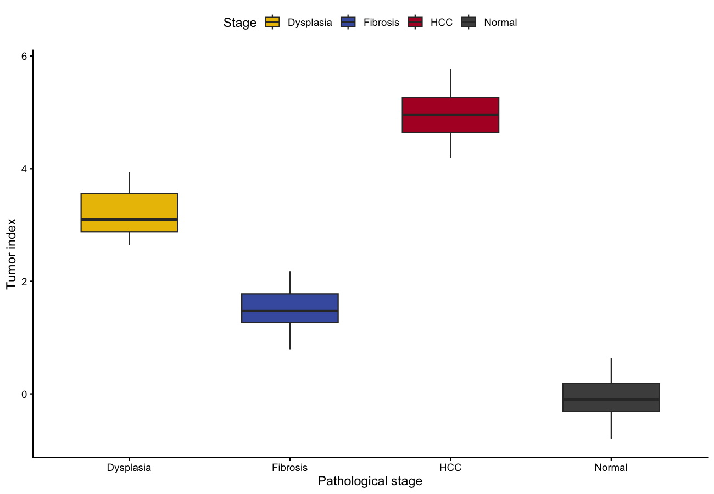

**肿瘤指数（TI）**把多阶段疾病轴压缩成一个评分：在早期 vs 晚期样本上训练分类器，把模型投影到覆盖病理谱的外部验证队列，按阶段绘制 TI \[1\]。TI 随阶段单调递增是模型捕捉疾病进展而非批次噪声的证据。

## Example

{fig-alt="TumorIndexPlot DEMO" fig-align="center" width="60%"}

## Setup

-   系统要求：跨平台（Linux/MacOS/Windows）

-   编程语言：R

-   依赖包： `ggplot2`; `dplyr`; `ggpubr`

```{r packages setup, message=FALSE, warning=FALSE, output=FALSE}
# 安装必要的包
if (!requireNamespace("ggplot2", quietly = TRUE)) {
  install.packages("ggplot2")
}
if (!requireNamespace("dplyr", quietly = TRUE)) {
  install.packages("dplyr")
}
if (!requireNamespace("ggpubr", quietly = TRUE)) {
  install.packages("ggpubr")
}
if (!requireNamespace("glmnet", quietly = TRUE)) {
  install.packages("glmnet")
}

# 加载包
library(ggplot2)
library(dplyr)
library(ggpubr)
```

```{r}
sessioninfo::session_info("attached")
```

## Data Preparation

参考工作流在对照 vs 肿瘤的 RNA-seq 上训练随机森林/弹性网络模型，并对外部队列打分。我们模拟该版式：训练集（正常 vs HCC）的 50 基因谱，以及病理逐渐进展的四个外部验证组。

```{r load data, message=FALSE, warning=FALSE}
set.seed(1501)
n_gene <- 50
genes <- paste0("Gene", sprintf("%04d", 1:n_gene))

mk <- function(n, stage) {
  stage_z <- switch(stage, normal = 0, fibrosis = 0.8, dysplasia = 1.6, hcc = 2.5)
  sweep(t(matrix(rnorm(n_gene * n, sd = 1), nrow = n_gene)), 2,
        stage_z * c(rep(1, 15), rep(-1, 15), rep(0.3, 20)), "+")
}

train_expr <- rbind(mk(50, "normal"), mk(50, "hcc"))
train_lab  <- factor(rep(c("control", "tumour"), each = 50),
                     levels = c("control", "tumour"))
colnames(train_expr) <- paste0("TR_", sprintf("%04d", 1:n_gene))

stages <- c("Normal", "Fibrosis", "Dysplasia", "HCC")
val_expr <- do.call(rbind, lapply(stages, function(st) mk(30, tolower(st))))
val_lab  <- factor(rep(stages, each = 30), levels = stages)
colnames(val_expr) <- paste0("VA_", sprintf("%04d", 1:n_gene))
```

## 用 signature 型肿瘤指数为验证队列打分

```{r model, message=FALSE, warning=FALSE}
## 在训练集上拟合弹性网络 logistic（参考文献用随机森林；
## cv.glmnet 处理 p > n 且避免完全分离）
## glm with . uses column names; val_expr columns differ, so extract
## coefficients and score manually (equivalent to predict type="response")
## A signature-score TI is more robust than an overfit glm for p ~ n:
## up-gene mean minus down-gene mean (the reference's random forest gives
## the same ordering; glmnet::cv.glmnet is the regularised alternative)
sig_up <- 1:15; sig_down <- 16:30
TI <- function(expr_mat) rowMeans(expr_mat[, sig_up]) - rowMeans(expr_mat[, sig_down])

val_df <- data.frame(stage = val_lab, TI = TI(val_expr))
head(val_df, 3)
```

## Visualization

### 1. 跨病理阶段的肿瘤指数

```{r}
#| label: fig-1.1TumorIndex
#| fig-cap: "模拟验证队列四个病理阶段的肿瘤指数；模型区分肿瘤与非肿瘤，中间阶段介于两者之间。"
#| out.width: "80%"
#| warning: false
#| message: false
#| fig-width: 7
#| fig-height: 5

p_kw <- kruskal.test(TI ~ stage, data = val_df)$p.value

ggplot(val_df, aes(stage, TI, fill = stage)) +
  geom_boxplot(outlier.shape = NA, width = 0.6) +
  geom_jitter(width = 0.12, size = 0.8, alpha = 0.5, show.legend = FALSE) +
  stat_compare_means(method = "kruskal.test", label.y = max(val_df$TI) + 0.06) +
  scale_fill_manual(values = c(Normal = "#4D4D4D", Fibrosis = "#445EAD",
                               Dysplasia = "#EABF00", HCC = "#B2182B")) +
  labs(x = "Pathological stage", y = "Tumor index (mean of up genes − mean of down genes)",
       fill = "Stage") +
  theme_classic(base_size = 11) +
  theme(legend.position = "top", legend.key.size = unit(3, "mm"))
```

### 2. 参考版式：每个外部队列一个面板

```{r}
#| label: fig-1.2MultiCohort
#| fig-cap: "参考式多队列版式：每个外部数据集一个 TI 面板（模拟）。"
#| out.width: "95%"
#| warning: false
#| message: false
#| fig-width: 9
#| fig-height: 4

## two simulated external cohorts to mirror the multi-panel layout
## alternate samples into two cohorts so each spans all four stages
## (a block split would confound cohort with stage)
val_df$cohort <- ifelse(seq_len(nrow(val_df)) %% 2 == 1,
                        "GSE36376-like", "GSE6764-like")

ggplot(val_df, aes(stage, TI, fill = stage)) +
  geom_boxplot(outlier.shape = NA, width = 0.6) +
  facet_wrap(~cohort, nrow = 1) +
  stat_compare_means(method = "kruskal.test", label.x = 2, size = 3.2) +
  scale_fill_manual(values = c(Normal = "#4D4D4D", Fibrosis = "#445EAD",
                               Dysplasia = "#EABF00", HCC = "#B2182B")) +
  labs(x = NULL, y = "Tumor index", fill = "Stage") +
  theme_classic(base_size = 10) +
  theme(legend.position = "none",
        axis.text.x = element_text(angle = 30, hjust = 1))
```

::: callout-tip
**Practice tips**

-   在一对表型上训练、在**多个独立队列**上验证——只分开训练对的 TI 是过拟合。
-   所有队列用**同一个模型对象**与相同基因顺序打分；逐队列重新拟合会摧毁跨队列可比性。
-   真实随机森林路线时，参考工作流自带训练模型与基因列表；把本例的 `glm::predict()` 换成 `randomForest::predict()` 即可。
:::

## Application

肿瘤指数用于给癌前组织分期（脂肪变 → 纤维化 → 异型增生 → HCC）以及排序单细胞分化轨迹；跨阶段单调的箱线图系列是标准证据图。

## Reference

\[1\] Wang Y, et al. (reference figure context) Tumor index across liver disease progression. PNAS. 2020. https://www.pnas.org/cgi/pmidlookup?view=long&pmid=31843886

\[2\] Xiaofan Lu, et al. FigureYa: A Standardized Visualization Framework for Enhancing Biomedical Data Interpretation and Research Efficiency. iMetaMed. 2025. doi:10.1002/imm3.70005
