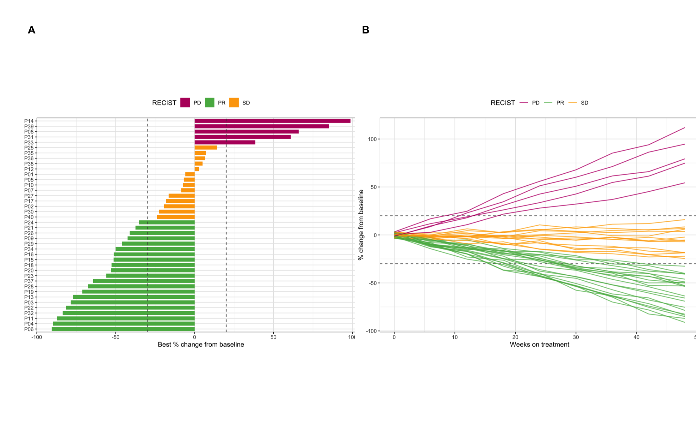
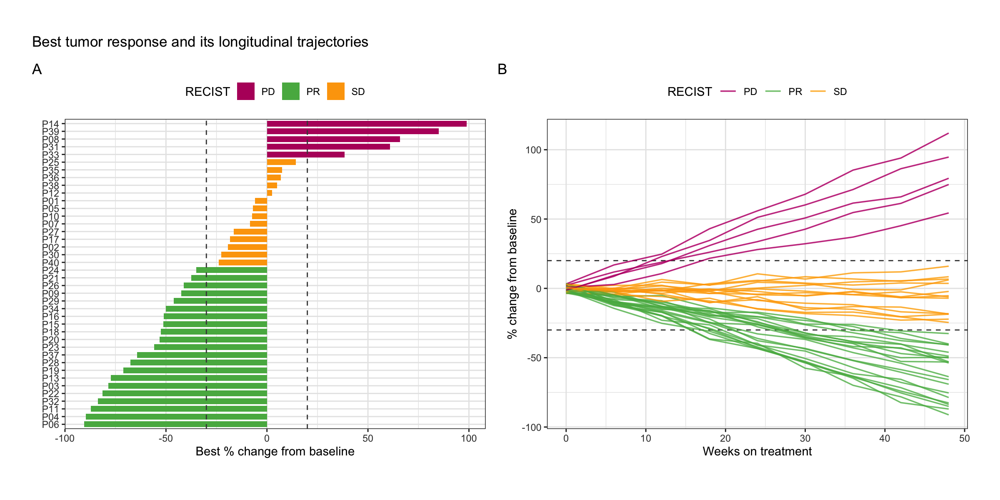

The waterfall plot is the standard way to display best tumor response per patient in oncology trials. Each bar is one patient, sorted by the best percentage change in the sum of target-lesion diameters from baseline; bars are typically colored by the RECIST response category (CR, PR, SD, PD) \[1\]. The plot answers "how deep are the responses?" at a glance, complements the Kaplan-Meier survival curves (which answer "how long did patients live?"), and is often paired with a *spider plot* showing each patient's longitudinal tumor-size trajectory.

::: callout-note
Waterfall plots can visually overestimate the response rate because only the best change is displayed and non-measurable progressions may be under-represented \[2\]. Pair them with spider plots and report the response rate in numbers.
:::

## Example

{fig-alt="WaterfallPlot DEMO" fig-align="center" width="60%"}

## Setup

-   System Requirements: Cross-platform (Linux/MacOS/Windows)

-   Programming language: R

-   Dependent packages: `dplyr`; `forcats`; `ggplot2`; `patchwork`

```{r packages setup, message=FALSE, warning=FALSE, output=FALSE}
# Load packages
library(dplyr)
library(forcats)
library(ggplot2)
library(patchwork)
```

```{r}
sessioninfo::session_info("attached")
```

## Data Preparation

The required input is one row per patient with, at minimum, the best percentage change in target-lesion size and the RECIST category. Because no clinical-trial patient-level data set ships with R, we simulate a realistic phase-II-style cohort: 40 patients whose best change follows the expected pattern of a moderately active regimen (RECIST thresholds: PR requires ≥30% shrinkage, PD ≥20% growth) \[1\]. Replace the simulation with `read.csv("your_recist_data.csv")` for real data — the column structure is identical.

```{r load data, message=FALSE, warning=FALSE}
set.seed(2026)
n <- 40

response <- sample(c("CR", "PR", "SD", "PD"), n,
                   prob = c(0.05, 0.40, 0.30, 0.25), replace = TRUE)
best_change <- round(case_when(
  response == "CR" ~ -runif(n, 95, 100),   # complete response: almost full shrinkage
  response == "PR" ~ -runif(n, 30, 92),    # partial response: 30-90% shrinkage
  response == "SD" ~ runif(n, -25, 18),    # stable disease
  response == "PD" ~ runif(n, 22, 120)     # progressive disease
), 1)

wf <- data.frame(
  patient     = paste0("P", sprintf("%02d", seq_len(n))),
  best_change = best_change,
  response    = response
)

head(wf)
```

We also simulate the longitudinal trajectories for the companion spider plot: a straight-line drift from baseline to the best change with small week-to-week noise, with progressors accelerating late.

```{r spider data, message=FALSE, warning=FALSE}
set.seed(2027)
weeks <- seq(0, 48, 6)

spider <- do.call(rbind, lapply(seq_len(nrow(wf)), function(i) {
  k <- length(weeks)
  endpoint <- wf$best_change[i]
  base <- approx(x = c(1, k), y = c(0, endpoint), xout = 1:k)$y
  noise <- runif(k, -4, 4)
  if (wf$response[i] == "PD") noise <- noise + seq(0, 12, length.out = k)  # acceleration
  data.frame(patient = wf$patient[i], week = weeks,
             change = round(pmin(base + noise, 130), 1),
             response = wf$response[i])
}))

head(spider)
```

## Visualization

### 1. Basic Waterfall Plot

Sort patients by best change and flip the coordinates so bars read like the classic publication layout.

```{r}
#| label: fig-1.1BasicWaterfall
#| fig-cap: "Basic waterfall plot of best tumor change per patient."
#| out.width: "80%"
#| fig-width: 8
#| fig-height: 6
#| warning: false
#| message: false

p1 <- wf %>%
  mutate(patient = fct_reorder(patient, best_change)) %>%
  ggplot(aes(patient, best_change)) +
  geom_col(fill = "#4393C3", width = 0.75) +
  coord_flip() +
  labs(x = NULL, y = "Best % change from baseline") +
  theme_bw()
p1
```

### 2. RECIST-Colored Waterfall with Threshold Lines

Color bars by response category and add the RECIST reference lines: −30% marks the partial-response boundary and +20% the progression boundary.

```{r}
#| label: fig-2.1RecistWaterfall
#| fig-cap: "Waterfall plot colored by RECIST response with reference lines at -30% and +20%."
#| out.width: "80%"
#| fig-width: 8
#| fig-height: 6
#| warning: false
#| message: false

recist_colors <- c(CR = "#1B7837", PR = "#66BD63", SD = "#FFB300", PD = "#C51B7D")

p2 <- wf %>%
  mutate(patient = fct_reorder(patient, best_change)) %>%
  ggplot(aes(patient, best_change, fill = response)) +
  geom_col(width = 0.75) +
  geom_hline(yintercept = c(-30, 20), linetype = "dashed", color = "grey35") +
  scale_fill_manual(values = recist_colors, name = "RECIST") +
  coord_flip() +
  labs(x = NULL, y = "Best % change from baseline") +
  theme_bw() +
  theme(legend.position = "top")
p2
```

The two dashed lines instantly reveal the response rate (bars below −30%) versus the disease-control rate (all bars below +20%).

### 3. Companion Spider Plot

```{r}
#| label: fig-3.1SpiderPlot
#| fig-cap: "Spider plot of longitudinal tumor change; the waterfall shows endpoints, the spider shows trajectories."
#| out.width: "80%"
#| fig-width: 8
#| fig-height: 6
#| warning: false
#| message: false

p3 <- spider %>%
  ggplot(aes(week, change, group = patient, color = response)) +
  geom_hline(yintercept = c(-30, 20), linetype = "dashed", color = "grey35") +
  geom_line(alpha = 0.75, linewidth = 0.6) +
  scale_color_manual(values = recist_colors, name = "RECIST") +
  labs(x = "Weeks on treatment", y = "% change from baseline") +
  theme_bw() +
  theme(legend.position = "top")
p3
```

### 4. Combined Figure

```{r}
#| label: fig-4.1Combined
#| fig-cap: "Waterfall (left) and spider (right) plots combined with patchwork."
#| out.width: "95%"
#| fig-width: 12
#| fig-height: 5.5
#| warning: false
#| message: false

p2 + p3 + plot_annotation(
  title = "Best tumor response and its longitudinal trajectories",
  tag_levels = "A"
)
```

Reading them together: bars tell the depth of response, lines tell its shape — early shrinkers, late progressors and primary refractory patients are distinguishable in the spider plot only.

## Application

Waterfall plots are ubiquitous in clinical oncology papers and FDA/EMA filings to summarize anti-tumor activity of a regimen; the combined waterfall + spider panel below is the typical presentation.

{fig-alt="WaterfallPlot Application" fig-align="center" width="60%"}

## Reference

\[1\] Eisenhauer EA, Therasse P, Bogaerts J, et al. New response evaluation criteria in solid tumours: revised RECIST guideline (version 1.1). Eur J Cancer. 2009;45(2):228-247. doi:10.1016/j.ejca.2008.10.026

\[2\] Kim MS, Lee J, Ha J, et al. Assessment of accuracy of waterfall plot representations of response rate in cancer clinical trials. Am J Ther. 2019;26(2):e217-e222. doi:10.1097/MJT.0000000000000654
