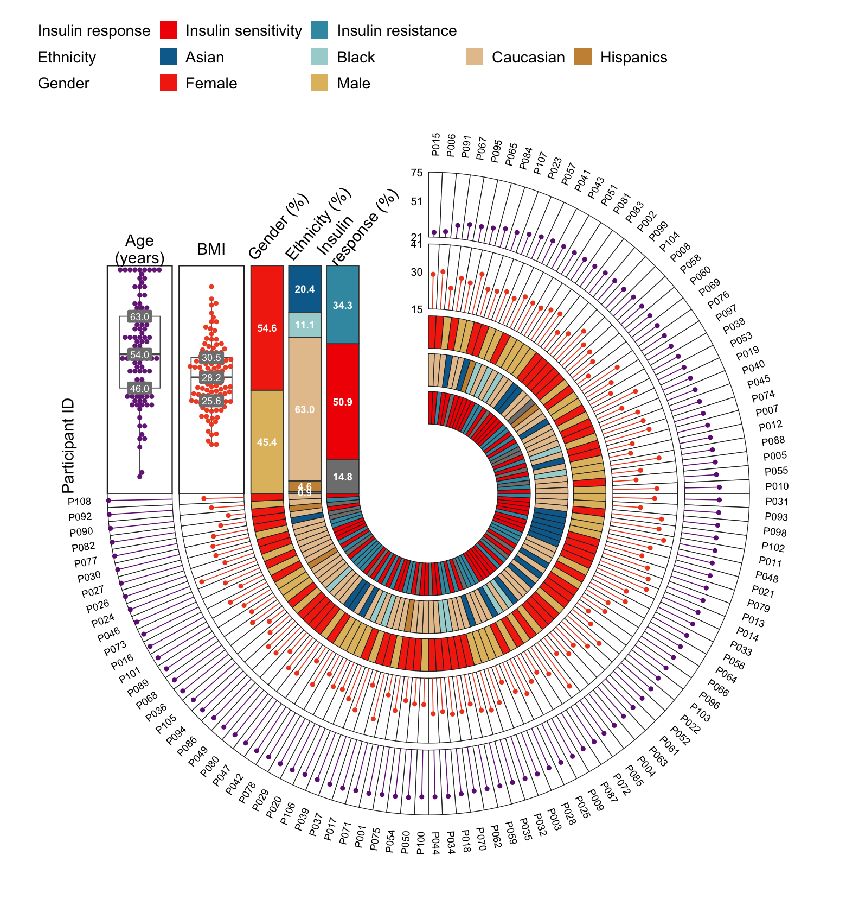

A circular multi-track sample annotation plot arranges every sample of a cohort as one sector of a ring: each sector carries an outer label, concentric tracks encode different variables (continuous variables as lollipop tracks whose dot radius marks the value, categorical variables as colored bands), and the gap of the ring hosts compact summary panels — boxplots with swarm-style points for the continuous tracks, stacked proportion bars for the categorical ones — aligned to the same radial scale. It is designed for cohort figures that must show many samples and several variables at once (the reference figure shows 108 participants of a longitudinal multi-omics cohort), so individual-level patterns, group composition and overall distributions can be read in a single glance. This tutorial reproduces the chart type covered by the *顶刊图社* series (issue 094, after Shen et al., *Nature Aging* 2024); see the Reference section below.

## Example

{fig-alt="CircularAnnotation DEMO" fig-align="center" width="65%"}

This example shows a simulated 108-participant cohort. Samples are sorted by age around the ring; the two outer lollipop tracks show age and BMI (dot radius = value, with circular tick marks), the three inner bands encode insulin response, ethnicity and gender. The upper-left gap contains the summary panels: boxplot with swarm-style points for age and BMI (sharing the radius scale of their tracks, so the median line of the box sits exactly at the corresponding radius of the ring) and 100% stacked proportion bars (percentage labels for segments of at least 6%) for the three categorical variables.

## Setup

-   System Requirements: Cross-platform (Linux/MacOS/Windows)

-   Programming Language: R

-   Dependencies: `tidyverse`

```{r packages setup, message=FALSE, warning=FALSE, output=FALSE}
# Installing necessary packages
if (!requireNamespace("tidyverse", quietly = TRUE)) {
  install.packages("tidyverse")
}

# Load packages
library(tidyverse)
```

## Data Preparation

The example simulates a cohort comparable to the reference figure (108 participants) so the tutorial runs without external data. Every row is one participant; `age` and `bmi` are the continuous variables, `iris`, `ethnicity` and `gender` the categorical ones.

```{r simulate data, message=FALSE}
set.seed(2026)
n <- 108
dat <- tibble(
  id = sprintf("P%03d", 1:n),
  age = round(pmin(pmax(rnorm(n, 56, 12), 21), 75)),
  bmi = round(pmin(pmax(rnorm(n, 28, 4), 15), 41), 1),
  iris = sample(c("IS", "IR", "Unknown"), n, TRUE, prob = c(.52, .33, .15)),
  ethnicity = sample(c("Asian", "Black", "Caucasian", "Hispanics", "Unknown"), n, TRUE,
                     prob = c(.20, .07, .66, .04, .03)),
  gender = sample(c("Female", "Male"), n, TRUE, prob = c(.52, .48))
)

head(dat)
```

The track layout is described declaratively. Each **numeric track** defines its column, the radius band it occupies (`inner`/`outer`), the value range mapped onto that band (`min`/`max`), the track color and optional tick values. Each **category track** defines its column and radius band; colors (and their order) are supplied through a named vector, and categories without a color receive one automatically.

```{r track settings, message=FALSE}
numeric_tracks <- tribble(
  ~name,  ~column, ~title,          ~inner, ~outer, ~min, ~max, ~color,    ~ticks,
  "Age",  "age",   "Age\n(years)",  3.32,   4.16,    21,   75,   "#702083", "21,51,75",
  "BMI",  "bmi",   "BMI",           2.39,   3.23,    15,   41,   "#F04A22", "15,30,41")

category_tracks <- tribble(
  ~name,               ~column,      ~title,                   ~inner, ~outer,
  "Gender",            "gender",     "Gender\n(%)",            1.88,   2.30,
  "Ethnicity",         "ethnicity",  "Ethnicity\n(%)",         1.39,   1.81,
  "Insulin response",  "iris",       "Insulin\nresponse (%)",  0.90,   1.32)

category_colors <- c(
  Female = "#F33010", Male = "#E2BD6E",
  Asian = "#046C9B", Black = "#A8D3D4", Caucasian = "#E5C39C", Hispanics = "#CA9143",
  Unknown = "#BDBDBD", IS = "#F21901", IR = "#3C99B0")
```

## Visualization

The complete figure is produced by one reusable function, `circular_annotation_plot()`. It converts every sample sector into ordinary cartesian coordinates (so the ring and the summary panels live in a single ggplot2 coordinate system and align exactly), then stacks the category bands, the lollipop tracks, the sample labels, the circular ticks and the gap panels.

```{r define function, message=FALSE}
# ─────────────────────────────────────────────────────────────────────────────
# circular_annotation_plot(): ring of samples + multi-track annotation + gap panels
# ─────────────────────────────────────────────────────────────────────────────
circular_annotation_plot <- function(data, id_col, sort_col,
                                     numeric_tracks, category_tracks,
                                     category_colors = c(),
                                     gap_degrees = 90, show_summary = TRUE,
                                     id_size = 2.1, base_size = 10) {
  data <- data |> arrange(.data[[sort_col]])
  n <- nrow(data)
  span <- (360 - gap_degrees) * pi / 180
  step <- span / n
  data <- data |>
    mutate(.i = row_number(),
           .start = pi / 2 - (.i - 1) * step,
           .end = pi / 2 - .i * step,
           .angle = (.start + .end) / 2)

  # default palette for categories missing a color
  auto_palette <- c("#046C9B", "#E5C39C", "#CA9143", "#A8D3D4", "#F33010",
                    "#E2BD6E", "#3C99B0", "#F21901", "#7A5195", "#EF5675", "#FFA600")

  # Resolve colors for a vector of category values: explicit entries from
  # `category_colors`; remaining categories draw from palette colors not
  # already used, so auto-assigned colors never collide with explicit ones.
  resolve_colors <- function(values) {
    values <- as.character(values)
    fill <- category_colors[values]
    missing <- is.na(fill)
    if (any(missing)) {
      lv <- setdiff(unique(values[missing]), names(category_colors))
      pool <- setdiff(auto_palette, unname(category_colors))
      extra <- rep_len(pool, length(lv))
      names(extra) <- lv
      fill[missing] <- extra[values[missing]]
    }
    fill
  }

  # -- sector polygons for one category track ---------------------------------
  band_polygons <- function(column, inner, outer) {
    fill <- resolve_colors(data[[column]])
    map_dfr(seq_len(n), function(k) {
      a <- seq(data$.start[k], data$.end[k], length.out = 8)
      tibble(.group = k,
             x = c(outer * cos(a), inner * cos(rev(a))),
             y = c(outer * sin(a), inner * sin(rev(a))),
             fill = fill[k])
    })
  }

  value_radius <- function(v, minv, maxv, inner, outer) {
    inner + (v - minv) / (maxv - minv) * (outer - inner)
  }

  # -- lollipop segments for one numeric track --------------------------------
  lollipop <- function(column, minv, maxv, inner, outer) {
    r <- value_radius(data[[column]], minv, maxv, inner, outer)
    tibble(x0 = cos(data$.angle) * inner, y0 = sin(data$.angle) * inner,
           x1 = cos(data$.angle) * r,   y1 = sin(data$.angle) * r)
  }

  # -- gap panels -------------------------------------------------------------
  slot_x <- function(j, numeric = TRUE) {
    if (numeric) -5.05 + (j - 1) * 1.02
    else -5.05 + nrow(numeric_tracks) * 1.02 + (j - 1) * 0.86
  }
  # boxplot (computed in value space, mapped onto the ring radius)
  box_stats <- map_dfr(seq_len(nrow(numeric_tracks)), function(j) {
    tb <- numeric_tracks[j, ]; v <- data[[tb$column]]
    q <- quantile(v, c(.25, .5, .75)); r <- function(val) value_radius(val, tb$min, tb$max, tb$inner, tb$outer)
    tibble(x = slot_x(j), ymin = r(min(v)), ymax = r(max(v)), yq1 = r(q[1]), yq2 = r(q[2]), yq3 = r(q[3]),
           med = format(round(q[2], 1), nsmall = 1))
  })
  # deterministic swarm offsets (alternating around the slot)
  swarm <- map_dfr(seq_len(nrow(numeric_tracks)), function(j) {
    tb <- numeric_tracks[j, ]; v <- data[[tb$column]]
    o <- order(v); k <- integer(length(v)); k[o] <- seq_along(v)
    off <- ceiling(k / 2) * ifelse(k %% 2 == 1, -1, 1) * 0.008
    tibble(x = slot_x(j) + off, y = value_radius(v, tb$min, tb$max, tb$inner, tb$outer),
           color = tb$color, track = tb$name)
  })
  # stacked proportion bars
  bars <- map_dfr(seq_len(nrow(category_tracks)), function(j) {
    tb <- category_tracks[j, ]; f <- as.character(data[[tb$column]])
    tab <- sort(table(f), decreasing = TRUE); frac <- as.numeric(tab) / sum(tab)
    fill <- resolve_colors(names(tab))
    y0 <- tb$inner + (tb$outer - tb$inner) * c(0, head(cumsum(frac), -1))
    y1 <- tb$inner + (tb$outer - tb$inner) * cumsum(frac)
    tibble(x = slot_x(j, numeric = FALSE), y0 = y0, y1 = y1,
           pct = round(frac * 100, 1), fill = fill, cat = names(tab))
  })
  # circular ticks for numeric tracks
  tick_values <- numeric_tracks |> filter(!is.na(.data$ticks))
  ticks <- map_dfr(seq_len(nrow(tick_values)), function(j) {
    tb <- tick_values[j, ]
    v <- as.numeric(strsplit(tb$ticks, ",")[[1]])
    r <- value_radius(v, tb$min, tb$max, tb$inner, tb$outer)
    ang <- 1.64 + 0.15 * (j - 1)   # stagger ticks per track along the gap edge
    tibble(value = v, x = cos(ang) * r, y = sin(ang) * r)
  })

  # -- assemble ---------------------------------------------------------------
  p <- ggplot() +
    # guide circles at numeric track boundaries
    geom_hline(yintercept = 0, linewidth = 0) +
    lapply(unique(c(numeric_tracks$inner, numeric_tracks$outer)), function(r) {
      annotate("path", x = cos(seq(-pi, pi, length.out = 200)) * r, y = sin(seq(-pi, pi, length.out = 200)) * r,
               color = "grey85", linewidth = 0.25)
    }) +
    map(seq_len(nrow(category_tracks)), function(j) {
      tb <- category_tracks[j, ]
      geom_polygon(data = band_polygons(tb$column, tb$inner, tb$outer),
                   aes(x, y, group = .group, fill = fill), color = "white", linewidth = 0.12)
    }) +
    map(seq_len(nrow(numeric_tracks)), function(j) {
      tb <- numeric_tracks[j, ]
      geom_segment(data = lollipop(tb$column, tb$min, tb$max, tb$inner, tb$outer),
                   aes(x0, y0, xend = x1, yend = y1), color = "grey45", linewidth = 0.2)
    }) +
    map(seq_len(nrow(numeric_tracks)), function(j) {
      tb <- numeric_tracks[j, ]
      d <- lollipop(tb$column, tb$min, tb$max, tb$inner, tb$outer)
      geom_point(data = d, aes(x1, y1), color = tb$color, size = 1.25)
    }) +
    scale_fill_identity() +
    # sample ids
    geom_text(data = data |> mutate(
                deg = .angle * 180 / pi,
                lx = cos(.angle) * (max(category_tracks$outer, numeric_tracks$outer) + 0.16),
                ly = sin(.angle) * (max(category_tracks$outer, numeric_tracks$outer) + 0.16),
                rot = ifelse(cos(.angle) >= 0, deg, deg + 180),
                hj = ifelse(cos(.angle) >= 0, 0, 1)),
              aes(lx, ly, label = .data[[id_col]], angle = rot, hjust = hj), size = id_size, color = "grey15") +
    # gap panels
    { if (show_summary) geom_crossbar(data = box_stats, aes(x, yq2, ymin = yq1, ymax = yq3), width = 0.24, color = "grey20", linewidth = 0.40) } +
    { if (show_summary) geom_segment(data = box_stats, aes(x, ymin, xend = x, yend = ymax), color = "grey20", linewidth = 0.40) } +
    { if (show_summary) geom_segment(data = box_stats, aes(x - 0.10, ymin, xend = x + 0.10, yend = ymin), color = "grey20", linewidth = 0.40) } +
    { if (show_summary) geom_segment(data = box_stats, aes(x - 0.10, ymax, xend = x + 0.10, yend = ymax), color = "grey20", linewidth = 0.40) } +
    { if (show_summary) geom_text(data = box_stats, aes(x, yq2, label = med), size = base_size * 0.22, vjust = -0.55) } +
    { if (show_summary) geom_point(data = swarm, aes(x, y), color = swarm$color, size = 0.75) } +
    { if (show_summary) geom_rect(data = bars, aes(xmin = x - 0.24, xmax = x + 0.24, ymin = y0, ymax = y1, fill = fill),
              color = "white", linewidth = 0.35) } +
    { if (show_summary) geom_text(data = bars |> filter(pct >= 6), aes(x, (y0 + y1) / 2, label = pct), size = base_size * 0.2) } +
    # panel titles
    { if (show_summary) geom_text(data = numeric_tracks |> mutate(x = slot_x(seq_len(n()), TRUE), y = max(numeric_tracks$outer) + 0.22),
              aes(x, y, label = title), size = base_size * 0.24, vjust = 0, lineheight = 0.9) } +
    { if (show_summary) geom_text(data = category_tracks |> mutate(x = slot_x(seq_len(n()), FALSE), y = max(numeric_tracks$outer) + 0.22),
              aes(x, y, label = title), size = base_size * 0.24, vjust = 0, lineheight = 0.9) } +
    # ticks
    geom_point(data = ticks, aes(x, y), size = 1.0, color = "grey15") +
    geom_text(data = ticks, aes(x, y, label = value), size = base_size * 0.21, hjust = 1.2) +
    coord_fixed(xlim = c(-5.6, 4.9), ylim = c(-5.1, 5.1)) +
    theme_void(base_size = base_size)
  p
}
```

### 1. Basic Ring

Setting `show_summary = FALSE` draws the ring itself: ordered samples, category bands, value tracks and circular tick marks.

```{r}
#| label: fig-1.1BasicCircular
#| fig-cap: "Basic circular multi-track sample annotation plot"
#| out.width: "90%"
#| warning: false
#| message: false
#| fig-width: 9.5
#| fig-height: 9.5

p1 <- circular_annotation_plot(dat, id_col = "id", sort_col = "age",
  numeric_tracks = numeric_tracks, category_tracks = category_tracks,
  category_colors = category_colors, show_summary = FALSE)
p1
```

### 2. Summary Panels in the Gap

With the default `show_summary = TRUE`, the gap of the ring is filled with the cohort summary: boxplot with swarm-style points for each continuous track (drawn at the same radial scale as its ring) and 100% stacked proportion bars for each categorical track.

```{r}
#| label: fig-1.2FullCircular
#| fig-cap: "Circular annotation plot with summary panels in the gap"
#| out.width: "90%"
#| warning: false
#| message: false
#| fig-width: 10.4
#| fig-height: 10.8

p2 <- circular_annotation_plot(dat, id_col = "id", sort_col = "age",
  numeric_tracks = numeric_tracks, category_tracks = category_tracks,
  category_colors = category_colors)
p2
```

::: callout-tip
**Key Parameters: **

- `sort_col`: the column that defines the sample order around the ring (sorted ascending).
- `gap_degrees`: angular size of the gap (default 90°) that hosts the summary panels.
- `show_summary`: draw the boxplot/swarm/proportion panels (`TRUE`) or the bare ring (`FALSE`).
- `category_colors`: named color vector; unlisted categories are colored automatically.
- `id_size` / `base_size`: label and text scaling.
:::

### 3. Customization

The track tables and the function parameters make the figure easy to re-target: here the same cohort is re-sorted by BMI and drawn with a wider 120° gap.

```{r}
#| label: fig-1.3CustomCircular
#| fig-cap: "Customized annotation plot: sorted by BMI with a 120-degree gap"
#| out.width: "90%"
#| warning: false
#| message: false
#| fig-width: 10.4
#| fig-height: 10.8

p3 <- circular_annotation_plot(dat, id_col = "id", sort_col = "bmi",
  numeric_tracks = numeric_tracks, category_tracks = category_tracks,
  category_colors = category_colors, gap_degrees = 120)
p3
```

## Applications

-   **Cohort overview figures**: participant characteristics (demographics, clinical variables, omics groups) in the opening figure of multi-omics and longitudinal studies — the reference paper uses exactly this layout.
-   **Clinical trial arms**: samples sorted by a biomarker or enrollment order, tracks encoding arm, response and key measurements.
-   **Single-cell / sample-level QC**: per-sample quality metrics as continuous tracks with the panel distributions in the gap.
-   The declarative track tables mean new variables are added by appending one row; the layout engine (sector angles, radius mapping, panel alignment) stays untouched.

## Reference

\[1\] 顶刊图社 | 第094期：环形多轨道样本注释图. WeChat article. <https://mp.weixin.qq.com/s/E2IZKV3eCi9ufdsGOAeE8g>

\[2\] Shen X, Wang C, Zhou X, et al. Nonlinear dynamics of multi-omics profiles during human aging. Nat Aging. 2024;4(11):1619-1634. doi:10.1038/s43587-024-00692-2
