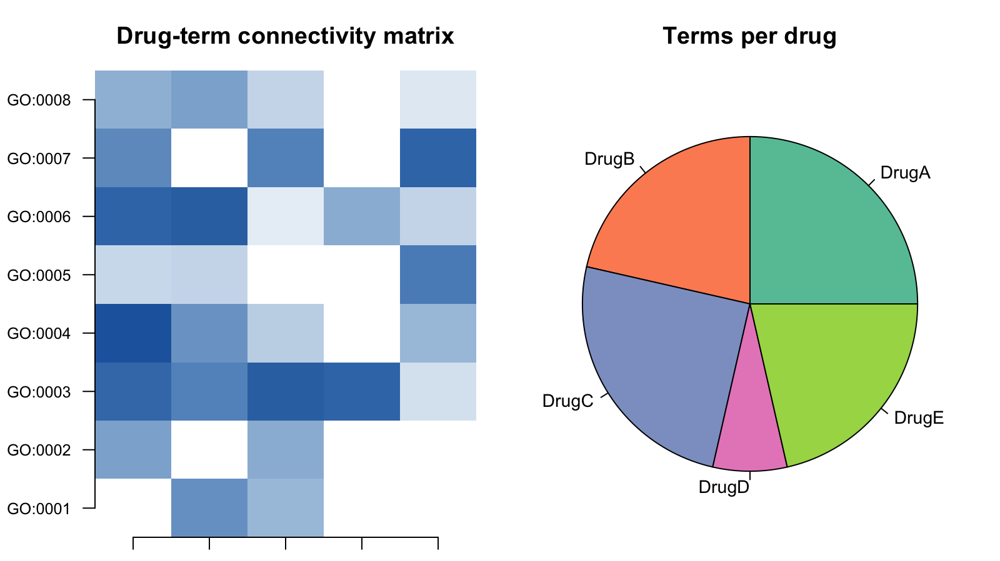

Enrichment outputs naturally pair a **binary connectivity matrix** (drug x term: does the term contain genes from the drug's perturbation set?) with a **pie chart** summarising per-column connectivity counts. FigureYa127 combines them side by side \[1\]. This tutorial reproduces the pair on a simulated drug-term connectivity matrix:

## Example

{fig-alt="HeatmapPieChart DEMO" fig-align="center" width="60%"}

## Setup

-   System Requirements: Cross-platform (Linux/MacOS/Windows)

-   Programming language: R

-   Dependent packages: `ggplot2`; `RColorBrewer`

```{r packages setup, message=FALSE, warning=FALSE, output=FALSE}
suppressPackageStartupMessages({
  library(ggplot2)
  library(RColorBrewer)
})
```

```{r}
sessioninfo::session_info("attached")
```

## Data Preparation

Simulated 8-term x 5-drug binary connectivity matrix (12 zeroed cells so not every drug connects to every term); the pie counts how many terms each drug connects to:

```{r load data}
set.seed(12701)
terms <- paste0("GO:", sprintf("%04d", 1:8))
Drugs <- paste0("Drug", LETTERS[1:5])
connect <- matrix(runif(8 * 5, 0.1, 1), 8, 5, dimnames = list(terms, Drugs))
connect[sample(40, 12)] <- 0  # zeros for no connection
pie_val <- colSums(connect > 0)
```

## Visualization

### 1. Side-by-Side Connectivity Heatmap + Pie

```{r}
#| label: fig-1.1HeatmapPie
#| fig-cap: "Drug-term connectivity heatmap (left) and per-drug connectivity-count pie (right): the pie summarises how many terms each drug connects to."
#| out.width: "100%"
#| warning: false
#| message: false
#| fig-width: 9
#| fig-height: 4.5

par(mfrow = c(1, 2), mar = c(1, 4, 3, 1))
image(t(connect), axes = FALSE,
      col = colorRampPalette(c("white", "#2166AC"))(50),
      main = "Drug-term connectivity matrix", cex.main = 1.2)
axis(1, at = seq(0, 1, length.out = 5), labels = Drugs, las = 2, cex.axis = 0.8)
axis(2, at = seq(0, 1, length.out = 8), labels = terms, las = 2, cex.axis = 0.8)
par(mar = c(1, 1, 3, 1))
pie(pie_val, col = brewer.pal(5, "Set2"), main = "Terms per drug", cex = 0.9)
```

::: callout-tip
**Practice tips**

-   The pie is a **summary statistic** of the heatmap columns (count of non-zero cells) — draw them side by side so the reader can verify the pie against the matrix without flipping pages.
-   `image(t(connect))` transposes so drugs run along x and terms along y, matching the ggplot2 convention used elsewhere on the site.
-   For many drugs or terms, replace the base-graphics `image()` with `geom_tile()` in ggplot2 and `scatterpie::geom_scatterpie()` for pies embedded on the heatmap cells.
:::

## Applications

::: {#fig-HeatmapPieApplications1}
{fig-alt="HeatmapPieChart Application" fig-align="center" width="60%"}

Drug-term connectivity
:::

The heatmap + pie pair applies to any binary association matrix: pathway x gene set, compound x target, or mutation x sample cluster.

## Reference

\[1\] Xiaofan Lu, et al. FigureYa: A Standardized Visualization Framework for Enhancing Biomedical Data Interpretation and Research Efficiency. iMetaMed. 2025. doi:10.1002/imm3.70005
