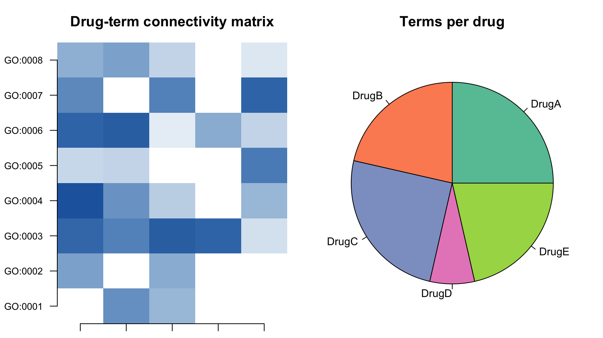

富集输出天然配对一张**二值连接矩阵**（药物 x 词条：该词条是否包含来自药物扰动集的基因？）与一张**饼图**（总结逐列连接计数）。FigureYa127 将二者并排 \[1\]。本教程在模拟药物-词条连接矩阵上复现该组合：

## Example

{fig-alt="热图 + 饼图组合 DEMO" fig-align="center" width="60%"}

## Setup

-   系统要求：跨平台（Linux/MacOS/Windows）

-   编程语言：R

-   依赖包：`ggplot2`; `RColorBrewer`

```{r packages setup, message=FALSE, warning=FALSE, output=FALSE}
suppressPackageStartupMessages({
  library(ggplot2)
  library(RColorBrewer)
})
```

```{r}
sessioninfo::session_info("attached")
```

## 数据准备

模拟 8 词条 × 5 药物的二值连接矩阵（12 个格子置零，不是每个药物连到每个词条）；饼图统计每药物连接多少词条：

```{r load data}
set.seed(12701)
terms <- paste0("GO:", sprintf("%04d", 1:8))
Drugs <- paste0("Drug", LETTERS[1:5])
connect <- matrix(runif(8 * 5, 0.1, 1), 8, 5, dimnames = list(terms, Drugs))
connect[sample(40, 12)] <- 0  # zeros for no connection
pie_val <- colSums(connect > 0)
```

## Visualization

### 并排连接热图 + 饼图

药物-词条连接热图（左）和逐药物连接计数饼图（右）：饼图总结每个药物连接多少词条。

```{r}
#| label: fig-1.1HeatmapPie
#| fig-cap: "Drug-term connectivity heatmap (left) and per-drug connectivity-count pie (right): the pie summarises how many terms each drug connects to."
#| out.width: "100%"
#| warning: false
#| message: false
#| fig-width: 9
#| fig-height: 4.5

par(mfrow = c(1, 2), mar = c(1, 4, 3, 1))
image(t(connect), axes = FALSE,
      col = colorRampPalette(c("white", "#2166AC"))(50),
      main = "Drug-term connectivity matrix", cex.main = 1.2)
axis(1, at = seq(0, 1, length.out = 5), labels = Drugs, las = 2, cex.axis = 0.8)
axis(2, at = seq(0, 1, length.out = 8), labels = terms, las = 2, cex.axis = 0.8)
par(mar = c(1, 1, 3, 1))
pie(pie_val, col = brewer.pal(5, "Set2"), main = "Terms per drug", cex = 0.9)
```


## 应用场景

::: {#fig-HeatmapPieChartApplications1}
{fig-alt="HeatmapPieChart Application" fig-align="center" width="60%"}

药物-词条连接矩阵
:::

热图 + 饼图组合适用于任何二值关联矩阵：通路 x 基因集、化合物 x 靶点、或突变 x 样本簇。

## 参考文献

\[1\] Xiaofan Lu, et al. FigureYa: A Standardized Visualization Framework for Enhancing Biomedical Data Interpretation and Research Efficiency. iMetaMed. 2025. doi:10.1002/imm3.70005
