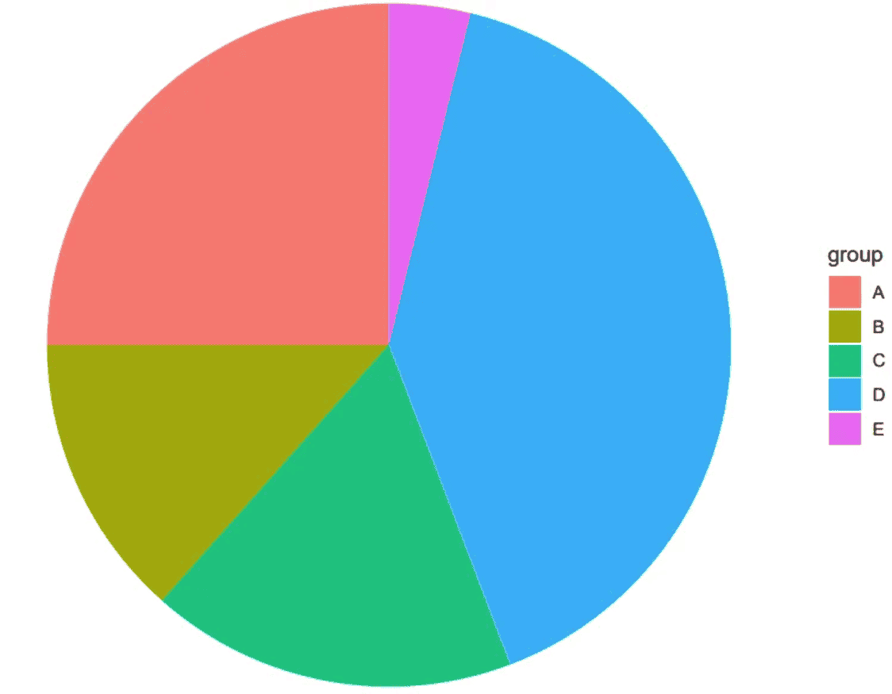
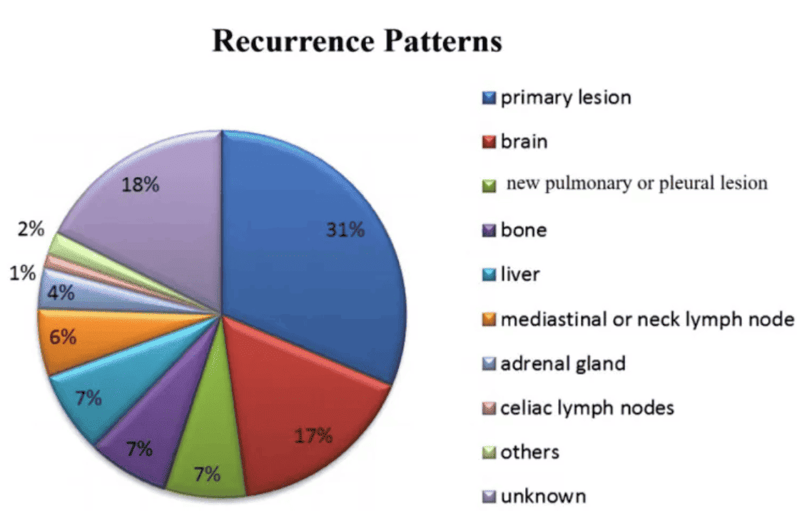
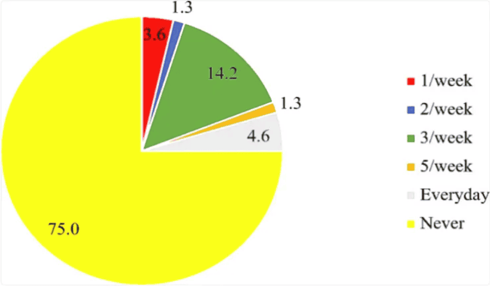
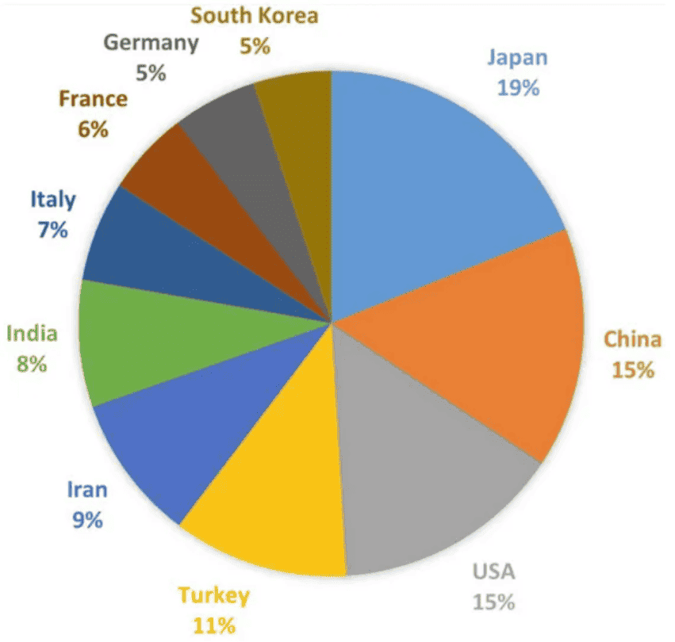

A pie chart is a basic chart in statistics, using sectors of different sizes to represent the magnitude of each item. A pie chart provides a visual understanding of the proportion of each data point within the overall data.

## Example

{fig-alt="PieChart DEMO" fig-align="center" width="60%"}

The image is a very basic pie chart. The different colored and sized sectors represent different data items, which can intuitively show the proportion of each data group in the overall data.

## Setup

-   System Requirements: Cross-platform (Linux/MacOS/Windows)

-   Programming Language: R

-   Dependencies: `ggplot2`

```{r packages setup, message=FALSE, warning=FALSE, output=FALSE}
# Install packages
if (!requireNamespace("ggplot2", quietly = TRUE)) {
  install.packages("ggplot2")
}

# Load packages
if (!requireNamespace("scatterpie", quietly = TRUE)) install.packages("scatterpie")
library(ggplot2)
```

```{r}
sessioninfo::session_info("attached")
```

## Data Preparation

The data comes from the PubMed paper "The epidemiology of lung cancer in Hungary based on the characteristics of patients diagnosed in 2018"\[1\], which includes statistics on lung cancer staging.

```{r load data}
# Data writing: one column for grouping, one column for values.
data <- data.frame(
  group = c("I", "II", "III", "IV", "NA"),
  value = c(402, 955, 1252, 3343, 3567)
)

head(data)
```

## Visualization

### 1. Basic pie chart

```{r}
#| label: fig1BasicBar
#| fig-cap: "Basic drawing - bar chart"
#| out.width: "95%"
#| warning: false

# Basic drawing - bar chart
p <- ggplot(data, aes(x = "", y = value, fill = group)) +
  geom_col() # First, draw a bar chart, then transform it into a pie chart using coord_polar().

p
```

Drawing a bar chart is an intermediate step in drawing a pie chart using `ggplot2`. Then, by performing coordinate polarization using `coord_polar()`, the pie chart can be obtained.

```{r}
#| label: fig2BasicPie
#| fig-cap: "Basic pie chart"
#| out.width: "95%"
#| warning: false

# Basic pie chart
p <- ggplot(data, aes(x = "", y = value, fill = group)) +
  geom_col() + # First, draw a bar chart, then transform it into a pie chart using coord_polar().
  coord_polar(theta = "y") # Used for drawing pie charts

p
```

The image shows a pie chart drawn using `ggplot2`, but coordinate labels and scales are not necessary.

### 2. Simple pie chart

```{r}
#| label: fig3SimplePie
#| fig-cap: "Simple pie chart"
#| out.width: "95%"
#| warning: false

# Use theme_void() to remove elements such as grid, backgroundcolor, and axis.label.
p <- ggplot(data, aes(x = "", y = value, fill = group)) +
  geom_col() +
  coord_polar(theta = "y") +
  theme_void()
p
```

This pie chart removes elements such as grid, background color, and axis.label, making it look cleaner.

### 3. Custom colors

```{r}
#| label: fig4Color
#| fig-cap: "Custom colors"
#| out.width: "95%"
#| warning: false

# Use scale_fill_manual() to customize colors.
p <- ggplot(data, aes(x = "", y = value, fill = group)) +
  geom_col() +
  coord_polar(theta = "y") +
  theme_void() +
  scale_fill_manual(values = c("red","blue","purple","pink","grey")) # Custom colors
p
```

This pie chart uses `scale_fill_manual()` to customize the colors. Note that you should not use `scale_color_manual()`; the color of the sector in the chart is the fill color.

### 4. Add Labels

Before adding labels, you need to calculate their positions. Since only the y-axis value is used when drawing a pie chart, you only need to calculate the y-axis coordinates. A pie chart is derived from a bar chart, so you only need to calculate the center y-value of each bar. For example, if `group="I"`, based on the position of bar group I in the bar chart, `label_loc` will equal the height of the four groups below plus half the height of group I.

```{r}
#| label: fig5AddLabel
#| fig-cap: "Add Labels"
#| out.width: "95%"
#| warning: false

# Calculate label position
data$label_loc <- NA # Add a column for label positions to the original data frame, initially NA.
for (i in 1:length(data$group)) { # Loop through and calculate the label position of the group.
  locate <- data$value[i] / 2 # The label position is the center of the current group plus the height of the group below it. The height of the group below it is calculated using a loop.
  if (i < length(data$group)) {
    for (j in (i + 1):length(data$group)) {
      locate <- locate + data$value[j]
    }
  }
  data$label_loc[i] <- locate # Finally, the location of this group of tags was obtained.
}

# Draw a labeled pie chart
p <- ggplot(data, aes(x = "", y = value, fill = group)) +
  geom_col() +
  coord_polar(theta = "y") +
  theme_void() +
  geom_text(aes(y = label_loc, label = group)) + # y is the y-axis position of the label, and label is the label name.
  theme(legend.position = "None") # Since the groups are used as labels, the legend is removed here.
p
```

The pie chart was successfully labeled, but the code is a bit cumbersome. Using Python or R's `pie()` function would be much simpler.

### 5. Add percentage labels

```{r}
#| label: fig6AddPercentLabel
#| fig-cap: "Add percentage labels"
#| out.width: "95%"
#| warning: false

# 1.Calculate the label position (same as above).
data$label_loc <- NA 
for (i in 1:length(data$group)) {
  locate <- data$value[i] / 2 
if (i < length(data$group)) {
    for (j in (i + 1):length(data$group)) {
      locate <- locate + data$value[j]
    }
  }
  data$label_loc[i] <- locate
}
# 2.Calculate percentage
data$label <- NA 
sum <- sum(data$value) 
for (i in 1:length(data$group)) {
  data$label[i] <- paste0(round(data$value[i] / sum * 100, 1), "%")
}

# Draw a percentage label pie chart
p <- ggplot(data, aes(x = "", y = value, fill = group)) +
  geom_col() +
  coord_polar(theta = "y") +
  theme_void() +
  geom_text(aes(y = label_loc, label = label))
p
```

The pie chart legend shows groups, and the labels display percentages, making it more aesthetically pleasing and intuitive.

### 6. Place the label outside the pie chart

Sometimes there are many groups, and putting the labels inside the pie chart can make it look very crowded.

```{r}
#| label: fig7Out
#| fig-cap: "Place the label outside the pie chart"
#| out.width: "95%"
#| warning: false

# The code for calculating percentage labels and label positions remains unchanged.
# 1.Calculate the label position (same as above).
data$label_loc <- NA 
for (i in 1:length(data$group)) { 
  locate <- data$value[i] / 2 
if (i < length(data$group)) {
    for (j in (i + 1):length(data$group)) {
      locate <- locate + data$value[j]
    }
  }
  data$label_loc[i] <- locate 
}
# 2.Calculate percentage
data$label <- NA 
sum <- sum(data$value) 
for (i in 1:length(data$group)) {
  data$label[i] <- paste0(round(data$value[i] / sum * 100, 1), "%")
}

# Adjusting the x-value in geom_text() will move the label inward (decreasing the x-value) or outward (increasing the x-value).
p <- ggplot(data, aes(x = "", y = value, fill = group)) +
  geom_col() +
  coord_polar(theta = "y") +
  theme_void() +
  geom_text(aes(x = rep_len(1.6, length(group)), y = label_loc, label = label))
p
```

The labels on the pie chart are placed outside the pie chart itself, which makes the pie chart look more aesthetically pleasing, especially when there are many groups.

### 7. Add labels to the lines pointing to the pie chart

```{r}
#| label: fig8Line
#| fig-cap: "Add labels to the lines pointing to the pie chart."
#| out.width: "95%"
#| warning: false

# The code for calculating percentage labels and label positions remains unchanged.
# 1.Calculate the label position (same as above).
data$label_loc <- NA 
for (i in 1:length(data$group)) { 
  locate <- data$value[i] / 2 
if (i < length(data$group)) {
    for (j in (i + 1):length(data$group)) {
      locate <- locate + data$value[j]
    }
  }
  data$label_loc[i] <- locate 
}
# 2.Calculate percentage
data$label <- NA 
sum <- sum(data$value) 
for (i in 1:length(data$group)) {
  data$label[i] <- paste0(round(data$value[i] / sum * 100, 1), "%") 
}

# The line segment can be defined by adjusting the values of x and xend in geom_segment(), where the x value is greater than the radius of the pie chart, the xend value is slightly less than the coordinates of the label, and y and yend are still vectors representing the positions of the labels.
p <- ggplot(data, aes(x = "", y = value, fill = group)) +
  geom_col() +
  coord_polar(theta = "y") +
  theme_void() +
  geom_text(aes(x = rep_len(1.6, length(group)), y = label_loc, label = label)) +
  geom_segment(aes(
    x = rep_len(1.45, length(group)),
    xend = rep_len(1.58, length(group)),
    y = label_loc, yend = label_loc
  ))
p
```

The labels on the pie chart have corresponding line segments pointing to specific areas of the pie chart, preventing confusion when there are many groups.

### 8. Grouped Pie Charts and Scatterpie

When samples are divided into groups (e.g. High/Low risk), **grouped pie charts** show the category distribution within each group \[4\]. The scatterpie variant places multiple small pies on a 2D scatter plot.

```{r}
#| label: fig-8.1GroupedPie
#| fig-cap: "Grouped pie charts showing the proportion of three cell types in High vs Low risk groups."
#| out.width: "85%"
#| warning: false
#| message: false
#| fig-width: 8
#| fig-height: 4.5

set.seed(3001)
groups <- c("High risk", "Low risk")
cell_types <- c("T cell", "B cell", "Macrophage")
pie_data <- data.frame(
  group = rep(groups, each = 3),
  cell_type = rep(cell_types, times = 2),
  count = c(30, 15, 5, 15, 20, 25))

ggplot(pie_data, aes(x = "", y = count, fill = cell_type)) +
  geom_col(width = 1, colour = "white") +
  coord_polar(theta = "y") +
  facet_wrap(~ group, scales = "free") +
  scale_fill_manual(values = c("T cell" = "#B2182B", "B cell" = "#2166AC",
                               "Macrophage" = "#4D9342")) +
  labs(title = "Cell type composition by risk group", x = NULL, y = NULL,
       fill = "Cell type") +
  theme_void(base_size = 11) +
  theme(legend.position = "bottom",
        strip.text = element_text(size = 11, face = "bold"))
```

### 9. Scatterpie on a 2D Embedding

```{r}
#| label: fig-9.1Scatterpie
#| fig-cap: "Scatterpie: small pies showing cell-type proportions on a 2D embedding, one pie per sample group."
#| out.width: "85%"
#| warning: false
#| message: false
#| fig-width: 7.5
#| fig-height: 5.5

library(scatterpie)
set.seed(3002)
n_grp <- 6
sc_df <- data.frame(
  x = c(1, 1.5, 3, 3.5, 5, 5.5),
  y = c(2, 5, 1, 4, 2.5, 6),
  group = paste0("Cluster", 1:n_grp),
  `T cell` = runif(n_grp, 10, 40),
  `B cell` = runif(n_grp, 5, 25),
  Macrophage = runif(n_grp, 5, 30),
  check.names = FALSE)

ggplot() +
  geom_scatterpie(aes(x, y, group = group, r = 0.5), data = sc_df,
                  cols = c("T cell", "B cell", "Macrophage"), colour = NA) +
  scale_fill_manual(values = c("T cell" = "#B2182B", "B cell" = "#2166AC",
                               "Macrophage" = "#4D9342")) +
  coord_equal() +
  labs(title = "Cell-type composition per cluster") +
  theme_classic(base_size = 11)
```

::: callout-tip
**Practice tips**

-   For the grouped pie, `coord_polar(theta = "y")` converts a stacked bar chart into a pie chart — the stacking order determines the pie slice order.
-   For scatterpie, the `r` parameter controls the pie radius; adjust based on the axis range to avoid overlap.
-   With real data, `scatterpie` is commonly used on UMAP/t-SNE embeddings to show cell-type composition per cluster.
:::

## Applications

::: {#fig-PieChartApplications}
{fig-alt="PieChartApp1" fig-align="center" width="60%"}

Applications of Pie Chart 1
:::

The figure shows that the recurrence pattern after failure of first-line treatment for small cell lung cancer is mainly recurrence of the primary lesion (31%), followed by brain metastasis (17%), lung or pleural metastasis (7%), bone metastasis (7%), liver metastasis (7%), mediastinal or cervical lymph node metastasis (6%), adrenal metastasis (4%), abdominal lymph node metastasis (1%), pancreatic and intestinal metastasis (2%), and unknown (18%). \[1\]

::: {#fig-PieChartApplications}
{fig-alt="PieChartApp2" fig-align="center" width="60%"}

Applications of Pie Chart 2
:::

The chart shows that the use of folic acid supplements and the intake of folic acid-fortified foods are quite low, with 75% of participants reporting that they have never taken folic acid supplements. \[2\]

::: {#fig-PieChartApplications}
{fig-alt="PieChartApp3" fig-align="center" width="60%"}

Applications of Pie Chart 3
:::

The chart shows the number of publications on TAO in each country. Japan has published the most related articles (91, 16.46%), followed by China (74, 13.38%), the United States (71, 12.84%), Turkey (54, 9.76%), Iran (45, 8.14%), and others. \[3\]

## Reference

\[1\] ZHOU Y, WU Z, WANG H, et al. Evaluation of the prognosis in patients with small-cell lung cancer treated by chemotherapy using tumor shrinkage rate-based radiomics[J]. Eur J Med Res, 2024,29(1): 401.

\[2\] AKWAA H O, IFIE I, NKWONTA C, et al. Knowledge, awareness, and use of folic acid among women of childbearing age living in a peri-urban community in Ghana: a cross-sectional survey[J]. BMC Pregnancy Childbirth, 2024,24(1): 241.

\[3\] LIU Z, ZHOU C, GUO H, et al. Knowledge Mapping of Global Status and Trends for Thromboangiitis Obliterans: A Bibliometrics and Visual Analysis[J]. J Pain Res, 2023,16: 4071-4087.


\[4\] Xiaofan Lu, et al. FigureYa: A Standardized Visualization Framework for Enhancing Biomedical Data Interpretation and Research Efficiency. iMetaMed. 2025. doi:10.1002/imm3.70005
