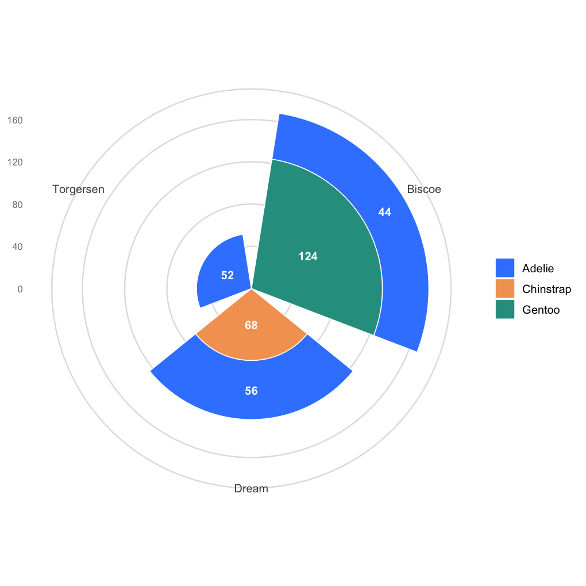

A radial stacked bar plot wraps a stacked bar chart around a circle: each sector is one category, and the composition within the category is stacked **outward along the radius**, so both the total size and the internal proportions read from a single compact shape. It is the radial cousin of the classic stacked bar and the fuller alternative to a plain donut chart, and it earns its space when a dozen or so categories each have several compositional parts (species per island, cell types per sample, variants per lineage). **Read it with care:** all sectors get the same angular width, so the totals are encoded only in the radius, and equal proportions cover very different amounts of ink depending on how far out they sit — the proportional (section 2) form is the honest comparison, exactly as with any pie-family chart. This tutorial reproduces the chart type covered by the *顶刊图社* series (issue 002); see the Reference section below.

## Example

{fig-alt="RadialStackedBar DEMO" fig-align="center" width="65%"}

This radial stacked bar shows how the penguin census is composed at each research island: every sector is one island, the coloured segments are the three species stacked outward, and the numbers inside the segments give the counts — Biscoe is the largest island (168 birds, vs 124 and 52), and the species mix varies strongly from island to island.

## Setup

-   System Requirements: Cross-platform (Linux/MacOS/Windows)

-   Programming Language: R

-   Dependencies: `tidyverse`; `palmerpenguins`

```{r packages setup, message=FALSE, warning=FALSE, output=FALSE}
# Installing necessary packages
if (!requireNamespace("tidyverse", quietly = TRUE)) {
  install.packages("tidyverse")
}
if (!requireNamespace("palmerpenguins", quietly = TRUE)) {
  install.packages("palmerpenguins")
}

# Load packages
library(tidyverse)
library(palmerpenguins)
```

## Data Preparation

The example uses the `penguins` dataset shipped with `palmerpenguins`: the observed birds cross-classified by island and species — exactly the long format a radial stacked bar needs (one row per group × part combination with a count).

```{r load data, message=FALSE}
data("penguins")

island_species <- penguins |>
  count(island, species)

island_species
```

**Note:** any `count()`-style long table works — the two grouping columns define sectors and stacking parts, the third column is the magnitude (counts, percentages, abundances).

## Visualization

### 1. Basic Plot

The whole trick is `coord_polar(theta = "x")`: the ordinary stacked columns become sectors, and the stacking direction becomes the radius. Value labels are placed with `position_stack()`, which positions each label at the centre of its segment.

```{r}
#| label: fig-1.1BasicRadialStacked
#| fig-cap: "Basic radial stacked bar plot"
#| out.width: "85%"
#| warning: false
#| message: false
#| fig-width: 6.8
#| fig-height: 6.8

radial_colors <- c(Adelie = "#3a86ff", Chinstrap = "#f4a261", Gentoo = "#2a9d8f")

ggplot(island_species, aes(x = island, y = n, fill = species)) +
  geom_col(width = .85, colour = "white", linewidth = .35) +
  geom_text(aes(label = n), position = position_stack(vjust = .5),
            colour = "white", fontface = "bold", size = 3.4) +
  coord_polar(theta = "x") +
  scale_fill_manual(values = radial_colors) +
  labs(x = NULL, y = NULL, fill = NULL) +
  theme_minimal(base_size = 12) +
  theme(panel.grid.major.x = element_blank(),
        panel.grid.major.y = element_line(colour = "grey88"),
        axis.text.y = element_text(colour = "grey50", size = 8))
```

::: callout-tip
**Key Parameters: **

- `theta = "x"`: rotates the x axis into the angle; `coord_polar(theta = "y")` instead wraps the *value* axis — keep `"x"` for stacked bars.
- `width = .85`: angular width of each sector; lower it for visible gaps between categories.
- `position_stack(vjust = .5)`: label placement at the middle of each stacked segment.
:::

### 2. Proportions with a Donut Hole

Feeding proportions instead of counts turns the figure into a composition chart; a negative lower limit on the value axis carves the donut hole, whose centre can carry a title.

```{r}
#| label: fig-1.2ProportionRadialStacked
#| fig-cap: "Species proportions per island with a donut hole"
#| out.width: "85%"
#| warning: false
#| message: false
#| fig-width: 6.8
#| fig-height: 6.8

island_props <- island_species |>
  group_by(island) |>
  mutate(frac = n / sum(n)) |>
  ungroup()

ggplot(island_props, aes(x = island, y = frac, fill = species)) +
  geom_col(width = .85, colour = "white", linewidth = .35) +
  geom_text(aes(label = scales::percent(frac, accuracy = 0.1)),
            position = position_stack(vjust = .5),
            colour = "white", fontface = "bold", size = 3.2) +
  coord_polar(theta = "x") +
  scale_y_continuous(labels = scales::percent, limits = c(-0.45, 1)) +
  annotate("text", x = 1, y = -0.45, label = "Species\ncomposition",
           size = 3.6, colour = "grey30", fontface = "bold") +
  scale_fill_manual(values = radial_colors) +
  labs(x = NULL, y = NULL, fill = NULL) +
  theme_minimal(base_size = 12) +
  theme(panel.grid = element_blank(), axis.text = element_blank(),
        axis.title = element_blank())
```

### 3. Sorted Sectors

Reordering the sectors by the share of one focal part (`fct_reorder()`) is the radial equivalent of sorting bars — it puts the comparison of interest in visual order.

```{r}
#| label: fig-1.3SortedRadialStacked
#| fig-cap: "Sectors sorted by the Gentoo share"
#| out.width: "85%"
#| warning: false
#| message: false
#| fig-width: 6.8
#| fig-height: 6.8

island_sorted <- island_props |>
  mutate(island = fct_reorder(island, frac * (species == "Gentoo"), .fun = sum))

ggplot(island_sorted, aes(x = island, y = frac, fill = species)) +
  geom_col(width = .85, colour = "white", linewidth = .35) +
  geom_text(aes(label = scales::percent(frac, accuracy = 0.1)),
            position = position_stack(vjust = .5),
            colour = "white", fontface = "bold", size = 3.2) +
  coord_polar(theta = "x", start = -pi / 3) +
  scale_y_continuous(labels = scales::percent, limits = c(-0.45, 1)) +
  scale_fill_manual(values = radial_colors) +
  labs(x = NULL, y = NULL, fill = NULL) +
  theme_minimal(base_size = 12) +
  theme(panel.grid = element_blank(), axis.text = element_blank(),
        axis.title = element_blank())
```

## Applications

-   **Cross-classified compositions**: species per site, cell types per sample, mutation classes per cohort — anything shaped like a two-way count table.
-   **Compact dashboards**: with ~4-12 sectors the radial form reads at a glance and saves the space of a long stacked bar.
-   **Donut alternative**: a plain donut shows one composition only; the radial stacked bar shows one composition *per sector*.
-   The recipe stays `geom_col()` + `coord_polar()` — every stacked-bar trick (order, labels, groups) carries over unchanged.

## Reference

\[1\] 顶刊图社 | 第002期：径向堆积柱状图. WeChat article. <http://mp.weixin.qq.com/s?__biz=MzU5NjE2ODU0OQ==&mid=2247483770&idx=1&sn=8b284bca4da2552a07d0ed475ce5f5cf>

\[2\] Horst AM, Hill AP, Gorman KB. palmerpenguins: Palmer Archipelago (Antarctica) penguin data. R package version 0.1.0. 2020. doi:10.5281/zenodo.3960218
