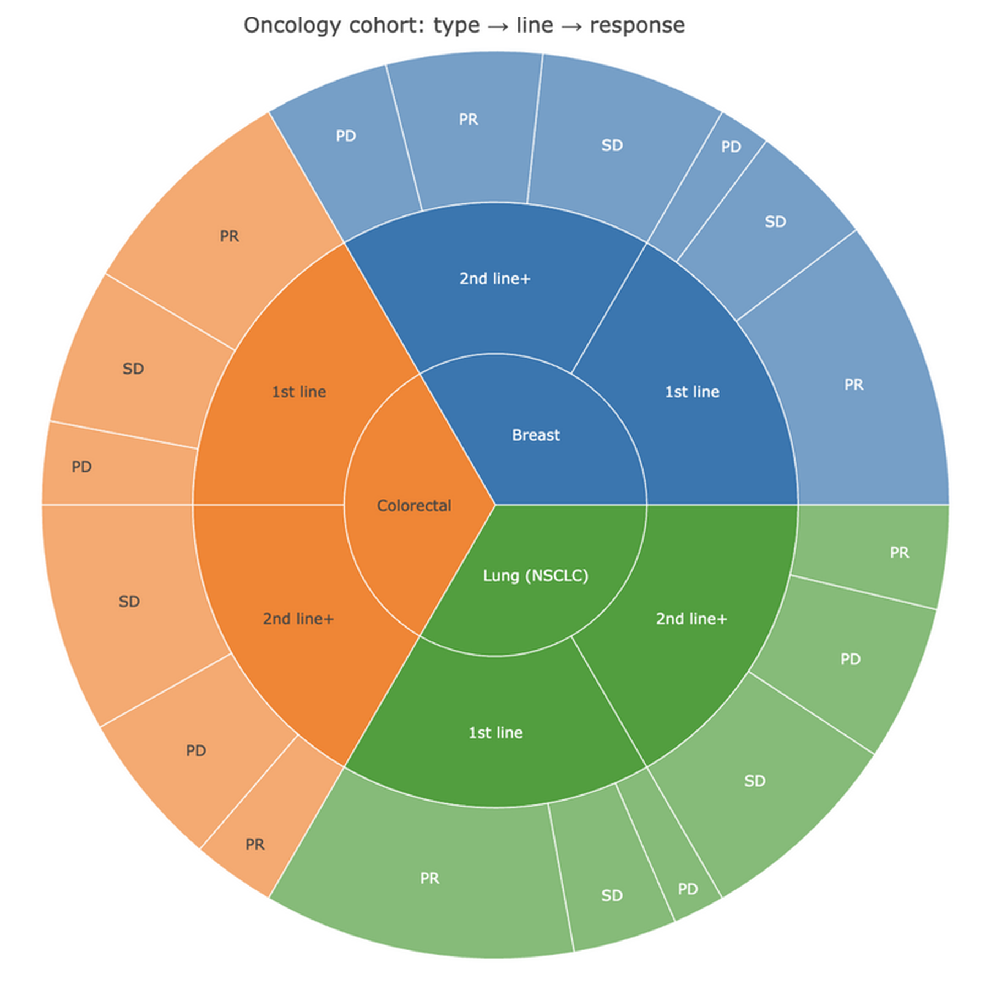
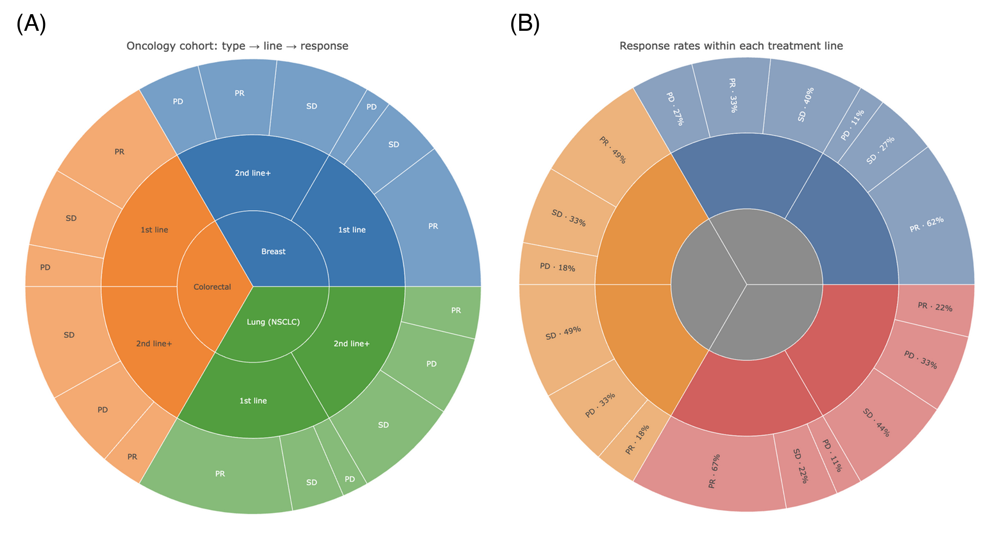

旭日图（sunburst chart）是面向**层次组成**的多层环形图：每一环对应层级结构的一层，角宽与数值（计数、费用）成比例，分段从根到叶径向嵌套 \[1\]。与树图相比它强调层级结构的*层次*；与堆叠饼图相比它让每一层都保持定量且可交互（悬停查看、点击缩放到子树）。临床数据中凡能自然分解的队列都适用——癌种 → 治疗线数 → 疗效，或科室 → 诊断组 → 操作。

本教程用 `plotly` \[2\] 以 `ids`/`labels`/`parents`/`values` 节点表构建旭日图。图形是交互式 HTML 部件，渲染页面支持悬停提示与点击缩放。

本教程涵盖两种工作流：

1. 基础的三层队列旭日图；
2. 带分支配色与悬停文本的彩色变体。

## Example

{fig-alt="Sunburst DEMO" fig-align="center" width="60%"}

## Setup

-   系统要求：跨平台（Linux/MacOS/Windows）

-   编程语言：R

-   依赖包：`plotly`；`dplyr`

```{r packages setup, message=FALSE, warning=FALSE, output=FALSE}
# 加载包
library(plotly)
library(dplyr)
```

```{r}
sessioninfo::session_info("attached")
```

## Data Preparation

我们模拟一个 270 例患者的肿瘤学队列：三个癌种、两条治疗线、三类疗效（PR = 部分缓解，SD = 疾病稳定，PD = 疾病进展）。节点表需要恰好四列：`id`（唯一路径）、`label`、`parent`（根为空）、`value`（叶子计数；使用 `branchvalues = "total"` 时每个父节点的 value 必须等于其子节点之和）。

```{r load data, message=FALSE, warning=FALSE}
set.seed(251)

coh <- data.frame(
  cancer = rep(c("Breast", "Lung (NSCLC)", "Colorectal"), each = 90),
  line   = rep(c("1st line", "2nd line+"), each = 45, times = 3),
  response = c(rep(c("PR", "SD", "PD"), times = c(28, 12, 5)),
               rep(c("PR", "SD", "PD"), times = c(15, 18, 12)),
               rep(c("PR", "SD", "PD"), times = c(30, 10, 5)),
               rep(c("PR", "SD", "PD"), times = c(10, 20, 15)),
               rep(c("PR", "SD", "PD"), times = c(22, 15, 8)),
               rep(c("PR", "SD", "PD"), times = c(8, 22, 15)))
)
cnt <- coh |> count(cancer, line, response, name = "n")

nodes <- bind_rows(
  # 根：每个癌种一个
  data.frame(id = unique(cnt$cancer), label = unique(cnt$cancer), parent = "",
             value = sapply(unique(cnt$cancer), function(x) sum(cnt$n[cnt$cancer == x]))),
  # 第 2 层：治疗线
  cnt |>
    distinct(cancer, line) |>
    mutate(id = paste(cancer, line), label = line, parent = cancer,
           value = sapply(paste(cancer, line), function(x) sum(cnt$n[paste(cnt$cancer, cnt$line) == x]))) |>
    select(id, label, parent, value),
  # 第 3 层：疗效
  cnt |>
    mutate(id = paste(cancer, line, response), label = response,
           parent = paste(cancer, line), value = n) |>
    select(id, label, parent, value)
)

# 父节点 value 必须等于子节点之和（branchvalues = "total"）
stopifnot(all(sapply(unique(nodes$parent[nodes$parent != ""]),
                     function(p) sum(nodes$value[nodes$parent == p]) ==
                       nodes$value[nodes$id == p])))
```

## Visualization

### 1. 基础队列旭日图

```{r}
#| label: fig-1.1Sunburst
#| fig-cap: "肿瘤学队列的三层旭日图：内环 = 癌种，中层 = 治疗线，外环 = 疗效。悬停显示计数；点击分段可缩放到其子树。"
#| out.width: "80%"
#| warning: false
#| message: false

fig1 <- plot_ly(
  type = "sunburst",
  ids = nodes$id, labels = nodes$label,
  parents = nodes$parent, values = nodes$value,
  branchvalues = "total",
  hovertemplate = "%{id}<br>n = %{value}<extra></extra>"
) |>
  layout(title = "Oncology cohort: type → line → response")
fig1
```

### 2. 彩色旭日图

```{r}
#| label: fig-2.1SunburstColored
#| fig-cap: "同一层级的分支配色版本，颜色沿树继承；疗效分段悬停显示其在父分支内的缓解率。"
#| out.width: "80%"
#| warning: false
#| message: false

cols <- setNames(c("#4E79A7", "#F28E2B", "#E15759"), unique(cnt$cancer))

resp_rate <- cnt |>
  group_by(cancer, line) |>
  mutate(rate = scales::percent(n / sum(n), accuracy = 1)) |>
  ungroup()
lbls <- resp_rate |>
  mutate(id = paste(cancer, line, response),
         label = paste0(response, " · ", rate))

fig2 <- plot_ly(
  type = "sunburst",
  ids = nodes$id, labels = lbls$label[match(nodes$id, lbls$id)],
  parents = nodes$parent, values = nodes$value,
  branchvalues = "total",
  marker = list(colors = ifelse(nodes$parent == "", "#8C8C8C",
                                cols[substr(nodes$parent, 1, nchar(nodes$parent))])),
  textinfo = "label",
  insidetextorientation = "radial",
  hovertemplate = "%{id}<br>n = %{value}<extra></extra>"
) |>
  layout(title = "Response rates within each treatment line")
fig2
```

::: callout-tip
## 实践要点

-   `branchvalues = "total"` 下父节点 `value` 必须等于子节点之和——请程序化验证节点表（见 Data Preparation），否则 plotly 会画出重叠的扇形。或用 `branchvalues = "remainder"`，父节点只填自身值。
-   `id` 用唯一的完整路径（`paste(parent, child)`）——重复的 id 会静默合并子树。
-   超过约 3 层或约 30 个叶子时旭日图就难以阅读；先把稀有类别折叠为 "Other" 分段。
-   用于印刷的静态导出需要对部件截图——`webshot2` 包或浏览器截图；悬停交互是网页版的优势。
:::

## Application

旭日图用于队列组成（注册研究论文）、费用分解（诊断 → 操作）与物种丰度（宏基因组：门 → 属 → 种）。下图模拟典型论文版式：(A) 完整层级图，(B) 缓解率变体。

{fig-alt="Sunburst Application" fig-align="center" width="60%"}

## Reference

\[1\] Data-to-Viz. Sunburst. https://www.data-to-viz.com/graph/sunburst.html

\[2\] Sievert C. Interactive Web-Based Data Visualization with R, plotly, and shiny. Chapman and Hall/CRC; 2020. doi:10.1201/9780429447273
