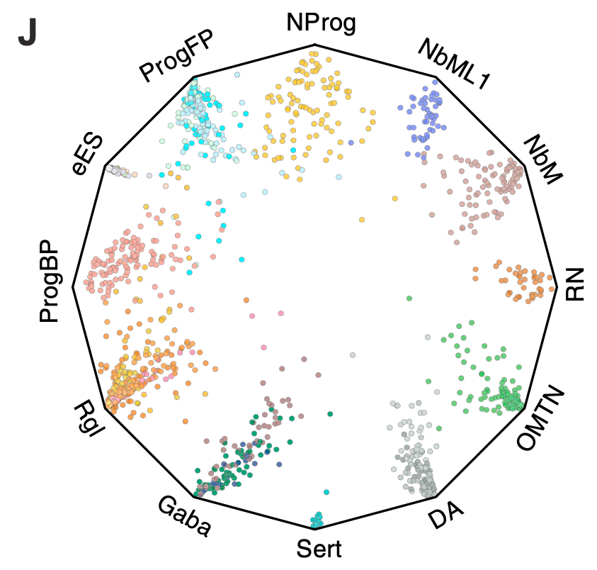

When displaying proportional composition or multi-group hierarchical categories in a compact circular format, a **wheel chart** (circular bar chart or sunburst variant) maps wedge sizes to category proportions using polar coordinates \[1\]. Here, a 30-category hierarchical taxonomy is simulated and rendered as a circular bar plot with ggplot2 `coord_polar`:

## Example

{fig-alt="Circular Proportional Wheel Chart DEMO" fig-align="center" width="75%"}

## Setup

-   System Requirements: Cross-platform (Linux/MacOS/Windows)

-   Programming language: R

-   Dependent packages: `ggplot2`; `dplyr`

```{r packages setup, message=FALSE, warning=FALSE, output=FALSE}
suppressPackageStartupMessages({
  library(ggplot2); library(dplyr)
})
```

```{r}
sessioninfo::session_info("attached")
```

## Data Preparation

30 compositional categories nested under 4 main domains (Immune, Stromal, Epithelial, Other), with simulated percentage proportions summing to 100%. Categories are sorted for a clean wheel layout:

```{r load data}
suppressPackageStartupMessages({library(ggplot2); library(dplyr)})
set.seed(47281)
n_cat <- 30
domains <- rep(c("Immune", "Stromal", "Epithelial", "Other"), c(9, 7, 8, 6))
cats <- sprintf("Cat%02d", 1:n_cat)
vals <- runif(n_cat, 2, 15)
vals <- vals / sum(vals) * 100

wheel_df <- data.frame(
  category = factor(cats, levels = cats),
  domain = domains,
  value = vals
)
wheel_df <- wheel_df %>% arrange(domain, desc(value))
wheel_df$id <- seq_len(nrow(wheel_df))
```

## Visualization

### 1. Circular Bar Chart (Wheel Chart)

Bars in polar coordinates, coloured by domain, with category labels aligned radially:

```{r}
#| label: fig-1.1WheelChart
#| fig-cap: "Circular proportional wheel chart representing 30 compositional categories grouped into 4 domains: wedge height encodes percentage proportion, coloured by domain."
#| out.width: "85%"
#| fig-width: 8
#| fig-height: 8

ggplot(wheel_df, aes(x = reorder(category, id), y = value, fill = domain)) +
  geom_col(width = 0.85, colour = "white", linewidth = 0.3) +
  coord_polar(start = 0) +
  scale_fill_brewer(palette = "Set2", name = "Domain") +
  labs(x = NULL, y = NULL) +
  theme_minimal(base_size = 11) +
  theme(axis.text.y = element_blank(),
        axis.ticks = element_blank(),
        panel.grid = element_blank(),
        legend.position = "right")
```

::: callout-tip
**Practice tips**
-   Order categories by domain and value to prevent visual fragmentation in polar coordinates.
-   Use qualitative palettes (`RColorBrewer::brewer.pal`) for domain grouping.
-   Remove background grid lines and y-axis text to maintain a clean circular aesthetic.
-   Keep category labels concise when displaying more than 20 wedges.
-   Ensure wedge heights sum to 100% or total proportional values correctly.
:::

## Application

::: {#fig-WheelChartApplications1}
{fig-alt="Circular Proportional Wheel Chart" fig-align="center" width="75%"}

Circular proportional wheel chart
:::

Wheel charts apply to any hierarchical proportion breakdown: cell-type lineage trees, functional gene ontology proportions, or budget allocations across domains.

## Reference

\[1\] Xiaofan Lu, et al. Festival of Standardized Biomedical Visualizations: Circular Wheel Chart. iMetaMed. 2025. doi:10.1002/imm3.70005
