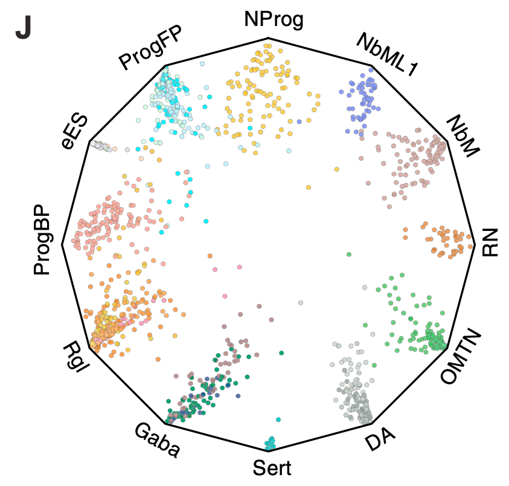

当以紧凑的环形格式展示比例组成或多组分层类别时，**轮盘图**（圆形条形图或旭日图变体）使用极坐标将扇区大小映射到类别比例 \[\1\]。此处模拟 30 个类别的分层分类法，并用 ggplot2 `coord_polar` 渲染为圆形条形图：

## Example

{fig-alt="环形比例轮盘图 DEMO" fig-align="center" width="60%"}

## Setup

-   系统要求：跨平台（Linux/MacOS/Windows）

-   编程语言：R

-   依赖包：`ggplot2`; `dplyr`

```{r packages setup, message=FALSE, warning=FALSE, output=FALSE}
suppressPackageStartupMessages({
  library(ggplot2); library(dplyr)
})
```

```{r}
sessioninfo::session_info("attached")
```

## 数据准备

嵌套在 4 个主要结构域（免疫、基质、上皮、其他）下的 30 个组成类别，模拟百分比比例加和为 100%。类别已排序以供清洁的轮盘布局：

```{r load data}
suppressPackageStartupMessages({library(ggplot2); library(dplyr)})
set.seed(47281)
n_cat <- 30
domains <- rep(c("Immune", "Stromal", "Epithelial", "Other"), c(9, 7, 8, 6))
cats <- sprintf("Cat%02d", 1:n_cat)
vals <- runif(n_cat, 2, 15)
vals <- vals / sum(vals) * 100

wheel_df <- data.frame(
  category = factor(cats, levels = cats),
  domain = domains,
  value = vals
)
wheel_df <- wheel_df %>% arrange(domain, desc(value))
wheel_df$id <- seq_len(nrow(wheel_df))
```

## Visualization

### 圆形条形图（轮盘图）

极坐标中的条形、按结构域着色、类别标签径向对齐：

```{r}
#| label: fig-1.1WheelChart
#| fig-cap: "代表分组到 4 个结构域中的 30 个组成类别的圆形比例轮盘图：扇区高度编码百分比比例、按结构域着色。"
#| out.width: "85%"
#| fig-width: 8
#| fig-height: 8

ggplot(wheel_df, aes(x = reorder(category, id), y = value, fill = domain)) +
  geom_col(width = 0.85, colour = "white", linewidth = 0.3) +
  coord_polar(start = 0) +
  scale_fill_brewer(palette = "Set2", name = "Domain") +
  labs(x = NULL, y = NULL) +
  theme_minimal(base_size = 11) +
  theme(axis.text.y = element_blank(),
        axis.ticks = element_blank(),
        panel.grid = element_blank(),
        legend.position = "right")
```


## 应用场景

::: {{#fig-WheelChartApplications1}}
{fig-alt="环形比例轮盘图" fig-align="center" width="60%"}

环形比例轮盘图
:::

轮盘图适用于任何分层比例分解：细胞类型世系树、功能基因本体比例、或跨结构域预算分配。

## 参考文献

\[1\] Xiaofan Lu, et al. Festival of Standardized Biomedical Visualizations: Circular Wheel Chart. iMetaMed. 2025. doi:10.1002/imm3.70005
