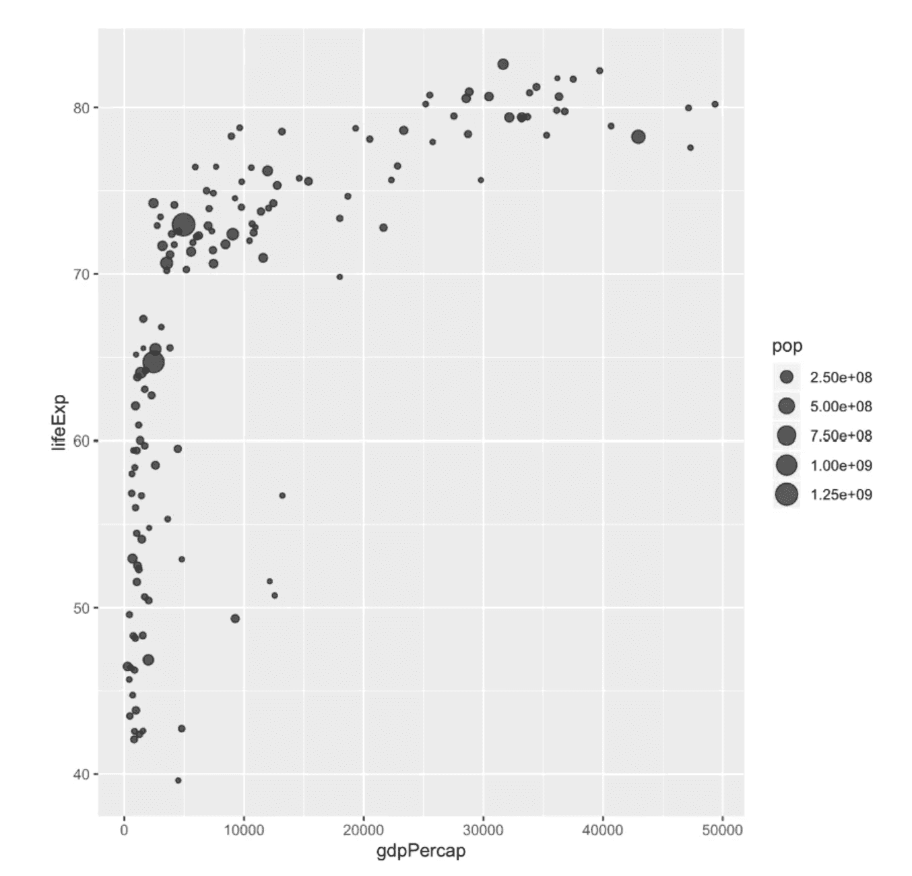
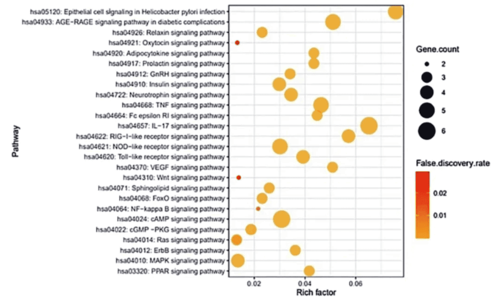
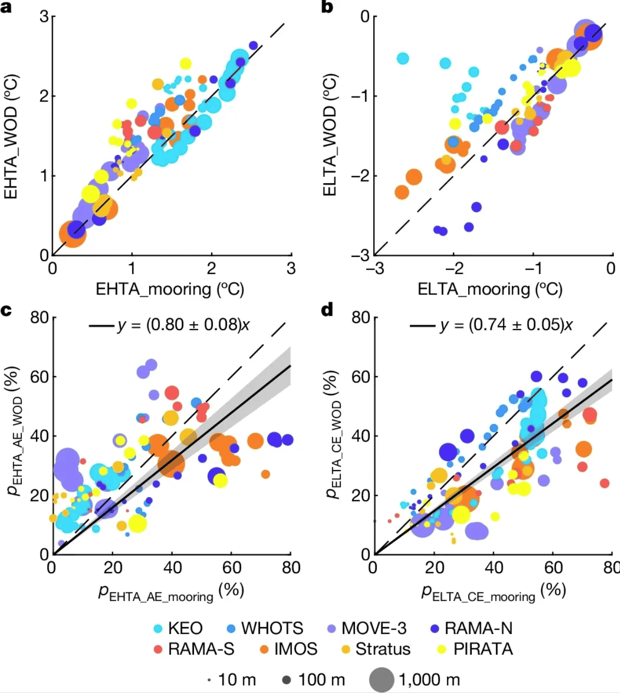

A bubble plot is a scatter plot in which a third numeric variable is mapped to the size of the circles. This article shows several ways to build bubble charts using R.

## Example

{fig-alt="Bubble Plot DEMO" fig-align="center" width="60%"}

## Setup

-   System Requirements: Cross-platform (Linux/MacOS/Windows)

-   Programming Language: R

-   Dependencies: `dplyr`, `ggplot2`, `gapminder`, `hrbrthemes`, `viridis`, `cowplot`

```{r packages setup, message=FALSE, warning=FALSE, output=FALSE}
# Install packages
if (!requireNamespace("dplyr", quietly = TRUE)) {
  install.packages("dplyr")
}
if (!requireNamespace("ggplot2", quietly = TRUE)) {
  install.packages("ggplot2")
}
if (!requireNamespace("gapminder", quietly = TRUE)) {
  install.packages("gapminder")
}
if (!requireNamespace("hrbrthemes", quietly = TRUE)) {
  install.packages("hrbrthemes")
}
if (!requireNamespace("viridis", quietly = TRUE)) {
  install.packages("viridis")
}
if (!requireNamespace("cowplot", quietly = TRUE)) {
  install.packages("cowplot")
}

# Load packages
library(dplyr)
library(ggplot2)
library(gapminder) # is an R package that provides a summary of data from Gapminder.org. The data includes life expectancy, GDP per capita, and population data for 142 countries every five years from 1952 to 2007.
library(hrbrthemes)
library(viridis)
library(cowplot)
```

```{r}
sessioninfo::session_info("attached")
```

## Data Preparation

Use R built-in `iris` dataset, TCGA database and `gapminder` built-in dataset.

```{r load data}
#| message: false

# R built-in data - iris
head(iris)

# TCGA database (using clinical data on lung cancer in 2020)
TCGA_clinic <- readr::read_tsv("https://bizard-1301043367.cos.ap-guangzhou.myqcloud.com/raponi2006_public_raponi2006_public_clinicalMatrix.gz")
TCGA_clinic$T <- as.factor(TCGA_clinic$T)

# gapminder package
data <- gapminder %>% 
  filter(year=="2007") %>% 
  dplyr::select(-year)
```

## Visualization

### 1. Basic Plot

```{r}
#| label: fig-BasicPlot
#| fig-cap: "Basic Plot"
#| out.width: "95%"
#| warning: false

# Taking iris data as an example
p <- ggplot(iris, aes(x=Sepal.Length, y=Sepal.Width, size = Species)) +
  geom_point(alpha=0.4)

p
```

This bubble plot depicts the relationship between the `Sepal.Length` and `Sepal.Width` variables across `species`.

### 2. Change Color

```{r}
#| label: fig-ChangeColor
#| fig-cap: "Change Color"
#| out.width: "95%"
#| warning: false

# Change Color
p <- ggplot(iris, aes(x=Sepal.Length, y=Sepal.Width, size=Species,color=Species)) +
  geom_point(alpha=0.3)

p
```

This bubble plot depicts the relationship between the `Sepal.Length` and `Sepal.Width` variables across `species`.

### 3. Change the range of bubble size

```{r}
#| label: fig-ChangeSize
#| fig-cap: "Change the range of bubble size"
#| out.width: "95%"
#| warning: false

# Taking TCGA data as an example
p <- TCGA_clinic %>%
  arrange(desc(Age)) %>%
  ggplot(aes(x=T, y=OS.time, size = Age,color=Age)) +
  geom_point(alpha=0.4) +
  scale_size(range = c(.1, 12), name="Age")

p
```

This bubble plot depicts the relationship between age and OS.time variable in different tumor T stages.

### 4. Refined Plot

```{r}
#| label: fig-RefinedFig
#| fig-cap: "Refined Plot"
#| out.width: "95%"
#| warning: false

# Take the data in the gapminder package as an example
p <- data %>%
  arrange(desc(pop)) %>%
  mutate(country = factor(country, country)) %>%
  ggplot(aes(x=gdpPercap, y=lifeExp, size=pop, fill=continent)) +
  geom_point(alpha=0.5, shape=21, color="black") +
  scale_size(range = c(.1, 24), name="Population (M)") +
  scale_fill_viridis(discrete=TRUE, guide=FALSE, option="A") +
  theme_ipsum() +
  theme(legend.position="bottom") +
  ylab("Life Expectancy") +
  xlab("Gdp per Capita") +
  theme(legend.position = "none")

p
```

This bubble plot depicts the relationship between life expectancy (y) and GDP per capita (x) for countries around the world.

### 5. Enrichment Bubble Panels Arranged Diagonally

A gene-set enrichment staple \[8\]: one bubble per pathway with `GeneRatio` on x, bubble size for the gene count, colour for the P value — and the terms **ordered by GeneRatio** so the bubbles climb diagonally. Down- and up-regulated directions are drawn as mirror panels (right panel flips the term axis to the right with `scale_y_discrete(position = "right")`) and combined side by side.

```{r}
#| label: fig-5.1EnrichDiagonal
#| fig-cap: "Down/up enrichment bubble panels; terms ordered by GeneRatio produce the diagonal arrangement, directions combined with cowplot."
#| out.width: "95%"
#| warning: false
#| message: false
#| fig-width: 13
#| fig-height: 5

set.seed(11)
mk_enrich <- function(prefix, n) {
  data.frame(
    Term = sprintf("%s pathway %d", prefix, 1:n),
    PValue = 10^(-runif(n, 1.3, 6)),
    Count = sample(5:60, n),
    Pop.Hits = sample(80:200, n)
  )
}
enrich <- rbind(cbind(direction = "Down", mk_enrich("Down", 8)),
                cbind(direction = "Up",   mk_enrich("Up", 8)))
enrich$GeneRatio <- enrich$Pop.Hits / enrich$Count

enrich_bubble <- function(dat, legend_pos, term_side = "left") {
  dat <- dat[order(dat$GeneRatio), ]
  dat$Term <- factor(dat$Term, levels = dat$Term)      # keep the sorted order
  p <- ggplot(dat, aes(GeneRatio, Term, colour = PValue)) +
    geom_point(aes(size = Count)) +
    scale_size_continuous(range = c(2, 10)) +
    scale_color_gradientn(colours = c("red", "yellow")) +
    theme_bw(base_size = 11) +
    ylab(NULL) +
    theme(legend.position = legend_pos, legend.justification = legend_pos,
          legend.background = element_blank(), legend.key = element_blank())
  if (term_side == "right") p <- p + scale_y_discrete(position = "right")
  p
}

p_down <- enrich_bubble(subset(enrich, direction == "Down"), c(1, 0))
p_up   <- enrich_bubble(subset(enrich, direction == "Up"),   c(0, 0), term_side = "right")

plot_grid(p_down, p_up, labels = c("Down-regulated", "Up-regulated"),
          label_x = 0.02, hjust = 0)
```

::: callout-tip
**Practice tips**

- The diagonal is nothing more than **sorting rows by the x value** before converting `Term` to a factor — sort descending to reverse the slope.
- `legend.position` / `legend.justification` with the same coordinate pair pins the legend to a corner (`c(1, 0)` bottom-right, `c(0, 0)` bottom-left); the transparent background lets it sit inside the plot.
- Any enrichment table works as input as long as it carries a ratio column, a gene-count column and a P value column — swap which one drives x, size or colour to taste.
:::

## Applications

### 1. Bubble plots are used to display KEGG pathway enrichment analysis

::: {#fig-BubblePlotApplications}
{fig-alt="BubblePlotApp1" fig-align="center" width="60%"}

Applications of Bubble Plot
:::

This bubble plot shows 26 signaling pathways associated with the development and progression of COVID-19. \[1\]

### 2. Bubble plot can be used to display multivariate data

::: {#fig-BubblePlotApplications}
{fig-alt="BubblePlotApp2" fig-align="center" width="60%"}

Applications of Bubble Plot
:::

This bubble plot demonstrates the agreement between extreme temperature anomalies estimated from mooring observations and historical temperature profile measurements. a. Bubble plot of the 95th percentile EHTA estimated from a mooring site and the corresponding historical temperature distribution measurements within a 5×5° grid box centered at the mooring site. Colors indicate observations from different locations, and dot size indicates observation depths from 10 to 1000 meters. b. Same as a, but for the 5th percentile ELTA. Note that ELTAs below -3°C (at the KEO site) are not plotted. c, d. Same as a(c) and b(d), but with different percentages (p) of EHTA measurements observed within AE (c) and ELTA measurements observed within CE (d). The solid black line with gray shading represents the corresponding linear regression with a 95% confidence level. \[2\]

## Reference

\[1\] Oh KK, Adnan M, Cho DH. Network pharmacology approach to decipher signaling pathways associated with target proteins of NSAIDs against COVID-19. Sci Rep. 2021 May 5;11(1):9606. doi: 10.1038/s41598-021-88313-5. PMID: 33953223; PMCID: PMC8100301.

\[2\] He Q, Zhan W, Feng M, Gong Y, Cai S, Zhan H. Common occurrences of subsurface heatwaves and cold spells in ocean eddies. Nature. 2024 Oct;634(8036):1111-1117. doi: 10.1038/s41586-024-08051-2. Epub 2024 Oct 16. PMID: 39415017; PMCID: PMC11525169.

\[3\] Wickham, H. (2016). ggplot2: Elegant Graphics for Data Analysis. Springer-Verlag New York. https://ggplot2.tidyverse.org

\[4\] Bryan, J. (2023). gapminder: Data from Gapminder (Version 1.0.0). Retrieved from https://CRAN.R-project.org/package=gapminder

\[5\] Wickham, H. (2017). dplyr: A Grammar of Data Manipulation (Version 0.7.4). Retrieved from https://CRAN.R-project.org/package=dplyr

\[6\] Rudis, B. (2017). hrbrthemes: Additional Themes, Theme Components and Utilities for 'ggplot2' (Version 0.8.7). Retrieved from https://github.com/hrbrmstr/hrbrthemes

\[7\] Ross, N., & Garnier, S. (2016). viridis: Default Color Maps for 'ggplot2'. Retrieved from https://cran.r-project.org/web/packages/viridis/index.html


\[8\] Xiaofan Lu, et al. FigureYa: A Standardized Visualization Framework for Enhancing Biomedical Data Interpretation and Research Efficiency. iMetaMed. 2025. doi:10.1002/imm3.70005
