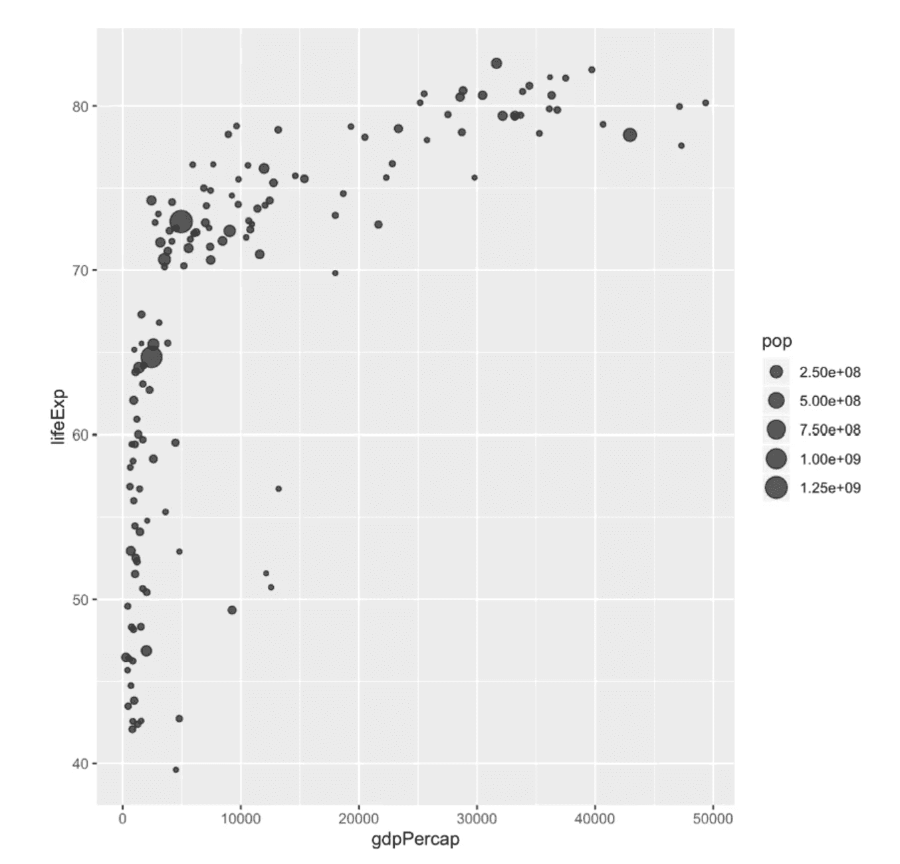
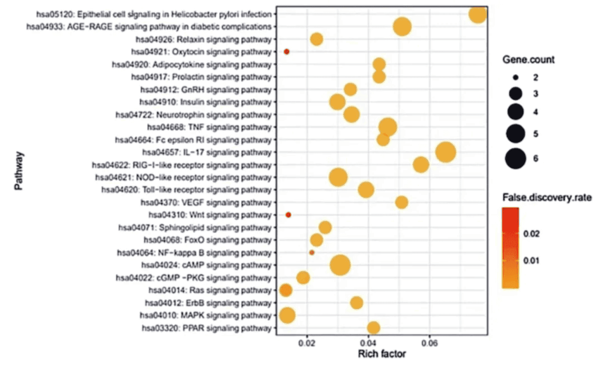
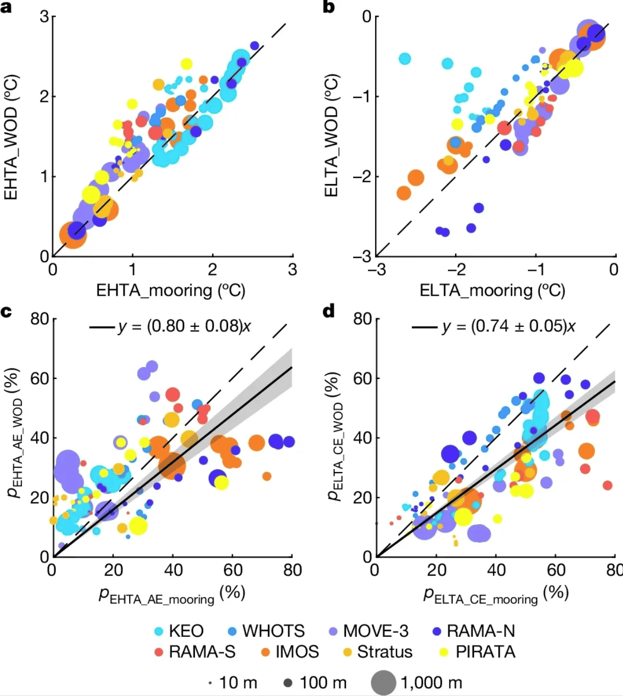

气泡图是一种散点图，其中第三个数值变量映射到圆圈大小。本文介绍了使用 R 构建气泡图的几种方法。

## 示例

{fig-alt="Bubble Plot DEMO" fig-align="center" width="60%"}

## 环境配置

-   系统要求： 跨平台（Linux/MacOS/Windows）

-   编程语言：R

-   依赖包：`dplyr`, `ggplot2`, `gapminder`, `hrbrthemes`, `viridis`, `cowplot`

```{r packages setup, message=FALSE, warning=FALSE, output=FALSE}
# 安装包
if (!requireNamespace("dplyr", quietly = TRUE)) {
  install.packages("dplyr")
}
if (!requireNamespace("ggplot2", quietly = TRUE)) {
  install.packages("ggplot2")
}
if (!requireNamespace("gapminder", quietly = TRUE)) {
  install.packages("gapminder")
}
if (!requireNamespace("hrbrthemes", quietly = TRUE)) {
  install.packages("hrbrthemes")
}
if (!requireNamespace("viridis", quietly = TRUE)) {
  install.packages("viridis")
}
if (!requireNamespace("cowplot", quietly = TRUE)) {
  install.packages("cowplot")
}

# 加载包
library(dplyr)
library(ggplot2)
library(gapminder) # 是一个 R 语言的数据包，它提供了来自 Gapminder.org 的数据摘要。这些数据包括了 142 个国家从 1952 年到 2007 年每五年的生命期望值、人均 GDP 和人口数据。
library(hrbrthemes)
library(viridis)
library(cowplot)
```

```{r}
sessioninfo::session_info("attached")
```

## 数据准备

主要运用 R 内置的 `iris` 数据集，TCGA 数据库和 `gapminder` 内置数据集。

```{r load data}
#| message: false

# R内置的data——iris
head(iris)

# TCGA数据库(运用2020年肺癌的临床数据)
TCGA_clinic <- readr::read_tsv("https://bizard-1301043367.cos.ap-guangzhou.myqcloud.com/raponi2006_public_raponi2006_public_clinicalMatrix.gz")
TCGA_clinic$T <- as.factor(TCGA_clinic$T)

# gapminder包
data <- gapminder %>% 
  filter(year=="2007") %>% 
  dplyr::select(-year)
```

## 可视化

### 1. 基本绘图

```{r}
#| label: fig-BasicPlot
#| fig-cap: "基本绘图"
#| out.width: "95%"
#| warning: false

# 以iris数据为例
p <- ggplot(iris, aes(x=Sepal.Length, y=Sepal.Width, size = Species)) +
  geom_point(alpha=0.4)

p
```

这个气泡图描述了不同物种间`Sepal.Length`变量与`Sepal.Width`变量之间的关系。

### 2. 改变颜色

```{r}
#| label: fig-ChangeColor
#| fig-cap: "改变颜色"
#| out.width: "95%"
#| warning: false

# 改变颜色
p <- ggplot(iris, aes(x=Sepal.Length, y=Sepal.Width, size=Species,color=Species)) +
  geom_point(alpha=0.3)

p
```

这个气泡图描述了不同物种间`Sepal.Length`变量`与`Sepal.Width`变量之间的关系。

### 3. 改变圆圈大小的范围

```{r}
#| label: fig-ChangeSize
#| fig-cap: "改变圆圈大小的范围"
#| out.width: "95%"
#| warning: false

# 以TCGA数据为例
p <- TCGA_clinic %>%
  arrange(desc(Age)) %>%
  ggplot(aes(x=T, y=OS.time, size = Age,color=Age)) +
  geom_point(alpha=0.4) +
  scale_size(range = c(.1, 12), name="Age")

p
```

这个气泡图描述了不同肿瘤T分期中年龄与OS.time变量的关系。

### 4. 精细化图片

```{r}
#| label: fig-RefinedFig
#| fig-cap: "精细化图片"
#| out.width: "95%"
#| warning: false

# 以gapminder包里面的数据为例
p <- data %>%
  arrange(desc(pop)) %>%
  mutate(country = factor(country, country)) %>%
  ggplot(aes(x=gdpPercap, y=lifeExp, size=pop, fill=continent)) +
  geom_point(alpha=0.5, shape=21, color="black") +
  scale_size(range = c(.1, 24), name="Population (M)") +
  scale_fill_viridis(discrete=TRUE, guide=FALSE, option="A") +
  theme_ipsum() +
  theme(legend.position="bottom") +
  ylab("Life Expectancy") +
  xlab("Gdp per Capita") +
  theme(legend.position = "none")

p
```

这个气泡图描述了世界各国预期寿命（y）与人均国内生产总值（x）之间的关系。
### 5. 对角线排列的富集气泡双面板

基因集富集分析的经典画法 \[8\]：每个通路一个气泡，`GeneRatio` 为横坐标、气泡大小为基因数、颜色为 P 值——并**按 GeneRatio 排序**通路，让气泡沿对角线爬升。下调/上调两个方向画成镜像面板（右面板用 `scale_y_discrete(position = "right")` 把通路轴翻到右侧），再并排组合。

```{r}
#| label: fig-5.1EnrichDiagonal
#| fig-cap: "下调/上调富集气泡面板；通路按 GeneRatio 排序形成对角线排列，cowplot 组合方向。"
#| out.width: "95%"
#| warning: false
#| message: false
#| fig-width: 13
#| fig-height: 5

set.seed(11)
mk_enrich <- function(prefix, n) {
  data.frame(
    Term = sprintf("%s pathway %d", prefix, 1:n),
    PValue = 10^(-runif(n, 1.3, 6)),
    Count = sample(5:60, n),
    Pop.Hits = sample(80:200, n)
  )
}
enrich <- rbind(cbind(direction = "Down", mk_enrich("Down", 8)),
                cbind(direction = "Up",   mk_enrich("Up", 8)))
enrich$GeneRatio <- enrich$Pop.Hits / enrich$Count

enrich_bubble <- function(dat, legend_pos, term_side = "left") {
  dat <- dat[order(dat$GeneRatio), ]
  dat$Term <- factor(dat$Term, levels = dat$Term)      # 保持排序
  p <- ggplot(dat, aes(GeneRatio, Term, colour = PValue)) +
    geom_point(aes(size = Count)) +
    scale_size_continuous(range = c(2, 10)) +
    scale_color_gradientn(colours = c("red", "yellow")) +
    theme_bw(base_size = 11) +
    ylab(NULL) +
    theme(legend.position = legend_pos, legend.justification = legend_pos,
          legend.background = element_blank(), legend.key = element_blank())
  if (term_side == "right") p <- p + scale_y_discrete(position = "right")
  p
}

p_down <- enrich_bubble(subset(enrich, direction == "Down"), "bottom")
p_up   <- enrich_bubble(subset(enrich, direction == "Up"),   "bottom", term_side = "right")

plot_grid(p_down, p_up, labels = c("Down-regulated", "Up-regulated"),
          label_x = 0.02, hjust = 0)
```

::: callout-tip
**实践要点**

- 对角线排列不过是**先把行按 x 值排序再转因子**——改成降序即可反转斜率方向。
- 图例**永远放在数据区外**（`legend.position = "bottom"`）：点稀疏时面板内角落的图例会直接压在气泡上，恰好遮住对角线要展示的点。
- 输入只需包含倍数比列、基因数列和 P 值列的任意富集表——x、大小或颜色由哪列驱动可以自由替换。
:::

## 应用场景

### 1. 气泡图用于展示KEGG通路富集分析

::: {#fig-BubblePlotApplications}
{fig-alt="BubblePlotApp1" fig-align="center" width="60%"}

气泡图应用
:::

这个气泡图展示了与新冠肺炎发生和进展相关的26种信号通路。\[1\]

### 2. 气泡图可用于多变量数据展示

::: {#fig-BubblePlotApplications}
{fig-alt="BubblePlotApp2" fig-align="center" width="60%"}

气泡图应用
:::

这个气泡图展示了根据系泊观测和历史温度剖面测量估计的极端温度异常之间的一致性。a、 根据系泊点估算的第95百分位EHTA气泡图和以系泊点为中心的5×5°网格框内的相应历史温度分布测量值。颜色表示来自不同地点的观测结果，点的大小表示10至1000米的观测深度。b与a相同，但适用于第5百分位ELTA。请注意，未绘制低于-3°C的ELTA（在KEO现场）。c、 d，与a（c）和b（d）相同，但AE（c）内观察到的EHTA测量值和CE（d）内观察的ELTA测量值的百分比（p）不同。带有灰色阴影的实心黑线表示具有95%置信水平的相应线性回归。\[2\]

## 参考文献

\[1\] Oh KK, Adnan M, Cho DH. Network pharmacology approach to decipher signaling pathways associated with target proteins of NSAIDs against COVID-19. Sci Rep. 2021 May 5;11(1):9606. doi: 10.1038/s41598-021-88313-5. PMID: 33953223; PMCID: PMC8100301.

\[2\] He Q, Zhan W, Feng M, Gong Y, Cai S, Zhan H. Common occurrences of subsurface heatwaves and cold spells in ocean eddies. Nature. 2024 Oct;634(8036):1111-1117. doi: 10.1038/s41586-024-08051-2. Epub 2024 Oct 16. PMID: 39415017; PMCID: PMC11525169.

\[3\] Wickham, H. (2016). ggplot2: Elegant Graphics for Data Analysis. Springer-Verlag New York. https://ggplot2.tidyverse.org

\[4\] Bryan, J. (2023). gapminder: Data from Gapminder (Version 1.0.0). Retrieved from https://CRAN.R-project.org/package=gapminder

\[5\] Wickham, H. (2017). dplyr: A Grammar of Data Manipulation (Version 0.7.4). Retrieved from https://CRAN.R-project.org/package=dplyr

\[6\] Rudis, B. (2017). hrbrthemes: Additional Themes, Theme Components and Utilities for 'ggplot2' (Version 0.8.7). Retrieved from https://github.com/hrbrmstr/hrbrthemes

\[7\] Ross, N., & Garnier, S. (2016). viridis: Default Color Maps for 'ggplot2'. Retrieved from https://cran.r-project.org/web/packages/viridis/index.html

\[8\] Xiaofan Lu, et al. FigureYa: A Standardized Visualization Framework for Enhancing Biomedical Data Interpretation and Research Efficiency. iMetaMed. 2025. doi:10.1002/imm3.70005

