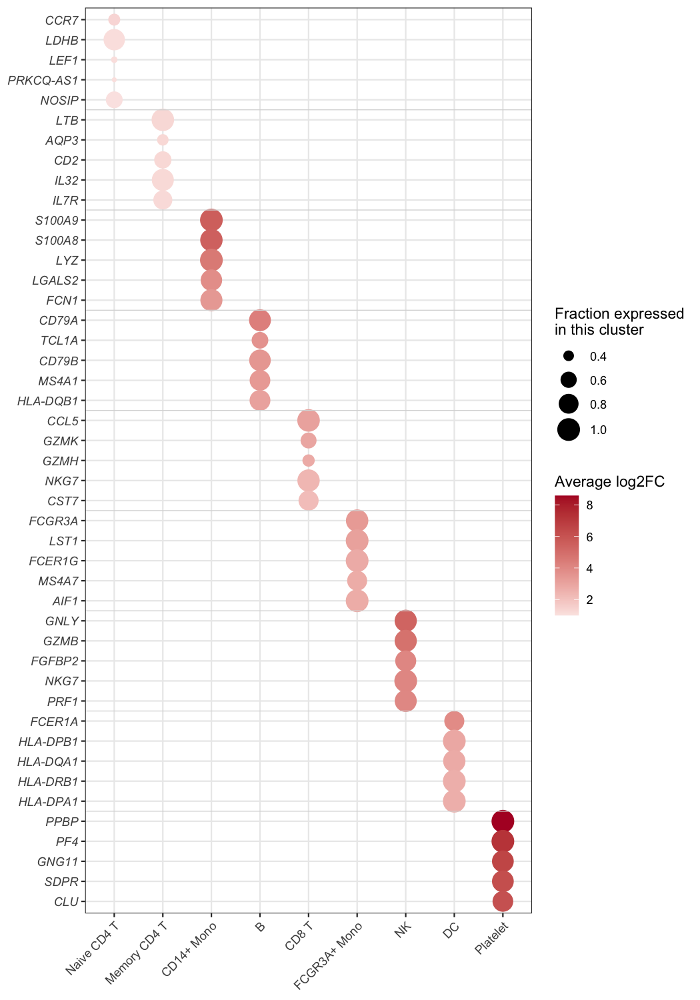

A bubble heatmap keeps the grid of a heatmap but replaces each colored cell with a bubble that can encode **two variables at once**: the bubble's size carries one value (e.g. the fraction of cells expressing a gene) and its color carries another (e.g. the effect size or the significance). The result is the reference layout of single-cell marker dot plots and of pathway-enrichment matrices, where one glance reveals both how widespread and how strong each association is. This tutorial reproduces the chart type covered by the *顶刊图社* series (issue 013); see the Reference section below.

## Example

{fig-alt="BubbleHeatmap DEMO" fig-align="center" width="75%"}

This bubble heatmap summarises the marker genes of the PBMC dataset: the top-5 markers of each of the nine cell clusters (45 marker rows — 44 unique genes, since `NKG7` marks both CD8 T and NK cells — grouped into blocks of five by the faint separators) are plotted against the clusters. Bubble size is the fraction of cells of that cluster that express the gene (`pct.1`), and colour is the average log2 fold change of the gene against all remaining cells — the strongest marker of each cluster glows dark red in its own column, forming the diagonal.

## Setup

-   System Requirements: Cross-platform (Linux/MacOS/Windows)

-   Programming Language: R

-   Dependencies: `tidyverse`; `scRNAtoolVis`

```{r packages setup, message=FALSE, warning=FALSE, output=FALSE}
# Installing necessary packages
if (!requireNamespace("tidyverse", quietly = TRUE)) {
  install.packages("tidyverse")
}
if (!requireNamespace("scRNAtoolVis", quietly = TRUE)) {
  remotes::install_github("junjunlab/scRNAtoolVis")
}

# Load packages
library(tidyverse)
library(scRNAtoolVis)
```

## Data Preparation

The example uses `pbmc.markers`, the PBMC single-cell marker table shipped with scRNAtoolVis (9 clusters, 5,921 marker statistics). Each row reports one gene in one cluster with the fraction of expressing cells (`pct.1`), the average log2 fold change (`avg_log2FC`) and the adjusted P value (`p_val_adj`). The top-5 markers per cluster give the figure its blocks.

```{r load data, message=FALSE}
data("pbmc.markers")

marker_top <- pbmc.markers |>
  group_by(cluster) |>
  slice_max(avg_log2FC, n = 5) |>
  ungroup() |>
  arrange(cluster, desc(avg_log2FC)) |>
  mutate(cluster = factor(cluster),
         row = row_number())

head(marker_top, 3)
```

**Note:** In your own analysis the input is one row per row-column pair with the two values you want to encode — marker statistics from `Seurat::FindAllMarkers()`, a pathway enrichment table (gene count + P value), or any long-format matrix.

## Visualization

### 1. Basic Plot

The basic figure maps `pct.1` to bubble size and `avg_log2FC` to a diverging colour scale; genes are ordered block by block, so every cluster's markers sit together.

```{r}
#| label: fig-1.1BasicBubbleHeatmap
#| fig-cap: "Basic bubble heatmap of the top PBMC markers"
#| out.width: "90%"
#| warning: false
#| message: false
#| fig-width: 7
#| fig-height: 10

ggplot(marker_top, aes(x = cluster, y = row)) +
  geom_point(aes(size = pct.1, colour = avg_log2FC)) +
  scale_colour_gradient2(low = "#2166ac", mid = "white", high = "#b2182b", midpoint = 0) +
  scale_size_continuous(range = c(1, 7)) +
  scale_y_continuous(breaks = marker_top$row, labels = marker_top$gene,
                     trans = "reverse", expand = expansion(add = .6)) +
  labs(x = NULL, y = NULL, colour = "avg log2FC", size = "pct.1") +
  theme_bw(base_size = 11) +
  theme(axis.text.y = element_text(face = "italic"),
        axis.text.x = element_text(angle = 45, hjust = 1))
```

### 2. Refined Blocks and Legends

Faint separators between the gene blocks and descriptive legend titles turn the grid into the publication-ready dot plot; every bubble's meaning is readable without the caption.

```{r}
#| label: fig-1.2RefinedBubbleHeatmap
#| fig-cap: "Refined bubble heatmap with gene-block separators"
#| out.width: "90%"
#| warning: false
#| message: false
#| fig-width: 7
#| fig-height: 10

block_separators <- head(cumsum(table(marker_top$cluster)), -1) + 0.5

ggplot(marker_top, aes(x = cluster, y = row)) +
  geom_point(aes(size = pct.1, colour = avg_log2FC)) +
  geom_hline(yintercept = block_separators, colour = "grey85", linewidth = .3) +
  scale_colour_gradient2(low = "#2166ac", mid = "white", high = "#b2182b", midpoint = 0,
                         name = "Average log2FC") +
  scale_size_continuous(range = c(1, 7), name = "Fraction expressed\nin this cluster") +
  scale_y_continuous(breaks = marker_top$row, labels = marker_top$gene,
                     trans = "reverse", expand = expansion(add = .6)) +
  labs(x = NULL, y = NULL) +
  theme_bw(base_size = 11) +
  theme(panel.grid.minor = element_blank(),
        axis.text.y = element_text(face = "italic"),
        axis.text.x = element_text(angle = 45, hjust = 1))
```

::: callout-tip
**Key Parameters: **

- `size = pct.1` / `colour = avg_log2FC`: swap in any two numeric columns — the layout stays the same.
- `range = c(1, 7)`: smallest and largest bubble size; keep the minimum above zero so absent values are visibly small, not invisible.
- `midpoint = 0` with a diverging scale: white marks the neutral value (here no fold change); use `scale_colour_viridis_c()` for strictly positive values (next figure).
:::

### 3. Colour by Significance

The same grid can encode significance instead of effect size — the standard choice when the table comes from enrichment analysis, where `-log10(P)` spans orders of magnitude. Note the `pmax()` guard: `p_val_adj` is exactly 0 for the strongest markers, and `-log10(0)` would be infinite — clamping keeps those bubbles on the top of the scale instead of silently dropping them.

```{r}
#| label: fig-1.3SignificanceBubbleHeatmap
#| fig-cap: "Bubble heatmap coloured by significance"
#| out.width: "90%"
#| warning: false
#| message: false
#| fig-width: 7
#| fig-height: 10

ggplot(marker_top, aes(x = cluster, y = row)) +
  geom_point(aes(size = pct.1, colour = -log10(pmax(p_val_adj, .Machine$double.xmin)))) +
  geom_hline(yintercept = block_separators, colour = "grey85", linewidth = .3) +
  scale_colour_viridis_c(option = "magma", direction = -1, name = expression(-log[10](P[adj]))) +
  scale_size_continuous(range = c(1, 7), name = "Fraction expressed\nin this cluster") +
  scale_y_continuous(breaks = marker_top$row, labels = marker_top$gene,
                     trans = "reverse", expand = expansion(add = .6)) +
  labs(x = NULL, y = NULL) +
  theme_bw(base_size = 11) +
  theme(panel.grid.minor = element_blank(),
        axis.text.y = element_text(face = "italic"),
        axis.text.x = element_text(angle = 45, hjust = 1))
```

## Applications

-   **Single-cell marker dot plots**: the layout used across Seurat-style workflows to compare marker genes across clusters.
-   **Enrichment matrices**: pathways (rows) against clusters, conditions or time points (columns) with gene count as size and `-log10(P)` as colour.
-   **Cross-omics summaries**: any two statistics per cell of a feature × sample grid — expression and significance, abundance and fold change, score and coverage.
-   The bubbles are plain `geom_point()` calls: no matrix reshaping is needed, only a long table with one row per grid cell.

## Reference

\[1\] 顶刊图社 | 第013期：气泡热图. WeChat article. <http://mp.weixin.qq.com/s?__biz=MzU5NjE2ODU0OQ==&mid=2247483869&idx=1&sn=f35b5747cffd6ee98d7fcf0148dc4752>

\[2\] Zhang J. scRNAtoolVis: Making single-cell RNA-seq visualization easier and better. <https://github.com/junjunlab/scRNAtoolVis> (source of the `pbmc.markers` dataset).
