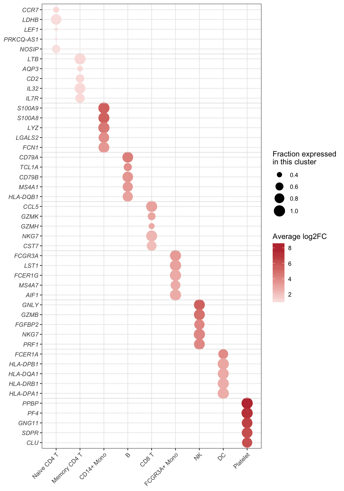

气泡热图保留了热图的网格结构，但把每个色块换成可**同时编码两个变量**的气泡：气泡大小承载一个数值（如表达该基因的细胞比例），颜色承载另一个（如效应量或显著性）。这正是单细胞标志基因点图（dot plot）与通路富集矩阵的标杆布局——一眼可见每个关联的"范围有多广、强度有多大"。本教程复现《顶刊图社》系列（第013期）介绍的图表类型，见文末参考文献。

## 示例

{fig-alt="BubbleHeatmap DEMO" fig-align="center" width="75%"}

这张气泡热图汇总了 PBMC 数据集的标志基因：九个细胞类群各取前 5 个标志基因（共 45 行标记——44 个唯一基因，因为 `NKG7` 同时是 CD8 T 与 NK 类群的标志——按每 5 行一组由浅色分隔线分组）与类群两两组合。气泡大小为该类群中表达该基因的细胞比例（`pct.1`），颜色为该基因相对其余细胞的平均 log2 变化倍数——每个类群最强的标志基因在其所在列中呈深红色，沿对角线排布。

## 环境配置

-   系统要求：跨平台（Linux/MacOS/Windows）

-   编程语言：R

-   依赖包：`tidyverse`；`scRNAtoolVis`

```{r packages setup, message=FALSE, warning=FALSE, output=FALSE}
# Installing necessary packages
if (!requireNamespace("tidyverse", quietly = TRUE)) {
  install.packages("tidyverse")
}
if (!requireNamespace("scRNAtoolVis", quietly = TRUE)) {
  remotes::install_github("junjunlab/scRNAtoolVis")
}

# Load packages
library(tidyverse)
library(scRNAtoolVis)
```

## 数据准备

示例使用 scRNAtoolVis 内置的 `pbmc.markers` 数据集（PBMC 单细胞标志基因表：9 个类群、5,921 行标记统计量）。每行报告一个基因在一个类群中的表达细胞比例（`pct.1`）、平均 log2 变化倍数（`avg_log2FC`）与校正 P 值（`p_val_adj`）。每个类群取前 5 个标志基因即构成图中的基因区块。

```{r load data, message=FALSE}
data("pbmc.markers")

marker_top <- pbmc.markers |>
  group_by(cluster) |>
  slice_max(avg_log2FC, n = 5) |>
  ungroup() |>
  arrange(cluster, desc(avg_log2FC)) |>
  mutate(cluster = factor(cluster),
         row = row_number())

head(marker_top, 3)
```

**注意：** 在你自己的分析中，输入是每个"行 × 列"组合一行的长表，携带你想编码的两个数值——可以是 `Seurat::FindAllMarkers()` 的标志基因统计量、通路富集表（基因数 + P 值），或任意长格式矩阵。

## 可视化

### 1. 基础绘图

基础图把 `pct.1` 映射为气泡大小、`avg_log2FC` 映射为发散配色；基因按区块排列，每个类群的标志基因聚在一起。

```{r}
#| label: fig-1.1BasicBubbleHeatmap
#| fig-cap: "PBMC 标志基因的基础气泡热图"
#| out.width: "90%"
#| warning: false
#| message: false
#| fig-width: 7
#| fig-height: 10

ggplot(marker_top, aes(x = cluster, y = row)) +
  geom_point(aes(size = pct.1, colour = avg_log2FC)) +
  scale_colour_gradient2(low = "#2166ac", mid = "white", high = "#b2182b", midpoint = 0) +
  scale_size_continuous(range = c(1, 7)) +
  scale_y_continuous(breaks = marker_top$row, labels = marker_top$gene,
                     trans = "reverse", expand = expansion(add = .6)) +
  labs(x = NULL, y = NULL, colour = "avg log2FC", size = "pct.1") +
  theme_bw(base_size = 11) +
  theme(axis.text.y = element_text(face = "italic"),
        axis.text.x = element_text(angle = 45, hjust = 1))
```

### 2. 基因区块与图例精修

基因区块之间的浅色分隔线与描述性图例标题，把网格升级为可直接发表的 dot plot；不依赖图注也能读懂每个气泡的含义。

```{r}
#| label: fig-1.2RefinedBubbleHeatmap
#| fig-cap: "含基因区块分隔线的精修气泡热图"
#| out.width: "90%"
#| warning: false
#| message: false
#| fig-width: 7
#| fig-height: 10

block_separators <- head(cumsum(table(marker_top$cluster)), -1) + 0.5

ggplot(marker_top, aes(x = cluster, y = row)) +
  geom_point(aes(size = pct.1, colour = avg_log2FC)) +
  geom_hline(yintercept = block_separators, colour = "grey85", linewidth = .3) +
  scale_colour_gradient2(low = "#2166ac", mid = "white", high = "#b2182b", midpoint = 0,
                         name = "Average log2FC") +
  scale_size_continuous(range = c(1, 7), name = "Fraction expressed\nin this cluster") +
  scale_y_continuous(breaks = marker_top$row, labels = marker_top$gene,
                     trans = "reverse", expand = expansion(add = .6)) +
  labs(x = NULL, y = NULL) +
  theme_bw(base_size = 11) +
  theme(panel.grid.minor = element_blank(),
        axis.text.y = element_text(face = "italic"),
        axis.text.x = element_text(angle = 45, hjust = 1))
```

::: callout-tip
**关键参数：**

- `size = pct.1` / `colour = avg_log2FC`：换成任意两个数值列即可，布局不变。
- `range = c(1, 7)`：气泡的最小与最大尺寸；最小值保持大于 0，让"无数据"仍可见为小点而不是消失。
- `midpoint = 0` 配发散色标：白色代表中性值（此处为无变化倍数）；全为正值的场景改用 `scale_colour_viridis_c()`（见下一图）。
:::

### 3. 按显著性着色

同一网格也可以编码显著性而非效应量——当表格来自富集分析（`-log10(P)` 跨多个数量级）时这是标准选择。注意 `pmax()` 保护：最强标志基因的 `p_val_adj` 恰为 0，`-log10(0)` 会得到无穷大——钳位让这些气泡留在色标顶端，而不是被静默丢弃。

```{r}
#| label: fig-1.3SignificanceBubbleHeatmap
#| fig-cap: "按显著性着色的气泡热图"
#| out.width: "90%"
#| warning: false
#| message: false
#| fig-width: 7
#| fig-height: 10

ggplot(marker_top, aes(x = cluster, y = row)) +
  geom_point(aes(size = pct.1, colour = -log10(pmax(p_val_adj, .Machine$double.xmin)))) +
  geom_hline(yintercept = block_separators, colour = "grey85", linewidth = .3) +
  scale_colour_viridis_c(option = "magma", direction = -1, name = expression(-log[10](P[adj]))) +
  scale_size_continuous(range = c(1, 7), name = "Fraction expressed\nin this cluster") +
  scale_y_continuous(breaks = marker_top$row, labels = marker_top$gene,
                     trans = "reverse", expand = expansion(add = .6)) +
  labs(x = NULL, y = NULL) +
  theme_bw(base_size = 11) +
  theme(panel.grid.minor = element_blank(),
        axis.text.y = element_text(face = "italic"),
        axis.text.x = element_text(angle = 45, hjust = 1))
```

### 4. 分类特征关联 tile 热图

同一网格也能承载**分类型**单元格。在临床关联分析中 \[3\]，行是临床特征，列是按两个表达组排序的患者，每个 tile 记录 yes/no，右侧边距标注每个特征的卡方检验 P 值——一张图就能看清哪些临床特征跟随分子分组。

```{r}
#| label: fig-1.4AssociationTiles
#| fig-cap: "关联 tile 热图：患者按表达组排序，临床特征以 yes/no tile 呈现，右边距标注卡方 P 值。"
#| out.width: "95%"
#| warning: false
#| message: false
#| fig-width: 8
#| fig-height: 4.5

set.seed(123)
n_group <- 50
group <- factor(rep(c("High expression", "Low expression"), each = n_group),
                levels = c("High expression", "Low expression"))
features   <- c("AJCC stage III", "Tumor size > 5 cm", "Serosal invasion", "Perineural invasion")
p_high     <- c(0.70, 0.65, 0.80, 0.35)   # 特征在高表达组更常见
p_low      <- c(0.25, 0.25, 0.30, 0.45)

tile_df <- do.call(rbind, c(
  list(data.frame(patient = seq_len(2 * n_group), row = "Expression group",
                  state = as.character(group))),
  lapply(seq_along(features), function(k) {
    yes <- c(rbinom(n_group, 1, p_high[k]), rbinom(n_group, 1, p_low[k]))
    data.frame(patient = seq_len(2 * n_group), row = features[k],
               state = ifelse(yes == 1, "yes", "no"))
  })
))
tile_df$row     <- factor(tile_df$row, levels = c("Expression group", features))
tile_df$patient <- factor(tile_df$patient, levels = seq_len(2 * n_group))

# 每个特征与表达组的卡方检验
pvals <- sapply(features, function(f) {
  chisq.test(table(tile_df$state[tile_df$row == f], group))$p.value
})
# P values go into the y-axis labels: they can never be clipped there
row_labels <- c("Expression group",
                sprintf("%s\nP %s", features,
                        ifelse(pvals < 0.001, "< 0.001", paste0("= ", sprintf("%.3f", pvals)))))
names(row_labels) <- levels(tile_df$row)

ggplot(tile_df, aes(x = patient, y = row, fill = state)) +
  geom_tile(colour = "grey85", linewidth = .3) +
  geom_tile(data = subset(tile_df, row == "Expression group"), colour = NA) +
  scale_fill_manual(values = c("High expression" = "#292C7C", "Low expression" = "#97B9D7",
                               "yes" = "#4582B5", "no" = "white")) +
  scale_y_discrete(labels = row_labels) +
  scale_x_discrete(expand = expansion(add = c(.6, .6))) +
  labs(x = "Patients (ordered by expression group)", y = NULL, fill = NULL) +
  theme_minimal(base_size = 11) +
  theme(axis.text.x = element_blank(), axis.ticks.x = element_blank(),
        axis.text.y = element_text(size = 9, lineheight = .9),
        panel.grid = element_blank(), legend.position = "left")
```

::: callout-tip
**关键参数：**

- tile 网格同样只是一张长表：患者 × 特征一格一行，`state` 驱动填充色。
- 把 P 值**并入 y 轴行标签**（`scale_y_discrete(labels = ...)`），而不是在网格外画文字——出界文字正是这张图被裁切的经典原因。
- 特征为有序或多分类时，按数据规模把卡方检验换成 `fisher.test`（小样本）或 Cochran–Armitage / Kruskal 检验。
:::

## 应用场景

-   **单细胞标志基因点图**：Seurat 风格工作流中对比各类群标志基因的标准布局。
-   **富集矩阵**：通路（行）对类群、条件或时间点（列），基因数为大小、`-log10(P)` 为颜色。
-   **跨组学汇总**：任意"特征 × 样本"网格上的两个统计量——表达量与显著性、丰度与变化倍数、得分与覆盖度。
-   气泡就是普通的 `geom_point()`：无需矩阵重排，只要一张每个网格格一行的长表。

## 参考文献

\[1\] 顶刊图社 | 第013期：气泡热图. 微信公众号文章. <http://mp.weixin.qq.com/s?__biz=MzU5NjE2ODU0OQ==&mid=2247483869&idx=1&sn=f35b5747cffd6ee98d7fcf0148dc4752>

\[2\] Zhang J. scRNAtoolVis: Making single-cell RNA-seq visualization easier and better. <https://github.com/junjunlab/scRNAtoolVis>（`pbmc.markers` 数据集来源）。

\[3\] Xiaofan Lu, et al. FigureYa: A Standardized Visualization Framework for Enhancing Biomedical Data Interpretation and Research Efficiency. iMetaMed. 2025. doi:10.1002/imm3.70005
