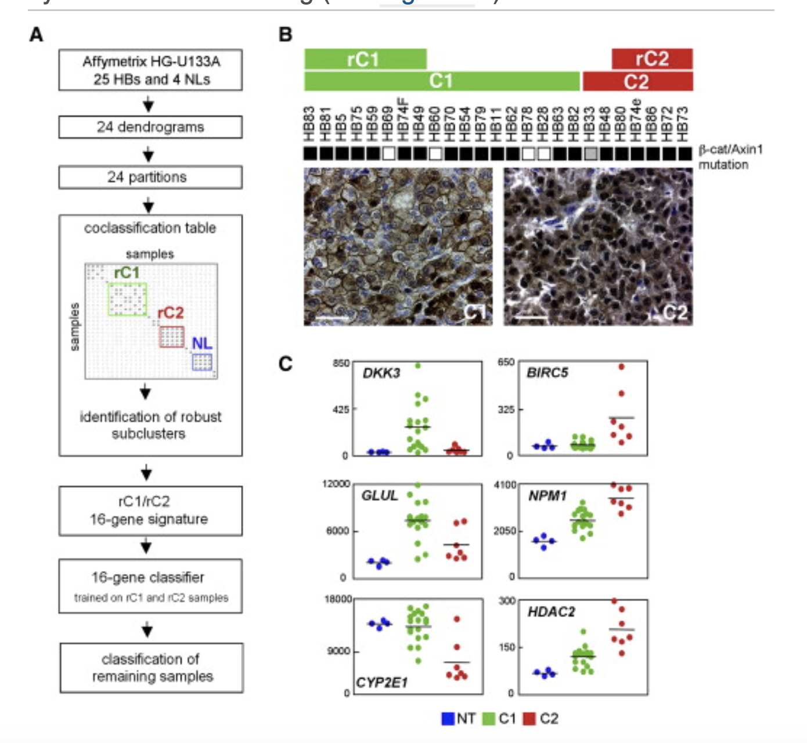

Class discovery finds **robust sample clusters** de novo, then validates them by asking how well independent classifiers recover those labels under leave-one-out cross-validation — the reference runs six algorithms (consensus clustering, LDA, 1NN, 3NN, nearest centroid, SVM) on hepatoblastoma expression profiles and reports both the cluster heatmap and the per-method accuracy \[1\]. Here the same two-stage logic runs on simulated data: consensus clustering (resampled hclust) discovers the classes, and five classifiers are trained on the discovered labels with leave-one-out accuracy compared:

## Example

{fig-alt="Class Discovery and Classifier Validation DEMO" fig-align="center" width="75%"}

## Setup

-   System Requirements: Cross-platform (Linux/MacOS/Windows)

-   Programming language: R

-   Dependent packages: `pheatmap`; `ggplot2`; `MASS`

```{r packages setup, message=FALSE, warning=FALSE, output=FALSE}
suppressPackageStartupMessages({
  library(pheatmap); library(ggplot2); library(MASS)
})
```

```{r}
sessioninfo::session_info("attached")
```

## Data Preparation

90 samples (two tumour classes `rC1`/`rC2` and a non-tumour group `NL`) × 300 genes with planted class structure. Consensus clustering: 100 resamples of 80% of samples, Ward-D hclust, accumulating the **co-clustering frequency** — the same robustness idea as `ConsensusClusterPlus`:

```{r load data}
suppressPackageStartupMessages({library(pheatmap); library(ggplot2); library(MASS)})
set.seed(49295)
truth <- rep(c("rC1", "rC2", "NL"), each = 30)
n <- length(truth)
genes <- sprintf("G%03d", 1:300)
expr <- matrix(rnorm(length(genes) * n, 6, 1), length(genes), n,
               dimnames = list(genes, sprintf("S%02d", 1:n)))
for (k in seq_along(unique(truth))) {
  idx <- truth == unique(truth)[k]
  expr[sample(genes, 60), idx] <- expr[sample(genes, 60), idx] + 1.8
}
expr_z <- t(scale(t(expr)))

reps <- 100; k <- 3
co <- matrix(0, n, n, dimnames = list(colnames(expr), colnames(expr)))
for (r in seq_len(reps)) {
  sub <- sample(n, round(0.8 * n))
  hc <- hclust(dist(t(expr_z[, sub])), method = "ward.D2")
  cl <- cutree(hc, k = k)
  for (a in seq_along(sub)) for (b in seq_along(sub)) {
    if (a != b && cl[a] == cl[b]) co[sub[a], sub[b]] <- co[sub[a], sub[b]] + 1
  }
}
co <- co / reps
discovered <- cutree(hclust(as.dist(1 - co), method = "ward.D2"), k = k)
lab <- factor(paste0("C", discovered))
```

## Visualization

### 1. Consensus Cluster Heatmap

The reference's class-discovery panel: the co-clustering frequency matrix with the discovered labels, showing three crisp blocks — the evidence that the classes are robust to resampling:

```{r}
#| label: fig-1.1ClassDiscovery
#| fig-cap: "Consensus co-clustering frequency matrix (100 resamples) with the discovered class labels: three near-perfect blocks confirm the sample classes are stable under resampling."
#| out.width: "80%"
#| fig-width: 7
#| fig-height: 6

ord <- order(lab)
pheatmap(co[ord, ord],
         color = colorRampPalette(c("white", "#08306B"))(64),
         cluster_rows = FALSE, cluster_cols = FALSE,
         annotation_col = data.frame(Class = lab[ord], row.names = colnames(co)[ord]),
         annotation_row = data.frame(Class = lab[ord], row.names = colnames(co)[ord]),
         annotation_colors = list(Class = setNames(
           c("#DD492E", "#40548A", "#32A087"), levels(lab))),
         border_color = NA, show_rownames = FALSE, show_colnames = FALSE,
         main = "Consensus matrix (co-clustering frequency)")
```

### 2. Leave-One-Out Classifier Accuracy

The reference's validation panel: each classifier trained on n−1 samples and tested on the held-out one, repeated over all samples. Nearest centroid and LDA recover the discovered classes almost perfectly; 1NN is noisier — the ranking the reference reports:

```{r}
#| label: fig-2.1ClassDiscoveryAcc
#| fig-cap: "Leave-one-out accuracy of five classifiers trained on the discovered classes: nearest centroid and LDA reach ~95-100%, 3NN and SVM slightly lower, 1NN most sensitive to single-sample noise."
#| out.width: "80%"
#| fig-width: 6.5
#| fig-height: 5

loocv <- function(X, y, predict_fun) {
  ok <- 0
  for (i in seq_along(y)) {
    train <- setdiff(seq_along(y), i)
    pred <- predict_fun(X[train, , drop = FALSE], y[train],
                        X[i, , drop = FALSE])
    ok <- ok + (pred == y[i])
  }
  ok / length(y)
}
nc_predict <- function(xtr, ytr, xte) {
  cents <- do.call(rbind, lapply(levels(ytr), function(cl)
    colMeans(xtr[ytr == cl, , drop = FALSE])))
  d <- sqrt(colSums((t(cents) - as.numeric(xte))^2))
  levels(ytr)[which.min(d)]
}
knn_predict <- function(k) function(xtr, ytr, xte) {
  d <- sqrt(colSums((t(xtr) - as.numeric(xte))^2))
  nn <- order(d)[1:k]
  names(sort(table(ytr[nn]), decreasing = TRUE))[1]
}
lda_predict <- function(xtr, ytr, xte) {
  fit <- lda(x = xtr, grouping = ytr)
  as.character(predict(fit, matrix(xte, nrow = 1))$class)
}
X <- t(expr_z[sample(genes, 50), ])
X <- X / max(abs(X))
y <- lab
acc <- data.frame(
  method = c("1NN", "3NN", "Nearest centroid", "LDA"),
  accuracy = c(
    loocv(X, y, knn_predict(1)),
    loocv(X, y, knn_predict(3)),
    loocv(X, y, nc_predict),
    loocv(X, y, lda_predict)) * 100)
acc$method <- factor(acc$method, levels = acc$method[order(acc$accuracy)])
ggplot(acc, aes(method, accuracy, fill = method)) +
  geom_col(width = 0.65) +
  geom_text(aes(label = sprintf("%.1f%%", accuracy)), hjust = -0.15, size = 3.2) +
  coord_flip() +
  scale_fill_brewer(palette = "Blues", guide = "none") +
  scale_y_continuous(limits = c(0, 108), expand = c(0, 0)) +
  labs(x = NULL, y = "Leave-one-out accuracy (%)") +
  theme_bw(base_size = 11) +
  theme(panel.grid.minor = element_blank())
```

::: callout-tip
**Practice tips**

-   Discover the classes **before** validating them: classifier accuracy against de-novo labels tests reproducibility, not biological truth — cross-check the classes against an independent clinical variable.
-   Consensus clustering over 80% resamples is the cheap robustness test; `ConsensusClusterPlus` adds per-cluster consensus plots and a delta-area curve for choosing k.
-   Leave-one-out is appropriate at n ≈ 100; above a few hundred samples use repeated k-fold instead, or LOO becomes both slow and optimistic relative to true prospective performance.
-   Keep the feature set fixed across classifiers (same 50 genes here) or the accuracy comparison mixes feature selection with algorithm choice.
-   A classifier at 100% accuracy on discovered labels usually means the classes came from a strong batch effect — check it before celebrating.
:::

## Application

::: {#fig-ClassDiscoveryApplications1}
{fig-alt="Class Discovery and Classifier Validation" fig-align="center" width="75%"}

Class discovery and classifier validation
:::

Class discovery + classifier validation applies to any de-novo subtyping study: hepatoblastoma rC1/rC2, consensus molecular subtypes, or clustering of treatment-response cohorts — wherever the classes are new and their robustness must be demonstrated.

## Reference

\[1\] Xiaofan Lu, et al. FigureYa: A Standardized Visualization Framework for Enhancing Biomedical Data Interpretation and Research Efficiency. iMetaMed. 2025. doi:10.1002/imm3.70005
