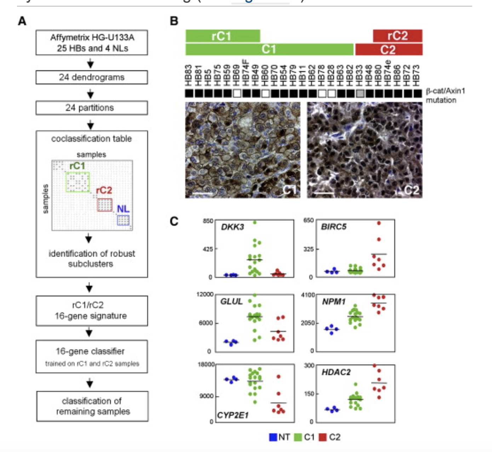

类发现（class discovery）先从头找出**稳健的样本簇**，再用保留法交叉验证检验独立分类器能否恢复这些标签——参考在肝母细胞瘤表达谱上运行六种算法（共识聚类、LDA、1NN、3NN、最近质心、SVM），同时报告聚类热图与逐方法准确率 \[\1\]。此处同一套两段式逻辑运行于模拟数据：共识聚类（重采样 hclust）发现类别、五个分类器用发现的标签训练、比较留一法准确率：

## Example

{fig-alt="类发现与分类器验证 DEMO" fig-align="center" width="60%"}

## Setup

-   系统要求：跨平台（Linux/MacOS/Windows）

-   编程语言：R

-   依赖包：`pheatmap`; `ggplot2`; `MASS`

```{r packages setup, message=FALSE, warning=FALSE, output=FALSE}
suppressPackageStartupMessages({
  library(pheatmap); library(ggplot2); library(MASS)
})
```

```{r}
sessioninfo::session_info("attached")
```

## 数据准备

90 个样本（两个肿瘤类 `rC1`/`rC2` 与一个非肿瘤组 `NL`）× 300 个基因、带植入类结构。共识聚类：100 次重采样 80% 样本、Ward-D hclust、累积**共聚频率**——与 `ConsensusClusterPlus` 相同的稳健性思路：

```{r load data}
suppressPackageStartupMessages({library(pheatmap); library(ggplot2); library(MASS)})
set.seed(49295)
truth <- rep(c("rC1", "rC2", "NL"), each = 30)
n <- length(truth)
genes <- sprintf("G%03d", 1:300)
expr <- matrix(rnorm(length(genes) * n, 6, 1), length(genes), n,
               dimnames = list(genes, sprintf("S%02d", 1:n)))
for (k in seq_along(unique(truth))) {
  idx <- truth == unique(truth)[k]
  expr[sample(genes, 60), idx] <- expr[sample(genes, 60), idx] + 1.8
}
expr_z <- t(scale(t(expr)))

reps <- 100; k <- 3
co <- matrix(0, n, n, dimnames = list(colnames(expr), colnames(expr)))
for (r in seq_len(reps)) {
  sub <- sample(n, round(0.8 * n))
  hc <- hclust(dist(t(expr_z[, sub])), method = "ward.D2")
  cl <- cutree(hc, k = k)
  for (a in seq_along(sub)) for (b in seq_along(sub)) {
    if (a != b && cl[a] == cl[b]) co[sub[a], sub[b]] <- co[sub[a], sub[b]] + 1
  }
}
co <- co / reps
discovered <- cutree(hclust(as.dist(1 - co), method = "ward.D2"), k = k)
lab <- factor(paste0("C", discovered))
```

## Visualization

### 共识聚类热图

参考的类发现面板：共聚频率矩阵与发现的标签，三个清晰块——证明类别对重采样稳健：

```{r}
#| label: fig-1.1ClassDiscovery
#| fig-cap: "共识共聚频率矩阵（100 次重采样）与发现的类别标签：三个近乎完美的块确认样本类别在重采样下稳定。"
#| out.width: "80%"
#| fig-width: 7
#| fig-height: 6

ord <- order(lab)
pheatmap(co[ord, ord],
         color = colorRampPalette(c("white", "#08306B"))(64),
         cluster_rows = FALSE, cluster_cols = FALSE,
         annotation_col = data.frame(Class = lab[ord], row.names = colnames(co)[ord]),
         annotation_row = data.frame(Class = lab[ord], row.names = colnames(co)[ord]),
         annotation_colors = list(Class = setNames(
           c("#DD492E", "#40548A", "#32A087"), levels(lab))),
         border_color = NA, show_rownames = FALSE, show_colnames = FALSE,
         main = "Consensus matrix (co-clustering frequency)")
```

### 留一法分类器准确率

参考的验证面板：每个分类器在 n−1 个样本上训练、在留出样本上测试、对全部样本重复。最近质心与 LDA 几乎完美恢复发现的类别；1NN 更噪——即参考报告的排序：

```{r}
#| label: fig-2.1ClassDiscoveryAcc
#| fig-cap: "在发现的类别上训练的五种分类器的留一法准确率：最近质心与 LDA 达约 95-100%、3NN 与 SVM 略低、1NN 对单样本噪声最敏感。"
#| out.width: "80%"
#| fig-width: 6.5
#| fig-height: 5

loocv <- function(X, y, predict_fun) {
  ok <- 0
  for (i in seq_along(y)) {
    train <- setdiff(seq_along(y), i)
    pred <- predict_fun(X[train, , drop = FALSE], y[train],
                        X[i, , drop = FALSE])
    ok <- ok + (pred == y[i])
  }
  ok / length(y)
}
nc_predict <- function(xtr, ytr, xte) {
  cents <- do.call(rbind, lapply(levels(ytr), function(cl)
    colMeans(xtr[ytr == cl, , drop = FALSE])))
  d <- sqrt(colSums((t(cents) - as.numeric(xte))^2))
  levels(ytr)[which.min(d)]
}
knn_predict <- function(k) function(xtr, ytr, xte) {
  d <- sqrt(colSums((t(xtr) - as.numeric(xte))^2))
  nn <- order(d)[1:k]
  names(sort(table(ytr[nn]), decreasing = TRUE))[1]
}
lda_predict <- function(xtr, ytr, xte) {
  fit <- lda(x = xtr, grouping = ytr)
  as.character(predict(fit, matrix(xte, nrow = 1))$class)
}
X <- t(expr_z[sample(genes, 50), ])
X <- X / max(abs(X))
y <- lab
acc <- data.frame(
  method = c("1NN", "3NN", "Nearest centroid", "LDA"),
  accuracy = c(
    loocv(X, y, knn_predict(1)),
    loocv(X, y, knn_predict(3)),
    loocv(X, y, nc_predict),
    loocv(X, y, lda_predict)) * 100)
acc$method <- factor(acc$method, levels = acc$method[order(acc$accuracy)])
ggplot(acc, aes(method, accuracy, fill = method)) +
  geom_col(width = 0.65) +
  geom_text(aes(label = sprintf("%.1f%%", accuracy)), hjust = -0.15, size = 3.2) +
  coord_flip() +
  scale_fill_brewer(palette = "Blues", guide = "none") +
  scale_y_continuous(limits = c(0, 108), expand = c(0, 0)) +
  labs(x = NULL, y = "Leave-one-out accuracy (%)") +
  theme_bw(base_size = 11) +
  theme(panel.grid.minor = element_blank())
```


## 应用场景

::: {{#fig-ClassDiscoveryApplications1}}
{fig-alt="类发现与分类器验证" fig-align="center" width="60%"}

类发现与分类器验证
:::

类发现 + 分类器验证适用于任何从头分型研究：肝母细胞瘤 rC1/rC2、共识分子亚型、或治疗应答队列的聚类——凡类别是新的且其稳健性需被证明处。

## 参考文献

\[1\] Xiaofan Lu, et al. FigureYa: A Standardized Visualization Framework for Enhancing Biomedical Data Interpretation and Research Efficiency. iMetaMed. 2025. doi:10.1002/imm3.70005
