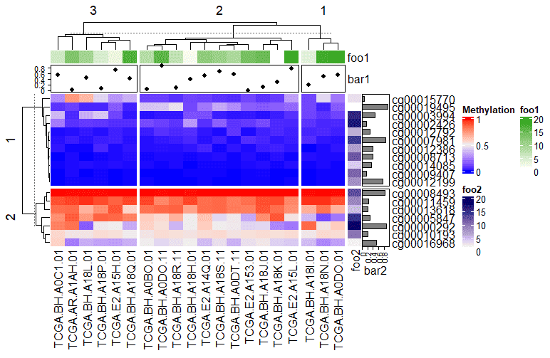
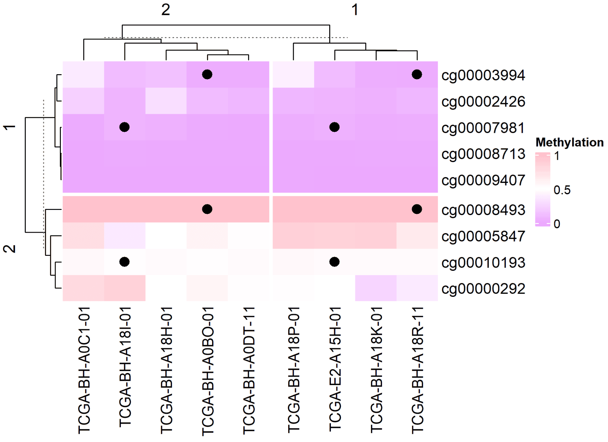
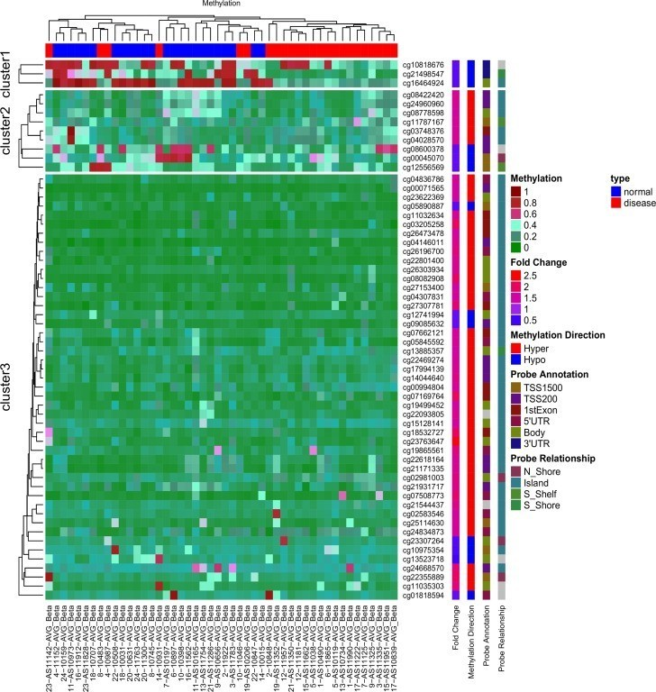

## Example

{fig-alt="ComplexHeatmap DEMO1" fig-align="center" width="60%"}

The Complex Heatmap is an advanced data visualization tool primarily used to display matrix relationships in multidimensional data. It adds multi-level annotation, cluster analysis, and data splitting capabilities to the basic heatmap. It can more clearly present the inherent structure and relationships of complex data.

## Setup

-   System Requirements: Cross-platform (Linux/MacOS/Windows)

-   Programming language: R

-   Dependent packages: `ComplexHeatmap`, `dendextend`, `tidyr`, `circlize`, `gridExtra`, `pheatmap`

```{r packages setup, message=FALSE, warning=FALSE, output=FALSE}
# Installing packages
if (!requireNamespace("ComplexHeatmap", quietly = TRUE)) {
  BiocManager::install("ComplexHeatmap")
}
if (!requireNamespace("dendextend", quietly = TRUE)) {
  install.packages("dendextend")
}
if (!requireNamespace("tidyr", quietly = TRUE)) {
  install.packages("tidyr")
}
if (!requireNamespace("circlize", quietly = TRUE)) {
  install.packages("circlize")
}
if (!requireNamespace("gridExtra", quietly = TRUE)) {
  install.packages("gridExtra")
}
if (!requireNamespace("pheatmap", quietly = TRUE)) {
  install.packages("pheatmap")
}

# Load packages
library(ComplexHeatmap)
library(dendextend)
library(tidyr)
library(circlize)
library(gridExtra)
library(pheatmap)
```

```{r}
sessioninfo::session_info("attached")
```

## Data Preparation

The data mainly comes from the methylation data of the `TCGA` database

```{r load data, message=FALSE}
# data_mat (continuous)
data <- readr::read_csv("https://bizard-1301043367.cos.ap-guangzhou.myqcloud.com/TCGA.BRCA.sampleMap_HumanMethylation27_ch.csv")

data <- as.data.frame(data)
rownames(data) <- data[,1]
data <- data[,-1]

data_TCGA <- na.omit(data[1:20,1:20])

data_TCGA <- as.matrix(data_TCGA)  

# Discrete
discrete_mat = matrix(sample(1:5, 100, replace = TRUE), 10, 10)
```

## Visualization

### 1. Basic ComplexHeatmap

**Continuous variables**

Here we take the methylation data of the `TCGA` database as an example

```{r}
#| label: fig-1.1BasicComplexheatmap
#| fig-cap: "Continuous variables"
#| out.width: "95%"
#| warning: false
#| message: false

# Continuous variables
Heatmap(data_TCGA , name = "Methylation")
```

The figure above shows a complex heatmap of methylation levels, with columns representing gene loci and samples representing behavioral patterns. Red indicates high methylation levels, while blue indicates low methylation levels. The edges represent the results of the cluster analysis.

**Discrete variables**

Here we take generating data as an example

```{r}
#| label: fig-1.2BasicComplexheatmap
#| fig-cap: "Discrete variables"
#| out.width: "95%"
#| warning: false
#| message: false

# Discrete variables
Heatmap(discrete_mat,  name = "mat")
```

The figure above is a complex heat map of the generated discrete variables, and the side axes are the results of cluster analysis.

### 2. Customization

#### 2.1 Color customization

**Continuous variables**

```{r}
#| label: fig-2.1Custom
#| fig-cap: "Customizing the color of continuous variables"
#| out.width: "95%"
#| warning: false
#| message: false

# Customizing the color of continuous variables
col_fun = colorRamp2(c(0, 0.5, 1),  # Set the cutoff point
                     c("blue", "white", "pink")) 
Heatmap(data_TCGA, name = "Methylation", col = col_fun, 
              column_title = "Custom three-segment color")
```

```{r}
#| label: fig-2.2Custom
#| fig-cap: "Customizing the color of continuous variables"
#| out.width: "95%"
#| warning: false
#| message: false

# Customizing the color of continuous variables
Heatmap(data_TCGA, name = "Methylation", col = rev(rainbow(10)), 
        column_title = "Creating a color vector")
```

**Discrete variables**

```{r}
#| label: fig-2.3Custom
#| fig-cap: "Customize discrete variable colors"
#| out.width: "95%"
#| warning: false
#| message: false

# Customize discrete variable colors
colors <- c(
  "1" = "#BBEDA7",  
  "2" = "#F3D8FA",  
  "3" = "#FFECA1",  
  "4" = "#D9E6F7",  
  "5" = "#EFBEC6"   
)
Heatmap(discrete_mat, name = "mat", col = colors,
        column_title = "Customize discrete variable colors")
```

#### 2.2 Border customization

```{r}
#| label: fig-2.4Custom
#| fig-cap: "Border customization"
#| out.width: "95%"
#| warning: false
#| message: false

# Border customization
Heatmap(data_TCGA, name = "Methylation", 
        border = "black", # The border value can be FALSE or color
        rect_gp = gpar(col = "white", lwd = 2), # lty line type, lwd line width
        column_title = "Border customization")
```

### 3. Clustering

You can customize clustering methods, dendrogram position, size, etc.

```{r}
#| label: fig-3.1Cluster
#| fig-cap: "Clustering"
#| out.width: "95%"
#| warning: false
#| message: false

# Clustering
Heatmap(data_TCGA, name = "Methylation", 
       # row_dend_side = "right", 
       # column_dend_side = "bottom", # Adjustable tree view position
        column_dend_height = unit(1, "cm"), 
        row_dend_width = unit(1, "cm"), # Adjustable dendrogram distance
        column_title = "聚类自定义",
        clustering_distance_rows = "pearson", # Clustering method, you can set your own function
      # show_parent_dend_line = FALSE  # Can hide dotted lines
        ) 
```

**Dendrogram rendering**

We also use the `dendextend` package to color the dendrogram

```{r}
#| label: fig-3.2Cluster
#| fig-cap: "Dendrogram rendering"
#| out.width: "95%"
#| warning: false
#| message: false

# Dendrogram rendering
row_dend = as.dendrogram(hclust(dist(data_TCGA)))
row_dend = color_branches(row_dend, k = 2)  # Generate branches
# Numbers indicate the number of colors
Heatmap(data_TCGA, name = "Methylation", 
        cluster_rows = row_dend,
      # row_dend_gp = gpar(col = "red")  # Customizable colors are also available
        )
```

As shown in the figure above, the branches of the tree are different colors.

### 4. Segmentation

**Continuous variables**

Use k-means clustering segmentation

```{r}
#| label: fig-4.1Split
#| fig-cap: "Continuous variable segmentation"
#| out.width: "95%"
#| warning: false
#| message: false

# Continuous variable segmentation
Heatmap(data_TCGA, 
        name = "Methylation", 
        row_km = 2,  # Set the number of divisions
        column_km = 3)
```

Using vector segmentation

```{r}
#| label: fig-4.2Split
#| fig-cap: "Using vector segmentation"
#| out.width: "95%"
#| warning: false
#| message: false

# Using vector segmentation
Heatmap(data_TCGA, name = "Methylation", 
        row_split = rep(c("A", "B"), 9), 
        column_split = rep(c("C", "D"), 10))
```

Using matrix segmentation

```{r}
#| label: fig-4.3Split
#| fig-cap: "Using matrix segmentation"
#| out.width: "95%"
#| warning: false
#| message: false

# Using matrix segmentation
Heatmap(data_TCGA, name = "Methylation", 
        row_split = data.frame(rep(c("A", "B"), 9), 
                               rep(c("C", "D"), each = 9)))
```

The above segmentation methods can be used independently in rows and columns. Setting `show_parent_dend_line = FALSE` can hide the dotted line

**Discrete variables**

segmentation by specified rows and columns

```{r}
#| label: fig-4.4Split
#| fig-cap: "segmentation by specified rows and columns"
#| out.width: "95%"
#| warning: false
#| message: false

# segmentation by specified rows and columns
Heatmap(discrete_mat, 
        name = "mat", 
        col = 1:4, 
        row_split = discrete_mat[,1]) # segmentation by the first column in the matrix data
```

**Parameter segmentation**

Titles, clustering parameters, etc. can be segmented based on heatmap segmentation

```{r}
#| label: fig-4.5Split
#| fig-cap: "Parameter segmentation"
#| out.width: "95%"
#| warning: false
#| message: false

# Parameter segmentation
Heatmap(data_TCGA, name = "Methylation", 
        row_km = 2, 
        row_title_gp = gpar(col = c("#9A090A", "#0D4B99"), font = 1:2),
        row_names_gp = gpar(col = c("#748901", "#E6AC03"), fontsize = c(10, 12)),
        column_km = 3, 
        column_title_gp = gpar(fill = c("#BFD641", "#FE9900", "#CC6CE7"), font = 1:3),
        column_names_gp = gpar(col = c("#1D6103", "#E08804", "#5E0676"), fontsize = c(10, 12, 8)))
```

**Annotation segmentation**

Edge annotations can be segmented based on heatmap segmentation

```{r}
#| label: fig-4.6Split
#| fig-cap: "Annotation segmentation"
#| out.width: "95%"
#| warning: false
#| message: false

# Annotation segmentation
Heatmap(data_TCGA, name = "Methylation", row_km = 2, column_km = 3,
        top_annotation = HeatmapAnnotation(foo1 = 1:20, bar1 = anno_points(runif(20))),
        right_annotation = rowAnnotation(foo2 = 18:1, bar2 = anno_barplot(runif(18)))
)
```

The added point map, heat map, and bar map annotations in the above figure are all segmented with the main heatmap.

### 5. Add labels

**Add data**

`cell_fun` accepts a function that is applied to each cell in the heatmap. The function's arguments are as follows:

- `j`: Column index (column number).

- `i`: Row index (row number).

- `x`, `y`: Coordinates of the cell center (in the coordinate system of the plotting device).

- `width`, `height`: The width and height of the cell.

- `fill`: The value corresponding to the cell (i.e., the value in the matrix).

```{r}
#| label: fig-5.1AddLabel
#| fig-cap: "Add data"
#| out.width: "95%"
#| warning: false
#| message: false

# Add data
small_mat = data_TCGA[1:9, 1:9]
col_fun = colorRamp2(c(0, 0.5, 1), c("#EBA7FE", "white", "pink"))
Heatmap(small_mat, name = "Methylation", col = col_fun,
        cell_fun = function(j, i, x, y, width, height, fill) {
          grid.text(sprintf("%.1f", small_mat[i, j]), x, y, gp = gpar(fontsize = 10))
        })
```

```{r}
#| label: fig-5.2AddLabel
#| fig-cap: "Add data"
#| out.width: "95%"
#| warning: false
#| message: false

# Add data
small_mat = data_TCGA[1:9, 1:9]
Heatmap(small_mat, name = "Methylation",  col = col_fun,
        cell_fun = function(j, i, x, y, width, height, fill) {
          if(small_mat[i, j] > 0.5) # Set the display range
            grid.text(sprintf("%.1f", small_mat[i, j]), x, y, gp = gpar(fontsize = 10)) # Add text/value
        })
```

The above figure only shows data with methylation levels greater than 0.5

**Add graphics**

```{r}
#| label: fig-5.3AddLabel
#| fig-cap: "Add graphics"
#| out.width: "95%"
#| warning: false
#| message: false
#| eval: false

# Add graphics
small_mat = data_TCGA[1:9, 1:9]
Heatmap(small_mat, name = "Methylation", col = col_fun,
        row_km = 2, column_km = 2,
        layer_fun = function(j, i, x, y, w, h, fill) {
          ind_mat = restore_matrix(j, i, x, y)
          ind = unique(c(ind_mat[1, 4], ind_mat[3, 2])) # Positioning, add graphics to each segmentation location
          grid.points(x[ind], y[ind], pch = 16, size = unit(4, "mm")) # Add Point
        }
)
```

::: {#fig-ComplexHeatmapFig5-3}
{fig-alt="ComplexHeatmapFig5-3" fig-align="center" width="60%"}

Add graphics
:::

### 6. Correlation-Ordered Heatmap with Annotations

In biomarker studies \[8\] the columns are samples **ordered by the expression of one target gene**, the rows are genes significantly positively or negatively correlated with it, and the top annotation carries subtype/mutation information. Turning clustering off makes the target gene's gradient (and the wedges of correlated genes) directly visible — an unclustered correlation heatmap.

```{r}
#| label: fig-6.1CorrOrdered
#| fig-cap: "Samples ordered by target-gene expression; genes split into positively and negatively correlated blocks by row segmentation."
#| out.width: "95%"
#| warning: false
#| message: false
#| fig-width: 9
#| fig-height: 6

set.seed(2026)
n_sam  <- 40
genes  <- paste0("Gene", sprintf("%03d", 1:299))
target <- rnorm(n_sam)                                   # target gene (TIM-3-like) expression
subtype <- factor(sample(c("Classical", "Mesenchymal", "Neural", "Proneural"), n_sam, TRUE))
idh     <- factor(sample(c("WT", "Mutant"), n_sam, TRUE, prob = c(0.6, 0.4)))

mat <- matrix(rnorm(299 * n_sam), nrow = 299,
              dimnames = list(genes, paste0("S", seq_len(n_sam))))
# Simulate biology: 15 genes co-vary with the target, 10 vary in opposition
pos_seed <- sample(genes, 15)
neg_seed <- sample(setdiff(genes, pos_seed), 10)
mat[pos_seed, ] <- mat[pos_seed, ] + outer(rep(1, 15), target) * 0.9
mat[neg_seed, ] <- mat[neg_seed, ] - outer(rep(1, 10), target) * 0.9
mat <- rbind(mat, "TARGET" = target)                     # add the target gene row

# Genes correlated with the target: top-15 positive, top-10 negative
cors      <- cor(t(mat[genes, ]), mat["TARGET", ])
pos_genes <- names(sort(cors[, 1], decreasing = TRUE))[1:15]
neg_genes <- names(sort(cors[, 1], decreasing = FALSE))[1:10]

sel  <- c(pos_genes, neg_genes)                          # rows: positive block first
mat_sel <- t(scale(t(mat[sel, ])))                       # row-wise z-score
mat_sel[mat_sel >  3] <-  3
mat_sel[mat_sel < -3] <- -3
ord    <- order(mat["TARGET", ])                         # columns ordered by the target gene
mat_sel <- mat_sel[, ord]

col_fun    <- circlize::colorRamp2(c(-3, 0, 3), c("#6699CC", "white", "#FF3C38"))
target_fun <- circlize::colorRamp2(c(-2, 0, 2), c("#2166ac", "white", "#b2182b"))

ha <- HeatmapAnnotation(
  `Target expression` = mat["TARGET", ord],
  Subtype = droplevels(subtype)[ord],
  IDH     = idh[ord],
  col = list(`Target expression` = target_fun,
             Subtype = c(Classical = "#CEDC7C", Mesenchymal = "#EA6767",
                         Neural = "#F7C07C", Proneural = "#445EAD"),
             IDH = c(WT = "#EA6767", Mutant = "#70C17A")))

Heatmap(mat_sel, name = "Z-score", top_annotation = ha,
        col = col_fun,
        cluster_rows = FALSE, cluster_columns = FALSE,   # keep the target-gene gradient
        row_split = factor(rep(c("Positively correlated", "Negatively correlated"),
                               c(length(pos_genes), length(neg_genes)))),
        border = TRUE)
```

::: callout-tip
**Practice tips**

- The row segmentation here is **driven by analysis results** (sign of the correlation), not by clustering — `row_split` accepts any factor.
- Sorting columns by the target gene before plotting is what turns correlation strength into a visible wedge; leave `cluster_columns = FALSE` or the sorting is destroyed.
- With real data, select correlated genes with `cor.test()` (Spearman) plus a cutoff on rho and P, as in the reference workflow.
:::

### 7. Single-Cell Cluster-Mean Marker Heatmap

Single-cell marker panels read best as **cluster-mean** heatmaps: average each marker gene within every cluster, z-score the rows and clip extremes so one loud gene cannot saturate the colour scale \[8\]. Rows stay in marker-set order (`cluster_rows = FALSE`) while the columns are complete-linked, and the `annotation_row` bar names the cell type each block belongs to — the diagonal marker-by-cell-type layout standard in scRNA-seq papers.

```{r}
#| label: fig-7.1ScMarkerHeatmap
#| fig-cap: "Cluster-mean marker heatmap: four marker blocks (24 genes) across four cell types, rows z-scored and clipped so the diagonal signal reads at equal contrast; the left annotation bar colours marker sets by cell type."
#| out.width: "95%"
#| warning: false
#| message: false
#| fig-width: 8.5
#| fig-height: 5

set.seed(5101)
clusters <- c("T", "B", "Mye", "NK")
n_clust <- length(clusters); n_genes_per <- 6
genes <- c(paste0("T_M", 1:n_genes_per), paste0("B_M", 1:n_genes_per),
           paste0("M_M", 1:n_genes_per), paste0("NK_M", 1:n_genes_per))
# cluster-mean marker expression: each marker set peaks only in its own cluster
avg <- matrix(rnorm(length(genes) * n_clust, sd = 0.4), nrow = length(genes),
              dimnames = list(genes, clusters))
for (k in 1:n_clust) {
  idx <- ((k - 1) * n_genes_per + 1):(k * n_genes_per)
  avg[idx, k] <- avg[idx, k] + 2.5
}
clip_scale <- function(x, lo = -2, hi = 2)
  matrix(pmin(pmax(x, lo), hi), nrow = nrow(x), dimnames = dimnames(x))
# per-gene z-score, clipped to +-2 so one loud gene cannot saturate the scale
ph_data <- clip_scale(t(scale(t(avg))))

ann <- data.frame(cluster = rep(clusters, each = n_genes_per))
cl_cols <- setNames(c("#B2182B", "#2166AC", "#EABF00", "#4D9342"), clusters)
hm <- ComplexHeatmap::pheatmap(ph_data,
  color = colorRampPalette(c("darkblue", "white", "red3"))(99),
  scale = "none", cluster_rows = FALSE, cluster_cols = TRUE,
  clustering_method = "complete", show_rownames = FALSE,
  annotation_row = ann, annotation_colors = list(cluster = cl_cols),
  border_color = NA)
ComplexHeatmap::draw(hm)

# the simulated marker blocks must each peak in their own cluster (diagonal)
diag_hits <- sapply(1:n_clust, function(k) {
  idx <- ((k - 1) * n_genes_per + 1):(k * n_genes_per)
  all(apply(avg[idx, , drop = FALSE], 1, which.max) == k)
})
stopifnot(sum(diag_hits) == n_clust)
```

::: callout-tip
**Practice tips**

-   `cluster_rows = FALSE` keeps marker sets contiguous; letting the rows cluster breaks the diagonal reading.
-   The per-gene z-score (`t(scale(t(avg)))`) is what makes all four blocks equally colourful — each row is scaled by its own contrast; the ±2 clip is only a guard against residual outliers.
-   The `darkblue-white-red3` 99-step ramp matches the classic style; build it once with `colorRampPalette()` and reuse it across panels.
:::
### 8. Multi-Block Horizontal Heatmap Composition

An entire publication panel — a binary trait bar, an expression matrix, and a numeric score column with in-cell labels — assembles from one row-aligned horizontal `pheatmap` list \[8\]. The `display_numbers` + `number_color` mechanism turns any block into a table-style column with per-cell control; missing values draw as `NA`.

```{r}
#| label: fig-8.1MultiBlockHeatmap
#| fig-cap: "Three-block horizontal composition on a shared six-drug axis: a response annotation (red = sensitive), a 12-gene expression profile, and CMap scores shown as in-cell numbers with NA for missing entries."
#| out.width: "95%"
#| warning: false
#| message: false
#| fig-width: 8
#| fig-height: 4.5

set.seed(5301)
drugs <- c("BI-2536", "Leptomycin", "Methotrexate",
           "Narciclasine", "SR-II-138A", "Vincristine")
expr_genes <- paste0("Gene", sprintf("%03d", 1:12))
# all three blocks share nrow = 6 (drugs) — required by a horizontal list
centre <- matrix(rnorm(12 * 6, sd = 1), nrow = 6, dimnames = list(drugs, expr_genes))
centre[1:2, ] <- centre[1:2, ] + 1.4       # first two drugs = responders

hm1 <- ComplexHeatmap::pheatmap(mat = matrix(c(1, 1, 0, 1, 0, 0), ncol = 1,
    dimnames = list(drugs, "Response")),
  color = c("#F7F7F7", "#B2182B"), cluster_rows = FALSE, cluster_cols = FALSE,
  show_rownames = TRUE, show_colnames = FALSE,
  cellwidth = 25, cellheight = 40, legend = FALSE)

hm2 <- ComplexHeatmap::pheatmap(mat = centre, cluster_rows = FALSE,
  cluster_cols = FALSE, show_rownames = FALSE, show_colnames = TRUE,
  color = colorRamp2(c(-2, 0, 2), c("#2166AC", "white", "#B2182B")),
  cellwidth = 55, cellheight = 18, border_color = "white", legend = FALSE)

score <- c(-83.13, NA, -49.61, -91.23, NA, -34.30)
hm3 <- ComplexHeatmap::pheatmap(mat = matrix(score, ncol = 1,
    dimnames = list(drugs, "CMap\nscore")),
  color = c("#FDCEB9", "#FDCEB9", "#F26E5F"),
  cluster_rows = FALSE, cluster_cols = FALSE,
  show_rownames = FALSE, show_colnames = TRUE,
  display_numbers = ifelse(is.na(score), "NA", sprintf("%.1f", score)),
  number_color = ifelse(is.na(score), "black", "white"),
  fontsize_number = 9, border_color = "white",
  cellwidth = 40, cellheight = 40, legend = FALSE)

ComplexHeatmap::draw(hm1 + hm2 + hm3)
stopifnot(sum(is.na(score)) == 2 &&
          identical(as.numeric(matrix(c(1, 1, 0, 1, 0, 0), ncol = 1)),
                    c(1, 1, 0, 1, 0, 0)))
```

::: callout-tip
**Practice tips**

-   A horizontal list requires **identical row counts** in every block (the error names each mismatched block): build all blocks on the same sample/drug vector.
-   `draw(hm1 + hm2 + hm3)` composes left-to-right; give each block its own `cellwidth`/`cellheight` rather than one shared figure size.
-   For blocks whose colours must not carry meaning (scores with missing values), `display_numbers` + per-cell `number_color` reads cleaner than forcing a colour ramp.
:::


::: {#fig-ComplexHeatmapApplications}
{fig-alt="ComplexHeatmapApp1" fig-align="center" width="60%"}

Applications of ComplexHeatmap
-   **Cluster first, then annotate (FigureYa91)**: pre-compute the sample tree — `hclust(distanceMatrix(as.matrix(mat), "pearson"), "ward.D")` — cut it with `cutree(hcs, k = 2)`, and write the cluster back as an annotation column (`annCol$Clust2 <- paste0("C", group[rownames(annCol)])`) so the top dendrogram reads as colour instead of lines; exporting `mat[, hcs$order]` hands the sorted sample list to downstream survival-by-cluster analysis.
:::

The figure above is an unsupervised hierarchical clustering heatmap of 59 differentially methylated ATG sites in the AVR data \[1\]. Red indicates high DNA methylation, and green indicates low DNA methylation.

## Reference

\[1\] Radhakrishna U, Albayrak S, Alpay-Savasan Z, Zeb A, Turkoglu O, Sobolewski P, Bahado-Singh RO. Genome-Wide DNA Methylation Analysis and Epigenetic Variations Associated with Congenital Aortic Valve Stenosis (AVS). PLoS One. 2016 May 6;11(5):e0154010. doi: 10.1371/journal.pone.0154010. PMID: 27152866; PMCID: PMC4859473.

\[2\] Gu, Z. (2016) Complex heatmaps reveal patterns and correlations in multidimensional genomic data. Bioinformatics.Gu, Z. (2022) Complex Heatmap Visualization. iMeta.

\[3\] Tal Galili (2015). dendextend: an R package for visualizing, adjusting, and comparing trees of hierarchical clustering. Bioinformatics. DOI:10.1093/bioinformatics/btv428

\[4\] Wickham H, Vaughan D, Girlich M (2024). tidyr: Tidy Messy Data. R package version 1.3.1, CRAN: Package tidyr.

\[5\] Gu, Z. (2014) circlize implements and enhances circular visualization in R. Bioinformatics.

\[6\] Auguie B (2017). gridExtra: Miscellaneous Functions for "Grid" Graphics. R package version 2.3, CRAN: Package gridExtra.

\[7\] Kolde R (2019). pheatmap: Pretty Heatmaps. R package version 1.0.12, CRAN: Package pheatmap.

\[8\] Xiaofan Lu, et al. FigureYa: A Standardized Visualization Framework for Enhancing Biomedical Data Interpretation and Research Efficiency. iMetaMed. 2025. doi:10.1002/imm3.70005

