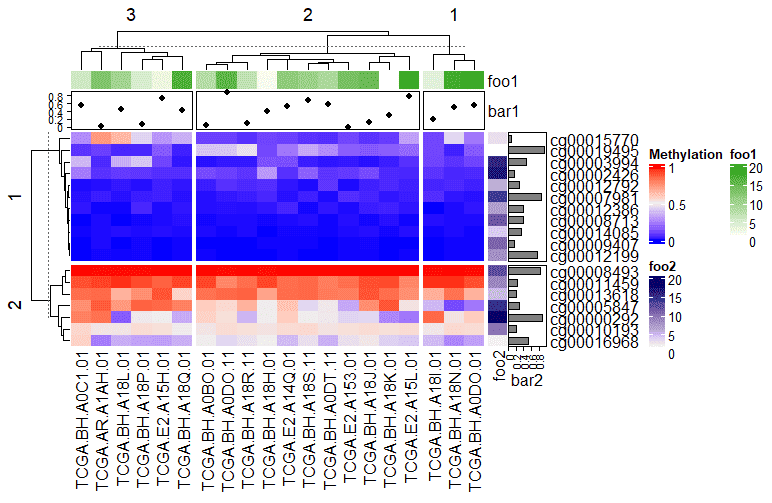
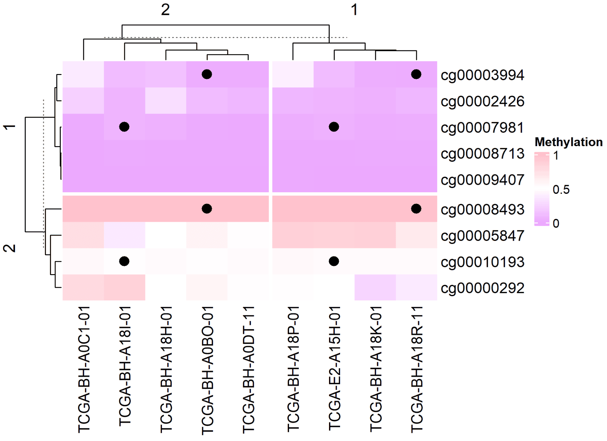
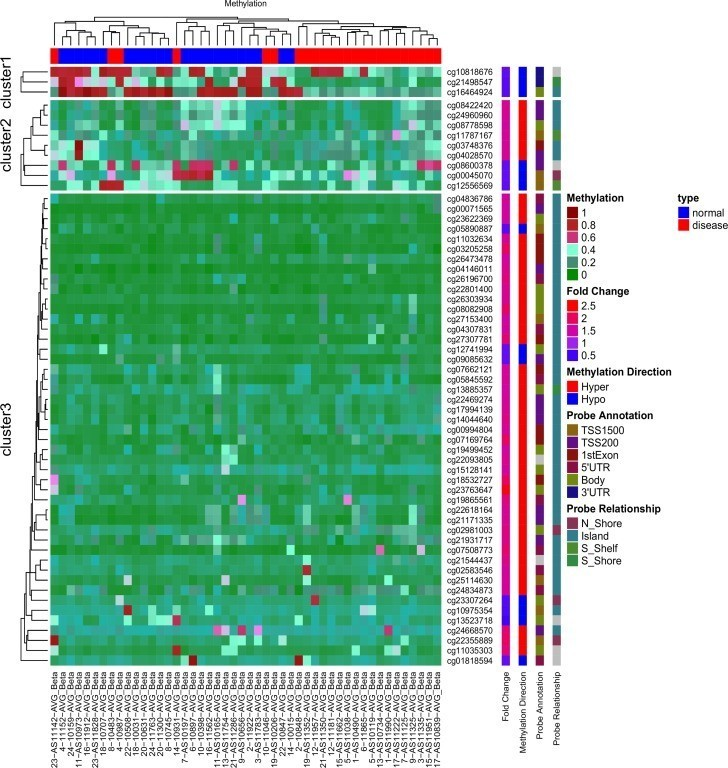

## 示例

{fig-alt="ComplexHeatmap DEMO1" fig-align="center" width="60%"}

复杂热图（Complex Heatmap）是一种高级数据可视化工具，主要用于展示多维数据的矩阵关系，并在基础热图（Heatmap）上增加了多层次注释、聚类分析、数据拆分等功能。它能够更清晰地呈现复杂数据的内在结构和关联性。

## 环境配置

-   系统要求： 跨平台（Linux/MacOS/Windows）

-   编程语言：R

-   依赖包：`ComplexHeatmap`, `dendextend`, `tidyr`, `circlize`, `gridExtra`, `pheatmap`

```{r packages setup, message=FALSE, warning=FALSE, output=FALSE}
# 安装包
if (!requireNamespace("ComplexHeatmap", quietly = TRUE)) {
  BiocManager::install("ComplexHeatmap")
}
if (!requireNamespace("dendextend", quietly = TRUE)) {
  install.packages("dendextend")
}
if (!requireNamespace("tidyr", quietly = TRUE)) {
  install.packages("tidyr")
}
if (!requireNamespace("circlize", quietly = TRUE)) {
  install.packages("circlize")
}
if (!requireNamespace("gridExtra", quietly = TRUE)) {
  install.packages("gridExtra")
}
if (!requireNamespace("pheatmap", quietly = TRUE)) {
  install.packages("pheatmap")
}

# 加载包
library(ComplexHeatmap)
library(dendextend)
library(tidyr)
library(circlize)
library(gridExtra)
library(pheatmap)
```

```{r}
sessioninfo::session_info("attached")
```

## 数据准备

数据主要来自`TCGA`数据库的甲基化数据

```{r load data, message=FALSE}
#data_mat(连续型)
data <- readr::read_csv("https://bizard-1301043367.cos.ap-guangzhou.myqcloud.com/TCGA.BRCA.sampleMap_HumanMethylation27_ch.csv")

data <- as.data.frame(data)
rownames(data) <- data[,1]
data <- data[,-1]

data_TCGA <- na.omit(data[1:20,1:20])

data_TCGA <- as.matrix(data_TCGA)  

#离散型
discrete_mat = matrix(sample(1:5, 100, replace = TRUE), 10, 10)
```

## 可视化

### 1. 基础复杂热图

**连续型变量**

这里我们以`TCGA`数据库的甲基化数据为例

```{r}
#| label: fig-1.1BasicComplexheatmap
#| fig-cap: "连续型变量"
#| out.width: "95%"
#| warning: false
#| message: false

# 连续型变量
Heatmap(data_TCGA , name = "Methylation")
```

上图为甲基化水平的复杂热图，列为基因位点，行为样本。红色表示高甲基化水平，蓝色表示低甲基化水平。边轴为聚类分析结果。

**离散型变量**

这里我们以生成数据为例

```{r}
#| label: fig-1.2BasicComplexheatmap
#| fig-cap: "离散型变量"
#| out.width: "95%"
#| warning: false
#| message: false

# 离散型变量
Heatmap(discrete_mat,  name = "mat")
```

上图为生成的离散变量的复杂热图，边轴为聚类分析结果。

### 2. 个性化

#### 2.1 颜色自定义

**连续型变量**

```{r}
#| label: fig-2.1Custom
#| fig-cap: "连续型变量颜色自定义"
#| out.width: "95%"
#| warning: false
#| message: false

# 连续型变量颜色自定义
col_fun = colorRamp2(c(0, 0.5, 1),  #设置截断点
                     c("blue", "white", "pink")) 
Heatmap(data_TCGA, name = "Methylation", col = col_fun, 
              column_title = "自定义三段颜色")
```

```{r}
#| label: fig-2.2Custom
#| fig-cap: "连续型变量颜色自定义"
#| out.width: "95%"
#| warning: false
#| message: false

# 连续型变量颜色自定义
Heatmap(data_TCGA, name = "Methylation", col = rev(rainbow(10)), 
        column_title = "创建颜色向量")
```

**离散型变量**

```{r}
#| label: fig-2.3Custom
#| fig-cap: "离散型变量颜色自定义"
#| out.width: "95%"
#| warning: false
#| message: false

# 离散型变量颜色自定义
colors <- c(
  "1" = "#BBEDA7",  
  "2" = "#F3D8FA",  
  "3" = "#FFECA1",  
  "4" = "#D9E6F7",  
  "5" = "#EFBEC6"   
)
Heatmap(discrete_mat, name = "mat", col = colors,
        column_title = "离散型变量颜色自定义")
```

#### 2.2 边框自定义

```{r}
#| label: fig-2.4Custom
#| fig-cap: "边框自定义"
#| out.width: "95%"
#| warning: false
#| message: false

# 边框自定义
Heatmap(data_TCGA, name = "Methylation", 
        border = "black", #border值可为FALSE或者颜色
        rect_gp = gpar(col = "white", lwd = 2),#lty线型, lwd线宽
        column_title = "边框自定义")
```

### 3. 聚类

可以自定义聚类方法，树状图位置、大小等

```{r}
#| label: fig-3.1Cluster
#| fig-cap: "聚类"
#| out.width: "95%"
#| warning: false
#| message: false

# 聚类
Heatmap(data_TCGA, name = "Methylation", 
       # row_dend_side = "right", 
       # column_dend_side = "bottom", #可调整树状图位置
        column_dend_height = unit(1, "cm"), 
        row_dend_width = unit(1, "cm"),#可调整树状图距离
        column_title = "聚类自定义",
        clustering_distance_rows = "pearson", #聚类方法，可自设函数
      # show_parent_dend_line = FALSE  #可隐藏虚线
        ) 
```

**树状图渲染**

我们还利用`dendextend`包对树状图进行颜色渲染

```{r}
#| label: fig-3.2Cluster
#| fig-cap: "树状图渲染"
#| out.width: "95%"
#| warning: false
#| message: false

# 树状图渲染
row_dend = as.dendrogram(hclust(dist(data_TCGA)))
row_dend = color_branches(row_dend, k = 2)  #生成分支
#数字表示颜色数量
Heatmap(data_TCGA, name = "Methylation", 
        cluster_rows = row_dend,
      # row_dend_gp = gpar(col = "red")  #也可自定义颜色
        )
```

上图可见树状图分支为不同颜色

### 4. 分割

**连续型变量**

采用k-means聚类分割

```{r}
#| label: fig-4.1Split
#| fig-cap: "连续型变量分割"
#| out.width: "95%"
#| warning: false
#| message: false

# 连续型变量分割
Heatmap(data_TCGA, 
        name = "Methylation", 
        row_km = 2,  #设置分割数
        column_km = 3)
```

利用向量分割

```{r}
#| label: fig-4.2Split
#| fig-cap: "利用向量分割"
#| out.width: "95%"
#| warning: false
#| message: false

# 利用向量分割
Heatmap(data_TCGA, name = "Methylation", 
        row_split = rep(c("A", "B"), 9), 
        column_split = rep(c("C", "D"), 10))
```

利用矩阵分割

```{r}
#| label: fig-4.3Split
#| fig-cap: "利用矩阵分割"
#| out.width: "95%"
#| warning: false
#| message: false

# 利用矩阵分割
Heatmap(data_TCGA, name = "Methylation", 
        row_split = data.frame(rep(c("A", "B"), 9), 
                               rep(c("C", "D"), each = 9)))
```

以上分割方法均可行列独立混使用，设置`show_parent_dend_line = FALSE`可隐藏虚线

**离散型变量**

按指定行列进行分割

```{r}
#| label: fig-4.4Split
#| fig-cap: "按指定行列进行分割"
#| out.width: "95%"
#| warning: false
#| message: false

# 按指定行列进行分割
Heatmap(discrete_mat, 
        name = "mat", 
        col = 1:4, 
        row_split = discrete_mat[,1])#根据矩阵数据中的第一列进行分割
```

**参数分割**

可根据热图分割对标题，聚类参数等进行分割

```{r}
#| label: fig-4.5Split
#| fig-cap: "参数分割"
#| out.width: "95%"
#| warning: false
#| message: false

# 参数分割
Heatmap(data_TCGA, name = "Methylation", 
        row_km = 2, 
        row_title_gp = gpar(col = c("#9A090A", "#0D4B99"), font = 1:2),
        row_names_gp = gpar(col = c("#748901", "#E6AC03"), fontsize = c(10, 12)),
        column_km = 3, 
        column_title_gp = gpar(fill = c("#BFD641", "#FE9900", "#CC6CE7"), font = 1:3), #fill用于填充
        column_names_gp = gpar(col = c("#1D6103", "#E08804", "#5E0676"), fontsize = c(10, 12, 8)))
```

**注释分割**

可根据热图分割对边注释进行分割

```{r}
#| label: fig-4.6Split
#| fig-cap: "注释分割"
#| out.width: "95%"
#| warning: false
#| message: false

# 注释分割
Heatmap(data_TCGA, name = "Methylation", row_km = 2, column_km = 3,
        top_annotation = HeatmapAnnotation(foo1 = 1:20, bar1 = anno_points(runif(20))),
        right_annotation = rowAnnotation(foo2 = 18:1, bar2 = anno_barplot(runif(18)))
)
```

上图中添加的点图、热图、条图注释均随主热图分割

### 5. 标签添加

**添加数据**

`cell_fun` 接受一个函数，该函数会被应用到热图的每个单元格上。函数的参数如下：

- `j`: 列索引（列号）。

- `i`: 行索引（行号）。

- `x`, `y`: 单元格中心点的坐标（基于绘图设备的坐标系）。

- `width`, `height`: 单元格的宽度和高度。

- `fill`: 单元格对应的数值（即矩阵中的值）。

```{r}
#| label: fig-5.1AddLabel
#| fig-cap: "添加数据"
#| out.width: "95%"
#| warning: false
#| message: false

# 添加数据
small_mat = data_TCGA[1:9, 1:9]
col_fun = colorRamp2(c(0, 0.5, 1), c("#EBA7FE", "white", "pink"))
Heatmap(small_mat, name = "Methylation", col = col_fun,
        cell_fun = function(j, i, x, y, width, height, fill) {
          grid.text(sprintf("%.1f", small_mat[i, j]), x, y, gp = gpar(fontsize = 10))
        })
```

```{r}
#| label: fig-5.2AddLabel
#| fig-cap: "添加数据"
#| out.width: "95%"
#| warning: false
#| message: false

# 添加数据
small_mat = data_TCGA[1:9, 1:9]
Heatmap(small_mat, name = "Methylation",  col = col_fun,
        cell_fun = function(j, i, x, y, width, height, fill) {
          if(small_mat[i, j] > 0.5) #设定显示范围
            grid.text(sprintf("%.1f", small_mat[i, j]), x, y, gp = gpar(fontsize = 10)) #添加文本/数值
        })
```

上图仅显示甲基化水平大于0.5的数据

**添加图形**

```{r}
#| label: fig-5.3AddLabel
#| fig-cap: "添加图形"
#| out.width: "95%"
#| warning: false
#| message: false
#| eval: false

# 添加图形
small_mat = data_TCGA[1:9, 1:9]
Heatmap(small_mat, name = "Methylation", col = col_fun,
        row_km = 2, column_km = 2,
        layer_fun = function(j, i, x, y, w, h, fill) {
          ind_mat = restore_matrix(j, i, x, y)
          ind = unique(c(ind_mat[1, 4], ind_mat[3, 2])) #定位,每个分割对应位置添加图形
          grid.points(x[ind], y[ind], pch = 16, size = unit(4, "mm")) #添加点
        }
)
```

::: {#fig-ComplexHeatmapFig5-3}
{fig-alt="ComplexHeatmapFig5-3" fig-align="center" width="60%"}

添加图形
:::

### 6. 按相关系数排序的带注释热图

在生物标志物研究中 \[8\]，列是**按某个目标基因表达量排序**的样本，行是与目标基因显著正/负相关的基因，顶部注释承载亚型/突变信息。关闭聚类后，目标基因的梯度（以及相关基因的楔形分布）一目了然——这就是无聚类的相关性热图。

```{r}
#| label: fig-6.1CorrOrdered
#| fig-cap: "样本按目标基因表达量排序；基因通过行分割拆成正/负相关两个区块。"
#| out.width: "95%"
#| warning: false
#| message: false
#| fig-width: 9
#| fig-height: 6

set.seed(2026)
n_sam  <- 40
genes  <- paste0("Gene", sprintf("%03d", 1:299))
target <- rnorm(n_sam)                                   # 目标基因（类 TIM-3）表达量
subtype <- factor(sample(c("Classical", "Mesenchymal", "Neural", "Proneural"), n_sam, TRUE))
idh     <- factor(sample(c("WT", "Mutant"), n_sam, TRUE, prob = c(0.6, 0.4)))

mat <- matrix(rnorm(299 * n_sam), nrow = 299,
              dimnames = list(genes, paste0("S", seq_len(n_sam))))
# 模拟生物学：15 个基因与目标基因共变，10 个反向变化
pos_seed <- sample(genes, 15)
neg_seed <- sample(setdiff(genes, pos_seed), 10)
mat[pos_seed, ] <- mat[pos_seed, ] + outer(rep(1, 15), target) * 0.9
mat[neg_seed, ] <- mat[neg_seed, ] - outer(rep(1, 10), target) * 0.9
mat <- rbind(mat, "TARGET" = target)                     # 加入目标基因行

# 与目标基因相关的基因：正相关 top-15、负相关 top-10
cors      <- cor(t(mat[genes, ]), mat["TARGET", ])
pos_genes <- names(sort(cors[, 1], decreasing = TRUE))[1:15]
neg_genes <- names(sort(cors[, 1], decreasing = FALSE))[1:10]

sel  <- c(pos_genes, neg_genes)                          # 行：正相关块在前
mat_sel <- t(scale(t(mat[sel, ])))                       # 逐行 z-score
mat_sel[mat_sel >  3] <-  3
mat_sel[mat_sel < -3] <- -3
ord    <- order(mat["TARGET", ])                         # 列按目标基因排序
mat_sel <- mat_sel[, ord]

col_fun    <- circlize::colorRamp2(c(-3, 0, 3), c("#6699CC", "white", "#FF3C38"))
target_fun <- circlize::colorRamp2(c(-2, 0, 2), c("#2166ac", "white", "#b2182b"))

ha <- HeatmapAnnotation(
  `Target expression` = mat["TARGET", ord],
  Subtype = droplevels(subtype)[ord],
  IDH     = idh[ord],
  col = list(`Target expression` = target_fun,
             Subtype = c(Classical = "#CEDC7C", Mesenchymal = "#EA6767",
                         Neural = "#F7C07C", Proneural = "#445EAD"),
             IDH = c(WT = "#EA6767", Mutant = "#70C17A")))

Heatmap(mat_sel, name = "Z-score", top_annotation = ha,
        col = col_fun,
        cluster_rows = FALSE, cluster_columns = FALSE,   # 保留目标基因梯度
        row_split = factor(rep(c("Positively correlated", "Negatively correlated"),
                               c(length(pos_genes), length(neg_genes)))),
        border = TRUE)
```

::: callout-tip
**实践要点**

- 这里的行分割由**分析结果驱动**（相关系数的符号），而非聚类——`row_split` 接受任意因子。
- 绘图前先按目标基因对列排序，相关性强弱才会呈现为可见的楔形；务必保持 `cluster_columns = FALSE`，否则排序会被聚类破坏。
- 真实数据请用 `cor.test()`（Spearman）加 rho 与 P 值阈值来筛选相关基因，参考工作流如此实现。
:::

### 7. 单细胞簇均值标记热图

单细胞标记基因面板以**簇均值**热图呈现最为清晰：每个标记基因在各簇内取均值、按行 z-score 并截断极值，以免单个高表达基因使色标饱和 \[8\]。行保持标记集顺序（`cluster_rows = FALSE`）、列做完全链接聚类，`annotation_row` 色带标注每块所属细胞类型——即 scRNA-seq 论文中标准的对角式标记-细胞类型布局。

```{r}
#| label: fig-7.1ScMarkerHeatmap
#| fig-cap: "簇均值标记热图：4 个细胞类型 × 4 套标记基因（共 24 个基因），行经 z-score 并截断，对角信号对比度一致；左侧注释条按细胞类型为标记基因集着色。"
#| out.width: "95%"
#| warning: false
#| message: false
#| fig-width: 8.5
#| fig-height: 5

set.seed(5101)
clusters <- c("T", "B", "Mye", "NK")
n_clust <- length(clusters); n_genes_per <- 6
genes <- c(paste0("T_M", 1:n_genes_per), paste0("B_M", 1:n_genes_per),
           paste0("M_M", 1:n_genes_per), paste0("NK_M", 1:n_genes_per))
# 簇均值标记表达：每套标记基因仅在其所属簇中达峰
avg <- matrix(rnorm(length(genes) * n_clust, sd = 0.4), nrow = length(genes),
              dimnames = list(genes, clusters))
for (k in 1:n_clust) {
  idx <- ((k - 1) * n_genes_per + 1):(k * n_genes_per)
  avg[idx, k] <- avg[idx, k] + 2.5
}
clip_scale <- function(x, lo = -2, hi = 2)
  matrix(pmin(pmax(x, lo), hi), nrow = nrow(x), dimnames = dimnames(x))
# 按基因 z-score 并截断至 ±2，防止单个高表达基因使色标饱和
ph_data <- clip_scale(t(scale(t(avg))))

ann <- data.frame(cluster = rep(clusters, each = n_genes_per))
cl_cols <- setNames(c("#B2182B", "#2166AC", "#EABF00", "#4D9342"), clusters)
hm <- ComplexHeatmap::pheatmap(ph_data,
  color = colorRampPalette(c("darkblue", "white", "red3"))(99),
  scale = "none", cluster_rows = FALSE, cluster_cols = TRUE,
  clustering_method = "complete", show_rownames = FALSE,
  annotation_row = ann, annotation_colors = list(cluster = cl_cols),
  border_color = NA)
ComplexHeatmap::draw(hm)

# 模拟的标记基因块须各自在所属簇中达峰（对角结构）
diag_hits <- sapply(1:n_clust, function(k) {
  idx <- ((k - 1) * n_genes_per + 1):(k * n_genes_per)
  all(apply(avg[idx, , drop = FALSE], 1, which.max) == k)
})
stopifnot(sum(diag_hits) == n_clust)
```

::: callout-tip
**实践要点**

-   `cluster_rows = FALSE` 令各标记基因集保持连续；若让行参与聚类，对角式阅读逻辑即被破坏。
-   让四组标记块色彩等浓的是按基因 z-score（`t(scale(t(avg)))`）——每行由自身对比度定标；±2 截断只是对残余离群值的保护。
-   `darkblue-white-red3` 99 级渐变匹配经典图风；用 `colorRampPalette()` 构建一次即可跨面板复用。
:::
### 8. 多区块水平拼接热图

一整幅论文版式——二分类性状条、表达矩阵、带格内数字标注的得分列——可由行对齐的三个 `pheatmap` 区块水平拼接而成 \[8\]。`display_numbers` + `number_color` 机制可把任意区块变成表格列：逐格控制数字与文字颜色，缺失值画为 `NA`。

```{r}
#| label: fig-8.1MultiBlockHeatmap
#| fig-cap: "以六种药物为共享坐标的三区块水平拼接：应答注释（红 = 敏感）、12 个基因的表达谱、以及以格内数字显示的 CMap 得分（缺失画 NA）。"
#| out.width: "95%"
#| warning: false
#| message: false
#| fig-width: 8
#| fig-height: 4.5

set.seed(5301)
drugs <- c("BI-2536", "Leptomycin", "Methotrexate",
           "Narciclasine", "SR-II-138A", "Vincristine")
expr_genes <- paste0("Gene", sprintf("%03d", 1:12))
# 三个区块行数均为 6（药物）——水平拼接的硬性要求
centre <- matrix(rnorm(12 * 6, sd = 1), nrow = 6, dimnames = list(drugs, expr_genes))
centre[1:2, ] <- centre[1:2, ] + 1.4       # 前两种药物为应答者

hm1 <- ComplexHeatmap::pheatmap(mat = matrix(c(1, 1, 0, 1, 0, 0), ncol = 1,
    dimnames = list(drugs, "Response")),
  color = c("#F7F7F7", "#B2182B"), cluster_rows = FALSE, cluster_cols = FALSE,
  show_rownames = TRUE, show_colnames = FALSE,
  cellwidth = 25, cellheight = 40, legend = FALSE)

hm2 <- ComplexHeatmap::pheatmap(mat = centre, cluster_rows = FALSE,
  cluster_cols = FALSE, show_rownames = FALSE, show_colnames = TRUE,
  color = colorRamp2(c(-2, 0, 2), c("#2166AC", "white", "#B2182B")),
  cellwidth = 55, cellheight = 18, border_color = "white", legend = FALSE)

score <- c(-83.13, NA, -49.61, -91.23, NA, -34.30)
hm3 <- ComplexHeatmap::pheatmap(mat = matrix(score, ncol = 1,
    dimnames = list(drugs, "CMap\nscore")),
  color = c("#FDCEB9", "#FDCEB9", "#F26E5F"),
  cluster_rows = FALSE, cluster_cols = FALSE,
  show_rownames = FALSE, show_colnames = TRUE,
  display_numbers = ifelse(is.na(score), "NA", sprintf("%.1f", score)),
  number_color = ifelse(is.na(score), "black", "white"),
  fontsize_number = 9, border_color = "white",
  cellwidth = 40, cellheight = 40, legend = FALSE)

ComplexHeatmap::draw(hm1 + hm2 + hm3)
stopifnot(sum(is.na(score)) == 2 &&
          identical(as.numeric(matrix(c(1, 1, 0, 1, 0, 0), ncol = 1)),
                    c(1, 1, 0, 1, 0, 0)))
```

::: callout-tip
**实践要点**

-   水平拼接要求**各区块行数相同**（报错会逐一列出各块行数）：所有区块须建于同一药物/样本向量之上。
-   `draw(hm1 + hm2 + hm3)` 自左向右组合；为每块单独设 `cellwidth`/`cellheight`，而非统一图幅。
-   对不宜以色载义的区块（含缺失值的得分列），`display_numbers` + 逐格 `number_color` 比强套色阶更易读。
:::


::: {#fig-ComplexHeatmapApplications}
{fig-alt="ComplexHeatmapApp1" fig-align="center" width="60%"}

复杂热图图应用
:::

上图是基于 AVR 数据\[1\]中 59 个差异甲基化 ATG 位点的无监督层次聚类热图。红色表示 DNA 甲基化程度高，绿色表示甲基化程度低。

## 参考文献

\[1\] Radhakrishna U, Albayrak S, Alpay-Savasan Z, Zeb A, Turkoglu O, Sobolewski P, Bahado-Singh RO. Genome-Wide DNA Methylation Analysis and Epigenetic Variations Associated with Congenital Aortic Valve Stenosis (AVS). PLoS One. 2016 May 6;11(5):e0154010. doi: 10.1371/journal.pone.0154010. PMID: 27152866; PMCID: PMC4859473.

\[2\] Gu, Z. (2016) Complex heatmaps reveal patterns and correlations in multidimensional genomic data. Bioinformatics.Gu, Z. (2022) Complex Heatmap Visualization. iMeta.

\[3\] Tal Galili (2015). dendextend: an R package for visualizing, adjusting, and comparing trees of hierarchical clustering. Bioinformatics. DOI:10.1093/bioinformatics/btv428

\[4\] Wickham H, Vaughan D, Girlich M (2024). tidyr: Tidy Messy Data. R package version 1.3.1, CRAN: Package tidyr.

\[5\] Gu, Z. (2014) circlize implements and enhances circular visualization in R. Bioinformatics.

\[6\] Auguie B (2017). gridExtra: Miscellaneous Functions for "Grid" Graphics. R package version 2.3, CRAN: Package gridExtra.

\[7\] Kolde R (2019). pheatmap: Pretty Heatmaps. R package version 1.0.12, CRAN: Package pheatmap.

\[8\] Xiaofan Lu, et al. FigureYa: A Standardized Visualization Framework for Enhancing Biomedical Data Interpretation and Research Efficiency. iMetaMed. 2025. doi:10.1002/imm3.70005

