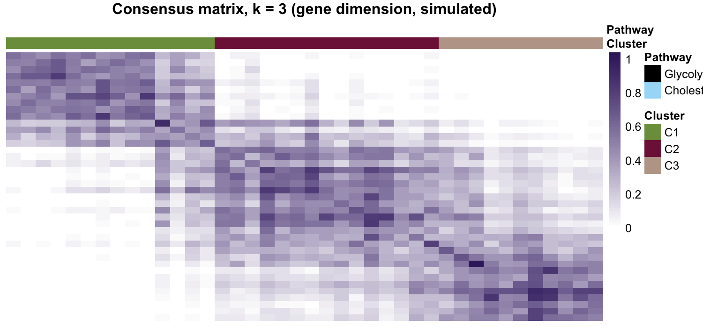

The reference flips consensus clustering on its side: instead of clustering tumours, it clusters **genes as observations** (tumours as features) to find which glycolytic vs cholesterogenic genes are co-expressed, then curates the stable gene groups into pathway signatures \[1\]. `ConsensusClusterPlus` is the usual engine but not in this repository's lockfile, so this tutorial re-implements its core — resample observations, cluster each resample, accumulate the **co-clustering frequency matrix** — and renders the consensus heatmap in the reference's white→purple ramp:

## Example

{fig-alt="Consensus Clustering on the Gene Dimension DEMO" fig-align="center" width="60%"}

## Setup

-   System Requirements: Cross-platform (Linux/MacOS/Windows)

-   Programming language: R

-   Dependent packages: `ggplot2`; `pheatmap`; `patchwork`

```{r packages setup, message=FALSE, warning=FALSE, output=FALSE}
suppressPackageStartupMessages({
  library(ggplot2)
  library(pheatmap)
})
```

```{r}
sessioninfo::session_info("attached")
```

## Data Preparation

40 simulated genes (20 glycolytic, 20 cholesterogenic) × 80 samples, with the gly genes following a shared pattern A and the chol genes pattern B — the consensus matrix must expose exactly these two stable blocks plus a residual third cluster:

```{r load data}
suppressPackageStartupMessages({library(ggplot2); library(pheatmap); library(patchwork)})
set.seed(20201)
## 40 genes: 20 glycolytic + 20 cholesterogenic, 80 samples (tumours as features)
n_gly <- 20; n_chol <- 20; n_sam <- 80
gly <- sprintf("GLY%02d", 1:n_gly); chol <- sprintf("CHO%02d", 1:n_chol)
expr <- matrix(rnorm((n_gly + n_chol) * n_sam), n_gly + n_chol, n_sam,
               dimnames = list(c(gly, chol), sprintf("T%02d", 1:n_sam)))
## planted co-expression: gly genes follow pattern A, chol pattern B
patA <- sin(seq(0, 3 * pi, length.out = n_sam)) + rnorm(n_sam, 0, 0.4)
patB <- cos(seq(0, 3 * pi, length.out = n_sam)) + rnorm(n_sam, 0, 0.4)
expr[1:n_gly, ] <- expr[1:n_gly, ] + patA * 1.2
expr[(n_gly + 1):(n_gly + n_chol), ] <- expr[(n_gly + 1):(n_gly + n_chol), ] + patB * 1.2
genes_obs <- t(scale(t(expr)))          # genes as observations, samples as features
## minimal consensus clustering: resample observations, cluster, accumulate
## the co-clustering frequency (what ConsensusClusterPlus does internally)
reps <- 100; k <- 3
n_obs <- nrow(genes_obs)
co <- matrix(0, n_obs, n_obs, dimnames = list(rownames(genes_obs), rownames(genes_obs)))
set.seed(2020103)
for (r in seq_len(reps)) {
  idx <- sample(n_obs, round(0.8 * n_obs), TRUE)
  hc <- hclust(dist(genes_obs[idx, ]), method = "ward.D2")
  cl <- cutree(hc, k = k)
  for (a in seq_along(idx)) for (b in seq_along(idx)) {
    if (a != b && cl[a] == cl[b]) co[idx[a], idx[b]] <- co[idx[a], idx[b]] + 1
  }
}
co <- co / reps
final <- hclust(as.dist(1 - co), method = "ward.D2")
cl <- cutree(final, k = k)
gene_cluster <- paste0("C", cl)
```

## Visualization

### 1. Consensus Matrix, k = 3

The co-clustering heatmap with the Cluster/Pathway annotation strips: the glycolytic block (C1) and cholesterogenic block (C2) show near-1 consensus within and ~0 across, and C3 collects genes that never join either pattern — the stability readout that decides which gene groups survive curation:

```{r}
#| label: fig-1.1Consensus
#| fig-cap: "Consensus matrix of 40 simulated genes clustered on the gene dimension (k = 3, 100 resamples): glycolytic (C1) and cholesterogenic (C2) blocks show high within-cluster consensus with the Pathway annotation strip, while C3 collects unaffiliated genes."
#| out.width: "100%"
#| warning: false
#| message: false
#| fig-width: 7.5
#| fig-height: 3.8

ann_col <- data.frame(Cluster = paste0("C", cl), row.names = rownames(co))
ann_col$Pathway <- c(rep("Glycolytic", n_gly), rep("Cholesterogenic", n_chol))[rownames(ann_col)]
ann_colors <- list(Cluster = c(C1 = "#7B9C4A", C2 = "#7F1D47", C3 = "#BDA597"),
                   Pathway = c(Glycolytic = "black", Cholesterogenic = "#A7DCF8"))
pheatmap(co[order(cl), order(cl)],
         color = colorRampPalette(c("white", "#3A236B"))(64),
         cluster_rows = FALSE, cluster_cols = FALSE,
         annotation_col = ann_col, annotation_colors = ann_colors,
         show_rownames = FALSE, show_colnames = FALSE,
         border_color = NA, legend = TRUE,
         main = "Consensus matrix, k = 3 (gene dimension, simulated)")
```

::: callout-tip
**Practice tips**

-   Consensus clustering is just **resample → cluster → co-clustering frequency**: 80% row resamples × 100 reps accumulate `co[a, b]` whenever two observations land in the same cluster; normalize by reps and cluster the matrix itself for the final order.
-   Run it on the **gene dimension** only when the question is "which genes co-behave" — for tumour subtyping keep samples as observations (the usual ConsensusClusterPlus setup).
-   Curate the surviving groups by intersecting each consensus cluster with the original pathway membership, and expect the exact gene numbers to vary between runs — the reference author says the same.
:::

## Applications

::: {#fig-ConsensusApplications1}
{fig-alt="Gene-dimension consensus matrix" fig-align="center" width="60%"}

Gene-dimension consensus matrix
:::

Gene-dimension consensus matrices curate unstable signatures: pathway gene sets, panel designs, or co-expression module boundaries.

## Reference

\[1\] Xiaofan Lu, et al. FigureYa: A Standardized Visualization Framework for Enhancing Biomedical Data Interpretation and Research Efficiency. iMetaMed. 2025. doi:10.1002/imm3.70005

\[2\} Wilkerson MD, Hayes DN. ConsensusClusterPlus: a class discovery tool with confidence assessments and item tracking. Bioinformatics. 2010;26(12):1572-1573. doi:10.1093/bioinformatics/btq170 (the engine the reference wraps)