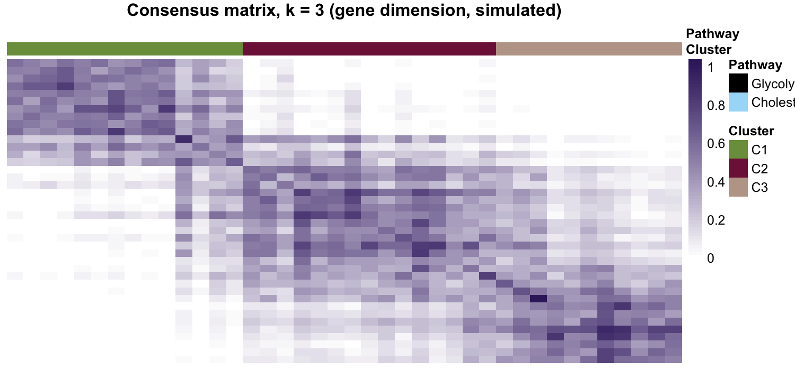

参考文档把共识聚类翻了个面：不是聚类肿瘤，而是把**基因作为观测**聚类（肿瘤作为特征）以发现哪些糖酵解与胆固醇合成基因共表达，再把稳定的基因组整理成通路 signature \[1\]。`ConsensusClusterPlus` 是常用引擎但不在本仓库 lockfile，本教程重实现其核心——重采样观测、逐次聚类、累积**共聚类频率矩阵**——并以参考的白色→紫色 ramp 渲染共识热图：

## Example

{fig-alt="基因维度共识聚类 DEMO" fig-align="center" width="60%"}

## Setup

-   系统要求：跨平台（Linux/MacOS/Windows）

-   编程语言：R

-   依赖包：`ggplot2`; `pheatmap`; `patchwork`

```{r packages setup, message=FALSE, warning=FALSE, output=FALSE}
suppressPackageStartupMessages({
  library(ggplot2)
  library(pheatmap)
})
```

```{r}
sessioninfo::session_info("attached")
```

## 数据准备

40 个模拟基因（20 糖酵解、20 胆固醇合成）× 80 样本，gly 基因共享模式 A、chol 基因共享模式 B——共识矩阵须暴露这两个稳定块加一个残余第三簇：

```{r load data}
suppressPackageStartupMessages({library(ggplot2); library(pheatmap); library(patchwork)})
set.seed(20201)
## 40 genes: 20 glycolytic + 20 cholesterogenic, 80 samples (tumours as features)
n_gly <- 20; n_chol <- 20; n_sam <- 80
gly <- sprintf("GLY%02d", 1:n_gly); chol <- sprintf("CHO%02d", 1:n_chol)
expr <- matrix(rnorm((n_gly + n_chol) * n_sam), n_gly + n_chol, n_sam,
               dimnames = list(c(gly, chol), sprintf("T%02d", 1:n_sam)))
## planted co-expression: gly genes follow pattern A, chol pattern B
patA <- sin(seq(0, 3 * pi, length.out = n_sam)) + rnorm(n_sam, 0, 0.4)
patB <- cos(seq(0, 3 * pi, length.out = n_sam)) + rnorm(n_sam, 0, 0.4)
expr[1:n_gly, ] <- expr[1:n_gly, ] + patA * 1.2
expr[(n_gly + 1):(n_gly + n_chol), ] <- expr[(n_gly + 1):(n_gly + n_chol), ] + patB * 1.2
genes_obs <- t(scale(t(expr)))          # genes as observations, samples as features
## minimal consensus clustering: resample observations, cluster, accumulate
## the co-clustering frequency (what ConsensusClusterPlus does internally)
reps <- 100; k <- 3
n_obs <- nrow(genes_obs)
co <- matrix(0, n_obs, n_obs, dimnames = list(rownames(genes_obs), rownames(genes_obs)))
set.seed(2020103)
for (r in seq_len(reps)) {
  idx <- sample(n_obs, round(0.8 * n_obs), TRUE)
  hc <- hclust(dist(genes_obs[idx, ]), method = "ward.D2")
  cl <- cutree(hc, k = k)
  for (a in seq_along(idx)) for (b in seq_along(idx)) {
    if (a != b && cl[a] == cl[b]) co[idx[a], idx[b]] <- co[idx[a], idx[b]] + 1
  }
}
co <- co / reps
final <- hclust(as.dist(1 - co), method = "ward.D2")
cl <- cutree(final, k = k)
gene_cluster <- paste0("C", cl)
```

## Visualization

### 共识矩阵，k = 3

带 Cluster/Pathway 注释条的共聚类热图：糖酵解块（C1）与胆固醇块（C2）内部近 1、跨块近 0，C3 收容不属于任一模式的基因——决定哪些基因组通过整理的稳定性读数：

```{r}
#| label: fig-1.1Consensus
#| fig-cap: "40 个模拟基因在基因维度聚类的共识矩阵（k = 3、100 次重采样）：糖酵解（C1）与胆固醇合成（C2）块内部共识高且带 Pathway 注释条，C3 收容无归属基因。"
#| out.width: "100%"
#| warning: false
#| message: false
#| fig-width: 7.5
#| fig-height: 3.8

ann_col <- data.frame(Cluster = paste0("C", cl), row.names = rownames(co))
ann_col$Pathway <- c(rep("Glycolytic", n_gly), rep("Cholesterogenic", n_chol))[rownames(ann_col)]
ann_colors <- list(Cluster = c(C1 = "#7B9C4A", C2 = "#7F1D47", C3 = "#BDA597"),
                   Pathway = c(Glycolytic = "black", Cholesterogenic = "#A7DCF8"))
pheatmap(co[order(cl), order(cl)],
         color = colorRampPalette(c("white", "#3A236B"))(64),
         cluster_rows = FALSE, cluster_cols = FALSE,
         annotation_col = ann_col, annotation_colors = ann_colors,
         show_rownames = FALSE, show_colnames = FALSE,
         border_color = NA, legend = TRUE,
         main = "Consensus matrix, k = 3 (gene dimension, simulated)")
```


::: callout-tip
**实践提示**

-   RSS 奖励的是**特异性而非活性**：处处高活的调控子得分低——按列读柱（每个调控子归哪个细胞类型），别按行。
-   RAS 二值化按各调控子自身分布的拐点（pySCENIC 默认逐调控子阈值）；全局截断会把低 RSS 细胞类型静默成人为零值。
-   按参考文档的方式验证二值化：图上的二值化活性必须与高亮细胞类型共定位；散乱的模式说明该调控子无细胞类型特异性，RSS 柱夸大了它。
:::

## 应用场景

::: {#fig-ConsensusApplications1}
{fig-alt="基因维度共识矩阵" fig-align="center" width="60%"}

基因维度共识矩阵
:::

基因维度共识矩阵用于整理不稳定的 signature：通路基因集、panel 设计、或共表达模块边界。

## 参考文献

\[1\] Xiaofan Lu, et al. FigureYa: A Standardized Visualization Framework for Enhancing Biomedical Data Interpretation and Research Efficiency. iMetaMed. 2025. doi:10.1002/imm3.70005

\[2\} Wilkerson MD, Hayes DN. ConsensusClusterPlus: a class discovery tool with confidence assessments and item tracking. Bioinformatics. 2010;26(12):1572-1573. doi:10.1093/bioinformatics/btq170 (the engine the reference wraps)