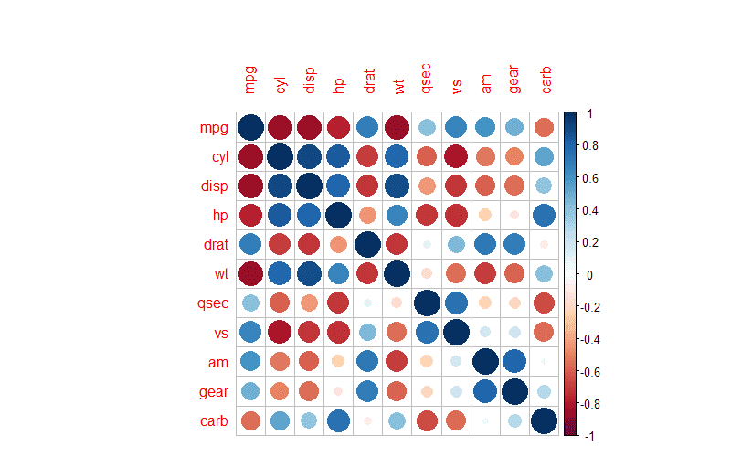
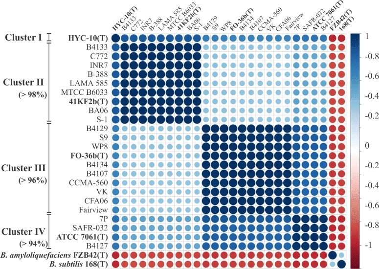
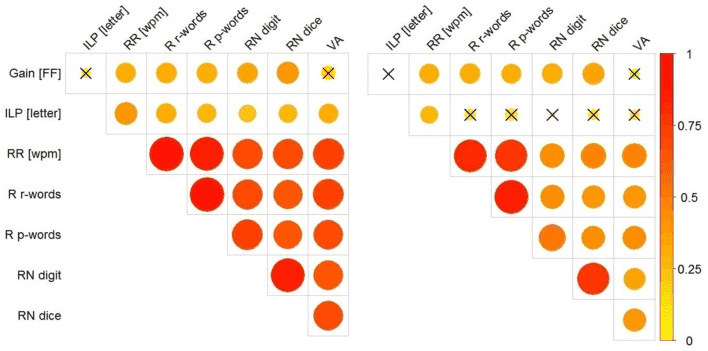

Correlogram or Correlation diagrams are often used to summarize the correlation information of various groups of data in the entire dataset.

## Example

{fig-alt="Correlogram DEMO" fig-align="center" width="60%"}

For example, the above diagram is a correlation heatmap of various groups of data in the `mtcars` dataset. Colors are used to represent the pairwise correlations of data in different groups, and the shade of the color represents the magnitude of the P-value.

## Setup

-   System Requirements: Cross-platform (Linux/MacOS/Windows)

-   Programming Language: R

-   Dependencies: `GGally`; `corrplot`; `ggcorrplot`; `corrgram`; `circlize`

```{r packages setup, message=FALSE, warning=FALSE, output=FALSE}
# Install packages
if (!requireNamespace("GGally", quietly = TRUE)) {
  install.packages("GGally")
}
if (!requireNamespace("corrplot", quietly = TRUE)) {
  install.packages("corrplot")
}
if (!requireNamespace("ggcorrplot", quietly = TRUE)) {
  install.packages("ggcorrplot")
}
if (!requireNamespace("corrgram", quietly = TRUE)) {
  install.packages("corrgram")
}
if (!requireNamespace("circlize", quietly = TRUE)) {
  install.packages("circlize")
}

# Load packages
library(GGally)
library(corrplot)
library(ggcorrplot)
library(corrgram)
library(circlize)
```

```{r}
sessioninfo::session_info("attached")
```

## Data Preparation

The correlation heatmap is mainly drawn using the built-in datasets in R.

```{r load data, message=FALSE}
data("flea", package = "GGally")
data_flea <- flea

data("mtcars", package = "datasets")
data_mtcars <- mtcars

data("tips", package = "GGally")
data_tips <- tips
```

## Visualization

### 1. GGally Package

> `GGally` is a commonly used tool for drawing correlation diagrams. It allows the injection of `ggplot2` code but does not have a sorting function.

#### **Drawing of Basic Correlation Diagram**

```{r, message=FALSE}
ggpairs(data_flea, columns = 2:5)
```

> The above diagram shows the correlation visualization of each group of data in the `flea` dataset. The picture consists of three parts: the scatter plot of the correlation between the corresponding two groups of data in the lower part; the density plot of a single group of data on the diagonal; and the `Pearson` correlation coefficient values of the corresponding two groups of data in the upper part.

#### **Introducing ggplot2 Codes to Color Each Category**

```{r, message=FALSE}
ggpairs(data_flea, columns = 2:4, ggplot2::aes(colour=species,alpha=0.7)) 
```

> The above diagram, on the basis of correlation visualization, classifies each category by color.

#### **Customizing the Plotting Type**

```{r, message=FALSE}
ggpairs(data_tips[, c(1, 3, 4, 2)])

summary(data_tips)
```

> In the above diagram, `tatal_bill` and `tip` are quantitative data, while `sex` and `smoker` are qualitative data. In the lower part, scatter plots, histograms, and bar charts of pairwise correlations are mainly drawn according to different data types; in the diagonal part, the distribution diagrams of each group of data are shown; in the upper part, pairwise correlation line charts are drawn according to different data types, and for two quantitative data, the `Pearson` correlation coefficient values are given.

```{r, message=FALSE}
# Changing the plotting type
ggpairs(
  data_tips[, c(1, 3, 4, 2)],
  upper = list(continuous = "density",
               combo = "box_no_facet"),
  lower = list(continuous = "points",
               combo = "dot_no_facet")
)
```

> Through customization, the histogram in the lower part is modified into a scatter plot, and the correlation coefficient values in the upper part are modified into a density plot.

#### **Correlation Visualization**

Visualize the correlation coefficients.

```{r, message=FALSE}
ggcorr(data_mtcars) # Draw a correlation coefficient heatmap, with Pearson as the default
```

> The above diagram visualizes the correlation coefficients through the `ggcorr（）` function.
>
> The `method` parameter of `ggcorr`:
>
> The default is in the form of `c("pairwise", "pearson")`. The first parameter is to determine the handling of missing values when calculating the covariance, and the second parameter is used to determine the type of correlation coefficient, such as `"pearson"`, `"kendall"` or `"spearman"`.

### 2. corrplot Package

> The `corrplot` package is a commonly used tool for **correlation visualization**, which has powerful customization functions and a sorting function.

#### **Basic Plotting**

```{r, message=FALSE}
corr <- cor(data_mtcars)
corrplot(corr)
```

#### **Parameter Customization**

> The main key parameters of `corrplot()`:
>
> `corr` The **correlation coefficient** matrix to be visualized
>
> `method` The shape of the visualization
>
> `type` The display range (full, lower, upper)
>
> `col` The color of the graph display
>
> `addCoef.col` The color of the correlation coefficient values
>
> `order` The sorting method of the correlation coefficients
>
> `is.corr` Whether to draw a correlation coefficient plot, which is `TRUE` by default. It can also achieve the visualization of non-correlation coefficients. Just set this parameter to `FALSE`.
>
> ......

```{r, message=FALSE}
corrplot(corr,method = "ellipse" ,#method, specify the visualization shape
         order = "AOE", #order, the sorting method of the correlation coefficients
         addCoef.col="black", # Specify the color of the correlation coefficients
         type="lower") # Specify the display part
```

> The above diagram is a correlation coefficient heatmap of the `mtcars` dataset.
>
> -   `type="lower"` specifies to display the lower part of the heatmap.
>
> -   The shade of the color represents the magnitude of the correlation coefficient.
>
> -   The shape of the ellipse represents the correlation coefficient: the greater the eccentricity, the flatter the ellipse, and the larger the absolute value of the correlation coefficient; the smaller the eccentricity, the rounder the ellipse, and the smaller the absolute value of the correlation coefficient. The direction of the long axis of the ellipse represents the positive or negative of the correlation coefficient. The upper right - lower left direction corresponds to a positive value, and the upper left - lower right direction corresponds to a negative value.

#### **Adding Significance Labels**

```{r, message=FALSE}
res1 <-cor.mtest(data_mtcars, conf.level= .95)
corrplot(corr, method= "circle",
         p.mat= res1$p, sig.level= 0.01, # P-values greater than 0.01 are considered to have no statistical significance
         mar= c(1,1,1,1))
```

> The above diagram adds significance labels on the basis of the correlation coefficient heatmap. P-values greater than 0.01 are regarded as having no statistical significance.

### 3. ggcorrplot Package

> The `ggcorrplot` package is equivalent to a simplified version of the `corrplot` package, mainly including the calculation function of `cor_pmat` and the plotting function of `ggcorrplot`.

#### **Calculating P-values with cor_pmat**

```{r, message=FALSE}
p.mat <- cor_pmat(data_mtcars)
head(p.mat[, 1:6])
```

#### **Plotting with ggcorrplot**

```{r, message=FALSE}
ggcorrplot(corr, method = "square" )
```

> The above diagram is a color heatmap of the correlation coefficients of the `mtcar` dataset.

```{r}
ggcorrplot(corr, method = "circle" )
```

> Here we have changed the plotting type to a circle.

### 4. corrgram Package

> The `corrgram` package is also a good choice for drawing correlation diagrams. It can select the content to be displayed in the upper, lower, and diagonal parts.
>
> We mainly use the `corrgram()` function to draw the correlation diagram:
>
> -   `cor.method` determines the type of correlation coefficient, `pearson` (default), `spearman`, `kendall`
>
> Different methods can be used for visualization:
>
> -   `panel.ellipse` displays an ellipse
> -   `panel.shade` is used for color blocks
> -   `panel.pie` is used for pie charts
> -   `panel.pts` is used for scatter plots

```{r, message=FALSE}
corrgram(data_mtcars, order=TRUE, 
         lower.panel=panel.shade, # Color blocks
         upper.panel=panel.pie, # Pie chart
         text.panel=panel.txt, 
         main="Car Milage Data in PC2/PC1 Order") 
```

> By setting `lower.panel=panel.shade` and `upper.panel=panel.pie`, the upper part is set as a pie chart, and the lower part is set as a color diagram.

```{r, message=FALSE}
corrgram(data_mtcars, order=TRUE, 
         lower.panel=panel.ellipse, # Display an ellipse
         upper.panel=panel.pts,  # Scatter plot
         text.panel=panel.txt, 
         diag.panel=panel.minmax, 
         main="Car Milage Data in PC2/PC1 Order") 
```

> By setting `lower.panel=panel.ellipse` and `upper.panel=panel.pts`, the upper part is set as a scatter plot, and the lower part is set as an ellipse diagram (where the red line is the fitted curve).

```{r, message=FALSE}
corrgram(data_mtcars, order=NULL, 
         lower.panel=panel.shade, # Color blocks
         upper.panel=NULL, 
         text.panel=panel.txt, 
         main="Car Milage Data (unsorted)")
```

> By setting `lower.panel=panel.shade` and `upper.panel=NULL`, only the color diagram in the lower part is displayed.

### 5. Multi-Gene Correlation with FDR Correction

When testing correlations for many genes simultaneously, **false discovery rate (FDR) correction** is essential \[7\]. This recipe computes pairwise correlations between a target gene and all others, applies BH correction, and visualises the results as a sorted bar chart.

```{r}
#| label: fig-5.1MultiGeneCor
#| fig-cap: "Correlation of simulated genes with a target gene; bars sorted by r, red = significant after BH correction."
#| out.width: "85%"
#| warning: false
#| message: false
#| fig-width: 8
#| fig-height: 6

set.seed(2801)
target_gene <- "TARGET"
other_genes <- paste0("Gene", sprintf("%03d", 1:30))
n_samp <- 40

expr_cor <- matrix(rnorm(31 * n_samp, sd = 1), nrow = 31,
                   dimnames = list(c(target_gene, other_genes), NULL))
# make some genes correlated with target
expr_cor[2:11, ] <- sweep(expr_cor[2:11, ], 2, expr_cor[1, ] * 0.6, `+`)

cor_res <- t(sapply(2:nrow(expr_cor), function(i) {
  ct <- cor.test(expr_cor[1, ], expr_cor[i, ], method = "pearson")
  c(r = unname(ct$estimate), p = ct$p.value)
}))
cor_df <- data.frame(gene = other_genes, r = cor_res[, "r"], p = cor_res[, "p"])
cor_df$fdr <- p.adjust(cor_df$p, method = "BH")
cor_df <- cor_df[order(cor_df$r), ]
cor_df$sig <- cor_df$fdr < 0.05

ggplot(cor_df, aes(r, reorder(gene, r), fill = sig)) +
  geom_col(width = 0.6) +
  scale_fill_manual(values = c(`TRUE` = "#B2182B", `FALSE` = "grey70"),
                    labels = c(`TRUE` = "FDR < 0.05", `FALSE` = "n.s."), name = NULL) +
  labs(x = "Pearson correlation coefficient", y = NULL,
       title = paste0("Correlation with ", target_gene)) +
  theme_classic(base_size = 10) +
  theme(legend.position = "bottom")
```

::: callout-tip
**Practice tips**

-   `p.adjust(method = "BH")` must be applied across **all tested genes** — adjusting per gene or per plot invalidates the FDR.
-   Sort bars by correlation coefficient (not by gene name) to see the gradient from positive to negative correlations.
-   For Spearman correlation, replace `cor.test(method = "pearson")` with `method = "spearman"`.
:::

### 6. Correlation Chord Around the Circle (circlize)

The FigureYa37 layout \[8\] turns a gene-gene correlation table into a **chord diagram**: every gene is a coloured arc around the circle, and each selected gene pair is a link whose **width encodes |cor|** and whose colour encodes the signed coefficient (green negative, red positive). Links attach to sub-segments of each arc sized by the cumulative widths, so a gene involved in many correlations gets proportionally sliced. The block below keeps the reference's construction, screening the top 16 Spearman pairs of a 10-gene simulated panel:

```{r}
#| label: fig-6.1CorrChord
#| fig-cap: "Spearman correlation chord of the top 16 pairs among 10 simulated genes: gene arcs coloured with the d3 palette, link width = |cor|, link colour = signed cor (green = negative, red = positive), gradient bar as the legend."
#| out.width: "70%"
#| warning: false
#| message: false
#| fig-width: 7.5
#| fig-height: 7.5

set.seed(3701)
n_s <- 120
genes10 <- paste0("GENE", sprintf("%02d", 1:10))
expr_c <- matrix(rnorm(n_s * 10), n_s, 10, dimnames = list(NULL, genes10))
expr_c[, 2] <- expr_c[, 1] * 0.85 + rnorm(n_s, 0, 0.5)
expr_c[, 3] <- -expr_c[, 1] * 0.8 + rnorm(n_s, 0, 0.5)
expr_c[, 5] <- expr_c[, 4] * 0.9 + rnorm(n_s, 0, 0.4)
expr_c[, 6] <- -expr_c[, 4] * 0.75 + rnorm(n_s, 0, 0.5)
expr_c[, 8] <- expr_c[, 7] * 0.8 + rnorm(n_s, 0, 0.5)

cors <- expand.grid(Gene_1 = genes10, Gene_2 = genes10, stringsAsFactors = FALSE)
cors <- cors[cors$Gene_1 < cors$Gene_2, ]
cors$cor <- mapply(function(a, b) cor(expr_c[, a], expr_c[, b], method = "spearman"),
                   cors$Gene_1, cors$Gene_2)
cors <- cors[order(-abs(cors$cor)), ][1:16, ]

## slice each gene's arc into per-pair sub-segments of width |cor|
pairs <- cors
long <- rbind(data.frame(pid = seq_len(nrow(pairs)), gene = pairs$Gene_1, cor = pairs$cor),
              data.frame(pid = seq_len(nrow(pairs)), gene = pairs$Gene_2, cor = pairs$cor))
long <- long[order(long$gene), ]
seg <- do.call(rbind, lapply(split(long, long$gene), function(x) {
  end <- cumsum(abs(x$cor))
  data.frame(key = paste(x$gene, x$pid, sep = "_"),
             gene = x$gene[1], start = c(0, head(end, -1)), end = end)
}))
key1 <- paste(pairs$Gene_1, seq_len(nrow(pairs)), sep = "_")
key2 <- paste(pairs$Gene_2, seq_len(nrow(pairs)), sep = "_")
pairs$start_1 <- seg$start[match(key1, seg$key)]; pairs$end_1 <- seg$end[match(key1, seg$key)]
pairs$start_2 <- seg$start[match(key2, seg$key)]; pairs$end_2 <- seg$end[match(key2, seg$key)]

gene_sum <- tapply(abs(long$cor), long$gene, sum)
GeneID <- data.frame(gene = names(gene_sum), Gene_End = as.numeric(gene_sum))
GeneID$Gene_Start <- 0
GeneID <- GeneID[order(GeneID$gene), ]
GeneID$Color <- ggsci::pal_d3("category20")(nrow(GeneID))

color_ramp <- colorRampPalette(c("#67BE54", "#FFFFFF", "#F82C2B"))(201)
pairs$color <- color_ramp[round((pairs$cor + 1) / 2 * 200) + 1]

circos.clear()
circos.par(start.degree = 90, gap.degree = 5, track.margin = c(0, 0.23),
           cell.padding = c(0, 0, 0, 0))
circos.initialize(factors = GeneID$gene, xlim = cbind(GeneID$Gene_Start, GeneID$Gene_End))
circos.trackPlotRegion(ylim = c(0, 1), factors = GeneID$gene, track.height = 0.05,
                       panel.fun = function(x, y) {
                         name <- get.cell.meta.data("sector.index")
                         i <- get.cell.meta.data("sector.numeric.index")
                         xlim <- get.cell.meta.data("xlim")
                         ylim <- get.cell.meta.data("ylim")
                         circos.text(x = mean(xlim), y = 1, labels = name, cex = 0.95,
                                     niceFacing = TRUE, facing = "bending",
                                     adj = c(0.5, -2.6), font = 2)
                         circos.rect(xlim[1], ylim[1], xlim[2], ylim[2],
                                     col = GeneID$Color[i], border = GeneID$Color[i])
                       })
for (i in seq_len(nrow(pairs))) {
  circos.link(sector.index1 = pairs$Gene_1[i],
              point1 = c(pairs$start_1[i], pairs$end_1[i]),
              sector.index2 = pairs$Gene_2[i],
              point2 = c(pairs$start_2[i], pairs$end_2[i]),
              col = paste0(pairs$color[i], "C9"), border = FALSE, rou = 0.7)
}
i0 <- seq(0, 0.995, 0.005)
rect(-1 + i0 / 2, -1, -0.9975 + i0 / 2, -0.96,
     col = paste0(as.character(color_ramp), "FF"),
     border = paste0(as.character(color_ramp), "FF"))
text(-0.97, -1.03, "-1"); text(-0.51, -1.03, "1")
circos.clear()
```

::: callout-tip
**Practice tips**

-   Screen pairs by |cor| before drawing: a full 45-pair chord diagram of 10 genes is unreadable; the top 16 keep the strong structure.
-   The sub-segment slicing (`cumsum(abs(cor))` per gene) is what makes link widths honest — draw full-width links instead and a hub gene with six links visually overstates its strongest correlation.
-   `circos.clear()` before AND after: a stale circos layout hijacks the next base plot.

-   **`pairs()` corrgram panels (FigureYa76)**: the base-graphics alternative needs no package — split the off-diagonals with custom panel functions (lower: scatter + regression line; upper: coefficient-filled rectangles via a red-white-blue ramp clipped at ±1; diagonal: variable names) and call `pairs(m, lower.panel = ..., upper.panel = ..., diag.panel = ...)`; `corrgram::panel.fill` is the inspiration but three short functions reproduce it.
::::::

## Applications

::: {#fig-CorrelogramApplications}
{fig-alt="CorrelogramApp1" fig-align="center" width="60%"}

Applications of Correlogram
:::

> The above diagram is a correlation diagram based on the ANI values of strains. The ANI values between each indicator strain are calculated using the JSpecies software and used for the construction of the Pearson correlation matrix. This diagram shows the correlations constructed and sorted by hierarchical clustering using the `corrplot` package. \[1\]

::: {#fig-CorrelogramApplications2}
{fig-alt="CorrelogramApp2" fig-align="center" width="60%"}

Applications of Correlogram
-   **Stars in the fill legend (FigureYa97correlationV3)**: a `geom_tile` correlation heatmap where significance lives in the legend title itself — `labs(fill = paste0(" * p < 0.05", "\n\n", "** p < 0.01", "\n\n", "Correlation"))` — with per-tile stars from the nested `ifelse(p < 0.05, ifelse(p < 0.01, "**", "*"), "")` overlaid by `geom_text`; keep `scale_fill_gradient2(low = "#2b8cbe", mid = "white", high = "#e41a1c")` anchored at white and use `linewidth` (not the deprecated `size`) for tile borders. Pre-harmonise sample IDs (`gsub(".", "-", rownames(...), fixed = TRUE)`) or the reordering silently produces NAs.
:::

> The above diagram shows the correlations between Gain \[FF\], ILP, wpm, RR, R r-words, R p-words, RN, and VA. The left diagram shows the correlations without excluding the influence of children's grades; the right diagram shows the correlations after differentiating the grades. The magnitude of the correlation is represented by the size (and color) of the circle. The `corrplot` package was used for drawing. \[2\]

## Reference

\[1\] Espariz M, Zuljan FA, Esteban L, Magni C. Taxonomic Identity Resolution of Highly Phylogenetically Related Strains and Selection of Phylogenetic Markers by Using Genome-Scale Methods: The Bacillus pumilus Group Case. PLoS One. 2016 Sep 22;11(9):e0163098. doi: 10.1371/journal.pone.0163098. PMID: 27658251; PMCID: PMC5033322.

\[2\] Marx C, Hutzler F, Schuster S, Hawelka S. On the Development of Parafoveal Preprocessing: Evidence from the Incremental Boundary Paradigm. Front Psychol. 2016 Apr 14;7:514. doi: 10.3389/fpsyg.2016.00514. PMID: 27148123; PMCID: PMC4830847.

\[3\] Schloerke B, Cook D, Larmarange J, Briatte F, Marbach M, Thoen E, Elberg A, Crowley J (2024). *GGally: Extension to 'ggplot2'*. R package version 2.2.1, [CRAN: Package GGally](https://CRAN.R-project.org/package=GGally).

\[4\] Taiyun Wei and Viliam Simko (2024). R package 'corrplot': Visualization of a Correlation Matrix (Version 0.94). Available from [GitHub - taiyun/corrplot: A visual exploratory tool on correlation matrix](https://github.com/taiyun/corrplot)

\[5\] Kassambara A (2023). *ggcorrplot: Visualization of a Correlation Matrix using 'ggplot2'*. R package version 0.1.4.1, [CRAN: Package ggcorrplot](https://CRAN.R-project.org/package=ggcorrplot).

\[6\] Wright K (2021). *corrgram: Plot a Correlogram*. R package version 1.14, [CRAN: Package corrgram](https://CRAN.R-project.org/package=corrgram).

\[7\] Xiaofan Lu, et al. FigureYa: A Standardized Visualization Framework for Enhancing Biomedical Data Interpretation and Research Efficiency. iMetaMed. 2025. doi:10.1002/imm3.70005

\[8\] Xiaofan Lu, et al. FigureYa: A Standardized Visualization Framework for Enhancing Biomedical Data Interpretation and Research Efficiency. iMetaMed. 2025. doi:10.1002/imm3.70005
