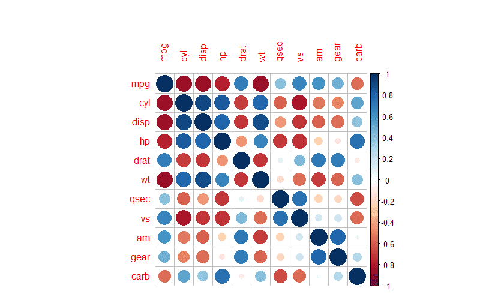
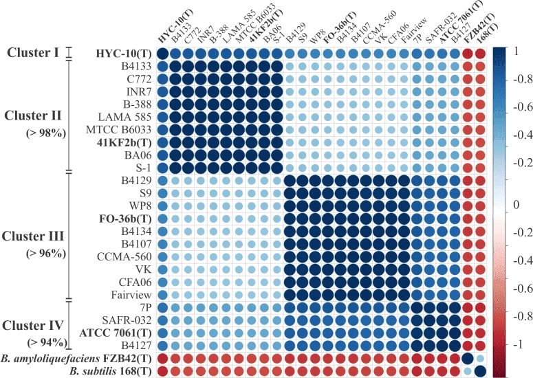
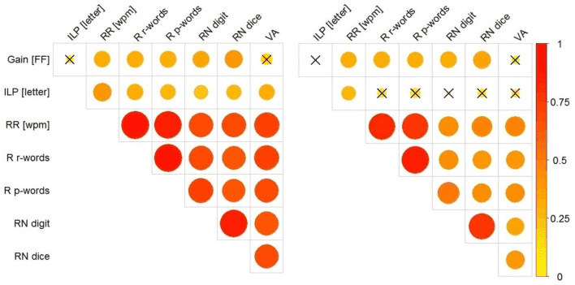

相关图或相关矩阵多用于概述整个数据集中各组数据的相关性信息。

## 示例

{fig-alt="Correlogram DEMO" fig-align="center" width="60%"}

例如上图则为`mtcars`数据集中各组数据的相关性热图，用颜色来表示不同组别数据的两两相关性，颜色的深浅代表了P值的大小。

## 环境配置

-   系统要求： 跨平台（Linux/MacOS/Windows）

-   编程语言：R

-   依赖包：`GGally`; `corrplot`; `ggcorrplot`; `corrgram`; `circlize`

```{r packages setup, message=FALSE, warning=FALSE, output=FALSE}
# 安装包
if (!requireNamespace("GGally", quietly = TRUE)) {
  install.packages("GGally")
}
if (!requireNamespace("corrplot", quietly = TRUE)) {
  install.packages("corrplot")
}
if (!requireNamespace("ggcorrplot", quietly = TRUE)) {
  install.packages("ggcorrplot")
}
if (!requireNamespace("corrgram", quietly = TRUE)) {
  install.packages("corrgram")
}

# 加载包
library(GGally)
library(corrplot)
library(ggcorrplot)
library(corrgram)
library(circlize)
```

```{r}
sessioninfo::session_info("attached")
```

## 数据准备

相关性热图主要应用内置数据集进行绘图。

```{r load data, message=FALSE}
data("flea", package = "GGally")
data_flea <- flea

data("mtcars", package = "datasets")
data_mtcars <- mtcars

data("tips", package = "GGally")
data_tips <- tips
```

## 可视化

### 1. GGally 包

> `GGally` 是常用的相关性图绘制工具，允许注入`ggplot2`代码，但不具有排序功能。

#### **基础相关图绘制**

```{r, message=FALSE}
ggpairs(data_flea, columns = 2:5)
```

> 上图展示了`flea`数据集各组数据的相关性可视化。图片共有三部分：下半部分的对应两组数据的相关散点图；对角线的单组数据密度图；上半部分的对应两组数据的`Pearson`相关系数值。

#### **注入 ggplot2 代码，为每个类别着色**

```{r, message=FALSE}
ggpairs(data_flea, columns = 2:4, ggplot2::aes(colour=species,alpha=0.7)) 
```

> 上图在进行相关性可视化的基础上，对各个类别进行了颜色分类。

#### **自定义绘图类型**

```{r, message=FALSE}
ggpairs(data_tips[, c(1, 3, 4, 2)])

summary(data_tips)
```

> 上图中，`tatal_bill`与`tip`为定量数据，`sex`与`smoker`为定性数据。下半部分主要根据数据类型的不同绘制了两两相关的散点图、直方图和直条图；对角线部分则为各组数据的分布图；上半部分根据数据类型分别绘制了两两相关的线形图，对于两个定量数据则给出了`Pearson`相关系数值。

```{r, message=FALSE}
# Changing the plotting type
ggpairs(
  data_tips[, c(1, 3, 4, 2)],
  upper = list(continuous = "density",
               combo = "box_no_facet"),
  lower = list(continuous = "points",
               combo = "dot_no_facet")
)
```

> 通过自定义，将下半部分的直方图修改为散点图，上半部分的相关系数值修改为密度图。

#### **相关性可视化**

将相关系数可视化呈现。

```{r, message=FALSE}
ggcorr(data_mtcars) # 绘制相关系数热图，默认为Pearson
```

> 上图通过`ggcorr()`函数进行相关系数可视化
>
> `ggcorr`的`method`参数：
>
> 默认为`c("pairwise","pearson")`的形式，第一个参数为确定协方差计算时对于缺失值的处理，第二个参数则用于确定相关系数的类型，比如`"pearson"`, `"kendall"`, `"spearman"`

### 2. corrplot 包

> `corrplot`包是常用的相关性可视化工具，其具有强大的自定义功能和排序功能。

#### **基础绘图**

```{r, message=FALSE}
corr <- cor(data_mtcars)
corrplot(corr)
```

#### **参数自定义**

> `corrplot()`的主要关键参数:
>
> `corr` 需要可视化的**相关系数**矩阵
>
> `method` 可视化的形状
>
> `type` 显示范围（full 、lower、upper）
>
> `col` 图形展示的颜色
>
> `addCoef.col` 相关系数值的颜色
>
> `order` 相关系数排序方法
>
> `is.corr` 是否为相关系数绘图，默认为`TRUE`，同样也可以实现非相关系数的可视化，只需使该参数设为`FALSE`即可
>
> ......

```{r, message=FALSE}
corrplot(corr,method = "ellipse" ,# method,指定可视化形状
         order = "AOE", # order，相关系数排序方式
         addCoef.col="black", # 指定相关系数颜色
         type="lower") # 指定显示部位
```

> 上图为`mtcars`数据集的相关系数热图。
>
> -   `type="lower"` 指定显示热图的下半部分。
>
> -   颜色的深浅代表相关系数的大小。
>
> -   椭圆的形状表示相关系数：离心率越大，椭圆越扁，相关系数绝对值较大；离心率越小，椭圆越圆，相关系数绝对值较小。椭圆长轴的方向表示相关系数的正负，右上-左下方向对应正值，左上-右下方向对应负值。

#### **添加显著性标签**

```{r, message=FALSE}
res1 <-cor.mtest(data_mtcars, conf.level= .95)
corrplot(corr, method= "circle",
         p.mat= res1$p, sig.level= 0.01, # p值大于0.01被认为无统计学意义
         mar= c(1,1,1,1))
```

> 上图在相关系数热图的基础上添加了显著性标签，P值大于0.01视为无统计学意义。

### 3. ggcorrplot 包

> `ggcorrplot`包相当于`corrplot`包的精简版，主要包括`cor_pmat`计算功能和`ggcorrplot`绘图功能。

#### **cor_pmat计算p值**

```{r, message=FALSE}
p.mat <- cor_pmat(data_mtcars)
head(p.mat[, 1:6])
```

#### **ggcorrplot绘图**

```{r, message=FALSE}
ggcorrplot(corr, method = "square" )
```

> 上图为`mtcar`数据集相关系数的颜色热图

```{r}
ggcorrplot(corr, method = "circle" )
```

> 这里我们把绘图类型改为了圆形

### 4. corrgram 包

> `corrgram` 包也是绘制相关图的一个不错选择，它可以选择在上、下和对角线中显示的内容。
>
> 我们主要利用`corrgram()`函数进行相关图的绘制：
>
> -   `cor.method` 确定相关系数类型`pearson`（默认）, `spearman`, `kendall`
>
> 可以使用不同的方法可视化：
>
> -   `panel.ellipse` 显示椭圆
> -   `panel.shade` 用于色块
> -   `panel.pie` 用于饼图
> -   `panel.pts` 用于散点图

```{r, message=FALSE}
corrgram(data_mtcars, order=TRUE, 
         lower.panel=panel.shade, # 彩色方块
         upper.panel=panel.pie, # 饼图
         text.panel=panel.txt, 
         main="Car Milage Data in PC2/PC1 Order") 
```

> 通过`lower.panel=panel.shade`,`upper.panel=panel.pie`将上半部分设置为饼图，下半部分设置为颜色图。

```{r, message=FALSE}
corrgram(data_mtcars, order=TRUE, 
         lower.panel=panel.ellipse, # 显示椭圆
         upper.panel=panel.pts,  # 散点图
         text.panel=panel.txt, 
         diag.panel=panel.minmax, 
         main="Car Milage Data in PC2/PC1 Order") 
```

> 通过`lower.panel=panel.ellipse`,`upper.panel=panel.pts`将上半部分设置为散点图，下半部分设置为椭圆图（其中红线为拟合曲线）。

```{r, message=FALSE}
corrgram(data_mtcars, order=NULL, 
         lower.panel=panel.shade, # 彩色方块
         upper.panel=NULL, 
         text.panel=panel.txt, 
         main="Car Milage Data (unsorted)")
```

> 通过`lower.panel=panel.shade`,`upper.panel=NULL`只显示下半部分的颜色图

### 5. 多基因相关分析 + FDR 校正

同时检验多个基因的相关性时，**假发现率（FDR）校正**必不可少 \[7\]。此配方计算目标基因与所有其他基因的成对相关，BH 校正后按相关系数排序画柱形图。

```{r}
#| label: fig-5.1MultiGeneCor
#| fig-cap: "模拟基因与目标基因的相关系数；柱形按 r 排序，红色 = BH 校正后显著。"
#| out.width: "85%"
#| warning: false
#| message: false
#| fig-width: 8
#| fig-height: 6

set.seed(2801)
target_gene <- "TARGET"
other_genes <- paste0("Gene", sprintf("%03d", 1:30))
n_samp <- 40

expr_cor <- matrix(rnorm(31 * n_samp, sd = 1), nrow = 31,
                   dimnames = list(c(target_gene, other_genes), NULL))
expr_cor[2:11, ] <- sweep(expr_cor[2:11, ], 2, expr_cor[1, ] * 0.6, `+`)

cor_res <- t(sapply(2:nrow(expr_cor), function(i) {
  ct <- cor.test(expr_cor[1, ], expr_cor[i, ], method = "pearson")
  c(r = unname(ct$estimate), p = ct$p.value)
}))
cor_df <- data.frame(gene = other_genes, r = cor_res[, "r"], p = cor_res[, "p"])
cor_df$fdr <- p.adjust(cor_df$p, method = "BH")
cor_df <- cor_df[order(cor_df$r), ]
cor_df$sig <- cor_df$fdr < 0.05

ggplot(cor_df, aes(r, reorder(gene, r), fill = sig)) +
  geom_col(width = 0.6) +
  scale_fill_manual(values = c(`TRUE` = "#B2182B", `FALSE` = "grey70"),
                    labels = c(`TRUE` = "FDR < 0.05", `FALSE` = "n.s."), name = NULL) +
  labs(x = "Pearson correlation coefficient", y = NULL,
       title = paste0("Correlation with ", target_gene)) +
  theme_classic(base_size = 10) +
  theme(legend.position = "bottom")
```

::: callout-tip
**实践要点**

-   `p.adjust(method = "BH")` 必须**跨所有被检验的基因**计算——逐基因或逐图校正会让 FDR 失效。
-   柱形按相关系数排序（而非基因名），可直观看到从正相关到负相关的梯度。
-   Spearman 相关将 `cor.test(method = "pearson")` 替换为 `method = "spearman"` 即可。
:::

### 6. 环形相关弦图（circlize）

FigureYa37 版式 \[8\] 把基因-基因相关表变成**弦图**：每个基因是圆周上的一条彩色弧，每对选出的基因之间一条连线，**宽度编码 |cor|**、颜色编码带符号的系数（绿负红正）。连线接到按累计宽度切分的弧段子段上，因此参与多个相关关系的基因会被按比例"切片"。下块保留参考文档的构造方式，从 10 基因模拟面板中筛出 Spearman 相关最强的 16 对：

```{r}
#| label: fig-6.1CorrChord
#| fig-cap: "10 个模拟基因中最强 16 对的 Spearman 相关弦图：基因弧用 d3 配色，连线宽度 = |cor|，颜色 = 带符号系数（绿 = 负、红 = 正），底部渐变条即图例。"
#| out.width: "70%"
#| warning: false
#| message: false
#| fig-width: 7.5
#| fig-height: 7.5

set.seed(3701)
n_s <- 120
genes10 <- paste0("GENE", sprintf("%02d", 1:10))
expr_c <- matrix(rnorm(n_s * 10), n_s, 10, dimnames = list(NULL, genes10))
expr_c[, 2] <- expr_c[, 1] * 0.85 + rnorm(n_s, 0, 0.5)
expr_c[, 3] <- -expr_c[, 1] * 0.8 + rnorm(n_s, 0, 0.5)
expr_c[, 5] <- expr_c[, 4] * 0.9 + rnorm(n_s, 0, 0.4)
expr_c[, 6] <- -expr_c[, 4] * 0.75 + rnorm(n_s, 0, 0.5)
expr_c[, 8] <- expr_c[, 7] * 0.8 + rnorm(n_s, 0, 0.5)

cors <- expand.grid(Gene_1 = genes10, Gene_2 = genes10, stringsAsFactors = FALSE)
cors <- cors[cors$Gene_1 < cors$Gene_2, ]
cors$cor <- mapply(function(a, b) cor(expr_c[, a], expr_c[, b], method = "spearman"),
                   cors$Gene_1, cors$Gene_2)
cors <- cors[order(-abs(cors$cor)), ][1:16, ]

## 把每个基因的弧按 |cor| 切成逐对子段
pairs <- cors
long <- rbind(data.frame(pid = seq_len(nrow(pairs)), gene = pairs$Gene_1, cor = pairs$cor),
              data.frame(pid = seq_len(nrow(pairs)), gene = pairs$Gene_2, cor = pairs$cor))
long <- long[order(long$gene), ]
seg <- do.call(rbind, lapply(split(long, long$gene), function(x) {
  end <- cumsum(abs(x$cor))
  data.frame(key = paste(x$gene, x$pid, sep = "_"),
             gene = x$gene[1], start = c(0, head(end, -1)), end = end)
}))
key1 <- paste(pairs$Gene_1, seq_len(nrow(pairs)), sep = "_")
key2 <- paste(pairs$Gene_2, seq_len(nrow(pairs)), sep = "_")
pairs$start_1 <- seg$start[match(key1, seg$key)]; pairs$end_1 <- seg$end[match(key1, seg$key)]
pairs$start_2 <- seg$start[match(key2, seg$key)]; pairs$end_2 <- seg$end[match(key2, seg$key)]

gene_sum <- tapply(abs(long$cor), long$gene, sum)
GeneID <- data.frame(gene = names(gene_sum), Gene_End = as.numeric(gene_sum))
GeneID$Gene_Start <- 0
GeneID <- GeneID[order(GeneID$gene), ]
GeneID$Color <- ggsci::pal_d3("category20")(nrow(GeneID))

color_ramp <- colorRampPalette(c("#67BE54", "#FFFFFF", "#F82C2B"))(201)
pairs$color <- color_ramp[round((pairs$cor + 1) / 2 * 200) + 1]

circos.clear()
circos.par(start.degree = 90, gap.degree = 5, track.margin = c(0, 0.23),
           cell.padding = c(0, 0, 0, 0))
circos.initialize(factors = GeneID$gene, xlim = cbind(GeneID$Gene_Start, GeneID$Gene_End))
circos.trackPlotRegion(ylim = c(0, 1), factors = GeneID$gene, track.height = 0.05,
                       panel.fun = function(x, y) {
                         name <- get.cell.meta.data("sector.index")
                         i <- get.cell.meta.data("sector.numeric.index")
                         xlim <- get.cell.meta.data("xlim")
                         ylim <- get.cell.meta.data("ylim")
                         circos.text(x = mean(xlim), y = 1, labels = name, cex = 0.95,
                                     niceFacing = TRUE, facing = "bending",
                                     adj = c(0.5, -2.6), font = 2)
                         circos.rect(xlim[1], ylim[1], xlim[2], ylim[2],
                                     col = GeneID$Color[i], border = GeneID$Color[i])
                       })
for (i in seq_len(nrow(pairs))) {
  circos.link(sector.index1 = pairs$Gene_1[i],
              point1 = c(pairs$start_1[i], pairs$end_1[i]),
              sector.index2 = pairs$Gene_2[i],
              point2 = c(pairs$start_2[i], pairs$end_2[i]),
              col = paste0(pairs$color[i], "C9"), border = FALSE, rou = 0.7)
}
i0 <- seq(0, 0.995, 0.005)
rect(-1 + i0 / 2, -1, -0.9975 + i0 / 2, -0.96,
     col = paste0(as.character(color_ramp), "FF"),
     border = paste0(as.character(color_ramp), "FF"))
text(-0.97, -1.03, "-1"); text(-0.51, -1.03, "1")
circos.clear()
```

::: callout-tip
**实践要点**

-   先按 |cor| 筛选再作图：10 个基因的完整 45 对弦图无法阅读，前 16 对足以保留强结构。
-   子段切分（每个基因内 `cumsum(abs(cor))`）是连线宽度诚实的关键——改画全宽连线，枢纽基因的六条连线会夸大其最强相关。
-   `circos.clear()` 前后都要调用：残留的 circos 布局会劫持下一张 base 图。
:::

## 应用场景

::: {#fig-CorrelogramApplications}
{fig-alt="CorrelogramApp1" fig-align="center" width="60%"}

相关图应用
:::

> 上图为基于菌株 ANI 值的相关图。 使用 JSpecies 软件计算每个指示菌株之间的 ANI 值，并用于Pearson相关矩阵构建。该图显示了使用 `corrplot` 包通过层次聚类构建和排序的相关性。 \[1\]

::: {#fig-CorrelogramApplications2}
{fig-alt="CorrelogramApp2" fig-align="center" width="60%"}

相关图应用

-   **`pairs()` corrgram 面板（FigureYa76）**：base graphics 的免包替代——用自定义 panel 函数拆分非对角区（左下：散点 + 回归线；右上：按红-白-蓝色带填充的相关系数矩形，±1 截断；对角线：变量名），然后 `pairs(m, lower.panel = ..., upper.panel = ..., diag.panel = ...)`；`corrgram::panel.fill` 是其灵感来源，但三个短函数即可复现。
:::-   **星号放进填充图例（FigureYa97correlationV3）**：`geom_tile` 相关热图把显著性写进图例标题本身——`labs(fill = paste0(" * p < 0.05", "\n\n", "** p < 0.01", "\n\n", "Correlation"))`——每格星号由嵌套 `ifelse(p < 0.05, ifelse(p < 0.01, "**", "*"), "")` 生成、`geom_text` 叠加；`scale_fill_gradient2(low = "#2b8cbe", mid = "white", high = "#e41a1c")` 保持白色居中，瓦片边框用 `linewidth`（勿用已弃用的 `size`）。样本 ID 先统一（`gsub(".", "-", rownames(...), fixed = TRUE)`），否则重排会静默产生 NA。
:::

> 上图展示了Gain [FF]、ILP、wpm、RR、R r-words、R p-words、 RN 、VA之间的相关性。左图显示未排除儿童年级影响的相关性；右图显示分化年级后的相关性。相关性的大小由圆圈的大小（和颜色）表示。使用了 `corrplot` 包进行绘制。 \[2\]

## 参考文献

\[1\] Espariz M, Zuljan FA, Esteban L, Magni C. Taxonomic Identity Resolution of Highly Phylogenetically Related Strains and Selection of Phylogenetic Markers by Using Genome-Scale Methods: The Bacillus pumilus Group Case. PLoS One. 2016 Sep 22;11(9):e0163098. doi: 10.1371/journal.pone.0163098. PMID: 27658251; PMCID: PMC5033322.

\[2\] Marx C, Hutzler F, Schuster S, Hawelka S. On the Development of Parafoveal Preprocessing: Evidence from the Incremental Boundary Paradigm. Front Psychol. 2016 Apr 14;7:514. doi: 10.3389/fpsyg.2016.00514. PMID: 27148123; PMCID: PMC4830847.

\[3\] Schloerke B, Cook D, Larmarange J, Briatte F, Marbach M, Thoen E, Elberg A, Crowley J (2024). *GGally: Extension to 'ggplot2'*. R package version 2.2.1, [CRAN: Package GGally](https://CRAN.R-project.org/package=GGally).

\[4\] Taiyun Wei and Viliam Simko (2024). R package 'corrplot': Visualization of a Correlation Matrix (Version 0.94). Available from [GitHub - taiyun/corrplot: A visual exploratory tool on correlation matrix](https://github.com/taiyun/corrplot)

\[5\] Kassambara A (2023). *ggcorrplot: Visualization of a Correlation Matrix using 'ggplot2'*. R package version 0.1.4.1, [CRAN: Package ggcorrplot](https://CRAN.R-project.org/package=ggcorrplot).

\[6\] Wright K (2021). *corrgram: Plot a Correlogram*. R package version 1.14, [CRAN: Package corrgram](https://CRAN.R-project.org/package=corrgram).

\[7\] Xiaofan Lu, et al. FigureYa: A Standardized Visualization Framework for Enhancing Biomedical Data Interpretation and Research Efficiency. iMetaMed. 2025. doi:10.1002/imm3.70005

\[8\] Xiaofan Lu, et al. FigureYa: A Standardized Visualization Framework for Enhancing Biomedical Data Interpretation and Research Efficiency. iMetaMed. 2025. doi:10.1002/imm3.70005
