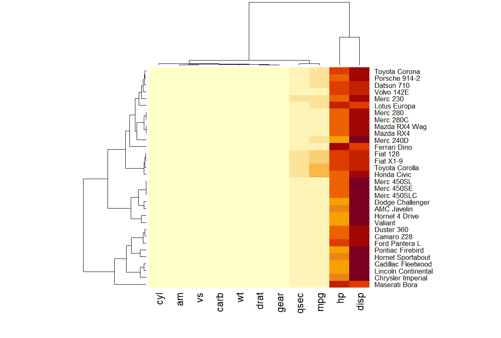
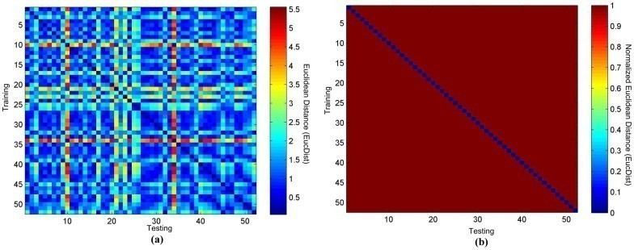
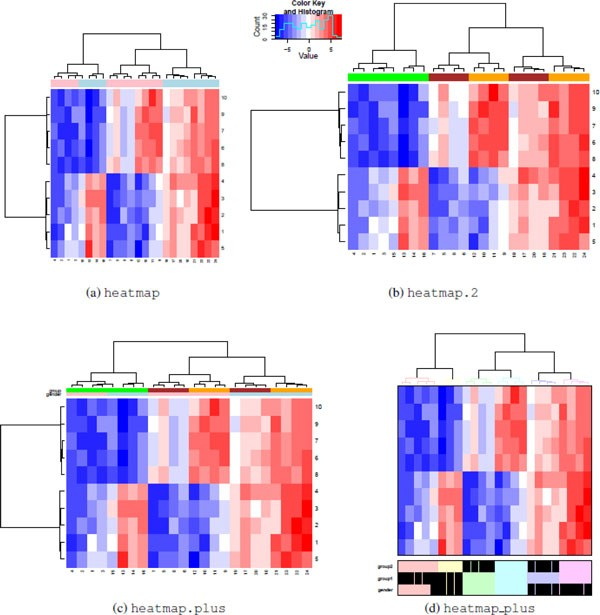
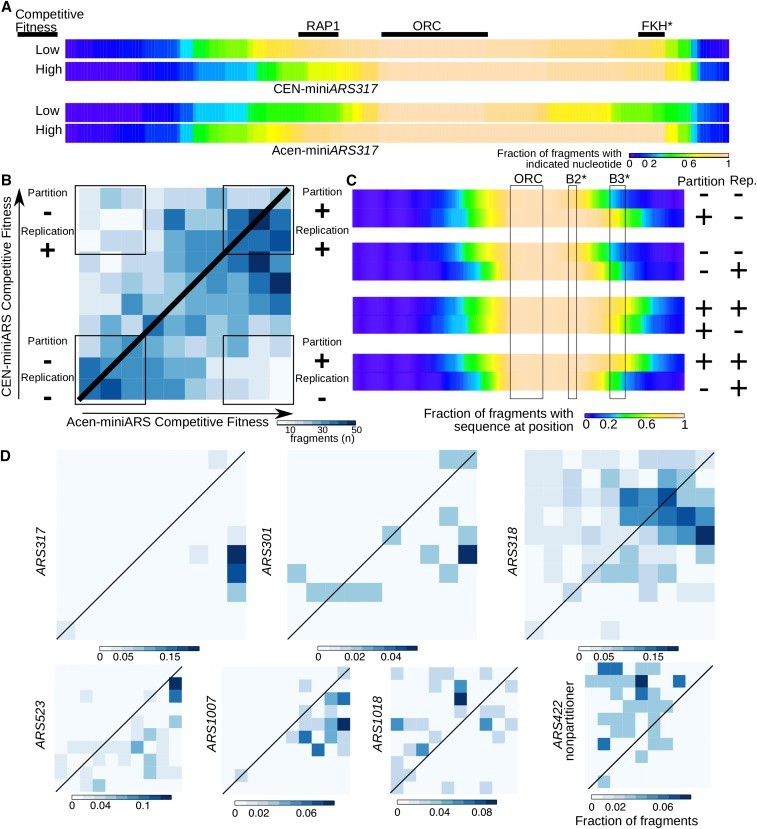

A heatmap is a powerful visualization tool that represents matrix values through color gradients. It is widely used to illustrate gene expression differences across sample groups, variations in compound concentrations, and pairwise sample similarities. More broadly, any tabular dataset can be structured into a heatmap to enhance interpretability.

## Example

{fig-alt="Heatmap Example" fig-align="center" width="60%"}

In this heatmap, rows correspond to car models (e.g., `Mazda RX4`, `Merc 450SLC`), while columns represent specific attributes (e.g., `mpg` for miles per gallon, `hp` for horsepower, `wt` for weight). Each cell encodes the attribute value for a given car, with higher values appearing closer to yellow.

Hierarchical clustering (dendrograms) on the top and left depict similarity relationships among rows and columns, facilitating pattern recognition and comparative analysis.

::: callout-note
**Notes**: The heatmap in this example provides limited insight due to the disparity in attribute scales. Attributes such as hp (horsepower) and disp (displacement) exhibit substantially higher values than others, distorting the color mapping and overshadowing lower-range features. To enhance interpretability, data normalization is required, as discussed in the following sections.
:::

## Setup

-   System Requirements: Cross-platform (Linux/MacOS/Windows)

-   Programming Language: R

-   Dependencies:`readr`, `ggplot2`, `hrbrthemes`, `dplyr`, `tidyr`, `viridis`, `tibble`, `htmlwidgets`, `RColorBrewer`, `plotly`, `remotes`, `d3heatmap`, `heatmaply`, `lattice`, `ComplexHeatmap`, `pheatmap`, `circlize`, `gridExtra`, `cowplot`

```{r packages setup, message=FALSE, warning=FALSE, output=FALSE}
# Installing necessary packages
if (!requireNamespace("readr", quietly = TRUE)) {
  install.packages("readr")
}
if (!requireNamespace("tidyverse", quietly = TRUE)) {
  install.packages("tidyverse")
}
if (!requireNamespace("ggplot2", quietly = TRUE)) {
  install.packages("ggplot2")
}
if (!requireNamespace("hrbrthemes", quietly = TRUE)) {
  remotes::install_github("hrbrmstr/hrbrthemes")
}
if (!requireNamespace("dplyr", quietly = TRUE)) {
  install.packages("dplyr")
}
if (!requireNamespace("tidyr", quietly = TRUE)) {
  install.packages("tidyr")
}
if (!requireNamespace("viridis", quietly = TRUE)) {
  install.packages("viridis")
}
if (!requireNamespace("tibble", quietly = TRUE)) {
  install.packages("tibble")
}
if (!requireNamespace("htmlwidgets", quietly = TRUE)) {
  install.packages("htmlwidgets")
}
if (!requireNamespace("RColorBrewer", quietly = TRUE)) {
  install.packages("RColorBrewer")
}
if (!requireNamespace("plotly", quietly = TRUE)) {
  install.packages("plotly")
}
if (!requireNamespace("d3heatmap", quietly = TRUE)) {
  remotes::install_github("talgalili/d3heatmap")
}
if (!requireNamespace("heatmaply", quietly = TRUE)) {
  install.packages("heatmaply")
}
if (!requireNamespace("lattice", quietly = TRUE)) {
  install.packages("lattice")
}
if (!requireNamespace("ComplexHeatmap", quietly = TRUE)) {
  BiocManager::install("ComplexHeatmap")
}
if (!requireNamespace("pheatmap", quietly = TRUE)) {
  install.packages("pheatmap")
}
if (!requireNamespace("circlize", quietly = TRUE)) {
  install.packages("circlize")
}
if (!requireNamespace("gridExtra", quietly = TRUE)) {
  install.packages("gridExtra")
}
if (!requireNamespace("cowplot", quietly = TRUE)) {
  install.packages("cowplot")
}

# Loading the libraries
library(readr)
library(hrbrthemes)     # Additional themes for ggplot2
library(dplyr)          # Data manipulation functions
library(tidyr)          # Data tidying functions
library(viridis)        # Color palettes for better visualization
library(tibble)         # Tidy data frames
library(htmlwidgets)    # Interactive web visualizations
library(RColorBrewer)   # Color palettes for visualizations
library(plotly)         # Interactive plots
library(d3heatmap)      # D3.js-based interactive heatmaps
library(heatmaply)      # Interactive heatmaps with ggplot2
library(lattice)        # Trellis graphics for multivariate data
library(ComplexHeatmap) # Advanced heatmap functionalities
library(pheatmap)       # Pretty heatmaps with clustering support
library(circlize)       # Circular visualizations
library(gridExtra)      # Grid layout visualization
library(cowplot)
library(tidyverse)
library(ggplot2)        # Data visualization package
```

```{r}
sessioninfo::session_info("attached")
```

## Data Preparation

This section provides a brief tutorial using built-in R datasets (`mtcars`, `volcano`) and the `TCGA-CHOL.methylation450.tsv` dataset from [UCSC Xena DATASETS](https://xenabrowser.net/datapages/?hub=https://gdcv18.xenahubs.net:443). These datasets will be used to demonstrate heatmap visualization in R. This example demonstrates how to load and work with these datasets in R.

```{r load data, message=FALSE}
# load built-in R datasets `mtcars`
data("mtcars", package = "datasets")
mtcars_matrix <- as.matrix(mtcars)

# Load and process methylation data
raw_methylation_data <- readr::read_tsv("https://bizard-1301043367.cos.ap-guangzhou.myqcloud.com/TCGA-CHOL.methylation450.tsv")

# Convert to matrix and clean up row/column names
methylation_matrix <- raw_methylation_data[, -1] %>%
  as.data.frame() %>%
  `rownames<-`(raw_methylation_data$Composite)

# Tidy to long format
methylation_long <- methylation_matrix %>%
  rownames_to_column("Composite") %>%
  pivot_longer(cols = -Composite, names_to = "Sample", values_to = "Methylation_Level") %>%
  mutate(
    Methylation_Level = as.numeric(Methylation_Level),
    Composite = gsub("^cg0+", "cg", Composite),
    Sample = substr(Sample, 9, 12)
  )

# Standardize methylation values
methylation_long_standardized <- methylation_long %>%
  group_by(Composite) %>%
  mutate(Standardized_Level = scale(Methylation_Level)[,1]) %>%
  ungroup()

# Convert back to wide format matrix
standardized_methylation_matrix <- methylation_long_standardized %>%
  select(Composite, Sample, Standardized_Level) %>%
  pivot_wider(names_from = Sample, values_from = Standardized_Level) %>%
  column_to_rownames("Composite") %>%
  as.matrix()


# Clean up raw methylation matrix (numerical version for raw heatmap)
methylation_matrix_num <- methylation_matrix %>%
  mutate(across(everything(), ~ as.numeric(as.character(.)))) %>%
  `rownames<-`(gsub("^cg0+", "cg", rownames(.))) %>%
  { `colnames<-`(., substr(colnames(.), 9, 12)) } %>%
  as.matrix()
```

## Visualization

### 1. Basic R Heatmaps

#### 1.1 Basic Heatmap

Using the `heatmap()` function to construct a heatmap. Below is the simplest heatmap created in base R without additional parameters. The `heatmap()` function requires a matrix as input. If the data is in a data frame, it can be converted into a matrix using the `as.matrix()` function. A matrix can also be transposed using the `t()` function, which swaps rows and columns, effectively exchanging the X and Y axes.

```{r}
#| label: fig-BasicHeatBasicR
#| fig-cap: "Basic Heatmap Basic R"
#| out.width: "95%"
#| warning: false

heatmap(mtcars_matrix)
```

This heatmap uses color variations to display numerical differences between performance variables of various cars in the `mtcars` dataset.

::: callout-tip
This heatmap is not particularly insightful because the variables `hp` and `disp` with relatively high values dominate the scale. Consequently, variations in other variables (e.g., `mpg`, `wt`) are hard to discern. Standardizing the data, as discussed in the next section, is necessary.
:::

#### 1.2 Standardization

The `scale` parameter in the `heatmap()` function can be used to standardize the matrix. It can be applied to rows or columns. Here, columns are chosen since we aim to capture variations between columns.

```{r}
#| label: fig-StandardizationBasicR
#| fig-cap: "Standardization Basic R"
#| out.width: "95%"
#| warning: false

heatmap(mtcars_matrix, scale="column")
```

This heatmap presents standardized values of performance variables in the `mtcars` dataset, making comparisons across variables on a common scale and improving the visual accuracy and interpretability.

#### 1.3 Clustering Dendrograms and Reordering

In the generated heatmap, the order of rows and columns differs from the original `mtcars` matrix because `heatmap()` applies clustering algorithms to reorder variables and observations. It calculates distances between pairs of rows and columns and sorts them based on similarities.

Additionally, dendrograms are displayed alongside the heatmap. These can be disabled using the `Rowv` and `Colv` parameters, as shown below.

```{r}
#| label: fig-ClusteringandReorderingBasicR
#| fig-cap: "Clustering Dendrograms and Reordering Basic R"
#| out.width: "95%"
#| warning: false

heatmap(mtcars_matrix, Colv = NA, Rowv = NA, scale="column")
```

This heatmap shows the standardized values of performance variables in the `mtcars` dataset, with the dendrograms removed to maintain the original order of rows and columns.

#### 1.4 Color Palettes

Heatmaps can utilize different color palettes:

-   Built-in R palettes: `terrain.colors()`, `rainbow()`, `heat.colors()`, `topo.colors()`, `cm.colors()`
-   Palettes suggested by the RColorBrewer package
-   Custom color palettes

```{r}
#| label: fig-ColorPalettesBasicR
#| fig-cap: "Color Palettes Basic R"
#| out.width: "95%"
#| warning: false

# Native color palette
heatmap(mtcars_matrix, scale="column", col = cm.colors(256))
heatmap(mtcars_matrix, scale="column", col = terrain.colors(256))

# Using Rcolorbrewer
coul <- colorRampPalette(brewer.pal(8, "PiYG"))(25)
heatmap(mtcars_matrix, scale="column", col = coul)

# Custom color palette
my_palette <- colorRampPalette(c("blue", "white", "red"))(256)
heatmap(mtcars_matrix, scale = "column", col = my_palette)
```

The following four heatmaps demonstrate the same data using different color palettes. These highlight the differences in performance variables of cars in the `mtcars` dataset, emphasizing how palette selection can influence visual interpretation and clarity.

##### **RColorBrewer**

The `display.brewer.all()` function in the `RColorBrewer` package showcases all available color schemes.

```{r}
#| label: fig-RColorBrewerBasicR
#| fig-cap: "RColorBrewer Basic R"
#| out.width: "95%"
#| warning: false

par(plt=c(0.1,1,0,1))
display.brewer.all()
```

The image displays color scheme names on the left and their respective colors on the right. These schemes fall into three categories: - *Sequential (seq)*: Gradual variations of a single color, suitable for continuous or ordered categorical variables. - *Qualitative (qual)*: Highly distinct colors without hierarchical relationships, ideal for unordered categorical variables. - *Diverging (div)*: Two colors transitioning in opposite directions, often used for continuous variables with meaningful midpoint values (e.g., temperature or odds ratios).

#### 1.5 Customizing Layout

Heatmaps can be customized using standard parameters like `main` for the title and `xlab`/`ylab` for axis labels. Additionally, `labRow`/`colRow` allow changes to labels, while `cexRow`/`cexCol` adjust their sizes.

```{r}
#| label: fig-CustomizingLayoutBasicR
#| fig-cap: "Customizing Layout Basic R"
#| out.width: "95%"
#| warning: false

# Custom titles and axis titles
p5 <- heatmap(mtcars_matrix, Colv = NA, Rowv = NA, scale="column", col = coul, xlab="variable", main="heatmap")

# Custom labels
p6 <- par(mar = c(5, 0, 4, 2))  # Adjust margins
heatmap(mtcars_matrix, scale="column", cexRow=.8, labRow=paste("new_", rownames(mtcars_matrix),sep=""), col= colorRampPalette(brewer.pal(8, "Blues"))(25))
```

The following two heatmaps illustrate standardized performance variables in the `mtcars` dataset with customized titles, axis labels, and row annotations, improving visual clarity and data communication.

#### 1.6 Heatmaps with Color Annotations

Heatmaps are often used to compare observed structures against expected ones. The`RowSideColors` parameter can add a color vector to the side of a heatmap to indicate expected groupings.

```{r}
#| label: fig-ColorAnnotationsBasicR
#| fig-cap: "Heatmaps with Color Annotations Basic R"
#| out.width: "95%"
#| warning: false

my_group <- as.numeric(as.factor(substr(rownames(mtcars_matrix), 1 , 1))) # Group row labels by the first letter and convert to numeric
colSide <- brewer.pal(9, "Set1")[my_group] # Use the Set1 color scheme from RColorBrewer to generate 9 colors, assigning each group a color
colMain <- colorRampPalette(brewer.pal(8, "Blues"))(25)
heatmap(mtcars_matrix, Colv = NA, Rowv = NA, scale="column" , RowSideColors=colSide, col=colMain)
```

The heatmap below groups rows by their first letters and assigns a distinct color to each group, helping observers quickly identify differences between groups and understand data patterns more intuitively.

### 2. ggplot2 Heatmaps

The `ggplot2` package uses the `geom_tile()` function to create heatmaps. Unlike `heatmap()`, it doesn't natively support standardization, clustering, or dendrograms.

#### 2.1 Basic Heatmap

A basic heatmap created with `ggplot2` and `geom_tile()`. Standardization must be performed beforehand, as `geom_tile()` cannot directly standardize data.

The input data must be in a long-format data frame, where each row represents one observation with three key variables:

-   `x`: Position on the X-axis
-   `y`: Position on the Y-axis
-   `fill`: Numerical values mapped to colors

```{r}
#| label: fig-BasicHeatggplot2
#| fig-cap: "Basic Heatmap ggplot2"
#| out.width: "95%"
#| warning: false

p <- ggplot(methylation_long_standardized, aes(x = Sample, y = Composite, fill= Standardized_Level)) + 
  geom_tile()

p 
```

This heatmap demonstrates the distribution of standardized methylation levels (Standardized_Level) in the TCGA-CHOL dataset across samples (Sample) and composites (Composite), highlighting differences in methylation patterns.

#### 2.2 Color Palettes

Heatmaps can have their color palettes customized, just like any ggplot2 chart. Below are three examples using different approaches:

-   `scale_fill_gradient()`: Sets the extreme colors of the palette.
-   `scale_fill_distiller())`: Uses `ColorBrewer` palettes.
-   `scale_fill_viridis()` Implements the `Viridis` palette. Remember to set `discrete=FALSE` for continuous variables (ensuring smooth color gradients).

```{r}
#| label: fig-ColorPalettesggplot2
#| fig-cap: "Color Palettes ggplot2"
#| out.width: "95%"
#| warning: false
#| fig-width: 25
#| fig-height: 6

# Extreme colors
p7 <- ggplot(methylation_long_standardized, aes(x = Sample, y = Composite, fill= Standardized_Level)) + 
  geom_tile()+
  scale_fill_gradient(low="white", high="blue") +
  theme_ipsum() +
  theme(axis.text.x = element_text(size = 10))

# ColorBrewer color palette
p8 <- ggplot(methylation_long_standardized, aes(x = Sample, y = Composite, fill= Standardized_Level)) + 
  geom_tile() +
  scale_fill_distiller(palette = "RdPu") +
  theme_ipsum() +
  theme(axis.text.x = element_text(size = 10)) 

# Using Viridis
p9 <- ggplot(methylation_long_standardized, aes(x = Sample, y = Composite, fill= Standardized_Level)) + 
  geom_tile()+
  scale_fill_viridis(discrete=FALSE) +
  theme_ipsum() + 
  theme(axis.text.x = element_text(size = 10))

plot_grid(p7, p8, p9, ncol = 3)
```

These three heatmaps showcase identical data from the TCGA-CHOL dataset, illustrating the distribution of standardized methylation levels between various samples and composites. They emphasize the importance of palette choice for visual impact and data interpretation.

#### 2.3 Handling Wide-Format Data

A common issue involves input in a wide matrix format, such as the `volcano` dataset. In such cases, the `gather()` function from the `tidyr` package can transform the data into a long format suitable for visualization with ggplot.

```{r}
#| label: fig-Wide-Formatggplot2
#| fig-cap: "Handling Wide-Format Data"
#| out.width: "95%"
#| warning: false

volcano %>%
  as_tibble() %>%
  rowid_to_column(var="X") %>%
  gather(key="Y", value="Z", -1) %>%
  
  mutate(Y=as.numeric(gsub("V","",Y))) %>%

  ggplot(aes(X, Y, fill= Z)) + 
    geom_tile() +
    theme_ipsum() +
    theme(legend.position="none")
```

This heatmap represents the elevation values (Z) in the `volcano` dataset. The x-axis indicates row indices (X), the y-axis represents column indices (Y), and color fill depicts changes in elevation.

#### 2.4 Interactive Heatmaps

One of the significant advantages of creating heatmaps with `ggplot2` is the ability to make them interactive using the `plotly` package. Simply wrap the plot in an object and pass it to the `ggplotly()` function.

You can also customize tooltips to provide richer information. Try hovering over a cell to view tooltips or zoom in on specific areas.

```{r}
#| label: fig-InterHeatggplot2
#| fig-cap: "Interactive Heatmaps"
#| out.width: "95%"
#| warning: false

# Create tooltips text
methylation_long_annotated <- methylation_long_standardized %>%
  mutate(text = paste0("Composite: ",Composite, "\n", "Sample: ", Sample, "\n", "Standardized_Level: ", Standardized_Level))

p <- ggplot(methylation_long_annotated, aes(Composite, Sample, fill = Standardized_Level, text = text)) + 
  geom_tile() +
  theme_ipsum()

pp <- ggplotly(p, tooltip="text", width = 1200, height = 700)

pp
```

This interactive heatmap, built with the `plotly` package, allows dynamic exploration and in-depth data analysis, offering a more intuitive understanding and information retrieval process.

Alternative packages like `d3heatmap` and `heatmaply` can also create interactive heatmaps.

##### **Using the `d3heatmap` Package**

```{r}
#| label: fig-d3heatmapggplot2
#| fig-cap: "Using d3heatmap ggplot2"
#| out.width: "95%"
#| warning: false

d3heatmap(standardized_methylation_matrix, scale = "row", dendrogram = "none")
```

The `d3heatmap` package creates interactive heatmaps, enabling dynamic exploration and deeper insights into data.

##### **Using the `heatmaply` Package**

```{r}
#| label: fig-heatmaplyggplot2
#| fig-cap: "Using heatmaply ggplot2"
#| out.width: "95%"
#| warning: false

p <- heatmaply(standardized_methylation_matrix,
               dendrogram = "none",
               xlab = "", ylab = "",
               main = "",
               scale = "row",
               margins = c(50,0,30,30),
               grid_color = "white",
               grid_width = 0.00001,
               titleX = FALSE,
               hide_colorbar = TRUE,
               branches_lwd = 0.1,
               fontsize_row = 5, fontsize_col = 5,
               labCol = colnames(standardized_methylation_matrix),
               labRow = rownames(standardized_methylation_matrix),
               heatmap_layers = theme(axis.line = element_blank())
)

p
```

Similarly, the `heatmaply` package generates interactive heatmaps, allowing for dynamic analysis and enhanced comprehension of the data.

#### 2.5 Diagonally Split Heatmap: Two Opposing Levels per Cell

When each cell carries **two opposing values** — e.g. copy-number amplification (upper triangle) versus deletion (lower triangle) per gene across cancer types \[17\] — split every cell into two triangles. A single diverging scale (red = gain, blue = loss) encodes both levels with one legend, and `geom_polygon()` does the splitting:

```{r}
#| label: fig-DiagSplitHeatmap
#| fig-cap: "Diagonally split heatmap: amplification (upper triangle, red) vs deletion (lower triangle, blue) for 10 genes across 8 cancer types."
#| out.width: "95%"
#| warning: false
#| message: false
#| fig-width: 7.5
#| fig-height: 5

set.seed(403)
gene_d <- paste0("Gene", sprintf("%02d", 1:10))
cancer_d <- c("BRCA", "LUAD", "COAD", "STAD", "KIRC", "HNSC", "LUSC", "PRAD")
amp <- matrix(runif(80, 0, 0.55), 10, 8, dimnames = list(gene_d, cancer_d))
del <- matrix(runif(80, 0, 0.55), 10, 8, dimnames = list(gene_d, cancer_d))
amp[1:4, ] <- amp[1:4, ] + 0.25      # oncogene-like: amplified
del[5:10, ] <- del[5:10, ] + 0.30    # tumour-suppressor-like: deleted
amp <- pmin(amp, 0.95); del <- pmin(del, 0.95)

make_tri <- function(i, j, upper) {
  x0 <- j - 0.5; y0 <- i - 0.5
  if (upper) data.frame(x = x0 + c(0, 0, 1), y = y0 + c(0, 1, 1))   # upper-left triangle
  else data.frame(x = x0 + c(0, 1, 1), y = y0 + c(0, 0, 1))         # lower-right triangle
}
cells <- expand.grid(i = seq_len(10), j = seq_len(8))
tri_df <- do.call(rbind, lapply(seq_len(nrow(cells)), function(k) {
  i <- cells$i[k]; j <- cells$j[k]
  rbind(cbind(make_tri(i, j, TRUE),  value =  amp[i, j], id = k, tri = "up",   gi = i, cj = j),
        cbind(make_tri(i, j, FALSE), value = -del[i, j], id = k, tri = "dn",   gi = i, cj = j))
}))
tri_df$gene <- factor(gene_d[tri_df$gi], levels = rev(gene_d))
tri_df$cancer <- factor(cancer_d[tri_df$cj], levels = cancer_d)

## polygons need NUMERIC x/y — a discrete aes would collapse the vertices
ggplot(tri_df, aes(x, y, group = interaction(id, tri), fill = value)) +
  geom_polygon(colour = "white", linewidth = 0.4) +
  scale_x_continuous(breaks = seq_len(8) - 0.5, labels = cancer_d, expand = c(0, 0)) +
  scale_y_continuous(breaks = seq_len(10) - 0.5, labels = gene_d, expand = c(0, 0)) +
  scale_fill_gradient2(low = "#3878C1", mid = "#FFFADD", high = "#AB221F",
                       midpoint = 0, limits = c(-1, 1), name = NULL,
                       labels = function(v) sprintf("%.1f", v)) +
  labs(x = "Cancer type", y = NULL,
       caption = "Upper triangle: amplification | lower triangle: deletion (colour depth = frequency)") +
  theme_minimal(base_size = 11) +
  theme(panel.grid = element_blank(),
        axis.text.x = element_text(angle = 45, hjust = 1),
        legend.key.height = unit(5, "mm"))
```

::: callout-tip
**Practice tips**

-   `group = interaction(id, tri)` is what keeps the two triangles of one cell as separate polygons — without it `geom_polygon()` connects all three-point sets in a single path.
-   Sign-coding (gain = +, loss = −) buys you one diverging scale for both levels; if the two levels carry different units, pre-compute hex colours and use `scale_fill_identity()` with a hand-drawn legend instead.
-   Row/column labels are plain discrete axes here, so reordering (cluster genes by pathway, cancers by organ) is just factor level order — no clustering machinery needed.
:::

### 3. lattice Heatmaps

The `lattice` package provides the `levelplot()` function for constructing heatmaps.

#### 3.1 Basic Usage of `levelplot()`

```{r}
#| label: fig-BasicHeatlattice
#| fig-cap: "Basic Heatmap lattice"
#| out.width: "95%"
#| warning: false

# Convert the Sample and Composite columns from characters to factors
methylation_long_standardized$Sample <- as.factor(methylation_long_standardized$Sample)
methylation_long_standardized$Composite <- as.factor(methylation_long_standardized$Composite) 

levelplot(Standardized_Level ~ Sample * Composite, data = methylation_long_standardized,
          xlab = "Sample", ylab = "Composite",
          main = "Heatmap of Standardized TCGA-CHOL Methylation Levels")
```

This heatmap illustrates the distribution of standardized methylation levels between samples and composites in the TCGA-CHOL dataset, highlighting variations in methylation states across different samples.

#### 3.2 Wide-Format Matrix Input

Unlike the earlier example with long-format data, this approach uses a square matrix.

::: callout-tip
Rows and columns are flipped in the heatmap.
:::

```{r}
#| label: fig-Wide-FormatMatrixInputlattice
#| fig-cap: "Wide-Format Matrix Input lattice"
#| out.width: "95%"
#| warning: false

levelplot(standardized_methylation_matrix)
```

This heatmap demonstrates variations in methylation states across TCGA-CHOL samples using a wide-format matrix in `levelplot()`.

#### 3.3 Flipping Axes

R's `t()` function transposes the input matrix, flipping the x and y coordinates. This makes the heatmap's structure align precisely with the input matrix.

Setting `aspect = "fill"` adjusts the aspect ratio automatically to reflect the matrix's actual proportions.

```{r}
#| label: fig-FlippingAxeslattice
#| fig-cap: "Flipping Axes lattice"
#| out.width: "95%"
#| warning: false

# Flip X and Y axes
levelplot( t(standardized_methylation_matrix),
           col.regions=heat.colors(220),
           aspect = "fill") # Automatically adjust aspect ratio
```

This heatmap reflects the same data as the original matrix with flipped coordinates for structural alignment.

#### 3.4 Color Palettes

Multiple palette options are available: - Native R palettes: `terrain.color()`， `rainbow()`，`heat.colors()`， `topo.colors()`，`cm.colors()` - `RColorBrewer`palettes - `Viridis`palettes: viridis, magma, inferno, plasma

```{r}
#| label: fig-ColorPaletteslattice
#| fig-cap: "Color Palettes lattice"
#| out.width: "95%"
#| warning: false

# Native color palette
p10 <- levelplot(volcano, col.regions = terrain.colors(100)) # try cm.colors() or terrain.colors()
p10

# Using Rcolorbrewer
coul <- colorRampPalette(brewer.pal(8, "PiYG"))(25)
p11 <- levelplot(volcano, col.regions = coul)
p11

# Using Viridis
coul <- viridis(100)
p12 <- levelplot(volcano, col.regions = coul) 
p12

```

Using the `volcano` dataset, these heatmaps visualize elevation values and emphasize the impact of palette selection on interpretability.。

### 4. pheatmap Heatmaps

The `pheatmap` package also builds heatmaps and supports data standardization.

#### 4.1 Basic Heatmap

```{r}
#| label: fig-BasicHeatPheatmap
#| fig-cap: "Basic Heatmap"
#| out.width: "95%"
#| warning: false

pheatmap(methylation_matrix_num, scale = "row")
```

This heatmap visualizes differences in methylation patterns across samples in the TCGA-CHOL dataset using the `pheatmap` package.

#### 4.2 Adjusting Dendrograms

-   `clustering_distance_rows` and `clustering_distance_cols` represent the distance measures used for row and column clustering. The default is "euclidean", but it can also be set to "correlation", meaning clustering will be performed based on the Pearson correlation method.
-   `clustering_method` allows modification of the clustering method, which can be one of the following: 'ward', 'ward.D', 'ward.D2', 'single', 'complete', 'average', 'mcquitty', 'median', or 'centroid'.

```{r}
#| label: fig-AdjustingDendrograms
#| fig-cap: "调整聚类图"
#| out.width: "95%"
#| warning: false

pheatmap(methylation_matrix_num, scale = "row", 
         clustering_distance_rows = "euclidean", clustering_distance_cols = "euclidean", # Distance measure used for clustering
         clustering_method = "complete", # Clustering method
         cluster_rows = T, cluster_cols = F, # Whether to display clustering trees
         treeheight_row = 30, treeheight_col = 30) # Adjust clustering tree heights
```

This heatmap uses the `pheatmap` package to display the differences in methylation status across different samples in the TCGA-CHOL dataset, with clustering between samples turned off. The samples are arranged in their original order.

#### 4.3 Angle Adjustment of Labels and Segmentation Position Without Clustering

```{r}
#| label: fig-AngleAdjustment
#| fig-cap: "Angle Adjustment of Labels and Segmentation Position Without Clustering"
#| out.width: "95%"
#| warning: false

pheatmap(methylation_matrix_num, scale = "row", 
         clustering_distance_rows = "euclidean", clustering_distance_cols = "euclidean", # Distance measure used for clustering
         clustering_method = "complete", # Clustering method
         cluster_rows = T, cluster_cols = F, # Whether to display clustering trees
         treeheight_row = 30, treeheight_col = 30, # Adjust clustering tree heights
         angle_col = "45", # Change column label angle
         gaps_col = c(3,6))  # Used only when column clustering is not performed, assuming samples are split into three groups at positions 3 and 6
```

Adjusting the label angles in this heatmap can prevent overlapping labels and improve readability. Adjusting the segmentation position under non-clustered conditions can highlight differences between specific samples, facilitating intuitive analysis.

#### 4.4 Adding Values or Markers

```{r}
#| label: fig-AddingValuesorMarkers
#| fig-cap: "Adding Values or Markers"
#| out.width: "95%"
#| warning: false

pheatmap(methylation_matrix_num, scale = "row",
         border_color = "white", # Change cell border color
         display_numbers = TRUE, # Display corresponding values in heatmap cells
         fontsize_number = 9, 
         number_color = "grey30",
         number_format = "%.1f") # Keep one decimal place
```

Adding values or markers to the heatmap provides additional context, helping observers quickly identify the specific methylation level of each sample or site, thereby enhancing the intuitiveness and accuracy of data interpretation.

##### **Using Raw Data for Annotation**

```{r}
#| label: fig-RawDataforAnnotation
#| fig-cap: "Using Raw Data for Annotation"
#| out.width: "95%"
#| warning: false

pheatmap(methylation_matrix_num, scale = "row",
         border_color = "white",
         display_numbers = matrix(ifelse(methylation_matrix_num > .8 | methylation_matrix_num < -.8, "*", ""), nrow = nrow(methylation_matrix_num)),
         fontsize_number = 9, 
         number_color = "grey30")
```

This heatmap uses unnormalized data for annotation, making the results incomparable and potentially misleading observers regarding the differences between samples. Unnormalized values may obscure actual relative changes due to absolute value differences between samples, reducing the accuracy of data interpretation.

##### **Using Normalized Data**

```{r}
#| label: fig-UsingNormalizedData
#| fig-cap: "Using Normalized Data"
#| out.width: "95%"
#| warning: false

pheatmap(standardized_methylation_matrix, scale = "none", # No need for further standardization
         border_color = "white",
         display_numbers = matrix(ifelse(standardized_methylation_matrix > 1 | standardized_methylation_matrix < -1, "*", ""), nrow = nrow(standardized_methylation_matrix)),
         fontsize_number = 9, 
         number_color = "grey30") 
```

Marking the heatmap with normalized data can intuitively highlight significant values or features, making it easier for observers to recognize notable methylation state changes or outliers, thus providing guidance for subsequent analysis. This approach enhances the readability and interpretability of the data, helping users quickly extract key information.

#### 4.5 Color Palettes

The heatmap generated by the `pheatmap` package allows for various ways to modify the color palette: - Native R palettes:`terrain.color()`， `rainbow()`，`heat.colors()`， `topo.colors()`，`cm.colors()` - Custom palettes - `RColorBrewer` palettes

```{r}
#| label: fig-ColorPalettesPheatmap
#| fig-cap: "调色板"
#| out.width: "95%"
#| warning: false
     
# Native color palette
p13 <- pheatmap(standardized_methylation_matrix, scale = "none",
         border_color = "white",
         color = colorRampPalette(c("navy","white","firebrick3"))(100))

# Custom color palette
p14 <- pheatmap(standardized_methylation_matrix, scale = "none",
         border_color = "white",
         color = cm.colors(100))

# Using Rcolorbrewer
coul <- colorRampPalette(brewer.pal(8, "PiYG"))(25)
p15 <- pheatmap(standardized_methylation_matrix, scale = "none",
         border_color = "white",
         color = coul)
```

These three heatmaps use different color palettes to showcase the differences in methylation states among samples in the TCGA-CHOL dataset, emphasizing the importance of palette choice for visual effects and data interpretation.

#### 4.6 Ternary Status Heatmap Against Normal Samples

Pathway-dysregulation studies often encode each gene as a **three-state** variable relative to normal samples: a gene is "up" in a tumour when its log2 expression exceeds the 97.5% quantile of the normals, "down" below the 2.5% quantile, otherwise "no-change" [17]. The resulting −1/0/1 matrix, clustered with Ward's method and drawn with a three-colour scale plus the fraction of up-regulated samples in each row label, exposes subtype structure inside one pathway.

```{r}
#| label: fig-TernaryStatusPheatmap
#| fig-cap: "Ternary status heatmap: genes scored UP/NO-CHANGE/DOWN against normal-sample quantiles, Ward clustering with three column clusters."
#| out.width: "95%"
#| warning: false
#| message: false
#| fig-width: 8
#| fig-height: 6

set.seed(2026)
n_tum <- 30; n_nor <- 20
path_genes <- paste0("PathGene", sprintf("%02d", 1:20))
base <- rnorm(20, mean = 5, sd = 0.3)            # baseline expression per gene
normal_expr <- sapply(seq_len(n_nor), function(i) base + rnorm(20, sd = 0.6))

tum_shift <- matrix(0, nrow = 20, ncol = n_tum)
tum_shift[1:8, 1:15]    <- 2.2                   # subgroup 1 (T01-T15): genes 1-8 up
tum_shift[17:20, 16:30] <- -2.2                  # subgroup 2 (T16-T30): genes 17-20 down
tum_expr <- sapply(seq_len(n_tum), function(i) base + tum_shift[, i] + rnorm(20, sd = 0.6))
colnames(tum_expr) <- paste0("T", sprintf("%02d", 1:n_tum))

logdata <- log2(cbind(tum_expr, normal_expr) - min(cbind(tum_expr, normal_expr)) + 0.5)
tumordata  <- logdata[, seq_len(n_tum)]
normaldata <- logdata[, (n_tum + 1):(n_tum + n_nor)]

# Three-state coding against the 2.5% / 97.5% normal quantiles, gene by gene
normaldown <- apply(normaldata, 1, quantile, probs = 0.025)
normalup   <- apply(normaldata, 1, quantile, probs = 0.975)
status <- tumordata                              # reuse the matrix shell
for (k in seq_len(nrow(tumordata))) {
  row_k <- as.numeric(tumordata[k, ])
  out <- rep(0, length(row_k))
  out[row_k > normalup[k]]   <-  1               # above the 97.5% normal quantile
  out[row_k < normaldown[k]] <- -1               # below the 2.5% normal quantile
  status[k, ] <- out
}

# Ward clustering on genes and samples; cut samples into 3 clusters
hcg <- hclust(dist(status), method = "ward.D")
hcs <- hclust(dist(t(status)), method = "ward.D")
group <- paste0("C", cutree(hcs, 3))

# A dysregulation score per sample (sum of -1/0/1 states), used as annotation
score <- colSums(status)
ann_col <- data.frame(Cluster = factor(group), Score = score)
p_val <- kruskal.test(score ~ Cluster, data = ann_col)$p.value
score_colname <- sprintf("Pathway score (KW %s)",
                         ifelse(p_val < 0.001, "p < 0.001", sprintf("p = %.3f", p_val)))
colnames(ann_col)[2] <- score_colname

# Row labels carry the fraction of tumours with the gene UP
pct <- paste0(round(rowSums(status == 1) / ncol(status), 2) * 100, "%")
rownames(status) <- paste0(path_genes, " (", pct, ")")

ann_colors <- list(Cluster = c(C1 = "#B31E22", C2 = "#529B40", C3 = "#020105"))
ann_colors[[score_colname]] <- colorRampPalette(c("#283285", "#DEDEDE", "#651430"))(64)

pheatmap(status,
         cluster_rows = hcg, cluster_cols = hcs,
         color = c("#283285", "#DEDEDE", "#651430"),   # down / no-change / up
         annotation_col = ann_col,
         annotation_colors = ann_colors,
         annotation_legend = FALSE,          # legends crowd out the body otherwise
         show_colnames = FALSE,              # 30 sample names would overprint
         cutree_cols = 3,
         legend_breaks = c(-1, 0, 1),
         legend_labels = c("mRNA\ndown-regulation", "mRNA\nno-change", "mRNA\nup-regulation"),
         fontsize_row = 8)
```

::: callout-tip
**Practice tips**

- Quantile thresholds estimated from **normal tissue** are what make the states meaningful — using tumour quantiles would re-absorb the heterogeneity this plot is meant to reveal.
- The reference workflow annotates columns with a GSVA pathway score; the per-sample state sum used here is a dependency-free stand-in showing the same contrast.
- `cutree_cols = 3` draws the cluster rectangles without re-sorting anything: `cluster_cols` still governs the order, the cut only frames the groups.
- Turn off column names and legends when they crowd the body (`show_colnames = FALSE`, `annotation_legend = FALSE`): pheatmap's legends stack on the right and can easily take a third of the canvas.
:::

#### 4.7 Heatmap with Per-Gene Group-Comparison P Values

Expression heatmaps become evidence figures when each row carries its **group-comparison P value** \[17\]: four tests cover all designs (t.test / Wilcoxon for two groups, ANOVA / Kruskal-Wallis for more), BH-adjust, and the verdict rides next to the profile as a colour-coded annotation column.

```{r}
#| label: fig-4.7PvalueHeatmap
#| fig-cap: "z-scored expression of 12 genes across samples from three WHO-like grades (columns split by grade); the right strip encodes per-gene BH-adjusted Kruskal-Wallis P."
#| out.width: "95%"
#| warning: false
#| message: false
#| fig-width: 9
#| fig-height: 5

set.seed(1601)
genes_p <- paste0("m6A", sprintf("%02d", 1:12))
grades <- c("G2", "G3", "G4")
samples <- paste0("S", sprintf("%02d", 1:60))
grade_v <- factor(rep(grades, each = 20), levels = grades)

expr_p <- matrix(rnorm(12 * 60, sd = 0.8), 12, 60, dimnames = list(genes_p, samples))
expr_p[1:4, grade_v == "G3"] <- expr_p[1:4, grade_v == "G3"] + 0.9
expr_p[1:4, grade_v == "G4"] <- expr_p[1:4, grade_v == "G4"] + 1.6
expr_p[5:8, grade_v == "G4"] <- expr_p[5:8, grade_v == "G4"] - 1.2

## one Kruskal-Wallis per gene, BH-adjusted (the reference's cross_subtype_compr)
p_kw <- apply(expr_p, 1, function(x) kruskal.test(x ~ grade_v)$p.value)
p_adj <- p.adjust(p_kw, method = "BH")

z_mat <- t(scale(t(expr_p)))
p_cut <- cut(p_adj, breaks = c(0, 0.001, 0.01, 0.05, 1),
             labels = c("P < 0.001", "P < 0.01", "P < 0.05", "n.s."))
p_col <- c("P < 0.001" = "#B2182B", "P < 0.01" = "#EF8A62",
           "P < 0.05" = "#FDDBC7", "n.s." = "grey90")
## per-GENE p values go as a row annotation on the right (one p per gene,
## like the reference's extra p column)
row_ha_p <- rowAnnotation(`KW P (BH)` = factor(p_cut, levels = names(p_col)),
  col = list(`KW P (BH)` = p_col),
  annotation_name_side = "top")

grade_col <- c(G2 = "#445EAD", G3 = "#EABF00", G4 = "#B2182B")
ha_col <- HeatmapAnnotation(Grade = grade_v, col = list(Grade = grade_col),
                            show_legend = FALSE)

Heatmap(z_mat, name = "Expression (z)",
        top_annotation = ha_col, right_annotation = row_ha_p,
        col = circlize::colorRamp2(c(-2, 0, 2), c("#2166AC", "white", "#B2182B")),
        cluster_columns = FALSE,
        column_split = grade_v, column_gap = unit(1.5, "mm"),
        row_names_gp = grid::gpar(fontsize = 9),
        show_column_names = FALSE, border = TRUE)
```

::: callout-tip
**Practice tips**

-   Pick the test by design, not by habit: 2 groups → `t.test`/`wilcox`, ≥3 groups → `anova`/`kruskal`; the four-branch helper in the reference wraps exactly this.
-   The annotation strip colours make significance scannable without printing twelve P values; keep the raw table as supplementary data.
-   `p.adjust(method = "BH")` is computed **across the tested genes** — adjusting per column or per plot invalidates the FDR.
:::

#### 4.8 Subtype-Specific Diagonal Heatmap

With ≥3 subtypes, one-vs-rest differential tests produce a **subtype-specific gene set per subtype**; stacking those sets into one unclustered heatmap of z-scored expression yields the diagonal layout \[17\] — each subtype's specific genes light up only in its own columns.

```{r}
#| label: fig-4.8DiagonalSubtype
#| fig-cap: "Subtype-specific diagonal heatmap: top-10 one-vs-rest up genes per simulated subtype, z-scored, columns grouped by subtype; rows stay in subtype-block order."
#| out.width: "95%"
#| warning: false
#| message: false
#| fig-width: 9
#| fig-height: 6.5

set.seed(1602)
subts <- paste0("C", 1:4)
n_rep <- 20
genes_d <- paste0("G", sprintf("%02d", 1:40))
subt_v <- rep(subts, each = 20)
samp_d <- paste0(subt_v, "_", unlist(lapply(table(subt_v), seq_len)))

expr_d <- matrix(rnorm(40 * 80, sd = 0.8), 40, 80,
                 dimnames = list(genes_d, samp_d))
for (k in seq_along(subts)) {                          # 10 specific genes per subtype
  blk <- ((k - 1) * 10 + 1):(k * 10)
  expr_d[blk, subt_v == subts[k]] <- expr_d[blk, subt_v == subts[k]] + 1.8
}

## one-vs-rest t-test per subtype; keep the top-10 up genes per subtype
spec_list <- lapply(subts, function(st) {
  rest <- subt_v != st
  p_vals <- apply(expr_d, 1, function(x) t.test(x[!rest], x[rest])$p.value)
  lfc <- rowMeans(expr_d[, !rest, drop = FALSE]) - rowMeans(expr_d[, rest, drop = FALSE])
  genes_d[order(p_adj2 <- p.adjust(p_vals, "BH"), -lfc)][1:10]
})
names(spec_list) <- subts

## stack the subtype blocks: rows = specific genes, columns = samples
row_idx <- unlist(spec_list)
col_idx <- order(subt_v)
z_d <- t(scale(t(expr_d[row_idx, col_idx, drop = FALSE])))

subt_col <- c(C1 = "#B31E22", C2 = "#529B40", C3 = "#383D8E", C4 = "#EABF00")
ann_d <- HeatmapAnnotation(Subtype = subt_v[col_idx],
                           col = list(Subtype = subt_col), show_legend = FALSE)
row_block <- data.frame(Specific = rep(subts, each = 10))

Heatmap(z_d, name = "Expression (z)",
        top_annotation = ann_d,
        col = circlize::colorRamp2(c(-2, 0, 2), c("#2166AC", "white", "#B2182B")),
        cluster_rows = FALSE, cluster_columns = FALSE,
        row_split = factor(rep(subts, each = 10), subts),
        column_split = factor(subt_v[col_idx], subts),
        column_gap = unit(1.5, "mm"), row_gap = unit(1.5, "mm"),
        show_column_names = FALSE,
        row_names_gp = grid::gpar(fontsize = 6), border = TRUE)
```

::: callout-tip
**Practice tips**

-   One-vs-rest is the comparison that creates the diagonal: test each subtype against **all other subtypes pooled**, not pairwise.
-   Keep rows grouped by subtype (`row_split`) and **never cluster rows** — clustering would interleave the specific blocks and erase the diagonal.
-   The reference workflow derives the specific sets from paired RNA-seq DE (edgeR); t-tests on log expression give the same selection on microarray-style data.
:::


#### 4.9 Pan-Cancer m6A-Regulator Heatmap

Regulator families (m6A readers / writers / erasers) are typically profiled as one **tumour-vs-normal log2 fold-change matrix across many cohorts**. `pheatmap` draws it natively: `annotation_row` carries the functional class as a colour strip, `clustering_method = "ward.D"` groups the rows, and a five-stop ramp anchored white at zero keeps up and down readable \[19\].

```{r pan-m6a-check, eval=FALSE}
# Real-data route: per cohort i, limma tumour-vs-normal contrast ->
# lfc[gene, cohort]; see the reference workflow's twoclasslimma loop.
```

```{r}
#| label: fig-4.9PanM6AHeatmap
#| fig-cap: "Pan-cancer m6A-regulator heatmap: tumour-vs-normal log2FC for 18 writers/readers/erasers across 10 TCGA cohorts; ward.D row clustering keeps each functional class together, the left strip annotates it."
#| out.width: "95%"
#| warning: false
#| message: false
#| fig-width: 9
#| fig-height: 6

set.seed(1609)
tumors <- c("BLCA", "BRCA", "CESC", "CHOL", "COAD",
            "LUAD", "LUSC", "PAAD", "PRAD", "UCEC")
m6a_genes <- paste0(rep(c("Reader", "Writer", "Eraser"), each = 6),
                    rep(seq_len(6), 3))
m6a_class <- rep(c("Readers", "Writers", "Erasers"), each = 6)

## simulated tumour-vs-normal log2FC matrix; readers move up, writers down,
## erasers stay flat (the real workflow takes these from per-cohort limma contrasts)
lfc <- matrix(rnorm(18 * 10, 0, 0.28), 18, 10, dimnames = list(m6a_genes, tumors))
lfc[1:6, ]   <- lfc[1:6, ]   + 0.95
lfc[7:12, ]  <- lfc[7:12, ]  - 0.85
lfc[13:18, ] <- lfc[13:18, ] + rnorm(60, 0, 0.25)

annRow <- data.frame(row.names = m6a_genes,
                     class = factor(m6a_class, levels = c("Readers", "Writers", "Erasers")),
                     stringsAsFactors = FALSE)
annColors <- list(class = c(Readers = "#51B743", Writers = "#FAC67A",
                            Erasers = "#5AC9FA"))
colPattern <- c("#183869", "#4195C1", "white", "#CB5746", "#62011D")

## pheatmap draws when called; keep it as the bare last expression so the
## figure renders exactly once (no `name=` legend title exists in pheatmap)
pheatmap(as.matrix(lfc),
         border_color = "black",
         cluster_rows = TRUE, cluster_cols = FALSE,
         clustering_method = "ward.D",
         show_rownames = TRUE, show_colnames = TRUE,
         annotation_row = annRow, annotation_colors = annColors,
         cellwidth = 22, cellheight = 14,
         color = colorRampPalette(colPattern)(64))
```

::: callout-tip
**Practice tips**

-   `clustering_method = "ward.D"` minimises within-cluster variance and keeps each functional class contiguous when the rows truly share an effect - a wrong method silently scrambles the biological message.
-   With a qualitative row grouping, pass it as `annotation_row` + `annotation_colors` instead of colouring gene names: the strip is read at a glance and survives black-and-white printing.
-   Anchor the diverging ramp on **white at 0** (`#183869/#4195C1/white/#CB5746/#62011D`): log2FC is signed, and an unanchored ramp makes tiny non-zero values look like effects.
:::


### 4.10 Subtype-Centroid Heatmap with Signature-Score Annotations (PAM50-Style)

Molecular-subtyping papers (the PAM50 figure behind FigureYa311 \[17\]) stack three layers in one heatmap: samples **ordered by predicted subtype** (columns split into blocks), a mean-centred expression matrix of the classifier's genes, and **top annotations** carrying the subtype call plus continuous signature scores. The classifier itself is a nearest-centroid rule — build centroids on a training split, assign each held-out sample by correlation — which here stands in for `genefu::intrinsic.cluster.predict()` (PAM50 needs the package plus gene IDs; not in this repository's lockfile), and the signature scores are simple gene-set means, the dependency-free stand-in for GSVA used elsewhere on this site.

```{r}
#| label: fig-4.10SubtypeCentroid
#| fig-cap: "Subtype-centroid heatmap (50 simulated PAM50-style genes, 60 samples): samples ordered and split by nearest-centroid prediction; top annotations show the subtype call, two signature-score lines (AR-like: Basal-high; proliferation: LumB-high) and the AR phenotype."
#| out.width: "100%"
#| warning: false
#| message: false
#| fig-width: 11
#| fig-height: 6

set.seed(3110)
subtypes <- c("LumA", "LumB", "Basal")
n_per <- 20
genes <- paste0("PAM50_", sprintf("%02d", 1:50))
n_samp <- length(subtypes) * n_per
sub_lab <- factor(rep(subtypes, each = n_per), levels = subtypes)
base <- matrix(rnorm(50 * n_samp, sd = 0.6), 50, n_samp,
               dimnames = list(genes, paste0("S", sprintf("%02d", 1:n_samp))))
sig_blocks <- list(
  LumA  = list(up = 1:10,  dn = NULL,  eff = 1.1),
  LumB  = list(up = 11:20, dn = NULL,  eff = 1.2),
  Basal = list(up = 21:30, dn = 31:40, eff = 1.3))
for (st in subtypes) {
  idx <- which(sub_lab == st)
  base[sig_blocks[[st]]$up, idx] <- base[sig_blocks[[st]]$up, idx] + sig_blocks[[st]]$eff
  if (!is.null(sig_blocks[[st]]$dn))
    base[sig_blocks[[st]]$dn, idx] <- base[sig_blocks[[st]]$dn, idx] - sig_blocks[[st]]$eff
}
## proliferation genes: high in LumB only
base[41:50, sub_lab == "LumB"] <- base[41:50, sub_lab == "LumB"] + 1.2

## nearest-centroid classification from a training split (SSP stand-in)
train <- c(TRUE, FALSE)[rep(1:2, length.out = n_samp)]
cent <- sapply(subtypes, function(st) rowMeans(base[, train & sub_lab == st]))
pred <- apply(base[, !train], 2, function(x) {
  corrs <- sapply(seq_len(ncol(cent)), function(k) cor(x, cent[, k]))
  subtypes[which.max(corrs)] })
pred <- factor(pred, levels = subtypes)
cat("held-out accuracy:", round(mean(pred == sub_lab[!train]), 2), "\n")

sig_scores <- rbind(
  `AR score`  = colMeans(base[21:30, ]) - colMeans(base[31:40, ]),  # Basal-high
  `Prolif score` = colMeans(base[41:50, ]))                          # LumB-high
pheno <- ifelse(sig_scores["AR score", ] > 0, "AR-high", "AR-low")

## mean-centre each gene (no scaling, the reference's fold-difference scale) and clip
mat <- t(scale(t(base), center = TRUE, scale = FALSE))
mat[mat > 4] <- 4; mat[mat < -4] <- -4
ord <- order(pred)
pred_o <- pred[ord]; mat_o <- mat[, ord]
pheno_o <- factor(pheno[ord], levels = c("AR-low", "AR-high"))
ar_o <- sig_scores["AR score", ord]; pro_o <- sig_scores["Prolif score", ord]

col_fun <- colorRamp2(c(-2, 0, 2), c("#170B88", "#FFFFFF", "#D23C30"))
ha <- HeatmapAnnotation(
  Subtype = pred_o,
  `AR score` = anno_lines(ar_o, border = FALSE),
  `Prolif score` = anno_lines(pro_o, border = FALSE),
  Phenotype = pheno_o,
  gap = unit(2.5, "mm"),
  annotation_name_gp = gpar(fontsize = 8.5),
  col = list(Subtype = c(LumA = "#395790", LumB = "#6BBD2A", Basal = "#FFA652"),
             Phenotype = c("AR-low" = "#07C7CF", "AR-high" = "#CE0706")))
draw(Heatmap(mat_o, name = "Expression",
             top_annotation = ha,
             cluster_columns = FALSE,
             column_split = pred_o,
             column_title = "Samples ordered by predicted subtype",
             show_row_names = FALSE, show_column_names = FALSE,
             column_title_gp = gpar(fontsize = 10),
             col = col_fun))
```

::: callout-tip
**Practice tips**

-   Keep the classifier's own gene set as the heatmap rows and **do not re-cluster rows** if you want the block structure the classifier saw; cluster only when presenting discovery, not prediction.
-   Mean-centre rows *without* scaling (the reference's fold-difference scale) and clip at ±4 — z-scaling would flatten the amplitude differences between signature blocks.
-   Report held-out accuracy next to the figure (printed above); a heatmap ordered by a classifier that predicts at chance level is decoration, not evidence.
:::

### 5. complexheatmap Heatmaps

The `ComplexHeatmap` package, based on the `grid` package, uses an object-oriented approach to implement heatmaps and their components. It mainly includes the following classes:

-   `Heatmap`：Draws a single heatmap (note the capitalization).
-   `HeatmapList`：Draws a list of heatmaps.
-   `HeatmapAnnotation`: Defines row and column annotations for the heatmap, which can either be part of the heatmap or independent of it.

Additionally, there are some internal classes:

-   `SingleAnnotation`：: Defines a single row or column annotation, forming the list elements of `HeatmapAnnotation`.
-   `ColorMapping`: Defines the mapping of values to colors.
-   `AnnotationFunction`: Used to customize annotation graphics.

#### 5.1 Basic Heatmap

```{r}
#| label: fig-BasicHeatcomplexheatmap
#| fig-cap: "Basic Heatmap complexheatmap"
#| out.width: "95%"
#| warning: false

Heatmap(standardized_methylation_matrix)
```

This heatmap uses the `ComplexHeatmap` package to display the differences in methylation status across different samples in the TCGA-CHOL dataset.

#### 5.2 Color Palettes

Usually, the matrices we plot consist of continuous data, so the color mapping function needs to take a vector as input and return a vector as output.

The author of this package recommends using the `colorRamp2()` function from another package, `circlize`, to set up color mapping. The `colorRamp2()` function takes two parameters: the first sets the breakpoint values for mapping, and the second specifies the corresponding color values.

In the example below, values between -2 and 2 are linearly interpolated to obtain corresponding colors, with values greater than 2 mapped to red and values less than -2 mapped to green.

```{r}
#| label: fig-ColorPalettescomplexheatmap
#| fig-cap: "Color Palettes complexheatmap"
#| out.width: "95%"
#| warning: false

col_fun <- colorRamp2(c(-2, 0, 2), c("green", "white", "red"))
Heatmap(standardized_methylation_matrix, name = "Standardized_Level", col = col_fun)
```

This heatmap uses `colorRamp2()` to set up color mapping, showcasing the differences in methylation states among samples in the TCGA-CHOL dataset.

Additionally, using `colorRamp2()` ensures color comparability across multiple heatmaps. For example, in two heatmaps, the same color always corresponds to the same value:

```{r}
#| label: fig-colorRamp2complexheatmap
#| fig-cap: "Using colorRamp2 complexheatmap"
#| out.width: "95%"
#| warning: false

p1 <- Heatmap(standardized_methylation_matrix, name = "Standardized_Level1", col = col_fun)
p2 <- Heatmap(standardized_methylation_matrix/2, name = "Standardized_Level2", col = col_fun)
p1 + p2 
```

This heatmap uses `colorRamp2()` to enable color comparisons on the same scale, showcasing the differences in methylation states among samples in the TCGA-CHOL dataset.

If the matrix is continuous, you can simply provide a color vector, and the colors will be linearly interpolated. However, this method is not robust to outliers, as color mapping is determined by the minimum and maximum values in the matrix. Extreme outliers can cause less noticeable color variations within the normal range.

```{r}
#| label: fig-ColorVectorcomplexheatmap
#| fig-cap: "Using Color Vector complexheatmap"
#| out.width: "95%"
#| warning: false

Heatmap(standardized_methylation_matrix, name = "Standardized_Level", col = rev(cm.colors(10)), column_title = "color vector for continuous matrix")
```

This heatmap demonstrates color mapping through linear interpolation, showing the differences in methylation states among samples in the TCGA-CHOL dataset.

You can also visualize NA values using the `na_col` parameter to specify the color for NA:

```{r}
#| label: fig-nacolcomplexheatmap
#| fig-cap: "Using `na_col` Parameter complexheatmap"
#| out.width: "95%"
#| warning: false

standardized_methylation_matrix_na <- standardized_methylation_matrix
na_index <- sample(c(TRUE, FALSE), nrow(standardized_methylation_matrix)*ncol(standardized_methylation_matrix), replace = TRUE, prob = c(1, 9))
standardized_methylation_matrix_na[na_index] <- NA
Heatmap(standardized_methylation_matrix_na, name = "matrix with na", na_col = "grey", column_title = "matrix with na")
```

This heatmap uses the `na_col` parameter to set the color of NA values to gray, showcasing the differences in methylation states among samples in the TCGA-CHOL dataset.

By default, linear interpolation of colors follows the LAB color space. Other color spaces, such as RGB, XYZ, and sRGB, are also available.

```{r}
#| label: fig-DifferentLinearInterpolationcomplexheatmap
#| fig-cap: "Different Linear Interpolation complexheatmap"
#| out.width: "95%"
#| warning: false

f1 <- colorRamp2(seq(min(standardized_methylation_matrix), max(standardized_methylation_matrix), length = 3), c("blue", "#EEEEEE", "red"))
f2 <- colorRamp2(seq(min(standardized_methylation_matrix), max(standardized_methylation_matrix), length = 3), c("blue", "#EEEEEE", "red"), space = "RGB")

p1 <- Heatmap(standardized_methylation_matrix, name = "Standardized_Level1", col = f1, column_title = "color space in LAB")
p2 <- Heatmap(standardized_methylation_matrix, name = "Standardized_Level2", col = f2, column_title = "color space in RGB")
p1 + p2
```

This heatmap illustrates the differences in methylation states among samples in the TCGA-CHOL dataset across various color spaces.

#### 5.3 Borders and Gridlines

The outermost border of the heatmap is set using the border parameter, while gridlines are configured with the `rect_gp` parameter.

The `border` parameter can be a logical or a color value. The `rect_gp` parameter requires a `grid::gpar` object.

```{r}
#| label: fig-BordersandGridlinescomplexheatmap
#| fig-cap: "Borders and Gridlines complexheatmap"
#| out.width: "95%"
#| warning: false

Heatmap(standardized_methylation_matrix, name = "Standardized_Level", border = "black", col = col_fun, rect_gp = gpar(col = "white", lwd = 2) )
```

This heatmap modifies the borders and gridlines to show the differences in methylation states among samples in the TCGA-CHOL dataset.

#### 5.4 Clustering

Adjusting the `cluster_rows` and `cluster_columns` parameters modifies the clustering of the heatmap.

```{r}
#| label: fig-Clusteringcomplexheatmap
#| fig-cap: "Clustering complexheatmap"
#| out.width: "95%"
#| warning: false

p1 <- Heatmap(standardized_methylation_matrix, cluster_rows = F, cluster_columns = F)
p1
```

This heatmap disables clustering, highlighting the differences in methylation states among samples in the TCGA-CHOL dataset.

#### 5.5 Annotation Bars and Multiple Heatmaps

Annotation bars are an important component of heatmaps. The `ComplexHeatmap` package provides flexible settings for annotation bars, which can be placed on any of the four sides of the heatmap (top, bottom, left, or right) using `top_annotation`, `bottom_annotation`, `left_annotation`, and `right_annotation`. All annotation bars are created using the `HeatmapAnnotation()` function (alternatively, the `rowAnnotation()` function can be used as a variant by specifying `HeatmapAnnotation(..., which = "row")`).

```{r}
#| label: fig-MultipleHeatmapscomplexheatmap
#| fig-cap: "Multiple Heatmaps complexheatmap"
#| out.width: "95%"
#| warning: false

p1 <- rowAnnotation(
  "Average Methylation" = anno_barplot(
    rowMeans(standardized_methylation_matrix), 
    gp = gpar(fill = "blue"), 
    width = unit(4, "cm"),
    axis_param = list(at = pretty(rowMeans(standardized_methylation_matrix)), 
                      labels = format(pretty(rowMeans(standardized_methylation_matrix)), nsmall = 1, digits = 1))
  )
)

p2 <- Heatmap(standardized_methylation_matrix, 
               name = "Standardized Methylation Levels", 
               col = f2, 
               row_km = 2,
               column_names_gp = gpar(fontsize = 8))  # Based on row clustering

p1 + p2
```

This bar chart serves as an annotation bar for the heatmap, displaying the average methylation value for each site.

One of the standout features of the `ComplexHeatmap` package is its ability to plot multiple heatmaps simultaneously. The example below shows horizontally arranged heatmaps; vertically arranged heatmaps follow a similar principle. Horizontally aligned heatmaps require the same rows.

The combination of the heatmap and bar chart displays differences in methylation states among samples in the TCGA-CHOL dataset and the average methylation value for each site.


#### 5.6 Categorical Heatmap with In-Cell Numbers

Continuous statistics (log fold change, correlation) often read better **binned into categories** and annotated with their numbers \[17\]: five fold-change bands (red = up, blue = down) plus a white band for non-significant cells, a `cell_fun` writing the value inside every cell in black-or-white depending on the band's darkness, and a left annotation carrying the gene class.

```{r}
#| label: fig-5.6CategoricalCells
#| fig-cap: "Categorical heatmap: fold changes binned into five bands (white = P >= 0.05), in-cell numbers switch colour with the band, left strip = gene class."
#| out.width: "95%"
#| warning: false
#| message: false
#| fig-width: 8
#| fig-height: 5.5

set.seed(503)
gene_r <- paste0("MMP", sprintf("%02d", 1:24))
cancer_r <- c("BRCA", "LUAD", "COAD", "STAD", "KIRC", "HNSC", "LUSC", "PRAD")
logfc_r <- matrix(rnorm(24 * 8, sd = 1.5), 24, 8,
                  dimnames = list(gene_r, cancer_r))
logfc_r[1:6, ] <- logfc_r[1:6, ] + 1.8      # up-regulated block
logfc_r[7:12, ] <- logfc_r[7:12, ] - 1.8    # down-regulated block
## explicit P-value design: strong bands significant, weak genes mostly not
p_low <- ifelse(runif(24 * 8) < 0.25, runif(24 * 8, 1e-3, 0.045),
                                       runif(24 * 8, 0.06, 0.9))
pval_r <- ifelse(abs(logfc_r) > 2, runif(24 * 8, 1e-8, 1e-3),
          ifelse(abs(logfc_r) > 1, runif(24 * 8, 1e-4, 0.04), p_low))
gene_type <- rep(c("Collagen-binding", "Membrane-type", "Gelatin-binding",
                   "Secreted", "Matrisome", "Other"),
                 each = 4)

## bin into 5 fold-change bands; P >= 0.05 overrides to a 6th (white) band
logfc_cat <- apply(logfc_r, 2, function(x)
  cut(x, breaks = c(-Inf, -2, -1, 1, 2, Inf),
      labels = c("< -2", "-2 - -1", "-1 - 1", "1 - 2", "> 2")))
rownames(logfc_cat) <- gene_r
logfc_cat[pval_r >= 0.05] <- "P >= 0.05"

col_cat <- c("> 2" = "#A80C3A", "1 - 2" = "#ED5E57", "-1 - 1" = "#DDD3D2",
             "-2 - -1" = "#6B9AB7", "< -2" = "#2F5B89", "P >= 0.05" = "white")

cell_fun <- function(j, i, x, y, width, height, fill) {
  dark <- logfc_cat[i, j] %in% c("> 2", "1 - 2", "< -2", "-2 - -1")
  val <- logfc_r[i, j]; if (abs(val) < 0.05) val <- 0
  grid::grid.text(sprintf("%.1f", val), x, y,
                  gp = grid::gpar(fontsize = 8,
                                  col = if (dark) "white" else "black"))
}

row_an <- HeatmapAnnotation(
  Type = gene_type, show_annotation_name = FALSE,
  col = list(Type = c("Collagen-binding" = "#ED1450", "Membrane-type" = "#FCCA02",
                      "Gelatin-binding" = "#A7CE35", "Secreted" = "#2C92DA",
                      "Matrisome" = "#59574A", "Other" = "#BCBDBF")),
  annotation_legend_param = list(title = "Gene class"), which = "row")

Heatmap(logfc_cat, name = "logFC band",
        rect_gp = grid::gpar(col = "grey90"),
        col = col_cat,
        heatmap_legend_param = list(border = "black"),
        cell_fun = cell_fun,
        row_names_side = "left",
        row_names_gp = grid::gpar(fontsize = 8),
        column_names_gp = grid::gpar(fontsize = 8),
        column_names_rot = 45,
        left_annotation = row_an)
```

::: callout-tip
**Practice tips**

-   The white "P >= 0.05" band is the trick that separates *magnitude* from *evidence*: a huge fold change with a weak P still reads as blank, exactly as reviewers expect.
-   `cell_fun` receives `i`/`j` in matrix order; switch the text colour on the **bin** (as here) rather than on the raw value, so text and background always agree.
-   The bins are factor levels — their order in `col_cat` is the legend order; keep bands increasing so the legend reads top-to-bottom as the biology does.
:::

### 6. Cluster-Correlation Heatmap

Unsupervised (consensus) clustering of samples splits a cohort into gene-driven subtypes; correlating **each gene with the numeric cluster label** then splits the gene set into a positively correlated signature (A) and a negatively correlated one (B), which is exactly the "identification of immunogenic gene subtypes" figure \[17\]. With real data, `ConsensusClusterPlus::ConsensusClusterPlus()` chooses k and returns the class vector; here the clusters are simulated and only the correlation + annotated heatmap is reproduced.

```{r}
#| label: fig-6.1ClusterCorrelation
#| fig-cap: "Annotated heatmap of z-scored expression: samples ordered by consensus gene cluster (top annotation) and genes split into positively (A) vs negatively (B) cluster-correlated signatures (left annotation)."
#| out.width: "95%"
#| warning: false
#| message: false
#| fig-width: 8.5
#| fig-height: 6.5

set.seed(4401)
n_s <- 90; n_g <- 45
cls3 <- rep(1:3, each = n_s / 3)             # consensus gene clusters 1/2/3
mat <- matrix(rnorm(n_g * n_s, sd = 0.5), n_g)
sigA <- 1:15; sigB <- 16:30                  # signature A rises in cluster 1,
mat[sigA, cls3 == 1] <- mat[sigA, cls3 == 1] + 1.8   # signature B rises in
mat[sigB, cls3 == 3] <- mat[sigB, cls3 == 3] + 1.8   # cluster 3 and dips in 1
mat[sigB, cls3 == 1] <- mat[sigB, cls3 == 1] - 1.5
rownames(mat) <- paste0("Gene", sprintf("%03d", 1:n_g))
colnames(mat) <- paste0("Sample", 1:n_s)

# Pearson r of each gene against the numeric cluster label (1/2/3)
rs <- sapply(1:n_g, function(i) cor(mat[i, ], as.numeric(cls3)))
out_tab <- data.frame(gene = rownames(mat), r = rs,
                      direct = ifelse(rs > 0, "A", "B"))

plotdata <- t(scale(t(mat)))                   # z-score per gene
plotdata[plotdata > 3] <- 3                    # truncate extreme values
plotdata[plotdata < -3] <- -3

ann_col <- data.frame("Gene cluster" = c("A", "B", "C")[cls3],
                      row.names = colnames(mat))
ann_row <- data.frame("Signature" = out_tab$direct,
                      row.names = out_tab$gene)
ann_cols <- list("Gene cluster" = c(A = "#008ECB", B = "#EA921D", C = "#D14039"),
                 Signature = c(A = "#D14039", B = "#008ECB"))

pheatmap(plotdata, cluster_rows = FALSE, cluster_cols = FALSE,
         show_rownames = FALSE, show_colnames = FALSE,
         annotation_row = ann_row, annotation_col = ann_col,
         annotation_colors = ann_cols,
         color = colorRampPalette(c("#343493", "white", "#C24A45"))(64))
```

::: callout-tip
**Practice tips**

-   On real data run `ConsensusClusterPlus::ConsensusCluster(d = as.matrix(expr), maxK = 4, reps = 1000, clusterAlg = "pam", innerLinkage = "ward.D", finalLinkage = "ward.D")` and read the class vector from `result[[k]]$consensusClass` — then the correlation loop above is unchanged.
-   Splitting signatures by the **sign** of r (instead of clustering genes again) keeps A and B biologically interpretable; a gene set dominated by one sign often means the cluster encoding (1/2/3) is not ordinal — try one-hot labels.
-   Always z-score per gene before truncating to ±3: the truncation keeps one outlier sample from saturating the colour scale.
-   The FigureYa311 presentation pattern pairs **SSP molecular subtyping with signature scores as column annotations**: `genefu::intrinsic.cluster.predict(sbt.model = pam50.robust, do.mapping = TRUE)` assigns each sample a PAM50 call, `GSVA::gsva(gsvaParam(expr, geneSets))` scores AR/NE/CCP-style signatures, and `ComplexHeatmap::columnAnnotation()` stacks them above a centroid-gene heatmap that is column-z-scored, winsorized to ±4 and drawn with `cluster_columns = FALSE` so samples visually group by subtype.
:::

### 4.11 Binned-Median Correlation Panels (FigureYa73batchCorrelation)

FigureYa73 \[11\] shows how a target gene's expression travels with its top-correlated partners: samples are sorted by the target, split into 20 equal bins, the **per-bin median expression** of each partner is plotted against the target's binned median, and each panel titles its Pearson r / P. Binning turns tens of thousands of noisy points (the reference's ChIP-seq peaks) into a clean monotone trend; the grid assembles the six positive and six negative top genes from a simulated matrix:

```{r}
#| label: fig-4.11BinnedCorr
#| fig-cap: "Binned-median correlation panels for a simulated target gene: 20 bins over the sorted samples; each panel plots a top-correlated partner's binned median vs the target's binned median with an lm line and titles r / P."
#| out.width: "100%"
#| warning: false
#| message: false
#| fig-width: 10
#| fig-height: 6

## freeze:auto re-executes only new chunks in a fresh session — re-attach here
suppressPackageStartupMessages({library(ggplot2); library(dplyr); library(tidyr)})
set.seed(7301)
n_bc <- 400
symbol <- "HDAC1"
top6_pos <- paste0("P", 1:6); top6_neg <- paste0("N", 1:6)
expr119 <- matrix(rnorm(n_bc * 13, 6, 1), n_bc, 13,
                  dimnames = list(NULL, c(symbol, top6_pos, top6_neg)))
expr119[, top6_pos] <- expr119[, top6_pos] + expr119[, 1] * 0.7
expr119[, top6_neg] <- expr119[, top6_neg] - expr119[, 1] * 0.6
genesexps <- as.data.frame(expr119)
sortgenesexps <- genesexps[order(genesexps[, 1]), ]
samplenum <- nrow(sortgenesexps)
pointnumber <- 20
group <- as.integer(cut(1:samplenum,
                        breaks = c(seq(0.5, samplenum, by = samplenum / pointnumber),
                                   samplenum + 0.5)))
ddf <- data.frame(row.names = 1:pointnumber)
allgenes <- colnames(expr119)
for (i in seq_along(allgenes)) {
  ddf[[allgenes[i]]] <- tapply(sortgenesexps[, i], group, median)
}
cor_df <- do.call(rbind, lapply(allgenes[-1], function(g) {
  ct <- cor.test(expr119[, symbol], expr119[, g], method = "pearson")
  data.frame(variable = g, r = ct$estimate, P = ct$p.value)
}))
mddf <- tidyr::pivot_longer(ddf, cols = -dplyr::all_of(symbol),
                            names_to = "variable", values_to = "value")
mddf$r <- cor_df$r[match(mddf$variable, cor_df$variable)]
mddf$P <- cor_df$P[match(mddf$variable, cor_df$variable)]
plist <- lapply(top6_pos[1:6], function(friend) {
  df <- mddf[mddf$variable == friend, ]
  ggplot(df, aes(x = .data[[symbol]], y = value)) +
    geom_point() +
    geom_smooth(method = "lm", se = FALSE, colour = "#206BB5") +
    ggtitle(paste0("r = ", round(unique(df$r), 2),
                   "\nP = ", sprintf("%1.1e", unique(df$P)))) +
    xlab(symbol) + ylab(friend) +
    theme_classic(base_size = 10)
})
cowplot::plot_grid(plotlist = plist, ncol = 3)
```

::: callout-tip
**Practice tips**

-   `cut(1:n, breaks = seq(0.5, n, by = n/pointnumber))` produces exactly `pointnumber` equal bins; when `pointnumber = NULL` the reference draws every sample — keep both modes behind the same parameter.
-   The panel grid shares the x axis (the target's binned median), so trends are comparable across panels even though each has its own y scale.
-   `aes(x = .data[[symbol]])` (embrace + bang-bang) keeps the column name in a variable without rlang quirks — `aes_string()` is soft-deprecated.
:::

## Application## Applications

### 1. Basic Heatmap

::: {#fig-HeatApplications1}
{fig-alt="HeatApp1" fig-align="center" width="70%"}

Applications of Basic Heatmap
:::

Figure 2: Heatmaps of TEC matching from 52 healthy individuals. (a) Raw heatmap. (b) Binary heatmap. \[1\]

### 2. Heatmaps with Color Annotations

::: {#fig-HeatApplications2}
{fig-alt="HeatApp2" fig-align="center" width="40%"}

Applications of Heatmaps with Color Annotations
:::

Figure 6: Grouping by labels. All heatmap functions support row and column annotations, but implementations vary. Heatmap (a) and heatmap.2 (b) functions support displaying only a single color bar. Heatmap.plus (c) supports displaying a matrix of colored bars. Heatmap_plus (d) can display data frames for binary variables. Although heatmap.2 and heatmap.plus can generate rectangular images, heatmap and heatmap_plus output square images. \[2\]

### 3. Comparative Heatmaps

::: {#fig-HeatApplications3}
{fig-alt="HeatApp3" fig-align="center" width="40%"}

Applications of Comparative Heatmaps
:::

Figure 6: Comparative heatmaps for miniARS experiments to resolve ambiguities in partitioning and replication functions associated with miniARS chromosomal fragments. Fragments depleted in the Cen-miniARS or Acen-miniARS experiments (e.g., miniARS317 fragments) compared to fragments enriched in these experiments. (B) Shared fragments in the miniARS datasets located in the given competition fitness deciles (i.e., fragments present in both Acen-miniARS and Cen-miniARS libraries) are represented in this heatmap. The heatmap is divided into 100 sections, each representing a combination of competition fitness deciles in the Acen-miniARS and Cen-miniARS experiments, as shown: Bottom-left: Fragments with low competition fitness in both Acen- and Cen-miniARS, indicating weak replication and partitioning abilities. (Partitioning "−"; Replication "−"). Contains 288 fragments representing 62 origins. Bottom-right: Fragments with high competition fitness in Acen-miniARS but low in Cen-miniARS, indicating strong partitioning but weak replication abilities (Partitioning "+"; Replication "−"). Contains 103 fragments representing 32 origins. Top-left: Fragments with low competition fitness in Acen-miniARS but high in Cen-miniARS, indicating weak partitioning but strong replication abilities (Partitioning "−"; Replication "+"). Contains 105 fragments representing 33 origins. (C) Combination analysis of the fragments from (B), aiming to define regions critical for maximizing partitioning abilities (1st and 4th pairs of heatmaps) versus replication abilities (2nd and 3rd pairs of heatmaps). (D) Similar to (B), but heatmaps include only miniARS fragments indicating ARS regions.\
Abbreviations: ARS: Autonomous Replicating Sequence, FKH: Forkhead, ORC: Origin Recognition Complex, RAP1: Rap1 protein binding site \[3\]

## Reference

1.  Yang, M., Liu, B., Zhao, M., Li, F., Wang, G., & Zhou, F. (2013). Normalizing electrocardiograms of both healthy persons and cardiovascular disease patients for biometric authentication. *PLoS One, 8*(8), e71523. <https://doi.org/10.1371/journal.pone.0071523>\
2.  Key, M. (2012). A tutorial in displaying mass spectrometry-based proteomic data using heat maps. *BMC Bioinformatics, 13*(Suppl 16), S10. <https://doi.org/10.1186/1471-2105-13-S16-S10>\
3.  Hoggard, T., Liachko, I., Burt, C., Meikle, T., Jiang, K., Craciun, G., Dunham, M. J., & Fox, C. A. (2016). High throughput analyses of budding yeast ARSs reveal new DNA elements capable of conferring centromere-independent plasmid propagation. *G3 (Bethesda), 6*(4), 993--1012. <https://doi.org/10.1534/g3.116.027904>\
4.  Wickham, H. (2016). *ggplot2: Elegant graphics for data analysis*. Springer. <https://r-graph-gallery.com/ggplot2-package.html>\
5.  Rudis, B. (2020). *hrbrthemes: Additional themes and theme components for 'ggplot2'*. <https://cran.r-project.org/package=hrbrthemes>\
6.  Wickham, H., François, R., Henry, L., & Müller, K. (2021). *dplyr: A grammar of data manipulation*. <https://cran.r-project.org/package=dplyr>\
7.  Wickham, H., & Henry, L. (2021). *tidyr: Tidy messy data*. <https://cran.r-project.org/package=tidyr>\
8.  Garnier, S. (2018). *viridis: Default color maps from 'matplotlib'*. <https://cran.r-project.org/package=viridis>\
9.  Henry, L. (2022). *tibble: Simple data frames*. <https://cran.r-project.org/package=tibble>\
10. Urbanek, S. (2021). *htmlwidgets: HTML widgets for R*. <https://cran.r-project.org/package=htmlwidgets>\
11. Neuwirth, E. (2014). *RColorBrewer: ColorBrewer palettes*. <https://cran.r-project.org/package=RColorBrewer>\
12. Winston, L., & Hsu, T. (2021). *plotly: Create interactive web graphics via 'plotly.js'*. <https://cran.r-project.org/package=plotly>\
13. *D3heatmap: Interactive heatmaps using 'd3.js'*. <https://cran.r-project.org/package=d3heatmap>\
14. Gang, C. (2020). *heatmaply: Interactive heat maps for R*. <https://cran.r-project.org/package=heatmaply>\
15. Becker, R. A., Wilks, A. R., & Brownrigg, R. (2021). *lattice: The lattice package for R*. <https://cran.r-project.org/package=lattice>\
16. Auguie, B. (2017). gridExtra: Miscellaneous Functions for "Grid" Graphics. <https://cran.r-project.org/package=gridExtra>
17. Xiaofan Lu, et al. FigureYa: A Standardized Visualization Framework for Enhancing Biomedical Data Interpretation and Research Efficiency. iMetaMed. 2025. doi:10.1002/imm3.70005
18. Xiaofan Lu, et al. FigureYa144DiagHeatmap reference figure: diagonally split heatmap. FigureYapy/FigureYa documentation. https://ying-ge.github.io/FigureYa/\
19. Xiaofan Lu, et al. FigureYa266panHeatmap reference figure: pan-cancer regulator log2FC heatmap with ward.D clustering. FigureYapy/FigureYa documentation. https://ying-ge.github.io/FigureYa/
