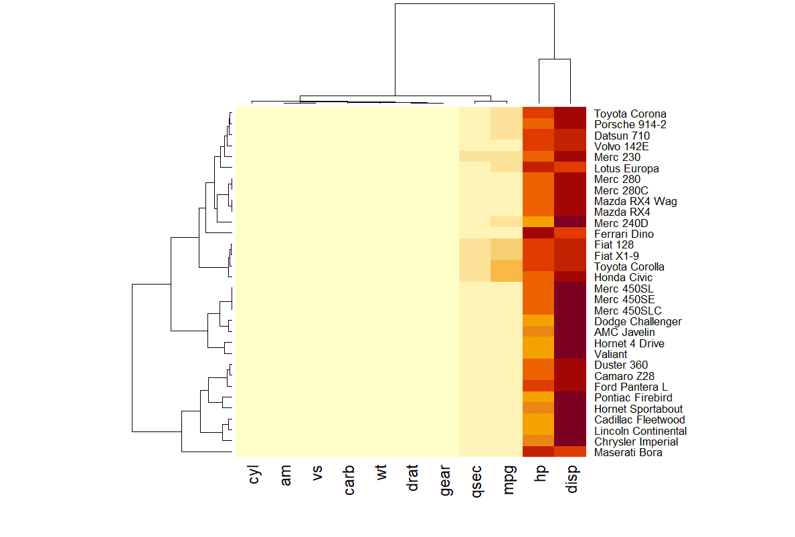
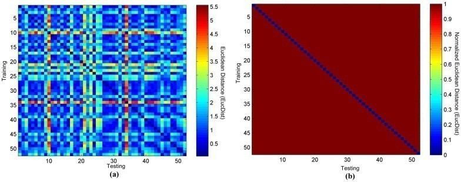
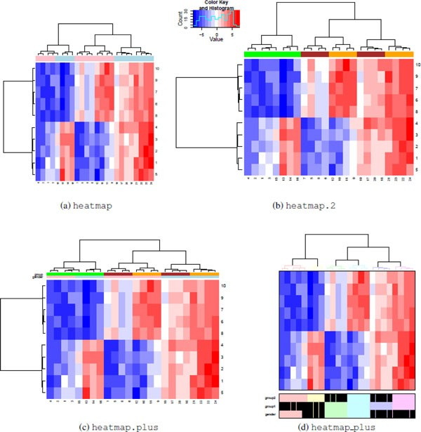
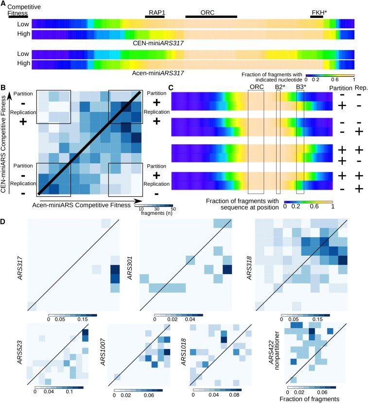

热图是一种用颜色表示矩阵中包含的各个值的可视化方式。常用来表示不同样品组代表性基因的表达差异、不同样品组代表性化合物的含量差异、不同样品之间的两两相似性。实际上，任何一个表格数据都可以转换为热图展示。

## 示例

{fig-alt="Heatmap Example" fig-align="center" width="60%"}

在此热图中，每一行代表一辆汽车（如 `Mazda RX4`、`Merc 450SLC` 等），每一列表示汽车的某个属性（如 `mpg`：每加仑行驶的英里数，`hp`：马力，`wt`：重量等）。每个方块表示某辆车在某个属性上的数值大小，越接近黄色数值越高。

顶部和左侧显示的线条表示层次聚类的结果（也称为树状图，dendrogram）。这些线条表示的是如何将行和列聚类的层次关系，即数据中不同行或列之间的相似性。

::: callout-note
**注意**: 由图可见，这个热图的信息量有限：很多变化被与其他变量相比具有非常高的值的hp和 disp变量吸收。（当所有变量被映射到同一颜色尺度时，`hp`和`disp`的较大值会主导颜色分布，导致图片不能很好的展示变量之间的差异。）我们需要对数据进行标准化，如下一节所述。
:::

## 环境配置

-   系统要求： 跨平台（Linux/MacOS/Windows）

-   编程语言：R

-   依赖包：`readr`, `ggplot2`, `hrbrthemes`, `dplyr`, `tidyr`, `viridis`, `tibble`, `htmlwidgets`, `RColorBrewer`, `plotly`, `remotes`, `d3heatmap`, `heatmaply`, `lattice`, `ComplexHeatmap`, `pheatmap`, `circlize`, `gridExtra`, `cowplot`

```{r packages setup, message=FALSE, warning=FALSE, output=FALSE}
# 安装包
if (!requireNamespace("readr", quietly = TRUE)) {
  install.packages("readr")
}
if (!requireNamespace("tidyverse", quietly = TRUE)) {
  install.packages("tidyverse")
}
if (!requireNamespace("ggplot2", quietly = TRUE)) {
  install.packages("ggplot2")
}
if (!requireNamespace("hrbrthemes", quietly = TRUE)) {
  remotes::install_github("hrbrmstr/hrbrthemes")
}
if (!requireNamespace("dplyr", quietly = TRUE)) {
  install.packages("dplyr")
}
if (!requireNamespace("tidyr", quietly = TRUE)) {
  install.packages("tidyr")
}
if (!requireNamespace("viridis", quietly = TRUE)) {
  install.packages("viridis")
}
if (!requireNamespace("tibble", quietly = TRUE)) {
  install.packages("tibble")
}
if (!requireNamespace("htmlwidgets", quietly = TRUE)) {
  install.packages("htmlwidgets")
}
if (!requireNamespace("RColorBrewer", quietly = TRUE)) {
  install.packages("RColorBrewer")
}
if (!requireNamespace("plotly", quietly = TRUE)) {
  install.packages("plotly")
}
if (!requireNamespace("d3heatmap", quietly = TRUE)) {
  remotes::install_github("talgalili/d3heatmap")
}
if (!requireNamespace("heatmaply", quietly = TRUE)) {
  install.packages("heatmaply")
}
if (!requireNamespace("lattice", quietly = TRUE)) {
  install.packages("lattice")
}
if (!requireNamespace("ComplexHeatmap", quietly = TRUE)) {
  BiocManager::install("ComplexHeatmap")
}
if (!requireNamespace("pheatmap", quietly = TRUE)) {
  install.packages("pheatmap")
}
if (!requireNamespace("circlize", quietly = TRUE)) {
  install.packages("circlize")
}
if (!requireNamespace("gridExtra", quietly = TRUE)) {
  install.packages("gridExtra")
}
if (!requireNamespace("cowplot", quietly = TRUE)) {
  install.packages("cowplot")
}

# 加载包
library(readr)
library(hrbrthemes)     # ggplot2 的附加主题
library(dplyr)          # 数据操作函数
library(tidyr)          # 数据整理函数
library(viridis)        # 调色板可实现更好的可视化
library(tibble)         # 整洁的数据框
library(htmlwidgets)    # 交互式网页可视化
library(RColorBrewer)   # 可视化的调色板
library(plotly)         # 交互式绘图
library(d3heatmap)      # D3.js-based 交互式热图
library(heatmaply)      # 使用 ggplot2 制作交互式热图
library(lattice)        # 多元数据的网格图形
library(ComplexHeatmap) # 高级热图功能
library(pheatmap)       # 漂亮的热图，支持聚类
library(circlize)       # 圆形可视化
library(gridExtra)      # 网格布局可视化
library(cowplot)
library(tidyverse)
library(ggplot2)        # 数据可视化包
```

```{r}
sessioninfo::session_info("attached")
```

## 数据准备

本节提供使用 R 内置数据集（`mtcars`、`volcano`）以及来自 [UCSC Xena DATASETS](https://xenabrowser.net/datapages/?hub=https://gdcv18.xenahubs.net:443) 的 `TCGA-CHOL.methylation450.tsv` 数据集的简短教程。这些数据集将用于演示 R 中的热图可视化。本示例演示了如何在 R 中加载和使用这些数据集。

```{r load data, message=FALSE}
# 加载内置 R 数据集“mtcars”
data("mtcars", package = "datasets")
mtcars_matrix <- as.matrix(mtcars)

# 加载和处理甲基化数据
raw_methylation_data <- readr::read_tsv("https://bizard-1301043367.cos.ap-guangzhou.myqcloud.com/TCGA-CHOL.methylation450.tsv")

# 转换为矩阵并清理行/列名称
methylation_matrix <- raw_methylation_data[, -1] %>%
  as.data.frame() %>%
  `rownames<-`(raw_methylation_data$Composite)

# 整理为长格式
methylation_long <- methylation_matrix %>%
  rownames_to_column("Composite") %>%
  pivot_longer(cols = -Composite, names_to = "Sample", values_to = "Methylation_Level") %>%
  mutate(
    Methylation_Level = as.numeric(Methylation_Level),
    Composite = gsub("^cg0+", "cg", Composite),
    Sample = substr(Sample, 9, 12)
  )

# 标准化甲基化值
methylation_long_standardized <- methylation_long %>%
  group_by(Composite) %>%
  mutate(Standardized_Level = scale(Methylation_Level)[,1]) %>%
  ungroup()

# 转换回宽格式矩阵
standardized_methylation_matrix <- methylation_long_standardized %>%
  select(Composite, Sample, Standardized_Level) %>%
  pivot_wider(names_from = Sample, values_from = Standardized_Level) %>%
  column_to_rownames("Composite") %>%
  as.matrix()


# 清理原始甲基化矩阵（原始热图的数值版本）
methylation_matrix_num <- methylation_matrix %>%
  mutate(across(everything(), ~ as.numeric(as.character(.)))) %>%
  `rownames<-`(gsub("^cg0+", "cg", rownames(.))) %>%
  { `colnames<-`(., substr(colnames(.), 9, 12)) } %>%
  as.matrix()
```

## 可视化

### 1. 基础 R 热图

#### 1.1 基础热图

使用`heatmap()`函数构建热图。下图是可以在基本 R 中构建的最基本的热图，没有使用参数。`heatmap()`以矩阵作为输入类型。如果数据是数据框类型，可以使用`as.matrix()`将其转换为矩阵。矩阵可以通过`t()`函数进行转置（transpose）。矩阵的转置操作会将原矩阵的行和列进行交换，交换 X 轴和 Y 轴。

```{r}
#| label: fig-BasicHeatBasicR
#| fig-cap: "基础 R 热图"
#| out.width: "95%"
#| warning: false

heatmap(mtcars_matrix)
```

此热图通过颜色的变化展示了 `mtcars` 数据集中不同汽车的性能变量之间的数值差异。

::: callout-tip
如图所示，这个热图并没有提供太多见解：所有的变异都被 `hp` 和 `disp` 两个变量吸收了，因为它们的数值远高于其他变量。（当所有变量被映射到同一颜色尺度时，hp和disp的较大值会主导颜色分布，使得其他变量（如`mpg`、`wt`等）的细微变化难以在图中体现。）我们需要对数据进行标准化，如下一节所述。
:::

#### 1.2 标准化

使用`heatmap()`函数的`scale`参数对矩阵进行标准化。它可以应用于行或列。这里选择列选项，因为我们需要吸收列之间的变化。

```{r}
#| label: fig-StandardizationBasicR
#| fig-cap: "标准化"
#| out.width: "95%"
#| warning: false

heatmap(mtcars_matrix, scale="column")
```

此热图显示了`mtcars`数据中各性能变量的标准化值，使得不同性能变量在同一尺度上进行比较，从而提高图片的效果和准确性。

#### 1.3 聚类图和重新排序

在绘制的热图中，行和列的顺序与原始`mtcar`矩阵不同。这是因为`heatmap()`使用聚类算法对变量和观测值进行重新排序：它计算每对行和列之间的距离，并尝试按相似性对它们进行排序。

此外，热图旁边还提供了聚类图。可以使用`Rowv`和`Colv`参数取消聚类图，如下所示。

```{r}
#| label: fig-ClusteringandReorderingBasicR
#| fig-cap: "聚类图和重新排序"
#| out.width: "95%"
#| warning: false

heatmap(mtcars_matrix, Colv = NA, Rowv = NA, scale="column")
```

此热图显示了`mtcars`数据中各性能变量的标准化值，取消树状图后行和列按照原顺序排列。

#### 1.4 调色板

热图可以使用不同调色板：

-   使用 R 的原生调色板：`terrain.color()`，`rainbow()`，`heat.colors()`，`topo.colors()`，`cm.colors()`
-   使用`RColorBrewer`建议的调色板
-   自定义调色板

```{r}
#| label: fig-ColorPalettesBasicR
#| fig-cap: "调色板"
#| out.width: "95%"
#| warning: false

# 原生调色板
heatmap(mtcars_matrix, scale="column", col = cm.colors(256))
heatmap(mtcars_matrix, scale="column", col = terrain.colors(256))

# 使用Rcolorbrewer
coul <- colorRampPalette(brewer.pal(8, "PiYG"))(25)
heatmap(mtcars_matrix, scale="column", col = coul)

# 自定义调色板
my_palette <- colorRampPalette(c("blue", "white", "red"))(256)
heatmap(mtcars_matrix, scale = "column", col = my_palette)
```

这四个热图通过不同的调色板展示了相同数据：`mtcars`数据集中不同汽车的性能变量之间的数值差异，强调了调色板选择对视觉效果和数据解释的重要性。

##### **RColorBrewer**

使用`display.brewer.all()`函数展示`RColorBrewer`包中所有的颜色系列。

```{r}
#| label: fig-RColorBrewerBasicR
#| fig-cap: "RColorBrewer Basic R"
#| out.width: "95%"
#| warning: false

par(plt=c(0.1,1,0,1))
display.brewer.all()
```

上图中，左侧是颜色系列的名称，右侧是对应的颜色。从图中可以看出，这些颜色系列共分为三类:
- 第一类颜色是单种颜色由浅到深的梯度变化，记作seq(sequential)；该系列的颜色主要适用于连续型变量或有序分类变量；
- 第二类颜色的彼此差异性较大，且不具备明显的等级关系，记作qual(qualitative)；该系列的颜色主要适用于无序的分类变量；
- 第三类颜色是两种颜色分别朝两个方向由浅到深的梯度变化，记作div(diverging)；该系列的颜色主要适用于中间值具有特殊意义的连续变量或有序分类变量，如摄氏温度、Logistic模型的OR值等。

#### 1.5 自定义布局

热图可以使用常用的`main`和`xlab`/`ylab`参数自定义标题和轴标题（左图），也可以使用`labRow`/`colRow`更改标签并使用`cexRow`/`cexCol`更改其大小（右图）。

```{r}
#| label: fig-CustomizingLayoutBasicR
#| fig-cap: "自定义布局"
#| out.width: "95%"
#| warning: false

# 自定义标题和轴标题
p5 <- heatmap(mtcars_matrix, Colv = NA, Rowv = NA, scale="column", col = coul, xlab="variable", main="heatmap")

# 自定义标签
p6 <- par(mar = c(5, 0, 4, 2))  # 调整边距
heatmap(mtcars_matrix, scale="column", cexRow=.8, labRow=paste("new_", rownames(mtcars_matrix),sep=""), col= colorRampPalette(brewer.pal(8, "Blues"))(25))
```

这两个热图通过自定义标题、轴标题和行标签，展示了 `mtcars` 数据集中不同汽车性能变量之间的标准化数值差异，强调了数据特征的可视化效果和信息传达的清晰度。

#### 1.6 带有颜色标记的热图

通常，热图旨在将观察到的结构与预期的结构进行比较。可以使用`RowSideColors`参数在热图旁边添加一个颜色向量，以表示预期的结构。

```{r}
#| label: fig-ColorAnnotationsBasicR
#| fig-cap: "带有颜色标记的热图"
#| out.width: "95%"
#| warning: false

my_group <- as.numeric(as.factor(substr(rownames(mtcars_matrix), 1 , 1))) # 将行标签按首字母分组并转换为数字
colSide <- brewer.pal(9, "Set1")[my_group] # 使用RColorBrewer包中的Set1方案生成9种颜色，为每个分组分配颜色标识
colMain <- colorRampPalette(brewer.pal(8, "Blues"))(25)
heatmap(mtcars_matrix, Colv = NA, Rowv = NA, scale="column" , RowSideColors=colSide, col=colMain)
```

此热图按首字母分组并为每个组分配不同颜色，帮助观察者快速识别不同组别或类别之间的差异，进而更直观地理解数据的模式和趋势。

### 2. ggplot2 热图

`ggplot2`使用`geom_tile()`函数来构建热图。但是只有`heatmap()`函数能提供标准化、聚类和树状图的选项。

#### 2.1 基础热图

使用`ggplot2`和`geom_tile()`函数构建的最基本的热图。因为`geom_tile()`函数不能直接进行标准化，需要提前进行标准化。

输入数据必须是长格式数据框，其中每行提供一个观察值。每个观察值至少需要 3 个变量：

-   `x`: X 轴上的位置
-   `y`: Y 轴上的位置
-   `fill`: 将以颜色转换的数值

```{r}
#| label: fig-BasicHeatggplot2
#| fig-cap: "基础热图"
#| out.width: "95%"
#| warning: false

p <- ggplot(methylation_long_standardized, aes(x = Sample, y = Composite, fill= Standardized_Level)) + 
  geom_tile()

p 
```

此热图使用 ggplot2 展示了在 TCGA-CHOL 数据集中不同样本（Sample）和复合体（Composite）之间标准化甲基化水平（Standardized_Level）的分布，反映了不同样本在甲基化状态上的差异。

#### 2.2 调色板

热图可以像任何`ggplot2`图表一样更改调色板。以下是使用不同方法的 3 个示例：

-   `scale_fill_gradient()`: 提供调色板的极端颜色。
-   `scale_fill_distiller())`: 提供`ColorBrewer`调色板。
-   `scale_fill_viridis()` 使用 `Viridis`。不要忘记 `discrete=FALSE` 连续变量。（颜色的渐变具有连续性）。

```{r}
#| label: fig-ColorPalettesggplot2
#| fig-cap: "调色板"
#| out.width: "95%"
#| warning: false
#| fig-width: 25
#| fig-height: 6

# Extreme colors
p7 <- ggplot(methylation_long_standardized, aes(x = Sample, y = Composite, fill= Standardized_Level)) + 
  geom_tile()+
  scale_fill_gradient(low="white", high="blue") +
  theme_ipsum() +
  theme(axis.text.x = element_text(size = 10))

# ColorBrewer color palette
p8 <- ggplot(methylation_long_standardized, aes(x = Sample, y = Composite, fill= Standardized_Level)) + 
  geom_tile() +
  scale_fill_distiller(palette = "RdPu") +
  theme_ipsum() +
  theme(axis.text.x = element_text(size = 10)) 

# Using Viridis
p9 <- ggplot(methylation_long_standardized, aes(x = Sample, y = Composite, fill= Standardized_Level)) + 
  geom_tile()+
  scale_fill_viridis(discrete=FALSE) +
  theme_ipsum() + 
  theme(axis.text.x = element_text(size = 10))

plot_grid(p7, p8, p9, ncol = 3)
```

这三个热图通过不同的调色板展示了相同数据：TCGA-CHOL 数据集中不同样本（Sample）和复合体（Composite）之间标准化甲基化水平（Standardized_Level）的分布，强调了调色板选择对视觉效果和数据解释的重要性。

#### 2.3 宽格式输入

输入为一个宽矩阵是一个常见的问题，使用`volcano`数据集时就是这样。在这种情况下，可以使用`tidyr包`的`gather()`函数对其进行整理变成长格式，然后用`ggplot`进行可视化 。

```{r}
#| label: fig-Wide-Formatggplot2
#| fig-cap: "宽格式输入"
#| out.width: "95%"
#| warning: false

volcano %>%
  as_tibble() %>%
  rowid_to_column(var="X") %>%
  gather(key="Y", value="Z", -1) %>%
  
  mutate(Y=as.numeric(gsub("V","",Y))) %>%

  ggplot(aes(X, Y, fill= Z)) + 
    geom_tile() +
    theme_ipsum() +
    theme(legend.position="none")
```

此热图展示了火山数据集中不同点的高程值（Z），其中横轴代表行索引（X），纵轴代表列索引（Y），通过颜色填充表示高程的变化。

#### 2.4 交互式热图

`ggplot2`创造热图的一大优点是借助`plotly`包，图表可以在几秒钟内变为交互式。只需要将图表包装在一个对象中，然后在`ggplotly()`函数中调用它即可。

你也可以自定义工具提示中的文本，提供更丰富的信息。尝试将鼠标悬停在单元格上以查看工具提示，选择要放大的区域。

```{r}
#| label: fig-InterHeatggplot2
#| fig-cap: "交互式热图"
#| out.width: "95%"
#| warning: false

# 创建工具提示文本
methylation_long_annotated <- methylation_long_standardized %>%
  mutate(text = paste0("Composite: ",Composite, "\n", "Sample: ", Sample, "\n", "Standardized_Level: ", Standardized_Level))

p <- ggplot(methylation_long_annotated, aes(Composite, Sample, fill = Standardized_Level, text = text)) + 
  geom_tile() +
  theme_ipsum()

pp <- ggplotly(p, tooltip="text", width = 1200, height = 700)

pp
```

 此交互式热图是使用`plotly`包构建，允许用户动态探索和深入分析数据，提供更直观的理解和信息获取。

也可以使用`d3heatmap`包和`heatmaply`包创造交互性热图

##### **使用 `d3heatmap` 包**

```{r}
#| label: fig-d3heatmapggplot2
#| fig-cap: "使用 `d3heatmap` 包"
#| out.width: "95%"
#| warning: false

d3heatmap(standardized_methylation_matrix, scale = "row", dendrogram = "none")
```

使用 `d3heatmap` 包构建交互式热图，允许用户动态探索和深入分析数据，提供更直观的理解和信息获取。

##### **使用 `heatmaply` 包**

```{r}
#| label: fig-heatmaplyggplot2
#| fig-cap: "使用 `heatmaply` 包"
#| out.width: "95%"
#| warning: false

p <- heatmaply(standardized_methylation_matrix,
               dendrogram = "none",
               xlab = "", ylab = "",
               main = "",
               scale = "row",
               margins = c(50,0,30,30),
               grid_color = "white",
               grid_width = 0.00001,
               titleX = FALSE,
               hide_colorbar = TRUE,
               branches_lwd = 0.1,
               fontsize_row = 5, fontsize_col = 5,
               labCol = colnames(standardized_methylation_matrix),
               labRow = rownames(standardized_methylation_matrix),
               heatmap_layers = theme(axis.line = element_blank())
)

p
```

使用`heatmaply`包构建交互式热图，允许用户动态探索和深入分析数据，提供更直观的理解和信息获取。

#### 2.5 对角分割热图：每格承载两个对立水平

当每个单元格携带**两个对立数值**——例如每个基因在各癌种中的拷贝数扩增（上三角）与缺失（下三角）\[17\]——就把每格切成两个三角形。单一 diverging 色标（红 = 扩增，蓝 = 缺失）用一个图例编码两个水平，`geom_polygon()` 负责切分：

```{r}
#| label: fig-DiagSplitHeatmap
#| fig-cap: "对角分割热图：10 个基因 × 8 个癌种的扩增（上三角，红）与缺失（下三角，蓝）。"
#| out.width: "95%"
#| warning: false
#| message: false
#| fig-width: 7.5
#| fig-height: 5

set.seed(403)
gene_d <- paste0("Gene", sprintf("%02d", 1:10))
cancer_d <- c("BRCA", "LUAD", "COAD", "STAD", "KIRC", "HNSC", "LUSC", "PRAD")
amp <- matrix(runif(80, 0, 0.55), 10, 8, dimnames = list(gene_d, cancer_d))
del <- matrix(runif(80, 0, 0.55), 10, 8, dimnames = list(gene_d, cancer_d))
amp[1:4, ] <- amp[1:4, ] + 0.25      # 原癌基因样：扩增
del[5:10, ] <- del[5:10, ] + 0.30    # 抑癌基因样：缺失
amp <- pmin(amp, 0.95); del <- pmin(del, 0.95)

make_tri <- function(i, j, upper) {
  x0 <- j - 0.5; y0 <- i - 0.5
  if (upper) data.frame(x = x0 + c(0, 0, 1), y = y0 + c(0, 1, 1))   # upper-left triangle
  else data.frame(x = x0 + c(0, 1, 1), y = y0 + c(0, 0, 1))         # lower-right triangle
}
cells <- expand.grid(i = seq_len(10), j = seq_len(8))
tri_df <- do.call(rbind, lapply(seq_len(nrow(cells)), function(k) {
  i <- cells$i[k]; j <- cells$j[k]
  rbind(cbind(make_tri(i, j, TRUE),  value =  amp[i, j], id = k, tri = "up",   gi = i, cj = j),
        cbind(make_tri(i, j, FALSE), value = -del[i, j], id = k, tri = "dn",   gi = i, cj = j))
}))
tri_df$gene <- factor(gene_d[tri_df$gi], levels = rev(gene_d))
tri_df$cancer <- factor(cancer_d[tri_df$cj], levels = cancer_d)

## 多边形需要数值 x/y——离散 aes 会把顶点坐标压塌
ggplot(tri_df, aes(x, y, group = interaction(id, tri), fill = value)) +
  geom_polygon(colour = "white", linewidth = 0.4) +
  scale_x_continuous(breaks = seq_len(8) - 0.5, labels = cancer_d, expand = c(0, 0)) +
  scale_y_continuous(breaks = seq_len(10) - 0.5, labels = gene_d, expand = c(0, 0)) +
  scale_fill_gradient2(low = "#3878C1", mid = "#FFFADD", high = "#AB221F",
                       midpoint = 0, limits = c(-1, 1), name = NULL,
                       labels = function(v) sprintf("%.1f", v)) +
  labs(x = "Cancer type", y = NULL,
       caption = "上三角：扩增 | 下三角：缺失（颜色深浅 = 频率）") +
  theme_minimal(base_size = 11) +
  theme(panel.grid = element_blank(),
        axis.text.x = element_text(angle = 45, hjust = 1),
        legend.key.height = unit(5, "mm"))
```

::: callout-tip
**实践要点**

-   `group = interaction(id, tri)` 让同一格的两个三角形保持为独立多边形——去掉它 `geom_polygon()` 会把所有三点集连成一条路径。
-   用符号编码（扩增 = +，缺失 = −）换来的是两个水平共享一条 diverging 色标；若两个水平单位不同，请预计算十六进制颜色并用 `scale_fill_identity()` 配手工图例。
-   行/列标签就是普通离散轴：重排（按通路聚类基因、按器官排列癌种）只需改因子水平顺序，无需聚类。
:::

### 3. lattice 热图

用 `lattice` 包的 `levelplot()` 函数构建热图

#### 3.1 `levelplot()` 的基本用法

```{r}
#| label: fig-BasicHeatlattice
#| fig-cap: "lattice 基础热图"
#| out.width: "95%"
#| warning: false

# 将 Sample 和 Composite 列由字符转换为因子
methylation_long_standardized$Sample <- as.factor(methylation_long_standardized$Sample)
methylation_long_standardized$Composite <- as.factor(methylation_long_standardized$Composite) 

levelplot(Standardized_Level ~ Sample * Composite, data = methylation_long_standardized,
          xlab = "Sample", ylab = "Composite",
          main = "Heatmap of Standardized TCGA-CHOL Methylation Levels")
```

此热图使用lattice展示了在 TCGA-CHOL 数据集中不同样本（Sample）和复合体（Composite）之间标准化甲基化水平（Standardized_Level）的分布，反映了不同样本在甲基化状态上的差异。

#### 3.2 来自宽输入矩阵

本文档的上一个示例基于长格式的数据框。这里改用方阵。这是该`levelplot()`函数理解的第二种格式。

::: callout-tip
此处热图中行和列会调转。
:::

```{r}
#| label: fig-Wide-FormatMatrixInputlattice
#| fig-cap: "来自宽输入矩阵"
#| out.width: "95%"
#| warning: false

levelplot(standardized_methylation_matrix)
```

此热图使用`levelplot()`函数宽格式输入，展示了在 TCGA-CHOL 数据集中不同样本在甲基化状态上的差异。

#### 3.3 翻转轴

R 的函数`t()`允许转置输入矩阵，从而翻转 X 和 Y 坐标。这样，来自宽输入矩阵levelplot()热图的组织方式与输入矩阵完全相同。

levelplot()输入为宽矩阵时默认小格的纵横比是1:1，可以用`aspect = "fill"`根据矩阵的实际比例自动调整纵横比。

```{r}
#| label: fig-FlippingAxeslattice
#| fig-cap: "翻转轴"
#| out.width: "95%"
#| warning: false

# 翻转 X 和 Y 坐标
levelplot( t(standardized_methylation_matrix),
           col.regions=heat.colors(220),
           aspect = "fill") # 自动调整纵横比
```

此热图展示了在 TCGA-CHOL 数据集中不同样本在甲基化状态上的差异。翻转 X 和 Y 坐标使得热图的组织方式与输入矩阵完全相同。

#### 3.4 调色板

调色板的方法有多种： 
- R的原生调色板：`terrain.color()`，`rainbow()`，`heat.colors()`，`topo.colors()`，`cm.colors()` 
- `RColorBrewer` 调色板 
- `Viridis`调色板：viridis, magma, inferno, plasma

```{r}
#| label: fig-ColorPaletteslattice
#| fig-cap: "调色板"
#| out.width: "95%"
#| warning: false

# 使用R原生调色板
p10 <- levelplot(volcano, col.regions = terrain.colors(100)) # try cm.colors() or terrain.colors()
p10

# 使用 Rcolorbrewer
coul <- colorRampPalette(brewer.pal(8, "PiYG"))(25)
p11 <- levelplot(volcano, col.regions = coul)
p11

# 使用 Viridis
coul <- viridis(100)
p12 <- levelplot(volcano, col.regions = coul) 
p12
```

这三个热图通过不同的调色板展示了相同数据：`volcano`数据集中不同点的高程值，强调了调色板选择对视觉效果和数据解释的重要性。

### 4. pheatmap 热图

用 `pheatmap` 包构建热图，`pheatmap` 包同样可以用参数进行标准化

#### 4.1 基础热图

```{r}
#| label: fig-BasicHeatPheatmap
#| fig-cap: "基础热图"
#| out.width: "95%"
#| warning: false

pheatmap(methylation_matrix_num, scale = "row")
```

此热图使用 `pheatmap` 包展示了在 TCGA-CHOL 数据集中不同样本在甲基化状态上的差异。

#### 4.2 调整聚类图

-   `clustering_distance_rows` 和 `clustering_distance_cols` 表示行、列聚类使用的度量方法，默认为“euclidean”，也可为 "correlation"，即按照 Pearson correlation方法进行聚类。
-   `clustering_method` 可以修改聚类方法，包括：‘ward’, ‘ward.D’, ‘ward.D2’, ‘single’, ‘complete’, ‘average’, ‘mcquitty’, ‘median’, ‘centroid’。

```{r}
#| label: fig-AdjustingDendrograms
#| fig-cap: "调整聚类图"
#| out.width: "95%"
#| warning: false

pheatmap(methylation_matrix_num, scale = "row", 
         clustering_distance_rows = "euclidean", clustering_distance_cols = "euclidean", # 聚类使用的度量方法
         clustering_method = "complete", # 聚类方法
         cluster_rows = T, cluster_cols = F, # 是否显示聚类树
         treeheight_row = 30, treeheight_col = 30) # 聚类树高度调整
```

此热图使用 `pheatmap` 包展示了在 TCGA-CHOL 数据集中不同样本在甲基化状态上的差异，取消了不同样本之间的聚类，样本按照原顺序排列。

#### 4.3 标签角度及未聚类条件下的隔断位置

```{r}
#| label: fig-AngleAdjustment
#| fig-cap: "标签角度及未聚类条件下的隔断位置"
#| out.width: "95%"
#| warning: false

pheatmap(methylation_matrix_num, scale = "row", 
         clustering_distance_rows = "euclidean", clustering_distance_cols = "euclidean", # 聚类使用的度量方法
         clustering_method = "complete", # 聚类方法
         cluster_rows = T, cluster_cols = F, # 是否显示聚类树
         treeheight_row = 30, treeheight_col = 30, # 聚类树高度调整
         angle_col = "45", # 改变列标签的角度
         gaps_col = c(3,6))  # 仅在未进行列聚类时使用，假设样本在3，6的位置隔断，分为三组
```

此热图调整标签角度，可以避免标签重叠，提升可读性；在未聚类条件下调整隔断位置则能突出特定样本之间的差异，便于直观分析。

#### 4.4 添加数值或标记

```{r}
#| label: fig-AddingValuesorMarkers
#| fig-cap: "添加数值或标记"
#| out.width: "95%"
#| warning: false

pheatmap(methylation_matrix_num, scale = "row",
         border_color = "white", # 修改单元格边框颜色
         display_numbers = TRUE, # 热图格子中显示相应的数值
         fontsize_number = 9, 
         number_color = "grey30",
         number_format = "%.1f") # 保留一位小数
```

在热图上添加数值或标记可以提供更多上下文信息，帮助观察者快速识别每个样本或位点的具体甲基化水平，从而增强数据解读的直观性和准确性。

##### **使用原数据判断标注**

```{r}
#| label: fig-RawDataforAnnotation
#| fig-cap: "使用原数据判断标注"
#| out.width: "95%"
#| warning: false

pheatmap(methylation_matrix_num, scale = "row",
         border_color = "white",
         display_numbers = matrix(ifelse(methylation_matrix_num > .8 | methylation_matrix_num < -.8, "*", ""), nrow = nrow(methylation_matrix_num)),
         fontsize_number = 9, 
         number_color = "grey30")
```

此热图使用未标准化的数据进行标注，结果不具有可比性，可能会导致观察者对不同样本之间的差异产生误解。未标准化的值可能因样本间的绝对数值差异而掩盖了真实的相对变化，从而降低了数据解读的准确性。

##### **使用经过标准化的数据**

```{r}
#| label: fig-UsingNormalizedData
#| fig-cap: "使用经过标准化的数据"
#| out.width: "95%"
#| warning: false

pheatmap(standardized_methylation_matrix, scale = "none", # 不需要再标准化
         border_color = "white",
         display_numbers = matrix(ifelse(standardized_methylation_matrix > 1 | standardized_methylation_matrix < -1, "*", ""), nrow = nrow(standardized_methylation_matrix)),
         fontsize_number = 9, 
         number_color = "grey30") 
```

在热图上标记可以直观地突出显示重要的数值或特征，使观察者更容易识别出显著的甲基化状态变化或异常值，从而为后续分析提供指导。这种方式增强了数据的可读性和解读性，帮助用户快速获取关键信息。

#### 4.5 调色板

`pheatmap` 包生成的热图同样可以用多种方式更改调色板：
- R的原生调色板:`terrain.color()`，`rainbow()`，`heat.colors()`，`topo.colors()`，`cm.colors()` 
- 自定义调色板 
- `RColorBrewer` 调色板

```{r}
#| label: fig-ColorPalettesPheatmap
#| fig-cap: "调色板"
#| out.width: "95%"
#| warning: false

# R 原生调色板
p13 <- pheatmap(standardized_methylation_matrix, scale = "none",
         border_color = "white",
         color = colorRampPalette(c("navy","white","firebrick3"))(100))

# 自定义调色板
p14 <- pheatmap(standardized_methylation_matrix, scale = "none",
         border_color = "white",
         color = cm.colors(100))

# 使用 Rcolorbrewer
coul <- colorRampPalette(brewer.pal(8, "PiYG"))(25)
p15 <- pheatmap(standardized_methylation_matrix, scale = "none",
         border_color = "white",
         color = coul)
```

这三个热图通过不同的调色板展示了 TCGA-CHOL 数据集中不同样本在甲基化状态上的差异，强调了调色板选择对视觉效果和数据解释的重要性。

#### 4.6 相对正常样本的三态编码热图

通路失调研究常把每个基因编码为**相对正常样本的三态变量**：某个肿瘤样本中该基因的 log2 表达超过正常样本的 97.5% 分位数为"上调"，低于 2.5% 分位数为"下调"，其余为"无变化" \[17\]。得到的 −1/0/1 矩阵用 Ward 法聚类、三色标度绘制、并在行名中标注该基因上调样本的比例，即可呈现单个通路内部的亚型结构。

```{r}
#| label: fig-TernaryStatusPheatmap
#| fig-cap: "三态编码热图：基因按正常样本分位数记为上调/无变化/下调，Ward 聚类并切分 3 个样本簇。"
#| out.width: "95%"
#| warning: false
#| message: false
#| fig-width: 8
#| fig-height: 6

set.seed(2026)
n_tum <- 30; n_nor <- 20
path_genes <- paste0("PathGene", sprintf("%02d", 1:20))
base <- rnorm(20, mean = 5, sd = 0.3)            # 每个基因的基准表达
normal_expr <- sapply(seq_len(n_nor), function(i) base + rnorm(20, sd = 0.6))

tum_shift <- matrix(0, nrow = 20, ncol = n_tum)
tum_shift[1:8, 1:15]    <- 2.2                   # 亚组 1（T01-T15）：基因 1-8 上调
tum_shift[17:20, 16:30] <- -2.2                  # 亚组 2（T16-T30）：基因 17-20 下调
tum_expr <- sapply(seq_len(n_tum), function(i) base + tum_shift[, i] + rnorm(20, sd = 0.6))
colnames(tum_expr) <- paste0("T", sprintf("%02d", 1:n_tum))

logdata <- log2(cbind(tum_expr, normal_expr) - min(cbind(tum_expr, normal_expr)) + 0.5)
tumordata  <- logdata[, seq_len(n_tum)]
normaldata <- logdata[, (n_tum + 1):(n_tum + n_nor)]

# 逐基因按正常样本 2.5% / 97.5% 分位数做三态编码
normaldown <- apply(normaldata, 1, quantile, probs = 0.025)
normalup   <- apply(normaldata, 1, quantile, probs = 0.975)
status <- tumordata                              # 复用矩阵外壳
for (k in seq_len(nrow(tumordata))) {
  row_k <- as.numeric(tumordata[k, ])
  out <- rep(0, length(row_k))
  out[row_k > normalup[k]]   <-  1               # 高于正常样本 97.5% 分位数
  out[row_k < normaldown[k]] <- -1               # 低于正常样本 2.5% 分位数
  status[k, ] <- out
}

# 基因与样本均用 Ward 聚类；样本切成 3 簇
hcg <- hclust(dist(status), method = "ward.D")
hcs <- hclust(dist(t(status)), method = "ward.D")
group <- paste0("C", cutree(hcs, 3))

# 每个样本的失调评分（-1/0/1 求和），用作列注释
score <- colSums(status)
ann_col <- data.frame(Cluster = factor(group), Score = score)
p_val <- kruskal.test(score ~ Cluster, data = ann_col)$p.value
score_colname <- sprintf("Pathway score (KW %s)",
                         ifelse(p_val < 0.001, "p < 0.001", sprintf("p = %.3f", p_val)))
colnames(ann_col)[2] <- score_colname

# 行名携带该基因上调的肿瘤比例
pct <- paste0(round(rowSums(status == 1) / ncol(status), 2) * 100, "%")
rownames(status) <- paste0(path_genes, " (", pct, ")")

ann_colors <- list(Cluster = c(C1 = "#B31E22", C2 = "#529B40", C3 = "#020105"))
ann_colors[[score_colname]] <- colorRampPalette(c("#283285", "#DEDEDE", "#651430"))(64)

pheatmap(status,
         cluster_rows = hcg, cluster_cols = hcs,
         color = c("#283285", "#DEDEDE", "#651430"),   # 下调 / 无变化 / 上调
         annotation_col = ann_col,
         annotation_colors = ann_colors,
         annotation_legend = FALSE,          # 图例不挤占主体
         show_colnames = FALSE,              # 30 个样本名会互相叠压
         cutree_cols = 3,
         legend_breaks = c(-1, 0, 1),
         legend_labels = c("mRNA\ndown-regulation", "mRNA\nno-change", "mRNA\nup-regulation"),
         fontsize_row = 8)
```

::: callout-tip
**实践要点**

- 阈值必须从**正常组织**估计才有意义——用肿瘤自身的分位数会把本图要揭示的异质性重新吸收掉。
- 参考工作流用 GSVA 通路评分做列注释；这里用每样本三态求和作为免依赖替代，对比效果相同。
- `cutree_cols = 3` 只负责画簇矩形、不改变任何排序：顺序仍由 `cluster_cols` 决定。
- 行/列名与图例挤占主体时果断关闭（`show_colnames = FALSE`、`annotation_legend = FALSE`）：pheatmap 的图例堆在右侧，轻松吃掉三分之一画布。
:::

#### 4.7 带组间比较 P 值的表达热图

表达热图加上每行的**组间比较 P 值**就成为证据图 \[17\]：四种检验覆盖所有设计（两组用 t.test/Wilcoxon，多组用 ANOVA/Kruskal-Wallis），BH 校正后把结论以颜色标注列放在热图旁。

```{r}
#| label: fig-4.7PvalueHeatmap
#| fig-cap: "12 个基因在三档 WHO 样 grades 中的 z-score 表达热图（列按 grade 分块）；右侧色条编码每基因 BH 校正后的 Kruskal-Wallis P。"
#| out.width: "95%"
#| warning: false
#| message: false
#| fig-width: 9
#| fig-height: 5

set.seed(1601)
genes_p <- paste0("m6A", sprintf("%02d", 1:12))
grades <- c("G2", "G3", "G4")
samples <- paste0("S", sprintf("%02d", 1:60))
grade_v <- factor(rep(grades, each = 20), levels = grades)

expr_p <- matrix(rnorm(12 * 60, sd = 0.8), 12, 60, dimnames = list(genes_p, samples))
expr_p[1:4, grade_v == "G3"] <- expr_p[1:4, grade_v == "G3"] + 0.9
expr_p[1:4, grade_v == "G4"] <- expr_p[1:4, grade_v == "G4"] + 1.6
expr_p[5:8, grade_v == "G4"] <- expr_p[5:8, grade_v == "G4"] - 1.2

## 逐基因 Kruskal-Wallis，BH 校正（参考的 cross_subtype_compr 四分支）
p_kw <- apply(expr_p, 1, function(x) kruskal.test(x ~ grade_v)$p.value)
p_adj <- p.adjust(p_kw, method = "BH")

z_mat <- t(scale(t(expr_p)))
p_cut <- cut(p_adj, breaks = c(0, 0.001, 0.01, 0.05, 1),
             labels = c("P < 0.001", "P < 0.01", "P < 0.05", "n.s."))
p_col <- c("P < 0.001" = "#B2182B", "P < 0.01" = "#EF8A62",
           "P < 0.05" = "#FDDBC7", "n.s." = "grey90")
## 每个基因一个 P 值，作为右侧行注释（同参考图的 p 值列）
row_ha_p <- rowAnnotation(`KW P (BH)` = factor(p_cut, levels = names(p_col)),
  col = list(`KW P (BH)` = p_col),
  annotation_name_side = "top")

grade_col <- c(G2 = "#445EAD", G3 = "#EABF00", G4 = "#B2182B")
ha_col <- HeatmapAnnotation(Grade = grade_v, col = list(Grade = grade_col),
                            show_legend = FALSE)

Heatmap(z_mat, name = "Expression (z)",
        top_annotation = ha_col, right_annotation = row_ha_p,
        col = circlize::colorRamp2(c(-2, 0, 2), c("#2166AC", "white", "#B2182B")),
        cluster_columns = FALSE,
        column_split = grade_v, column_gap = unit(1.5, "mm"),
        row_names_gp = grid::gpar(fontsize = 9),
        show_column_names = FALSE, border = TRUE)
```

::: callout-tip
**实践要点**

-   按设计选检验而非习惯：两组用 `t.test`/`wilcox`，≥3 组用 `anova`/`kruskal`；参考工作流的四分支辅助函数封装的正是这个。
-   注释色条让显著性无需打印十二个 P 值即可扫读；原始数值表留作补充数据。
-   `p.adjust(method = "BH")` 要**跨被检验的基因**计算——按列或按图分别校正会让 FDR 失效。
:::

#### 4.8 亚型特异性对角热图

≥3 个亚型时，one-vs-rest 差异检验产生**每个亚型特异的基因集**；把这些集合堆进同一张不聚类的 z-score 表达热图，就得到对角线布局 \[17\]——每个亚型的特异基因只在它自己的列亮起。

```{r}
#| label: fig-4.8DiagonalSubtype
#| fig-cap: "亚型特异性对角热图：每模拟亚型取 one-vs-rest 上调 top-10 基因，z-score 后列按亚型分组；行保持亚型区块顺序。"
#| out.width: "95%"
#| warning: false
#| message: false
#| fig-width: 9
#| fig-height: 6.5

set.seed(1602)
subts <- paste0("C", 1:4)
genes_d <- paste0("G", sprintf("%02d", 1:40))
subt_v <- rep(subts, each = 20)
samp_d <- paste0(subt_v, "_", unlist(lapply(table(subt_v), seq_len)))

expr_d <- matrix(rnorm(40 * 80, sd = 0.8), 40, 80,
                 dimnames = list(genes_d, samp_d))
for (k in seq_along(subts)) {                          # 每亚型 10 个特异基因
  blk <- ((k - 1) * 10 + 1):(k * 10)
  expr_d[blk, subt_v == subts[k]] <- expr_d[blk, subt_v == subts[k]] + 1.8
}

## 逐亚型 one-vs-rest t 检验；每亚型保留上调 top-10
spec_list <- lapply(subts, function(st) {
  rest <- subt_v != st
  p_vals <- apply(expr_d, 1, function(x) t.test(x[!rest], x[rest])$p.value)
  lfc <- rowMeans(expr_d[, !rest, drop = FALSE]) - rowMeans(expr_d[, rest, drop = FALSE])
  genes_d[order(p_adj2 <- p.adjust(p_vals, "BH"), -lfc)][1:10]
})
names(spec_list) <- subts

## 按亚型堆叠区块：行 = 特异基因，列 = 样本
row_idx <- unlist(spec_list)
col_idx <- order(subt_v)
z_d <- t(scale(t(expr_d[row_idx, col_idx, drop = FALSE])))

subt_col <- c(C1 = "#B31E22", C2 = "#529B40", C3 = "#383D8E", C4 = "#EABF00")
ann_d <- HeatmapAnnotation(Subtype = subt_v[col_idx],
                           col = list(Subtype = subt_col), show_legend = FALSE)
row_block <- data.frame(Specific = rep(subts, each = 10))

Heatmap(z_d, name = "Expression (z)",
        top_annotation = ann_d,
        col = circlize::colorRamp2(c(-2, 0, 2), c("#2166AC", "white", "#B2182B")),
        cluster_rows = FALSE, cluster_columns = FALSE,
        row_split = factor(rep(subts, each = 10), subts),
        column_split = factor(subt_v[col_idx], subts),
        column_gap = unit(1.5, "mm"), row_gap = unit(1.5, "mm"),
        show_column_names = FALSE,
        row_names_gp = grid::gpar(fontsize = 6), border = TRUE)
```

::: callout-tip
**实践要点**

-   one-vs-rest 是产生对角线的比较：把每个亚型与**合并的其他亚型**比，而非两两比较。
-   行按亚型分块（`row_split`）且**永不聚类行**——聚类会打散特异区块、抹掉对角线。
-   参考工作流的特异基因集来自配对 RNA-seq DE（edgeR）；microarray 型数据上 t 检验给出相同选择。
:::


#### 4.9 泛癌 m6A 调控因子热图

调控因子家族（m6A readers / writers / erasers）通常以**跨多个癌种的肿瘤-正常 log2 倍数变化矩阵**呈现。`pheatmap` 原生支持：`annotation_row` 用颜色条承载功能类别，`clustering_method = "ward.D"` 完成行聚类，以 0 为白锚的五段色带保证上下调可读 \[19\]。

```{r pan-m6a-check, eval=FALSE}
# 真实数据路线：每个癌种 i 跑 limma 肿瘤-正常对比 ->
# lfc[基因, 癌种]；见参考工作流的 twoclasslimma 循环。
```

```{r}
#| label: fig-4.9PanM6AHeatmap
#| fig-cap: "Pan-cancer m6A-regulator heatmap: tumour-vs-normal log2FC for 18 writers/readers/erasers across 10 TCGA cohorts; ward.D row clustering keeps each functional class together, the left strip annotates it."
#| out.width: "95%"
#| warning: false
#| message: false
#| fig-width: 9
#| fig-height: 6

set.seed(1609)
tumors <- c("BLCA", "BRCA", "CESC", "CHOL", "COAD",
            "LUAD", "LUSC", "PAAD", "PRAD", "UCEC")
m6a_genes <- paste0(rep(c("Reader", "Writer", "Eraser"), each = 6),
                    rep(seq_len(6), 3))
m6a_class <- rep(c("Readers", "Writers", "Erasers"), each = 6)

## simulated tumour-vs-normal log2FC matrix; readers move up, writers down,
## erasers stay flat (the real workflow takes these from per-cohort limma contrasts)
lfc <- matrix(rnorm(18 * 10, 0, 0.28), 18, 10, dimnames = list(m6a_genes, tumors))
lfc[1:6, ]   <- lfc[1:6, ]   + 0.95
lfc[7:12, ]  <- lfc[7:12, ]  - 0.85
lfc[13:18, ] <- lfc[13:18, ] + rnorm(60, 0, 0.25)

annRow <- data.frame(row.names = m6a_genes,
                     class = factor(m6a_class, levels = c("Readers", "Writers", "Erasers")),
                     stringsAsFactors = FALSE)
annColors <- list(class = c(Readers = "#51B743", Writers = "#FAC67A",
                            Erasers = "#5AC9FA"))
colPattern <- c("#183869", "#4195C1", "white", "#CB5746", "#62011D")

## pheatmap draws when called; keep it as the bare last expression so the
## figure renders exactly once (no `name=` legend title exists in pheatmap)
pheatmap(as.matrix(lfc),
         border_color = "black",
         cluster_rows = TRUE, cluster_cols = FALSE,
         clustering_method = "ward.D",
         show_rownames = TRUE, show_colnames = TRUE,
         annotation_row = annRow, annotation_colors = annColors,
         cellwidth = 22, cellheight = 14,
         color = colorRampPalette(colPattern)(64))
```

::: callout-tip
**实践要点**

-   `clustering_method = "ward.D"` 最小化簇内方差，行确实共享效应时能让每个功能类别保持连续——方法选错会悄悄打散生物学信息。
-   有定性行分组时，用 `annotation_row` + `annotation_colors` 传注释条，别给基因名上色：色条一眼可读，且黑白打印不失效。
-   发散色带务必**以 0 为白色锚点**（`#183869/#4195C1/white/#CB5746/#62011D`）：log2FC 带符号，无锚色带会让微小非零值看起来像效应。
:::


### 4.10 亚型质心热图 + signature 评分注释（PAM50 风格）

分子分型论文（FigureYa311 背后的 PAM50 图 \[17\]）在同一张热图里叠三层：样本**按预测亚型排序**（列分块）、分类器基因的均值中心化表达矩阵、以及携带亚型判定与连续 signature 评分的**顶部注释**。分类器本身是最近质心规则——训练集上建质心、按相关性给留出样本分类——此处替代 `genefu::intrinsic.cluster.predict()`（PAM50 需要该包与基因 ID 映射，不在本仓库 lockfile 中）；signature 评分用简单的基因集均值，即本站其他页面使用的 GSVA 免依赖替身。

```{r}
#| label: fig-4.10SubtypeCentroid
#| fig-cap: "亚型质心热图（50 个模拟 PAM50 风格基因，60 个样本）：样本按最近质心预测排序分块；顶部注释为亚型判定、两条 signature 评分线（AR 样：Basal 高；增殖：LumB 高）与 AR 表型。"
#| out.width: "100%"
#| warning: false
#| message: false
#| fig-width: 11
#| fig-height: 6

set.seed(3110)
subtypes <- c("LumA", "LumB", "Basal")
n_per <- 20
genes <- paste0("PAM50_", sprintf("%02d", 1:50))
n_samp <- length(subtypes) * n_per
sub_lab <- factor(rep(subtypes, each = n_per), levels = subtypes)
base <- matrix(rnorm(50 * n_samp, sd = 0.6), 50, n_samp,
               dimnames = list(genes, paste0("S", sprintf("%02d", 1:n_samp))))
sig_blocks <- list(
  LumA  = list(up = 1:10,  dn = NULL,  eff = 1.1),
  LumB  = list(up = 11:20, dn = NULL,  eff = 1.2),
  Basal = list(up = 21:30, dn = 31:40, eff = 1.3))
for (st in subtypes) {
  idx <- which(sub_lab == st)
  base[sig_blocks[[st]]$up, idx] <- base[sig_blocks[[st]]$up, idx] + sig_blocks[[st]]$eff
  if (!is.null(sig_blocks[[st]]$dn))
    base[sig_blocks[[st]]$dn, idx] <- base[sig_blocks[[st]]$dn, idx] - sig_blocks[[st]]$eff
}
## 增殖基因：仅在 LumB 中高表达
base[41:50, sub_lab == "LumB"] <- base[41:50, sub_lab == "LumB"] + 1.2

## 训练折上的最近质心分类（SSP 替身）
train <- c(TRUE, FALSE)[rep(1:2, length.out = n_samp)]
cent <- sapply(subtypes, function(st) rowMeans(base[, train & sub_lab == st]))
pred <- apply(base[, !train], 2, function(x) {
  corrs <- sapply(seq_len(ncol(cent)), function(k) cor(x, cent[, k]))
  subtypes[which.max(corrs)] })
pred <- factor(pred, levels = subtypes)
cat("held-out accuracy:", round(mean(pred == sub_lab[!train]), 2), "\n")

sig_scores <- rbind(
  `AR score`  = colMeans(base[21:30, ]) - colMeans(base[31:40, ]),  # Basal 高
  `Prolif score` = colMeans(base[41:50, ]))                          # LumB 高
pheno <- ifelse(sig_scores["AR score", ] > 0, "AR-high", "AR-low")

## 每个基因均值中心化（不缩放，即参考文献的倍数差异标度）并截断
mat <- t(scale(t(base), center = TRUE, scale = FALSE))
mat[mat > 4] <- 4; mat[mat < -4] <- -4
ord <- order(pred)
pred_o <- pred[ord]; mat_o <- mat[, ord]
pheno_o <- factor(pheno[ord], levels = c("AR-low", "AR-high"))
ar_o <- sig_scores["AR score", ord]; pro_o <- sig_scores["Prolif score", ord]

col_fun <- colorRamp2(c(-2, 0, 2), c("#170B88", "#FFFFFF", "#D23C30"))
ha <- HeatmapAnnotation(
  Subtype = pred_o,
  `AR score` = anno_lines(ar_o, border = FALSE),
  `Prolif score` = anno_lines(pro_o, border = FALSE),
  Phenotype = pheno_o,
  gap = unit(2.5, "mm"),
  annotation_name_gp = gpar(fontsize = 8.5),
  col = list(Subtype = c(LumA = "#395790", LumB = "#6BBD2A", Basal = "#FFA652"),
             Phenotype = c("AR-low" = "#07C7CF", "AR-high" = "#CE0706")))
draw(Heatmap(mat_o, name = "Expression",
             top_annotation = ha,
             cluster_columns = FALSE,
             column_split = pred_o,
             column_title = "Samples ordered by predicted subtype",
             show_row_names = FALSE, show_column_names = FALSE,
             column_title_gp = gpar(fontsize = 10),
             col = col_fun))
```

::: callout-tip
**实践要点**

-   热图行保持分类器自身的基因集，且**不要重新聚类行**——否则会破坏分类器所见的块结构；聚类用于呈现发现，不用于呈现预测。
-   行只做均值中心化*不缩放*（参考文献的倍数差异标度）并截断于 ±4——z-score 会抹平不同 signature 块之间的振幅差异。
-   在图旁报告留出集准确率（上方已打印）；按机会水平分类器排序的热图只是装饰，不是证据。
:::

### 5. complexheatmap 热图

`ComplexHeatmap`包是基于`grid`包的，使用面向对象的方式实现热图及其组件，主要包含以下几个类：

-   `Heatmap`：绘制单个热图（注意是大写）
-   `HeatmapList`：绘制热图列表
-   `HeatmapAnnotation`: 定义热图的行、列注释列表，可以是热图的一部分，也可以独立于热图

以及一些内部类：

-   `SingleAnnotation`：定义单个行、列注释，组成 `HeatmapAnnotation` 的列表元素
-   `ColorMapping`: 定义值到颜色的映射
-   `AnnotationFunction`: 用于自定义注释图形

#### 5.1 基础热图

```{r}
#| label: fig-BasicHeatcomplexheatmap
#| fig-cap: "Complexheatmap 基础热图"
#| out.width: "95%"
#| warning: false

Heatmap(standardized_methylation_matrix)
```

此热图使用 `ComplexHeatmap` 包展示了在 TCGA-CHOL 数据集中不同样本在甲基化状态上的差异。

#### 5.2 调色板

通常，我们绘制的矩阵都是连续型数据，因此颜色映射函数需要接受一个向量输入，并返回一个向量输出。

该包的作者推荐使用他写的另一个包 `circlize` 的函数 `colorRamp2()` 来设置颜色映射，`colorRamp2()`函数接受两个参数，第一个参数用来设置值映射范围断点，第二个参数用于设置对应的颜色值

在以下示例中，线性插值-2和2之间的值以获得相应的颜色，大于2的值都映射为红色，小于-2的值都映射为绿色。

```{r}
#| label: fig-ColorPalettescomplexheatmap
#| fig-cap: "complexheatmap 调色板"
#| out.width: "95%"
#| warning: false

col_fun <- colorRamp2(c(-2, 0, 2), c("green", "white", "red"))
Heatmap(standardized_methylation_matrix, name = "Standardized_Level", col = col_fun)
```

此热图使用 `colorRamp2()` 设置颜色映射，展示在 TCGA-CHOL 数据集中不同样本在甲基化状态上的差异。

另外，使用 `colorRamp2()` 可以使得多个热图之间的颜色具有可比性，如下所示，在2个热图中，相同的颜色总是对应相同的数值：

```{r}
#| label: fig-colorRamp2complexheatmap
#| fig-cap: "complexheatmap 使用 colorRamp2"
#| out.width: "95%"
#| warning: false

p1 <- Heatmap(standardized_methylation_matrix, name = "Standardized_Level1", col = col_fun)
p2 <- Heatmap(standardized_methylation_matrix/2, name = "Standardized_Level2", col = col_fun)
p1 + p2 
```

此热图使用 `colorRamp2()` 在相同尺度进行颜色比较，展示在 TCGA-CHOL 数据集中不同样本在甲基化状态上的差异。

如果矩阵是连续的，也可以简单地提供颜色的向量，并且颜色将被线性插值。 但是此方法对异常值不友好，因为颜色映射是根据整个矩阵中的最小值和最大值来确定的，如果矩阵中有极端的异常值，会导致其他正常范围内的值的颜色变化不明显。

```{r}
#| label: fig-ColorVectorcomplexheatmap
#| fig-cap: "complexheatmap 使用颜色向量"
#| out.width: "95%"
#| warning: false

Heatmap(standardized_methylation_matrix, name = "Standardized_Level", col = rev(cm.colors(10)), column_title = "color vector for continuous matrix")
```

此热图展示了线性插值设置颜色映射，展示在 TCGA-CHOL 数据集中不同样本在甲基化状态上的差异。

还可以可视化NA，使用`na_col`参数指定NA的颜色：

```{r}
#| label: fig-nacolcomplexheatmap
#| fig-cap: "complexheatmap 使用 `na_col` 参数"
#| out.width: "95%"
#| warning: false

standardized_methylation_matrix_na <- standardized_methylation_matrix
na_index <- sample(c(TRUE, FALSE), nrow(standardized_methylation_matrix)*ncol(standardized_methylation_matrix), replace = TRUE, prob = c(1, 9))
standardized_methylation_matrix_na[na_index] <- NA
Heatmap(standardized_methylation_matrix_na, name = "matrix with na", na_col = "grey", column_title = "matrix with na")
```

此热图使用 `na_col` 参数指定NA的颜色为灰色，展示在 TCGA-CHOL 数据集中不同样本在甲基化状态上的差异。

默认情况下，颜色的线性内插的方式是遵循 LAB 颜色空间的变化，还有其他的颜色空间可供选择，如：RGB，XYZ，sRGB

```{r}
#| label: fig-DifferentLinearInterpolationcomplexheatmap
#| fig-cap: "complexheatmap 不同的线性插值"
#| out.width: "95%"
#| warning: false

f1 <- colorRamp2(seq(min(standardized_methylation_matrix), max(standardized_methylation_matrix), length = 3), c("blue", "#EEEEEE", "red"))
f2 <- colorRamp2(seq(min(standardized_methylation_matrix), max(standardized_methylation_matrix), length = 3), c("blue", "#EEEEEE", "red"), space = "RGB")

p1 <- Heatmap(standardized_methylation_matrix, name = "Standardized_Level1", col = f1, column_title = "color space in LAB")
p2 <- Heatmap(standardized_methylation_matrix, name = "Standardized_Level2", col = f2, column_title = "color space in RGB")
p1 + p2
```

此热图展示不同颜色空间中 TCGA-CHOL 数据集中不同样本在甲基化状态上的差异。

#### 5.3 边框和网格线

热图的最外层边框使用 border 参数设置，网格线使用 `rect_gp` 参数来设置

`border` 参数可以是逻辑值或颜色值，而 `rect_gp` 参数需要接受一个 `grid::gpar` 对象

```{r}
#| label: fig-BordersandGridlinescomplexheatmap
#| fig-cap: "边框和网格线"
#| out.width: "95%"
#| warning: false

Heatmap(standardized_methylation_matrix, name = "Standardized_Level", border = "black", col = col_fun, rect_gp = gpar(col = "white", lwd = 2) )
```

此热图修改了边框和网格线，展示在 TCGA-CHOL 数据集中不同样本在甲基化状态上的差异。

#### 5.4 聚类

更改 `cluster_rows` 和 `cluster_columns` 参数修改聚类图

```{r}
#| label: fig-Clusteringcomplexheatmap
#| fig-cap: "complexheatmap 聚类"
#| out.width: "95%"
#| warning: false

p1 <- Heatmap(standardized_methylation_matrix, cluster_rows = F, cluster_columns = F)
p1
```

此热图取消了聚类，展示在 TCGA-CHOL 数据集中不同样本在甲基化状态上的差异。

#### 5.5 注释条和多个热图

注释条是热图的重要组成部分，`ComplexHeatmap`包提供灵活的注释条设置。注释条可以放在热图的上下左右四个位置，通过`top_annotation`、`bottom_annotation`、`left_annotation`、`right_annotation`设置，所有的注释条都是通过`HeatmapAnnotation()`函数完成的（还有一个`rowAnnotation()`，但是可以通过设置`HeatmapAnnotation(..., which = "row")`实现，可以看做是变体）。

```{r}
#| label: fig-MultipleHeatmapscomplexheatmap
#| fig-cap: "complexheatmap 多个热图"
#| out.width: "95%"
#| warning: false

p1 <- rowAnnotation(
  "Average Methylation" = anno_barplot(
    rowMeans(standardized_methylation_matrix), 
    gp = gpar(fill = "blue"), 
    width = unit(4, "cm"),
    axis_param = list(at = pretty(rowMeans(standardized_methylation_matrix)), 
                      labels = format(pretty(rowMeans(standardized_methylation_matrix)), nsmall = 1, digits = 1))
  )
)

p2 <- Heatmap(standardized_methylation_matrix, 
               name = "Standardized Methylation Levels", 
               col = f2, 
               row_km = 2,
               column_names_gp = gpar(fontsize = 8))  # Based on row clustering

p1 + p2
```

此条形图为热图的注释条，显示每个位点的平均甲基化值。

`ComplexHeatmap`包的一大特色就是可以同时绘制多个热图，下图为水平排列的热图，垂直排列的热图原理与此类似。水平排列的热图要求具有相同的行。

热图和条形图组合，显示了TCGA-CHOL 数据集中不同样本在甲基化状态上的差异和每个位点的平均甲基化值。
#### 5.6 分类型热图与格内数字

连续统计量（log 倍数变化、相关系数）**分档成类别**并标注数值往往更好读 \[17\]：五档倍数变化（红 = 上调、蓝 = 下调）加一档白色表示不显著，`cell_fun` 依色档深浅以黑/白把数值写进每个格子，左侧注释携带基因类别。

```{r}
#| label: fig-5.6CategoricalCells
#| fig-cap: "分类型热图：倍数变化分五档（白 = P >= 0.05），格内数字随色档换色，左侧色条 = 基因类别。"
#| out.width: "95%"
#| warning: false
#| message: false
#| fig-width: 8
#| fig-height: 5.5

set.seed(503)
gene_r <- paste0("MMP", sprintf("%02d", 1:24))
cancer_r <- c("BRCA", "LUAD", "COAD", "STAD", "KIRC", "HNSC", "LUSC", "PRAD")
logfc_r <- matrix(rnorm(24 * 8, sd = 1.5), 24, 8,
                  dimnames = list(gene_r, cancer_r))
logfc_r[1:6, ] <- logfc_r[1:6, ] + 1.8      # 上调区块
logfc_r[7:12, ] <- logfc_r[7:12, ] - 1.8    # 下调区块
## explicit P-value design: strong bands significant, weak genes mostly not
p_low <- ifelse(runif(24 * 8) < 0.25, runif(24 * 8, 1e-3, 0.045),
                                       runif(24 * 8, 0.06, 0.9))
pval_r <- ifelse(abs(logfc_r) > 2, runif(24 * 8, 1e-8, 1e-3),
          ifelse(abs(logfc_r) > 1, runif(24 * 8, 1e-4, 0.04), p_low))
gene_type <- rep(c("Collagen-binding", "Membrane-type", "Gelatin-binding",
                   "Secreted", "Matrisome", "Other"),
                 each = 4)

## 分成 5 档倍数变化；P >= 0.05 覆盖为第 6 档（白色）
logfc_cat <- apply(logfc_r, 2, function(x)
  cut(x, breaks = c(-Inf, -2, -1, 1, 2, Inf),
      labels = c("< -2", "-2 - -1", "-1 - 1", "1 - 2", "> 2")))
rownames(logfc_cat) <- gene_r
logfc_cat[pval_r >= 0.05] <- "P >= 0.05"

col_cat <- c("> 2" = "#A80C3A", "1 - 2" = "#ED5E57", "-1 - 1" = "#DDD3D2",
             "-2 - -1" = "#6B9AB7", "< -2" = "#2F5B89", "P >= 0.05" = "white")

cell_fun <- function(j, i, x, y, width, height, fill) {
  dark <- logfc_cat[i, j] %in% c("> 2", "1 - 2", "< -2", "-2 - -1")
  val <- logfc_r[i, j]; if (abs(val) < 0.05) val <- 0
  grid::grid.text(sprintf("%.1f", val), x, y,
                  gp = grid::gpar(fontsize = 8,
                                  col = if (dark) "white" else "black"))
}

row_an <- HeatmapAnnotation(
  Type = gene_type, show_annotation_name = FALSE,
  col = list(Type = c("Collagen-binding" = "#ED1450", "Membrane-type" = "#FCCA02",
                      "Gelatin-binding" = "#A7CE35", "Secreted" = "#2C92DA",
                      "Matrisome" = "#59574A", "Other" = "#BCBDBF")),
  annotation_legend_param = list(title = "Gene class"), which = "row")

Heatmap(logfc_cat, name = "logFC band",
        rect_gp = grid::gpar(col = "grey90"),
        col = col_cat,
        heatmap_legend_param = list(border = "black"),
        cell_fun = cell_fun,
        row_names_side = "left",
        row_names_gp = grid::gpar(fontsize = 8),
        column_names_gp = grid::gpar(fontsize = 8),
        column_names_rot = 45,
        left_annotation = row_an)
```

::: callout-tip
**实践要点**

-   白色"P >= 0.05"档是把*倍数大小*与*证据强度*分开的关键：倍数再大但 P 弱的格子读作空白，正是审稿人期望的呈现。
-   `cell_fun` 收到的 `i`/`j` 是矩阵顺序；文字颜色按**色档**切换（如本例）而非原始数值，文字与背景永远一致。
-   色档是因子水平——`col_cat` 中的顺序即图例顺序；保持档位递增，让图例自上而下与生物学方向一致。
:::

### 6. 聚类-相关性热图

Unsupervised (consensus) clustering of samples splits a cohort into gene-driven subtypes; correlating **each gene with the numeric cluster label** then splits the gene set into a positively correlated signature (A) and a negatively correlated one (B), which is exactly the "identification of immunogenic gene subtypes" figure \[17\]. With real data, `ConsensusClusterPlus::ConsensusClusterPlus()` chooses k and returns the class vector; here the clusters are simulated and only the correlation + annotated heatmap is reproduced.

```{r}
#| label: fig-6.1ClusterCorrelation
#| fig-cap: "z-score 标准化表达式的带标注热图：样本按共识基因聚类排序（上方标注），基因按与聚类正相关（A）与负相关（B）分为两组 signature（左侧标注）。"
#| out.width: "95%"
#| warning: false
#| message: false
#| fig-width: 8.5
#| fig-height: 6.5

set.seed(4401)
n_s <- 90; n_g <- 45
cls3 <- rep(1:3, each = n_s / 3)             # consensus gene clusters 1/2/3
mat <- matrix(rnorm(n_g * n_s, sd = 0.5), n_g)
sigA <- 1:15; sigB <- 16:30                  # signature A rises in cluster 1,
mat[sigA, cls3 == 1] <- mat[sigA, cls3 == 1] + 1.8   # signature B rises in
mat[sigB, cls3 == 3] <- mat[sigB, cls3 == 3] + 1.8   # cluster 3 and dips in 1
mat[sigB, cls3 == 1] <- mat[sigB, cls3 == 1] - 1.5
rownames(mat) <- paste0("Gene", sprintf("%03d", 1:n_g))
colnames(mat) <- paste0("Sample", 1:n_s)

# Pearson r of each gene against the numeric cluster label (1/2/3)
rs <- sapply(1:n_g, function(i) cor(mat[i, ], as.numeric(cls3)))
out_tab <- data.frame(gene = rownames(mat), r = rs,
                      direct = ifelse(rs > 0, "A", "B"))

plotdata <- t(scale(t(mat)))                   # z-score per gene
plotdata[plotdata > 3] <- 3                    # truncate extreme values
plotdata[plotdata < -3] <- -3

ann_col <- data.frame("Gene cluster" = c("A", "B", "C")[cls3],
                      row.names = colnames(mat))
ann_row <- data.frame("Signature" = out_tab$direct,
                      row.names = out_tab$gene)
ann_cols <- list("Gene cluster" = c(A = "#008ECB", B = "#EA921D", C = "#D14039"),
                 Signature = c(A = "#D14039", B = "#008ECB"))

pheatmap(plotdata, cluster_rows = FALSE, cluster_cols = FALSE,
         show_rownames = FALSE, show_colnames = FALSE,
         annotation_row = ann_row, annotation_col = ann_col,
         annotation_colors = ann_cols,
         color = colorRampPalette(c("#343493", "white", "#C24A45"))(64))
```

::: callout-tip
**实践要点**

-   真实数据用 `ConsensusClusterPlus::ConsensusCluster(d = as.matrix(expr), maxK = 4, reps = 1000, clusterAlg = "pam", innerLinkage = "ward.D", finalLinkage = "ward.D")`，类向量取 `result[[k]]$consensusClass`——上面的相关循环即可直接沿用。
-   按 r 的**符号**切分 signature（而非再次聚类基因）能让 A、B 保持生物学可解释性；若基因集几乎全是同一符号，往往说明聚类编码（1/2/3）不是序数型的——可改用 one-hot 编码。
-   截断到 ±3 之前务必按基因做 z-score 标准化：截断能防止单个离群样本使色标饱和。
-   FigureYa311 的呈现模式把 **SSP 分子分型与 signature 评分列注释**配对：`genefu::intrinsic.cluster.predict(sbt.model = pam50.robust, do.mapping = TRUE)` 给每个样本 PAM50 分型，`GSVA::gsva(gsvaParam(expr, geneSets))` 计算 AR/NE/CCP 类 signature 评分，`ComplexHeatmap::columnAnnotation()` 将其堆叠在质心基因热图上方——热图按列 z 标准化、winsorize 到 ±4、`cluster_columns = FALSE`，样本按亚型自然成组。
:::

### 4.11 分箱中位数相关面板（FigureYa73batchCorrelation）

FigureYa73 \[11\] 展示目标基因的表达如何与其最相关的伙伴同行：样本按目标基因排序、切成 20 个等大分箱，每个伙伴的**逐箱中位数表达**对目标的分箱中位数作图，面板标题写各自的 Pearson r / P。分箱把数万个噪声点（参考文档的 ChIP-seq peak）变成干净的单调趋势；网格面板装配模拟矩阵的正负相关 top 6：

```{r}
#| label: fig-4.11BinnedCorr
#| fig-cap: "模拟目标基因的分箱中位数相关面板：排序样本切成 20 箱；每面板画一个 top 相关伙伴的分箱中位数对目标分箱中位数，带 lm 线，标题写 r / P。"
#| out.width: "100%"
#| warning: false
#| message: false
#| fig-width: 10
#| fig-height: 6

## freeze:auto 只在新会话中重跑新 chunk——在此重新挂载包
suppressPackageStartupMessages({library(ggplot2); library(dplyr); library(tidyr)})
set.seed(7301)
n_bc <- 400
symbol <- "HDAC1"
top6_pos <- paste0("P", 1:6); top6_neg <- paste0("N", 1:6)
expr119 <- matrix(rnorm(n_bc * 13, 6, 1), n_bc, 13,
                  dimnames = list(NULL, c(symbol, top6_pos, top6_neg)))
expr119[, top6_pos] <- expr119[, top6_pos] + expr119[, 1] * 0.7
expr119[, top6_neg] <- expr119[, top6_neg] - expr119[, 1] * 0.6
genesexps <- as.data.frame(expr119)
sortgenesexps <- genesexps[order(genesexps[, 1]), ]
samplenum <- nrow(sortgenesexps)
pointnumber <- 20
group <- as.integer(cut(1:samplenum,
                        breaks = c(seq(0.5, samplenum, by = samplenum / pointnumber),
                                   samplenum + 0.5)))
ddf <- data.frame(row.names = 1:pointnumber)
allgenes <- colnames(expr119)
for (i in seq_along(allgenes)) {
  ddf[[allgenes[i]]] <- tapply(sortgenesexps[, i], group, median)
}
cor_df <- do.call(rbind, lapply(allgenes[-1], function(g) {
  ct <- cor.test(expr119[, symbol], expr119[, g], method = "pearson")
  data.frame(variable = g, r = ct$estimate, P = ct$p.value)
}))
mddf <- tidyr::pivot_longer(ddf, cols = -dplyr::all_of(symbol),
                            names_to = "variable", values_to = "value")
mddf$r <- cor_df$r[match(mddf$variable, cor_df$variable)]
mddf$P <- cor_df$P[match(mddf$variable, cor_df$variable)]
plist <- lapply(top6_pos[1:6], function(friend) {
  df <- mddf[mddf$variable == friend, ]
  ggplot(df, aes(x = .data[[symbol]], y = value)) +
    geom_point() +
    geom_smooth(method = "lm", se = FALSE, colour = "#206BB5") +
    ggtitle(paste0("r = ", round(unique(df$r), 2),
                   "\nP = ", sprintf("%1.1e", unique(df$P)))) +
    xlab(symbol) + ylab(friend) +
    theme_classic(base_size = 10)
})
cowplot::plot_grid(plotlist = plist, ncol = 3)
```

::: callout-tip
**实践要点**

-   `cut(1:n, breaks = seq(0.5, n, by = n/pointnumber))` 恰好产生 `pointnumber` 个等大分箱；当 `pointnumber = NULL` 时参考文档画全部样本——两种模式挂在同一参数后面。
-   面板网格共享 x 轴（目标的分箱中位数），即使每个面板有自己的 y 标度，趋势也能跨面板比较。
-   `aes(x = .data[[symbol]])`（embrace + bang-bang）把列名放在变量里且无 rlang 歧义——`aes_string()` 已被软弃用。
:::

## 应用场景

### 1. 基础热图

::: {#fig-HeatApplications1}
{fig-alt="HeatApp1" fig-align="center" width="70%"}

基础热图应用
:::

52 名健康人的 TEC 匹配热图。（a）原始热图 （b）二进制热图。 \[1\]

### 2. 带有颜色标记的热图

::: {#fig-HeatApplications2}
{fig-alt="HeatApp2" fig-align="center" width="40%"}

带有颜色标记的热图应用
:::

对标签进行分组。可以使用所有热图函数标记行和列，但实现方式各不相同。heatmap （a） 和 heatmap.2 （b） 函数仅限于显示单个颜色条。heatmap.plus （c） 函数可以显示彩条矩阵。heatmap_plus （d） 函数可以显示二进制变量的数据帧。虽然 heatmap.2 和 heatmap.plus 可以生成矩形图像，但 heatmap 和 heatmap_plus 都会生成方形图像作为输出。 \[2\]

### 3. 比较热图

::: {#fig-HeatApplications3}
{fig-alt="HeatApp3" fig-align="center" width="40%"}

比较热图应用
:::

比较 miniARS 实验以消除与 miniARS 染色体片段相关的分区和复制功能的歧义。（A） 将在 Cen-（含着丝粒）miniARS 或 Acen-（无着丝粒）miniARS 实验中耗尽的 MiniARS317 片段与在这些实验中富集的片段进行比较。（B） 共享 miniARS 数据集中位于给定竞争适应性十分位数的片段（即 Acen-miniARS 库和 Cen-miniARS 库中同时存在的片段）在此热图中表示。该热图图分为 100 个部分，每个部分代表 Acen-miniARS 和 Cen-miniARS 实验中竞争性适应度十分位数的不同组合，如图所示。左下角包含在 Acen- 和 Cen-miniARS 比赛中竞争适应性较低的片段，因此被确定为相对于种群中的其他片段具有较弱的复制和分区能力（分区“-”;复制 “−”）。在热图图的这一部分，有 288 个片段代表 62 个原点。右下角包含在 Acen-miniARS 库中具有高竞争适应性但在 Cen-miniARS 库中具有低竞争适应性的片段，因此被确定具有相对较强的分区能力但较弱的复制能力（分区“+”;复制 “−”）。在热图图的这一部分，有 103 个片段代表 32 个来源。左上角包含的片段在 Acen-miniARS 库中表现为低竞争适应性，但在 Cen-miniARS 库中表现为高竞争适应性，因此被确定具有相对较弱的分区能力但具有较强的复制能力（分区“−”;复制 “+”） 。在热图图的这一部分，有 105 个片段代表 33 个起点。（C） 对 B 中片段的组合分析，旨在定义对最大化分区能力至关重要的区域 [第一对（从上到上）和第四对热图] 与对最大化复制能力更关键的区域（第二对和第三对热图）。（D） 与 B 中的热图图相同，但它们仅包含来自指示 ARS 的 miniARS 片段。有关更多详细信息，请参阅正文。ARS，自主复制序列;FKH，叉头;ORC， 原点识别复合物;RAP1，Rap1 蛋白结合位点。 \[3\]

## 参考文献

1.  Yang, M., Liu, B., Zhao, M., Li, F., Wang, G., & Zhou, F. (2013). Normalizing electrocardiograms of both healthy persons and cardiovascular disease patients for biometric authentication. *PLoS One, 8*(8), e71523. <https://doi.org/10.1371/journal.pone.0071523>\
2.  Key, M. (2012). A tutorial in displaying mass spectrometry-based proteomic data using heat maps. *BMC Bioinformatics, 13*(Suppl 16), S10. <https://doi.org/10.1186/1471-2105-13-S16-S10>\
3.  Hoggard, T., Liachko, I., Burt, C., Meikle, T., Jiang, K., Craciun, G., Dunham, M. J., & Fox, C. A. (2016). High throughput analyses of budding yeast ARSs reveal new DNA elements capable of conferring centromere-independent plasmid propagation. *G3 (Bethesda), 6*(4), 993--1012. <https://doi.org/10.1534/g3.116.027904>\
4.  Wickham, H. (2016). *ggplot2: Elegant graphics for data analysis*. Springer. <https://r-graph-gallery.com/ggplot2-package.html>\
5.  Rudis, B. (2020). *hrbrthemes: Additional themes and theme components for 'ggplot2'*. <https://cran.r-project.org/package=hrbrthemes>\
6.  Wickham, H., François, R., Henry, L., & Müller, K. (2021). *dplyr: A grammar of data manipulation*. <https://cran.r-project.org/package=dplyr>\
7.  Wickham, H., & Henry, L. (2021). *tidyr: Tidy messy data*. <https://cran.r-project.org/package=tidyr>\
8.  Garnier, S. (2018). *viridis: Default color maps from 'matplotlib'*. <https://cran.r-project.org/package=viridis>\
9.  Henry, L. (2022). *tibble: Simple data frames*. <https://cran.r-project.org/package=tibble>\
10. Urbanek, S. (2021). *htmlwidgets: HTML widgets for R*. <https://cran.r-project.org/package=htmlwidgets>\
11. Neuwirth, E. (2014). *RColorBrewer: ColorBrewer palettes*. <https://cran.r-project.org/package=RColorBrewer>\
12. Winston, L., & Hsu, T. (2021). *plotly: Create interactive web graphics via 'plotly.js'*. <https://cran.r-project.org/package=plotly>\
13. *D3heatmap: Interactive heatmaps using 'd3.js'*. <https://cran.r-project.org/package=d3heatmap>\
14. Gang, C. (2020). *heatmaply: Interactive heat maps for R*. <https://cran.r-project.org/package=heatmaply>\
15. Becker, R. A., Wilks, A. R., & Brownrigg, R. (2021). *lattice: The lattice package for R*. <https://cran.r-project.org/package=lattice>\
16. Auguie, B. (2017). gridExtra: Miscellaneous Functions for "Grid" Graphics. <https://cran.r-project.org/package=gridExtra>
17. Xiaofan Lu, et al. FigureYa: A Standardized Visualization Framework for Enhancing Biomedical Data Interpretation and Research Efficiency. iMetaMed. 2025. doi:10.1002/imm3.70005
18. Xiaofan Lu, et al. FigureYa144DiagHeatmap 参考图：对角分割热图。FigureYa 文档。https://ying-ge.github.io/FigureYa/\
19. Xiaofan Lu, et al. FigureYa266panHeatmap 参考图：泛癌调控因子 log2FC 热图（ward.D 聚类）。FigureYa 文档。https://ying-ge.github.io/FigureYa/
