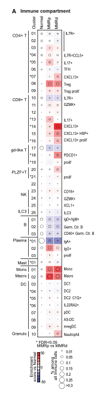

To highlight specific cells in a gene expression or correlation heatmap without cluttering the color grid, the reference overlays **symbols or dots (e.g. asterisks for p < 0.05)** on top of the heatmap tiles \[1\]. `ComplexHeatmap::Heatmap`'s `cell_fun` or `layer_fun` handles this natively; this tutorial simulates a 12 gene × 10 patient expression matrix with planted significant cells and renders the heatmap with overlaid significance dots:

## Example

{fig-alt="Heatmap with Overlaid Significance Symbols DEMO" fig-align="center" width="70%"}

## Setup

-   System Requirements: Cross-platform (Linux/MacOS/Windows)

-   Programming language: R

-   Dependent packages: `ComplexHeatmap`; `circlize`

```{r packages setup, message=FALSE, warning=FALSE, output=FALSE}
suppressPackageStartupMessages({
  library(ComplexHeatmap); library(circlize)
})
```

```{r}
sessioninfo::session_info("attached")
```

## Data Preparation

12 candidate genes × 10 patients. Expression matrix (z-scaled) plus a companion boolean significance matrix (`TRUE` where p < 0.05, marked for overlay dots):

```{r load data}
suppressPackageStartupMessages({library(ComplexHeatmap); library(circlize)})
set.seed(46278)
genes <- sprintf("GENE%02d", 1:12)
patients <- sprintf("PT%02d", 1:10)
mat <- matrix(rnorm(12 * 10, 0, 1.2), 12, 10,
              dimnames = list(genes, patients))
mat[1:4, 1:4] <- mat[1:4, 1:4] + 1.8          # high block
mat[5:8, 5:8] <- mat[5:8, 5:8] - 1.6          # low block

## significance matrix
sig_mat <- matrix(FALSE, 12, 10, dimnames = list(genes, patients))
sig_mat[1:5, c(1, 3, 6, 8)] <- TRUE
sig_mat[6:10, c(2, 4, 7, 10)] <- TRUE
```

## Visualization

### 1. Heatmap with Overlaid Asterisk Dots

`ComplexHeatmap`'s `layer_fun` accesses row and column coordinates vectorially to draw dots on significant cells:

```{r}
#| label: fig-1.1HeatmapPoints
#| fig-cap: "Gene expression heatmap (12 genes × 10 patients) with white asterisk dots overlaid on statistically significant cells (p < 0.05): clean color grid without text clutter."
#| out.width: "85%"
#| fig-width: 8
#| fig-height: 6

col_fun <- colorRamp2(c(-2, 0, 2), c("#2166AC", "white", "#B2182B"))
Heatmap(mat, name = "z-score",
        col = col_fun,
        cluster_rows = TRUE, cluster_columns = TRUE,
        row_names_side = "left",
        rect_gp = grid::gpar(col = "grey85", lwd = 1),
        layer_fun = function(j, i, x, y, w, h, fill) {
          v <- sig_mat[cbind(as.numeric(i), as.numeric(j))]
          if (any(v)) {
            grid::grid.text(
              ifelse(v[v], "*", ""),
              x[v], y[v],
              gp = grid::gpar(fontsize = 12, col = "white", fontface = "bold")
            )
          }
        },
        heatmap_legend_param = list(title = "z-score"))
```

### 2. P-Value Gradients as Dot Size

An alternative encoding: dot size proportional to −log10(p) over the heatmap tiles, so both effect size (color) and statistical confidence (dot size) are visible simultaneously:

```{r}
#| label: fig-2.1HeatmapDotSize
#| fig-cap: "Alternative encoding: dot size proportional to -log10(p) overlaid on heatmap tiles, combining effect size (color) and confidence (dot size) in one view."
#| out.width: "85%"
#| fig-width: 8
#| fig-height: 6

p_mat <- matrix(runif(120, 0.0001, 0.8), 12, 10, dimnames = list(genes, patients))
p_mat[sig_mat] <- runif(sum(sig_mat), 0.0001, 0.04)
nl_mat <- pmin(-log10(p_mat), 4)

Heatmap(mat, name = "z-score",
        col = col_fun,
        cluster_rows = TRUE, cluster_columns = TRUE,
        row_names_side = "left",
        rect_gp = grid::gpar(col = "grey85", lwd = 1),
        layer_fun = function(j, i, x, y, w, h, fill) {
          sz <- nl_mat[cbind(as.numeric(i), as.numeric(j))] / 4 * 2.8
          grid::grid.points(x, y, pch = 16,
                            gp = grid::gpar(col = ifelse(sz > 1, "white", "grey30")),
                            size = unit(sz, "mm"))
        },
        heatmap_legend_param = list(title = "z-score"))
```

::: callout-tip
## Practice tips
-   Use `layer_fun` instead of `cell_fun` in `ComplexHeatmap` for vectorized symbol overlay — it is orders of magnitude faster on large matrices.
-   Choose high-contrast dot colors (white on dark tiles, dark grey/black on light tiles) so symbols remain legible across the entire color ramp.
-   Limit overlaid symbols to significant cells only (`p < 0.05` or similar cutoff); marking every cell creates visual noise.
-   Dot size proportional to `-log10(p)` provides a continuous confidence channel without adding extra panels.
-   Keep tile borders thin (`lwd = 1` or `0.5`) so overlaid dots are not visually overpowered by grid lines.
:::

## Application

::: {#fig-HeatmapPointsApplications1}
{fig-alt="Heatmap with Overlaid Significance Symbols" fig-align="center" width="70%"}

Heatmap with overlaid significance symbols
:::

Overlaid symbols apply to any matrix where significance needs marking: gene expression t-tests, correlation matrices, mutation burden heatmaps, or differential methylation sites.

## Reference

\[1\] Xiaofan Lu, et al. Festival of Standardized Biomedical Visualizations: Heatmap with Overlaid Significance Symbols. iMetaMed. 2025. doi:10.1002/imm3.70005
