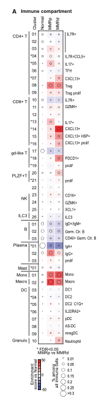

为了在不拥挤颜色网格的前提下高亮基因表达或相关热图中的特定细胞，参考在热图瓦片上方**叠加符号或点（如 p < 0.05 的星号）** \[\1\]。`ComplexHeatmap::Heatmap` 的 `cell_fun` 或 `layer_fun` 原生支持；本教程模拟 12 基因 × 10 病人表达矩阵并植入显著细胞，渲染带覆盖星号的热图：

## Example

{fig-alt="带显著性符号覆盖的热图 DEMO" fig-align="center" width="60%"}

## Setup

-   系统要求：跨平台（Linux/MacOS/Windows）

-   编程语言：R

-   依赖包：`ComplexHeatmap`; `circlize`

```{r packages setup, message=FALSE, warning=FALSE, output=FALSE}
suppressPackageStartupMessages({
  library(ComplexHeatmap); library(circlize)
})
```

```{r}
sessioninfo::session_info("attached")
```

## 数据准备

12 个候选基因 × 10 个病人。表达矩阵（z 标度）加上配套的布尔显著性矩阵（p < 0.05 处为 `TRUE`、标记为覆盖点）：

```{r load data}
suppressPackageStartupMessages({library(ComplexHeatmap); library(circlize)})
set.seed(46278)
genes <- sprintf("GENE%02d", 1:12)
patients <- sprintf("PT%02d", 1:10)
mat <- matrix(rnorm(12 * 10, 0, 1.2), 12, 10,
              dimnames = list(genes, patients))
mat[1:4, 1:4] <- mat[1:4, 1:4] + 1.8          # high block
mat[5:8, 5:8] <- mat[5:8, 5:8] - 1.6          # low block

## significance matrix
sig_mat <- matrix(FALSE, 12, 10, dimnames = list(genes, patients))
sig_mat[1:5, c(1, 3, 6, 8)] <- TRUE
sig_mat[6:10, c(2, 4, 7, 10)] <- TRUE
```

## Visualization

### 带覆盖星号点位热图

`ComplexHeatmap` 的 `layer_fun` 向量化访问行列坐标并在显著细胞上画星号：清晰的颜色网格而无文字杂乱：

```{r}
#| label: fig-1.1HeatmapPoints
#| fig-cap: "带有白色星号点覆盖显著细胞（p < 0.05）的基因表达热图（12 基因 × 10 病人）：无文字杂乱的清晰颜色网格。"
#| out.width: "85%"
#| fig-width: 8
#| fig-height: 6

col_fun <- colorRamp2(c(-2, 0, 2), c("#2166AC", "white", "#B2182B"))
Heatmap(mat, name = "z-score",
        col = col_fun,
        cluster_rows = TRUE, cluster_columns = TRUE,
        row_names_side = "left",
        rect_gp = grid::gpar(col = "grey85", lwd = 1),
        layer_fun = function(j, i, x, y, w, h, fill) {
          v <- sig_mat[cbind(as.numeric(i), as.numeric(j))]
          if (any(v)) {
            grid::grid.text(
              ifelse(v[v], "*", ""),
              x[v], y[v],
              gp = grid::gpar(fontsize = 12, col = "white", fontface = "bold")
            )
          }
        },
        heatmap_legend_param = list(title = "z-score"))
```

### 以点大小编码 p 值的替代方案

替代编码：点大小与 −log10(p) 成正比叠加在热图瓦片上，使效应大小（颜色）与统计置信度（点大小）同时可见：

```{r}
#| label: fig-2.1HeatmapDotSize
#| fig-cap: "替代编码：点大小与 -log10(p) 成正比叠加在热图瓦片上，在一张图中同时呈现效应大小（颜色）与置信度（点大小）。"
#| out.width: "85%"
#| fig-width: 8
#| fig-height: 6

p_mat <- matrix(runif(120, 0.0001, 0.8), 12, 10, dimnames = list(genes, patients))
p_mat[sig_mat] <- runif(sum(sig_mat), 0.0001, 0.04)
nl_mat <- pmin(-log10(p_mat), 4)

Heatmap(mat, name = "z-score",
        col = col_fun,
        cluster_rows = TRUE, cluster_columns = TRUE,
        row_names_side = "left",
        rect_gp = grid::gpar(col = "grey85", lwd = 1),
        layer_fun = function(j, i, x, y, w, h, fill) {
          sz <- nl_mat[cbind(as.numeric(i), as.numeric(j))] / 4 * 2.8
          grid::grid.points(x, y, pch = 16,
                            gp = grid::gpar(col = ifelse(sz > 1, "white", "grey30")),
                            size = unit(sz, "mm"))
        },
        heatmap_legend_param = list(title = "z-score"))
```


## 应用场景

::: {{#fig-HeatmapPointsApplications1}}
{fig-alt="带显著性符号覆盖的热图" fig-align="center" width="60%"}

带显著性符号覆盖的热图
:::

符号覆盖适用于任何需要标记显著性的矩阵：基因表达 t 检验、相关矩阵、突变负荷热图、或差异甲基化位点。

## 参考文献

\[1\] Xiaofan Lu, et al. Festival of Standardized Biomedical Visualizations: Heatmap with Overlaid Significance Symbols. iMetaMed. 2025. doi:10.1002/imm3.70005
