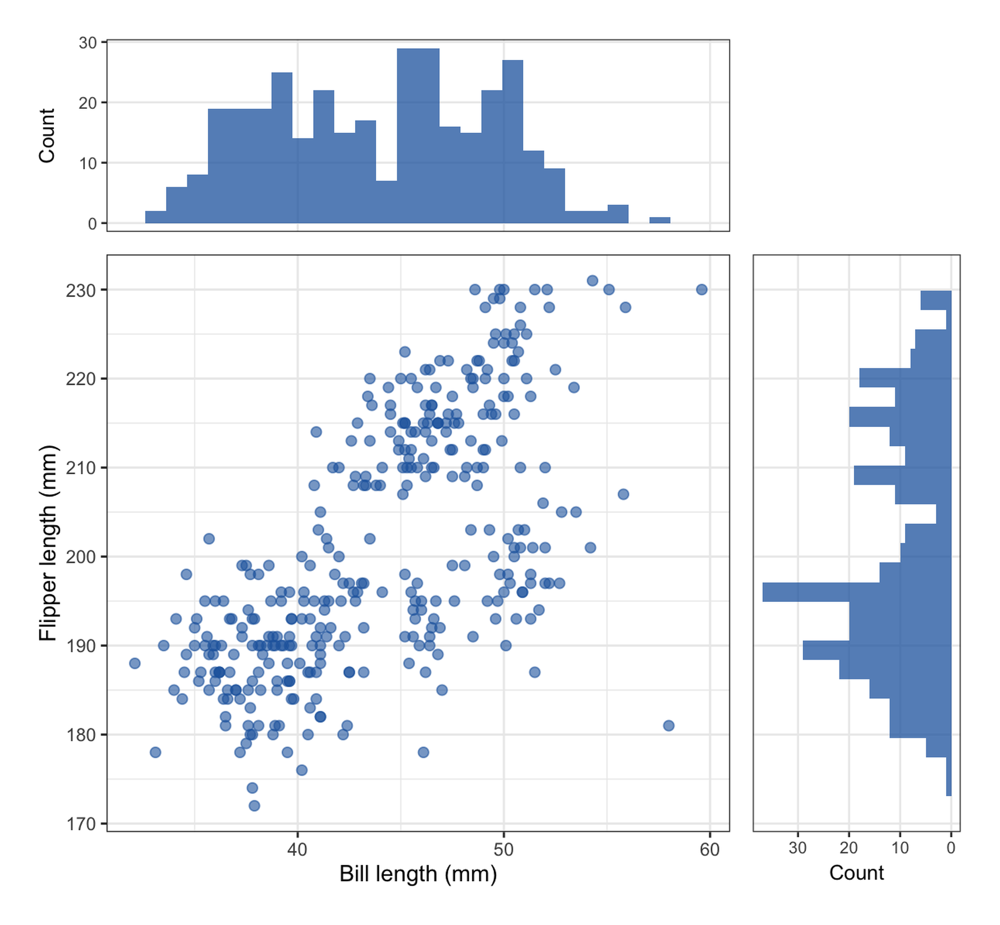
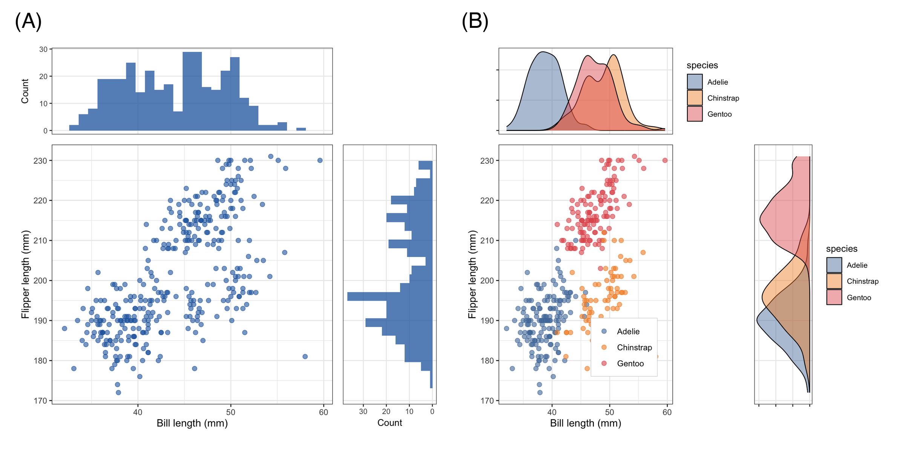

散点图展示两个变量如何共同变化，却隐藏了它们*各自*的分布——右上角的一团点云可能藏着一个双峰变量和一个偏态变量。**边缘分布图（marginal plots）**解决了这一问题：把 x 变量的分布沿上边缘、y 变量的分布沿右边缘附加到散点图上（直方图、密度或箱线图），读者在一张图中同时看到联合关系与两个边缘分布 \[1\]。这一设计在临床与生物医学散点图中非常流行——例如肿瘤论文里的生物标志物相关性面板。

本教程用 ggplot2 + patchwork \[2\] 手工搭建该版式。装配过程完全显式（哪些标度、哪些主题、哪些边距），不依赖特定包版本，且可直接迁移到任意面板组合。关于常用一行代码方案 `ggExtra::ggMarginal()` 的说明见下方 callout。

本教程涵盖两种工作流：

1. 带边缘直方图的散点图；
2. 按物种分层、共享色标的边缘密度图。

## Example

{fig-alt="MarginalPlot DEMO" fig-align="center" width="60%"}

## Setup

-   系统要求：跨平台（Linux/MacOS/Windows）

-   编程语言：R

-   依赖包：`ggplot2`；`dplyr`；`patchwork`；`palmerpenguins`

```{r packages setup, message=FALSE, warning=FALSE, output=FALSE}
# 安装必要的包
if (!requireNamespace("palmerpenguins", quietly = TRUE)) {
  install.packages("palmerpenguins")
}
if (!requireNamespace("patchwork", quietly = TRUE)) {
  install.packages("patchwork")
}

# 加载包
library(ggplot2)
library(dplyr)
library(patchwork)
library(palmerpenguins)
```

```{r}
sessioninfo::session_info("attached")
```

## Data Preparation

使用 `palmerpenguins` 包的 `penguins` 数据 \[3\]：344 只南极企鹅（三个物种）的形态学测量。喙长与鳍长在 342 只中完整——是该版式的经典相关变量对。

```{r load data, message=FALSE, warning=FALSE}
data(penguins, package = "palmerpenguins")

peng <- penguins |>
  filter(!is.na(bill_length_mm), !is.na(flipper_length_mm))
xr <- range(peng$bill_length_mm)
yr <- range(peng$flipper_length_mm)
cat("Rows used:", nrow(peng), "\n")
```

## Visualization

### 1. 带边缘直方图的散点图

诀窍是三个共享标度的图：主散点图、上侧直方图（*相同的 x 标度*）、右侧直方图（*相同的 y 标度*，且 x 轴反转使条形朝散点生长）。patchwork 的 `design` 字符串放置三个面板。

```{r}
#| label: fig-1.1MarginalHist
#| fig-cap: "喙长与鳍长的散点图及两边缘的直方图；共享标度使边缘分布与散点严格对齐。"
#| out.width: "75%"
#| fig-width: 6.5
#| fig-height: 6
#| warning: false
#| message: false

nb <- 28

pmain <- ggplot(peng, aes(bill_length_mm, flipper_length_mm)) +
  geom_point(color = "#2166AC", alpha = 0.6, size = 2) +
  scale_x_continuous(limits = xr) +
  scale_y_continuous(limits = yr) +
  labs(x = "Bill length (mm)", y = "Flipper length (mm)") +
  theme_bw(base_size = 11)

ptop <- ggplot(peng, aes(bill_length_mm)) +
  geom_histogram(bins = nb, fill = "#2166AC", alpha = 0.75) +
  scale_x_continuous(limits = xr) +
  labs(x = NULL, y = "Count") +
  theme_bw(base_size = 10) +
  theme(axis.text.x = element_blank(), axis.ticks.x = element_blank(),
        panel.grid.minor = element_blank())

pright <- ggplot(peng, aes(y = flipper_length_mm)) +
  geom_histogram(bins = nb, fill = "#2166AC", alpha = 0.75) +
  scale_y_continuous(limits = yr) +
  scale_x_continuous(trans = "reverse") +
  labs(x = "Count", y = NULL) +
  theme_bw(base_size = 10) +
  theme(axis.text.y = element_blank(), axis.ticks.y = element_blank(),
        panel.grid.minor = element_blank())

design <- "AB
CD"
p1 <- wrap_plots(A = ptop, B = plot_spacer(), C = pmain, D = pright,
                 design = design) +
  plot_layout(widths = c(3, 1), heights = c(1, 3))
p1
```

注意边缘直方图携带了散点图无法表达的信息：鳍长是双峰的，尽管散点看起来像一团连续的云。

### 2. 分组边缘密度图

```{r}
#| label: fig-2.1GroupedDensity
#| fig-cap: "按物种分层的散点与边缘密度：Gentoo 在两个轴上都分离；Adelie 与 Chinstrap 在散点中重叠，但在喙长（上边缘）上清晰分开。"
#| out.width: "75%"
#| fig-width: 6.5
#| fig-height: 6
#| warning: false
#| message: false

pal <- c(Adelie = "#4E79A7", Chinstrap = "#F28E2B", Gentoo = "#E15759")

pmain_g <- ggplot(peng, aes(bill_length_mm, flipper_length_mm, color = species)) +
  geom_point(alpha = 0.6, size = 2) +
  scale_color_manual(values = pal) +
  scale_x_continuous(limits = xr) + scale_y_continuous(limits = yr) +
  labs(x = "Bill length (mm)", y = "Flipper length (mm)") +
  theme_bw(base_size = 11) +
  theme(legend.position = c(0.72, 0.22), legend.title = element_blank(),
        legend.background = element_rect(fill = "white", color = "grey80",
                                         linewidth = 0.2))

ptop_g <- ggplot(peng, aes(bill_length_mm, fill = species)) +
  geom_density(alpha = 0.45, linewidth = 0.4) +
  scale_fill_manual(values = pal) +
  scale_x_continuous(limits = xr) +
  labs(x = NULL, y = NULL) +
  theme_bw(base_size = 10) +
  theme(axis.text.x = element_blank(), axis.ticks.x = element_blank(),
        axis.text.y = element_blank(), panel.grid.minor = element_blank())

pright_g <- ggplot(peng, aes(y = flipper_length_mm, fill = species)) +
  geom_density(alpha = 0.45, linewidth = 0.4) +
  scale_fill_manual(values = pal) +
  scale_y_continuous(limits = yr) +
  scale_x_continuous(trans = "reverse") +
  labs(x = NULL, y = NULL) +
  theme_bw(base_size = 10) +
  theme(axis.text.y = element_blank(), axis.ticks.y = element_blank(),
        axis.text.x = element_blank(), panel.grid.minor = element_blank())

p2 <- wrap_plots(A = ptop_g, B = plot_spacer(), C = pmain_g, D = pright_g,
                 design = design) +
  plot_layout(widths = c(3, 1), heights = c(1, 3))
p2
```

这正是该版式的价值所在：Adelie 与 Chinstrap 在鳍长（右边缘）上不可分，但上边缘把二者在喙长上干净地分开——这一事实在散点图中完全不可见。

::: callout-tip
## 实践要点

-   三个面板保持**完全相同的标度**：若边缘分布与散点轴不对齐，图就不诚实。用 `scale_*_continuous(limits = range(...))` 在每个面板冻结范围。
-   侧面板反转坐标轴（`scale_x_continuous(trans = "reverse")`），让条形朝散点生长——这是标准惯例。
-   一行代码即可完成：`ggExtra::ggMarginal(p)` \[1\]——但截至 2026-10，该包的边缘面板在 ggplot2 ≥ 4.0 下会塌陷（渲染为黑色矩形）；遇到此问题请回退到上面的手工装配方案，后者与版本无关。
-   n < ~30 时，把直方图换成边缘*地毯/散点*——小样本的分箱计数会误导。
:::

## Application

边缘增强散点图常见于方法比较与生物标志物论文：两种检测的相关性图（边缘放各自分布）、剂量-反应面板、PCA/t-SNE 投影配各轴得分分布。下图模拟典型论文版式：(A) 合并队列的边缘直方图，(B) 按亚群分组的边缘密度图。

{fig-alt="MarginalPlot Application" fig-align="center" width="60%"}

## Reference

\[1\] Attali D, Baker C. ggExtra: add marginal histograms to 'ggplot2', and more 'ggplot2' enhancements. https://github.com/daattali/ggExtra

\[2\] Pedersen TL. patchwork: the composer of plots. R package version 1.3.2. 2025. https://CRAN.R-project.org/package=patchwork

\[3\] Horst AM, Hill AP, Gorman KB. palmerpenguins: Palmer Archipelago (Antarctica) penguin data. R package version 0.1.1. 2022. doi:10.5281/zenodo.3965738
