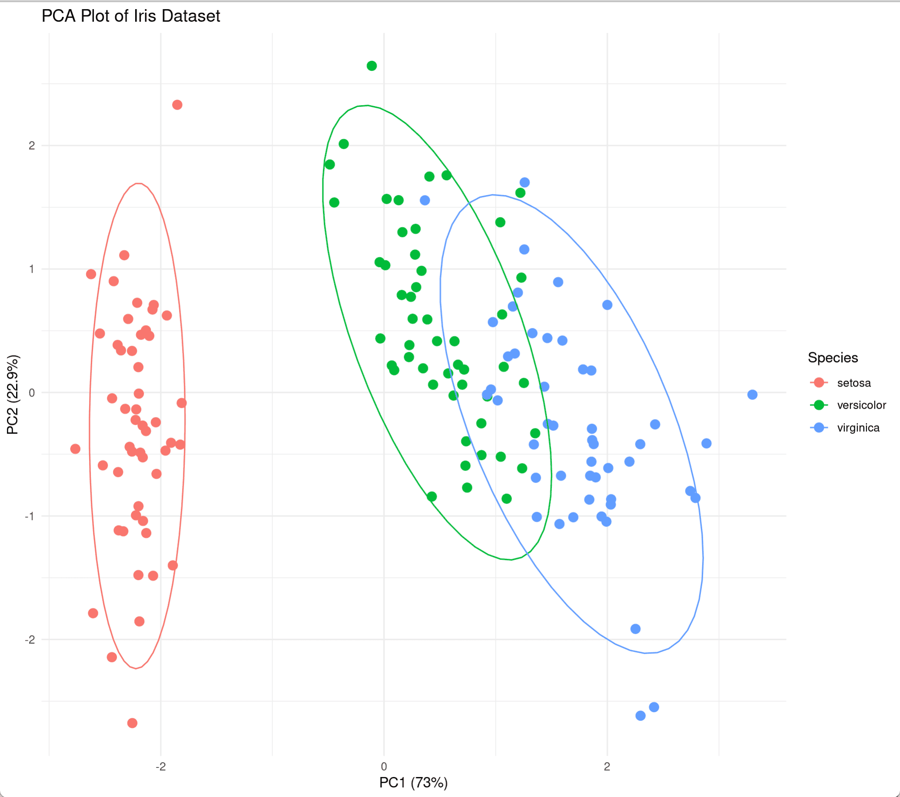
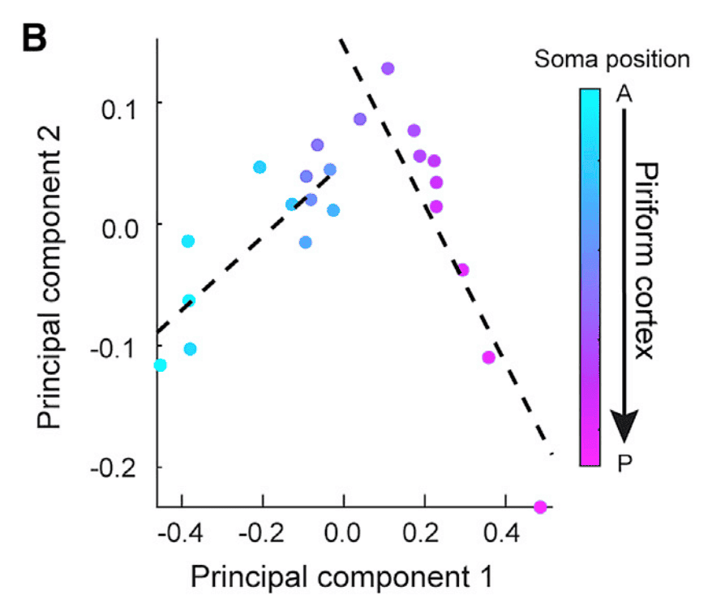

## Example

{fig-alt="PCAplot DEMO1" fig-align="center" width="60%"}

Principal component analysis (PCA) is a commonly used dimensionality reduction technique for high-dimensional data analysis. Its main principle is to transform the data by identifying the two principal component directions with the largest variance. This linear transformation projects the high-dimensional data into a low-dimensional space while preserving the data's key features. This article demonstrates how to perform PCA analysis in R and visualize it using the Iris dataset.

## Setup

-   System Requirements: Cross-platform (Linux/MacOS/Windows)

-   Programming language: R

-   Dependent packages: `ggplot2`, `dplyr`, `ggfortify`, `FactoMineR`, `factoextra`, `plotly`

```{r packages setup, message=FALSE, warning=FALSE, output=FALSE}
# Installing packages
if (!requireNamespace("ggplot2", quietly = TRUE)) {
  install.packages("ggplot2")
}
if (!requireNamespace("dplyr", quietly = TRUE)) {
  install.packages("dplyr")
}
if (!requireNamespace("ggfortify", quietly = TRUE)) {
  install.packages("ggfortify")
}
if (!requireNamespace("FactoMineR", quietly = TRUE)) {
  install.packages("FactoMineR")
}
if (!requireNamespace("factoextra", quietly = TRUE)) {
  install.packages("factoextra")
}
if (!requireNamespace("plotly", quietly = TRUE)) {
  install.packages("plotly")
}

# Load packages
library(ggplot2)
library(ggfortify)
library(FactoMineR)
library(factoextra)
library(dplyr)
library(plotly)
```

```{r}
sessioninfo::session_info("attached")
```

## Data Preparation

Use the iris dataset in R's own dataset `iris` for demonstration

```{r load data1, message=FALSE}
data("iris")
head(iris) 
```

## Visualization

**PCA analysis**

We first perform PCA analysis on the data. It should be noted that the data needs to be analyzed after standardization. The parameter scale in the function prcomp() provides us with the option of automatic standardization:

```{r pcaanalysis, message=FALSE}
iris.pca <- prcomp(iris[, -5], scale = TRUE)
summary(iris.pca)
```

### 1. Variance Explanation and Variable Contribution Visualization

As you can see in `summary(iris.pca)`, we've extracted multiple principal components, `PCs`, from the dataset, describing the data from a new "perspective." We can use `fviz_eig()` to draw the following histogram to show the proportion of data variance explained by each principal component. Meanwhile, `fviz_pca_var()` plots the variable contribution graph, showing the relationship between the original variables (i.e., petal length, width, and other raw features) and the top two principal components. The length of the arrow indicates the variable contribution (specified by `col.var = "contrib"`):

```{r}
#| label: fig-1.1fviz_eig
#| fig-cap: "fviz_eig"
#| out.width: "95%"
#| warning: false
#| message: false
#| fig-width: 6
#| fig-height: 6

fviz_eig(iris.pca, 
         addlabels = TRUE, 
         ylim = c(0, 85),
         main = "PCA variance explained proportion",
         xlab = "PC",
         ylab = "Percentage of variance explained")
```

```{r}
#| label: fig-1.2fviz_pca_var
#| fig-cap: "fviz_pca_var"
#| out.width: "95%"
#| warning: false
#| message: false
#| fig-width: 6
#| fig-height: 6

fviz_pca_var(iris.pca,
             col.var = "contrib",
             gradient.cols = c("#00AFBB", "#E7B800", "#FC4E07"),
             repel = TRUE,
             title = "Variable contribution plot")
```

### 2. Distribution of samples in principal component space

Now that we've transformed the data, we can plot the distribution of the samples in this new principal component space. If the principal components explain a high degree of variance, we'll see that different iris species are far apart in principal component space, while irises of the same species are close together. `fviz_pca_ind()` can create a scatter plot of the data along PC1 and PC2, coloring them by iris species and adding confidence ellipses.

```{r}
#| label: fig-2.1fviz_pca_ind
#| fig-cap: "fviz_pca_ind"
#| out.width: "95%"
#| warning: false
#| message: false
#| fig-width: 6
#| fig-height: 6

fviz_pca_ind(iris.pca,
             col.ind = iris$Species,
             geom.ind = "point",
             palette = c("#00AFBB", "#E7B800", "#FC4E07"),
             addEllipses = TRUE,
             ellipse.type = "confidence",
             legend.title = "Species",
             # repel = TRUE,
             title = "Sample PCA score plot")
```

::: callout-tip
**Parameter Description:**

- `col.ind`: Categorical variable for input data
- `geom.ind`: Select the type of scatter plot to draw. The default is labeled scatter plots. Entering "point" will cause the scatter plots to be labeled without labels.
- `palette`: Color vector to apply to the categorical variable
- `addEllipses`: Whether to add ellipses
- `ellipse.type`: Ellipse calculation method. Acceptable values include "convex", "confidence", "t", "norm", and "euclid".
- `legend.title`: Legend title
- `repel`: Whether to use extended lines to mark data points
- `title`: Image title
:::

Similar to `fviz_pca_ind()`, `fviz_pca_biplot()` can add original variable information based on sample scatter plots.

```{r}
#| label: fig-2.2fviz_pca_biplot
#| fig-cap: "fviz_pca_biplot"
#| out.width: "95%"
#| warning: false
#| message: false
#| fig-width: 6
#| fig-height: 6

fviz_pca_biplot(iris.pca,
                col.ind = iris$Species,
                palette = c("#00AFBB", "#E7B800", "#FC4E07"),
                addEllipses = TRUE,
                geom.ind = "point",
                ellipse.type = "confidence",
                legend.title = "Species",
                # repel = TRUE,
                title = "PCA biplot")
```

In addition, we can also use `ggplot2` to customize the PCA sample graph:

```{r}
#| label: fig-2.2ggplot2
#| fig-cap: "ggplot2 custom drawing PCA sample graph"
#| out.width: "95%"
#| warning: false
#| message: false
#| fig-width: 6
#| fig-height: 6

pca_scores <- as.data.frame(iris.pca$x)
pca_scores$Species <- iris$Species

ggplot(pca_scores, aes(x = PC1, y = PC2, color = Species)) +
  geom_point(size = 3, alpha = 0.8) +
  stat_ellipse(level = 0.95, linewidth = 1) +
  scale_color_manual(values = c("#00AFBB", "#E7B800", "#FC4E07")) +
  labs(title = "PCA analysis of the iris data set",
       x = paste0("PC1 (", round(summary(iris.pca)$importance[2,1]*100, 1), "%)"),
       y = paste0("PC2 (", round(summary(iris.pca)$importance[2,2]*100, 1), "%)"),
       caption = "Confidence level: 95%") +
  theme_minimal(base_size = 12) +
  theme(legend.position = "bottom", legend.box = "vertical",
        legend.margin = margin(t = 2))
```

### 3. PCA analysis using FactoMineR

FactoMineR is an R package designed for multidimensional data analysis and exploration. It also provides a convenient PCA analysis function, PCA(). The following is a simple demonstration of its use and visualization:

```{r}
#| label: fig-3.1FactoMineR
#| fig-cap: "FactoMineR draws PCA graph"
#| out.width: "95%"
#| warning: false
#| message: false
#| fig-width: 6
#| fig-height: 6

res.pca <- PCA(iris[, -5], scale.unit = TRUE, graph = FALSE)
fviz_pca_ind(res.pca, 
             label = "none", 
             habillage = iris$Species,
             addEllipses = TRUE, 
             ellipse.level = 0.95,
             title = "FactoMineR PCA results")
```

### 4. Mapping groups and batches to color and shape

In real omics projects the samples within a group often come from several sequencing batches or biological replicates. A common publication style keeps **one color per group** and maps **batch/replicate to point shape** \[2\]: a drifting batch or an outlier replicate then stands out immediately, which helps deciding whether a batch correction (e.g. `limma::removeBatchEffect`, ComBat) or removal of a sample is needed.

We simulate three sequencing batches inside the iris data (batch 3 artificially shifted along PC2):

```{r}
#| label: fig-4.1BatchShapePCA
#| fig-cap: "PCA sample plot with group mapped to color and sequencing batch mapped to shape; the drifted batch is easy to spot."
#| out.width: "95%"
#| warning: false
#| message: false
#| fig-width: 7.5
#| fig-height: 6

set.seed(123)
pca_scores$batch <- as.factor(ave(seq_len(nrow(pca_scores)), pca_scores$Species,
                                  FUN = function(i) paste("Batch", sample(1:3, length(i), replace = TRUE))))
pca_scores$PC2 <- pca_scores$PC2 + ifelse(pca_scores$batch == "Batch 3", 0.6, 0)  # simulate a batch shift

ggplot(pca_scores, aes(x = PC1, y = PC2, color = Species, shape = batch)) +
  geom_point(size = 3, alpha = 0.8) +
  scale_color_manual(values = c("#00AFBB", "#E7B800", "#FC4E07")) +
  scale_shape_manual(values = c(16, 17, 15)) +
  labs(title = "PCA with group (color) and batch (shape) mapping",
       caption = "Batch 3 is simulated to drift along PC2") +
  theme_minimal(base_size = 12) +
  theme(legend.position = "bottom", legend.box = "vertical",
        legend.margin = margin(t = 2))
```

::: callout-tip
**Practice tips**

- `ave(..., group, FUN = ...)` assigns batches **within** each group, which mirrors real experimental designs (each group is sequenced across several batches).
- Shapes 16–25 are solid and scale well in print; start the series at 15 (square) if you have many groups with similar colors.
- If one shape clearly separates from the others, suspect a batch effect: re-plot after batch correction, or inspect known batch marker genes.
:::

### 5. 3D PCA (Interactive + Static Projection)

Gene-set-restricted PCA is often shown in **3D** so a third component joins the view \[2\]. An interactive `plotly` surface works in the HTML site; a static PC1 × PC3 projection accompanies it for print.

```{r}
#| label: fig-5.1PCA3D
#| fig-cap: "Interactive 3D PCA of the simulated immune-gene matrix (group on colour and symbol); rotate in the HTML version."
#| out.width: "95%"
#| warning: false
#| message: false

set.seed(1302)
genes_i <- paste0("ImmuneGene", sprintf("%03d", 1:60))
groups <- factor(rep(c("GBM", "LGG"), each = 40), levels = c("LGG", "GBM"))
expr_i <- t(matrix(rnorm(60 * 80, sd = 1), nrow = 60))
expr_i[, 1:20] <- expr_i[, 1:20] + ifelse(groups == "GBM", 1.5, -1.5)  # immune programmes differ
pca3 <- prcomp(expr_i, scale. = TRUE)
scores3 <- as.data.frame(pca3$x[, 1:3])
scores3$group <- groups

plotly::plot_ly(scores3, x = ~PC1, y = ~PC2, z = ~PC3,
                color = ~group, symbol = ~group,
                colors = c(LGG = "#2874C5", GBM = "#B2182B"),
                symbols = c("circle", "diamond"),
                marker = list(size = 4)) |>
  plotly::add_markers() |>
  plotly::layout(scene = list(
    xaxis = list(title = "PC1"),
    yaxis = list(title = "PC2"),
    zaxis = list(title = "PC3")))
```

```{r}
#| label: fig-5.2PCA3DStatic
#| fig-cap: "Static companion: PC1 × PC3 projection with 80% ellipses; colour and shape encode the subgroup (PC2 is not shown in this projection)."
#| out.width: "85%"
#| warning: false
#| message: false
#| fig-width: 6.5
#| fig-height: 5

ggplot(scores3, aes(PC1, PC3, colour = group)) +
  geom_point(aes(shape = group), size = 2, alpha = 0.8) +
  stat_ellipse(level = 0.8, linewidth = 0.8) +
  scale_colour_manual(values = c(LGG = "#2874C5", GBM = "#B2182B")) +
  labs(x = sprintf("PC1 (%.0f%%)", 100 * summary(pca3)$importance[2, 1]),
       y = sprintf("PC3 (%.0f%%)", 100 * summary(pca3)$importance[2, 3]),
       title = "Static projection of the 3D PCA") +
  theme_minimal(base_size = 12) +
  theme(legend.position = "bottom")
```

::: callout-tip
**Practice tips**

-   Restricting the PCA input to a **gene set** (immune genes here, the reference's point) can separate groups that whole-genome PCA mixes — always compare both views before concluding "no difference".
-   Interactive 3D surfaces render no static PNG: the gallery treats them as manual cases, so pair them with a static projection for print.
-   `plotly` axes do not auto-scale titles; set them in `layout(scene = list(...))` as above.
:::

### 6. Signature Score from the First Principal Component

A PCA-based alternative to a LASSO/Cox coefficient-times-expression score builds a **signature score** from the first principal component of two opposing gene sets \[2\]: score = PC1 of signature A minus PC1 of signature B. Because each PC1 is the dominant co-variation axis within its signature, the difference is a compact per-sample marker that orders molecular subtypes without any survival model. (In a real pipeline the gene sets come from a Boruta-filtered cluster-correlation signature, as in the cluster-correlation heatmap tutorial.)

```{r}
#| label: fig-6.1SignatureScore
#| fig-cap: "Per-sample signature score PC1(A) - PC1(B): the first principal component of each gene signature is subtracted, giving a single axis that orders the three subtypes."
#| out.width: "85%"
#| warning: false
#| message: false
#| fig-width: 6.5
#| fig-height: 5

set.seed(4501)
n_s <- 90
subtype <- factor(rep(c("A", "B", "C"), each = n_s / 3),
                  levels = c("A", "B", "C"))

# signature-A genes (up in subtype A) and signature-B genes (up in subtype C)
exprA <- matrix(rnorm(12 * n_s, sd = 0.6), 12)
exprB <- matrix(rnorm(12 * n_s, sd = 0.6), 12)
exprA[, subtype == "A"] <- exprA[, subtype == "A"] + 1.6
exprB[, subtype == "C"] <- exprB[, subtype == "C"] + 1.6

# z-score per gene (rows = genes), then PC1 of each signature
exprA <- t(scale(t(exprA)))
exprB <- t(scale(t(exprB)))
pcA <- prcomp(t(exprA), scale. = FALSE)$x[, 1]
pcB <- prcomp(t(exprB), scale. = FALSE)$x[, 1]

score <- pcA - pcB
# PC1 sign is arbitrary; orient so the A-signature subtype scores highest
if (median(score[subtype == "A"]) < median(score[subtype == "C"])) score <- -score
score_df <- data.frame(subtype = subtype, score = score)
p_kw <- kruskal.test(score ~ subtype, data = score_df)$p.value

ggplot(score_df, aes(subtype, score, fill = subtype)) +
  geom_violin(alpha = 0.4, position = position_dodge(width = 0.75),
              linewidth = 0.4, colour = "black") +
  geom_boxplot(notch = TRUE, outlier.shape = NA, width = 0.22,
               colour = "black", linewidth = 0.35, alpha = 0.7,
               show.legend = FALSE) +
  geom_point(shape = 21, size = 2, fill = "white", colour = "black",
             stroke = 0.6, position = position_jitter(width = 0.12)) +
  scale_fill_manual(values = c(A = "#008ECB", B = "#EA921D", C = "#D14039")) +
  labs(title = sprintf("Signature score by subtype (Kruskal-Wallis %s)",
       ifelse(p_kw < 0.001, "p < 0.001", sprintf("p = %.3f", p_kw))),
       x = "Subtype", y = "Score (PC1_A - PC1_B)") +
  theme_classic(base_size = 11) +
  theme(legend.position = "none")
```

::: callout-tip
**Practice tips**

-   `prcomp()` returns an arbitrary PC1 sign — always orient it against a known reference subtype (as above) before comparing scores across runs or papers.
-   With a real Boruta step, run `Boruta::Boruta(x = t(expr), y = factor(cluster), maxRuns = 100, ntree = 500)` and keep rows with `decision == "Confirmed"` from `attStats()`; filter the A and B signatures **separately** so the dominant sign does not drown the minority set.
-   Score on per-gene z-scored expression so a high-expressed housekeeping gene cannot dominate PC1.
:::

### 7. Gene Loadings Along PC1 Read the Expression Programme

A single principal axis can carry an entire biological gradient: the sample scores give the subtype ordering, the variable loadings name the genes behind it \[2\]. Rotate the axis so the up-regulated marker set carries the positive loadings, then read both panels off the same `prcomp` decomposition. The reference study ordered four oocyte subtypes along PC1 and printed the developmental marker genes on the very same axis.

```{r}
#| label: fig-7.1PCLoadings
#| fig-cap: "Left: four oocyte-like subtypes (C1-C4) on the PC1/PC2 plane. Right: PC1 loadings of the six marker genes - the folliculogenesis set on one side of zero, the meiosis/methylation set on the other."
#| out.width: "95%"
#| warning: false
#| message: false
#| fig-width: 9
#| fig-height: 4.2

library(patchwork)
set.seed(6101)
subtypes <- c("C1", "C2", "C3", "C4")
n_cell <- 120
cls <- rep(subtypes, each = n_cell / 4)
prog <- as.numeric(factor(cls, levels = subtypes))      # differentiation score 1..4
base_genes <- paste0("G", sprintf("%03d", 1:40))
mark_up <- c("ZP1", "BMP15", "GDF9")   # folliculogenesis genes rising with C1 -> C4
mark_dn <- c("WEE2", "AURKA", "DNMT3A")  # meiosis/methylation genes falling along it
genes <- c(base_genes, mark_up, mark_dn)
mu <- matrix(rnorm(length(genes) * n_cell, sd = 0.5), nrow = length(genes),
             dimnames = list(genes, paste0("cell", 1:n_cell)))
# 标记基因随发育梯度变化：整个矩阵即是
for (g in mark_up) mu[g, ] <- mu[g, ] + 3.6 * (prog / max(prog))
for (g in mark_dn) mu[g, ] <- mu[g, ] - 3.6 * (prog / max(prog))
pc <- prcomp(t(mu), scale. = TRUE)
score <- pc$x[, 1]; load1 <- pc$rotation[, 1]
# 主成分轴的符号是任意的：调向使上调组占据正载荷一侧
if (mean(load1[mark_up]) < mean(load1[mark_dn])) { load1 <- -load1; score <- -score }
stopifnot(min(load1[mark_up]) > max(load1[mark_dn]))
var_pct <- round(pc$sdev^2 / sum(pc$sdev^2) * 100, 1)
df_cells <- data.frame(PC1 = score, PC2 = pc$x[, 2], subtype = cls)
p_a <- ggplot(df_cells, aes(PC1, PC2, colour = subtype)) +
  geom_point(size = 1.6, alpha = 0.8) +
  scale_colour_manual(values = c(C1 = "#8E3189", C2 = "#4C72B4", C3 = "#85B846", C4 = "#C64941")) +
  labs(x = paste0("PC1 (", var_pct[1], "%)"), y = paste0("PC2 (", var_pct[2], "%)")) +
  theme_classic(base_size = 11)
df_genes <- rbind(data.frame(gene = mark_up, load = load1[mark_up], set = "up"),
                  data.frame(gene = mark_dn, load = load1[mark_dn], set = "down"))
p_b <- ggplot(df_genes, aes(load, reorder(gene, load))) +
  geom_segment(aes(xend = 0), colour = "grey65", linewidth = 0.5) +
  geom_point(aes(colour = set), size = 3.2) +
  scale_colour_manual(values = c(up = "#B2182B", down = "#2166AC"), guide = "none") +
  geom_vline(xintercept = 0, colour = "grey30", linewidth = 0.4) +
  labs(x = "PC1 loading", y = NULL) +
  theme_classic(base_size = 11) + theme(panel.grid.major.x = element_blank())
print(p_a + p_b + plot_layout(ncol = 2, guides = "collect"))
```

::: callout-tip
**Practice tips**

-   `prcomp` fixes the PC sign by convention, not biology - the flip guard keeps the reading stable across seeds; without it the same data can print mirrored.
-   `stopifnot(min(load1[mark_up]) > max(load1[mark_dn]))` is worth keeping on real data: it fails loudly when PC1 is noise rather than the gradient.
-   `rotation` holds the loadings, `x` the scores; drawing both panels from one decomposition keeps score and loading narratives consistent.
:::

### 8. K-means Groups on the PCA Plane with Convex-Hull Borders

Clustering algorithms compute distances in a high-dimensional space no one can picture; projecting the same matrix with PCA and outlining every cluster with its convex hull reveals at a glance whether the partition is clean or the groups intermix \[2\] - overlapping hulls are the visual signature of an overfitted k. `factoextra::fviz_pca_ind(..., addEllipses = TRUE)` draws Gaussian ellipses instead; a hull follows the actual sample cloud and stays honest for skewed clusters.

```{r}
#| label: fig-8.1KmeansHullPCA
#| fig-cap: "Four k-means groups on the PCA plane: per-cluster convex-hull polygons mark the empirical partition, repelled labels tag one representative sample each, variance shares printed on the axes."
#| out.width: "95%"
#| warning: false
#| message: false
#| fig-width: 7.5
#| fig-height: 5.2

library(patchwork)
library(ggrepel)
set.seed(6201)
n_s <- 96
lab4 <- c("G1", "G2", "G3", "G4")
grp <- rep(lab4, each = n_s / 4)
n_feat <- 32
mat <- matrix(rnorm(n_feat * n_s, sd = 0.65), nrow = n_feat,
              dimnames = list(paste0("Gene", 1:n_feat), NULL))
# 每个真实簇携带一个高表达标记块 -> 簇间分离干净可审
for (k in 1:4) {
  blk <- ((k - 1) * 8 + 1):(k * 8)          # eight-gene marker block per cluster
  mat[blk, grp == lab4[k]] <- mat[blk, grp == lab4[k]] + 3.2
}
set.seed(6202)
km <- kmeans(t(mat), centers = 4, nstart = 25)   # k-means clusters the rows of x
pa <- prcomp(t(mat), scale. = TRUE)
dat <- data.frame(PC1 = pa$x[, 1], PC2 = pa$x[, 2],
                  cluster = factor(paste0("C", km$cluster), levels = paste0("C", 1:4)),
                  rownames = sprintf("S%02d", 1:n_s))
# 可恢复性门槛：每个真实组的多数成员须落入同一簇
tb <- table(grp, dat$cluster)
hit <- sum(tb[cbind(seq_len(nrow(tb)), apply(tb, 1, which.max))])
stopifnot(hit / n_s >= 0.90)
var1 <- round(pa$sdev[1]^2 / sum(pa$sdev^2) * 100, 1)
var2 <- round(pa$sdev[2]^2 / sum(pa$sdev^2) * 100, 1)
hull_rows <- list()
for (k in levels(dat$cluster)) {
  d <- dat[dat$cluster == k, ]
  hi <- chull(d$PC1, d$PC2)                 # base grDevices function
  hull_rows[[k]] <- data.frame(PC1 = d$PC1[hi], PC2 = d$PC2[hi],
                               cluster = factor(k, levels = levels(dat$cluster)))
}
hulls <- do.call(rbind, hull_rows)
stopifnot(all(is.finite(c(hulls$PC1, hulls$PC2))) && nrow(hulls) >= 12)
tag <- dat[!duplicated(dat$cluster), ]       # one labelled representative per cluster
tag <- tag[order(as.numeric(factor(tag$cluster))), ]
ggplot() +
  geom_polygon(data = hulls, aes(PC1, PC2, group = cluster, fill = cluster),
               alpha = 0.22, colour = NA) +
  geom_point(data = dat, aes(PC1, PC2, colour = cluster), size = 2) +
  geom_text_repel(data = tag, aes(PC1, PC2, label = rownames),
                  size = 2.4, force = 2, max.iter = 200) +
  scale_fill_manual(values = c(C1 = "#B2182B", C2 = "#2166AC", C3 = "#4D9342", C4 = "#EABF00")) +
  scale_colour_manual(values = c(C1 = "#8A1B24", C2 = "#174A85", C3 = "#2F6B28", C4 = "#9E7E00")) +
  labs(x = paste0("PC1 (", var1, "%)"), y = paste0("PC2 (", var2, "%)"),
       title = "K-means groups on the PCA plane, hull = empirical partition") +
  theme_bw(base_size = 11) + theme(legend.title = element_blank())
```

::: callout-tip
**Practice tips**

-   k-means clusters the rows of `x` - pass `t(mat)` for a genes-in-rows matrix and run `prcomp` on the same orientation so scores and clusters refer to one sample order.
-   `chull()` arrives through ggplot2 (re-exported from scales); compute it per cluster and rebuild one data frame with the cluster kept as a factor so `group`/`fill` stay aligned.
-   The confusion-matrix assertion catches a failed run before the figure does: on real cohorts, recovery below ~0.9 is the cue to revisit k or prune features.
:::

## Application

::: {#fig-UpsetApplications}
{fig-alt="PCAplotApp1" fig-align="center" width="60%"}

Applications of PCA Plot
:::

The figure shows the first two principal components of the mean projection strength of piriform cortex output neurons to AON, CoA, LENT, and OT. Each dot represents a slice. \[1\]

## Reference

\[1\] Chen Y, Chen X, Baserdem B. et al. High-throughput sequencing of single neuron projections reveals spatial organization in the olfactory cortex. Cell. 2022 Oct 27;185(22):4117-4134.e28.

\[2\] Xiaofan Lu, et al. FigureYa: A Standardized Visualization Framework for Enhancing Biomedical Data Interpretation and Research Efficiency. iMetaMed. 2025. doi:10.1002/imm3.70005

