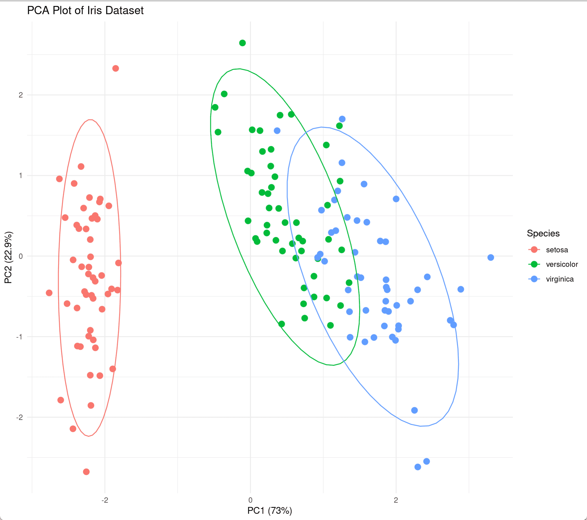
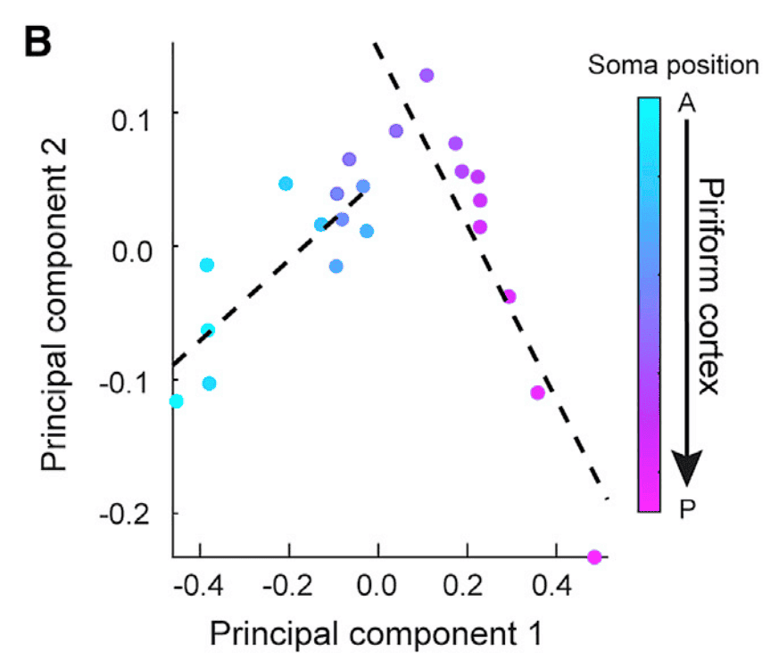

## 示例

{fig-alt="PCAplot DEMO1" fig-align="center" width="60%"}

在高维数据的分析中，主成分分析(PCA)是一种常用的降维技术，其主要原理是通过找出方差最大的两个主成分方向来变换数据，通过线性变换将高维数据投影到低维空间，同时保留数据的主要特征。本文将展示如何在R中进行PCA分析，并使用鸢尾花数据集进行可视化。

## 环境配置

-   系统要求： 跨平台（Linux/MacOS/Windows）

-   编程语言：R

-   依赖包：`ggplot2`, `dplyr`, `ggfortify`, `FactoMineR`, `factoextra`

```{r packages setup, message=FALSE, warning=FALSE, output=FALSE}
# 安装包
if (!requireNamespace("ggplot2", quietly = TRUE)) {
  install.packages("ggplot2")
}
if (!requireNamespace("dplyr", quietly = TRUE)) {
  install.packages("dplyr")
}
if (!requireNamespace("ggfortify", quietly = TRUE)) {
  install.packages("ggfortify")
}
if (!requireNamespace("FactoMineR", quietly = TRUE)) {
  install.packages("FactoMineR")
}
if (!requireNamespace("factoextra", quietly = TRUE)) {
  install.packages("factoextra")
}

# 加载包
library(ggplot2)
library(ggfortify)
library(FactoMineR)
library(factoextra)
library(dplyr)
```

```{r}
sessioninfo::session_info("attached")
```

## 数据准备

使用R自带数据集`iris`中的鸢尾花数据集进行演示

```{r load data1, message=FALSE}
data("iris")
head(iris) 
```

## 可视化

**PCA分析**

我们首先对数据进行执行PCA分析。需要注意的是，数据需要在标准化后进行分析，函数prcomp()中的参数scale为我们提供了自动标准化的选项：

```{r pcaanalysis, message=FALSE}
iris.pca <- prcomp(iris[, -5], scale = TRUE)
summary(iris.pca)
```

### 1. 方差解释与变量贡献可视化

在`summary(iris.pca)`中可以看到，我们已经从数据集中提取出了多个主成分`PC`从新的"视角"描述数据。我们可以使用`fviz_eig()`绘制下面的柱状图来显示每个主成分所解释的数据方差比例。同时`fviz_pca_var()`绘制的变量贡献图显示了原始变量（即花瓣长度、宽度等原始特征）与前两名的主成分的关系，箭头长度表示变量贡献度（参数指定`col.var = "contrib"`）：

```{r}
#| label: fig-1.1fviz_eig
#| fig-cap: "fviz_eig"
#| out.width: "95%"
#| warning: false
#| message: false
#| fig-width: 6
#| fig-height: 6

fviz_eig(iris.pca, 
         addlabels = TRUE, 
         ylim = c(0, 85),
         main = "PCA方差解释比例",
         xlab = "PC",
         ylab = "解释方差百分比")
```

```{r}
#| label: fig-1.2fviz_pca_var
#| fig-cap: "fviz_pca_var"
#| out.width: "95%"
#| warning: false
#| message: false
#| fig-width: 6
#| fig-height: 6

fviz_pca_var(iris.pca,
             col.var = "contrib",
             gradient.cols = c("#00AFBB", "#E7B800", "#FC4E07"),
             repel = TRUE,
             title = "变量贡献图")
```

### 2. 样本在主成分空间上的分布

上面我们已经完成了对数据的变换，现在可以展示样本在这个新的主成分空间上的分布。如果主成分对方差的解释度高，那么我们将看到不同种类的鸢尾花在主成分空间上相互远离，而同种类的鸢尾花则相互靠近。`fviz_pca_ind()`可以绘制PC1和PC2方向上的数据散点图，按鸢尾花种类着色并添加置信椭圆。

```{r}
#| label: fig-2.1fviz_pca_ind
#| fig-cap: "fviz_pca_ind"
#| out.width: "95%"
#| warning: false
#| message: false
#| fig-width: 6
#| fig-height: 6

fviz_pca_ind(iris.pca,
             col.ind = iris$Species,
             geom.ind = "point",
             palette = c("#00AFBB", "#E7B800", "#FC4E07"),
             addEllipses = TRUE,
             ellipse.type = "confidence",
             legend.title = "Species",
             # repel = TRUE,
             title = "样本PCA得分图")
```

::: callout-tip
**参数说明：**

- `col.ind`: 输入数据的分类变量
- `geom.ind`: 选择绘制的散点形状类型，默认为带有label的散点，这里输入"point"会让散点不显示label
- `palette`: 应用于分类变量的颜色向量
- `addEllipses`: 是否添加椭圆圈
- `ellipse.type`: 椭圆圈的计算方式，允许值有"convex"、"confidence"、"t"、"norm"、"euclid"等
- `legend.title`: 图例标题
- `repel`: 是否使用延长线标记数据点
- `title`: 图片标题
:::

与`fviz_pca_ind()`类似，`fviz_pca_biplot()`可以在样本散点的基础上添加原始的变量信息。

```{r}
#| label: fig-2.2fviz_pca_biplot
#| fig-cap: "fviz_pca_biplot"
#| out.width: "95%"
#| warning: false
#| message: false
#| fig-width: 6
#| fig-height: 6

fviz_pca_biplot(iris.pca,
                col.ind = iris$Species,
                palette = c("#00AFBB", "#E7B800", "#FC4E07"),
                addEllipses = TRUE,
                geom.ind = "point",
                ellipse.type = "confidence",
                legend.title = "Species",
                # repel = TRUE,
                title = "PCA双标图")
```

此外，我们还可以使用`ggplot2`自定义绘制PCA样本图：

```{r}
#| label: fig-2.2ggplot2
#| fig-cap: "ggplot2自定义绘制PCA样本图"
#| out.width: "95%"
#| warning: false
#| message: false
#| fig-width: 6
#| fig-height: 6

pca_scores <- as.data.frame(iris.pca$x)
pca_scores$Species <- iris$Species

ggplot(pca_scores, aes(x = PC1, y = PC2, color = Species)) +
  geom_point(size = 3, alpha = 0.8) +
  stat_ellipse(level = 0.95, linewidth = 1) +
  scale_color_manual(values = c("#00AFBB", "#E7B800", "#FC4E07")) +
  labs(title = "鸢尾花数据集PCA分析",
       x = paste0("PC1 (", round(summary(iris.pca)$importance[2,1]*100, 1), "%)"),
       y = paste0("PC2 (", round(summary(iris.pca)$importance[2,2]*100, 1), "%)"),
       caption = "置信水平: 95%") +
  theme_minimal(base_size = 12) +
  theme(legend.position = "bottom", legend.box = "vertical",
        legend.margin = margin(t = 2))
```

### 3. 使用FactoMineR进行PCA分析

`FactoMineR`是一个专门为多维数据分析和探索设计的R包，其中也提供了便捷的PCA分析函数`PCA()`。下面简单演示其使用与可视化：

```{r}
#| label: fig-3.1FactoMineR
#| fig-cap: "FactoMineR绘制PCA图"
#| out.width: "95%"
#| warning: false
#| message: false
#| fig-width: 6
#| fig-height: 6

res.pca <- PCA(iris[, -5], scale.unit = TRUE, graph = FALSE)
fviz_pca_ind(res.pca, 
             label = "none", 
             habillage = iris$Species,
             addEllipses = TRUE, 
             ellipse.level = 0.95,
             title = "FactoMineR PCA结果")
```

### 4. 分组映射颜色、批次映射形状

在真实的组学项目中，同一分组内的样品往往来自多个测序批次或生物学重复。一种常见的发表级画法是：**分组映射颜色、批次/重复映射点的形状** \[2\]。这样哪个批次漂移、哪个重复离群一目了然，有助于判断是否需要批次校正（如 `limma::removeBatchEffect`、ComBat）或剔除个别样品。

下面在 iris 数据中模拟三个测序批次（并人为让第 3 批沿 PC2 方向漂移）：

```{r}
#| label: fig-4.1BatchShapePCA
#| fig-cap: "分组映射颜色、测序批次映射形状的 PCA 图；漂移的批次很容易识别。"
#| out.width: "95%"
#| warning: false
#| message: false
#| fig-width: 7.5
#| fig-height: 6

set.seed(123)
pca_scores$batch <- as.factor(ave(seq_len(nrow(pca_scores)), pca_scores$Species,
                                  FUN = function(i) paste("Batch", sample(1:3, length(i), replace = TRUE))))
pca_scores$PC2 <- pca_scores$PC2 + ifelse(pca_scores$batch == "Batch 3", 0.6, 0)  # 模拟批次漂移

ggplot(pca_scores, aes(x = PC1, y = PC2, color = Species, shape = batch)) +
  geom_point(size = 3, alpha = 0.8) +
  scale_color_manual(values = c("#00AFBB", "#E7B800", "#FC4E07")) +
  scale_shape_manual(values = c(16, 17, 15)) +
  labs(title = "PCA with group (color) and batch (shape) mapping",
       caption = "Batch 3 is simulated to drift along PC2") +
  theme_minimal(base_size = 12) +
  theme(legend.position = "bottom", legend.box = "vertical",
        legend.margin = margin(t = 2))
```

::: callout-tip
**实践要点**

- `ave(..., group, FUN = ...)` 在**每个分组内部**分配批次，这与真实实验设计一致（每个分组都会分布在多个批次中）。
- 形状 16–25 均为实心，印刷效果好；分组很多且颜色相近时，可以从 15（正方形）开始取形状。
- 如果某个形状明显与其他分离，应怀疑批次效应：做批次校正后重新绘制，或检查已知的批次标志基因。
:::

### 5. 3D PCA（交互 + 静态投影）

限定基因集的 PCA 常以 **3D** 呈现，让第三主成分加入视图 \[2\]。交互式 `plotly` 曲面在 HTML 站点可用；静态 PC1 × PC3 投影作为印刷伴随图。

```{r}
#| label: fig-5.1PCA3D
#| fig-cap: "模拟免疫基因矩阵的交互式 3D PCA（组别映射颜色与符号）；HTML 版可旋转。"
#| out.width: "95%"
#| warning: false
#| message: false

set.seed(1302)
genes_i <- paste0("ImmuneGene", sprintf("%03d", 1:60))
groups <- factor(rep(c("GBM", "LGG"), each = 40), levels = c("LGG", "GBM"))
expr_i <- t(matrix(rnorm(60 * 80, sd = 1), nrow = 60))
expr_i[, 1:20] <- expr_i[, 1:20] + ifelse(groups == "GBM", 1.5, -1.5)  # 免疫程序不同
pca3 <- prcomp(expr_i, scale. = TRUE)
scores3 <- as.data.frame(pca3$x[, 1:3])
scores3$group <- groups

plotly::plot_ly(scores3, x = ~PC1, y = ~PC2, z = ~PC3,
                color = ~group, symbol = ~group,
                colors = c(LGG = "#2874C5", GBM = "#B2182B"),
                symbols = c("circle", "diamond"),
                marker = list(size = 4)) |>
  plotly::add_markers() |>
  plotly::layout(scene = list(
    xaxis = list(title = "PC1"),
    yaxis = list(title = "PC2"),
    zaxis = list(title = "PC3")))
```

```{r}
#| label: fig-5.2PCA3DStatic
#| fig-cap: "静态伴随图：PC1 × PC3 投影 + 80% 椭圆；颜色与形状编码亚组（本投影未展示 PC2）。"
#| out.width: "85%"
#| warning: false
#| message: false
#| fig-width: 6.5
#| fig-height: 5

ggplot(scores3, aes(PC1, PC3, colour = group)) +
  geom_point(aes(shape = group), size = 2, alpha = 0.8) +
  stat_ellipse(level = 0.8, linewidth = 0.8) +
  scale_colour_manual(values = c(LGG = "#2874C5", GBM = "#B2182B")) +
  labs(x = sprintf("PC1 (%.0f%%)", 100 * summary(pca3)$importance[2, 1]),
       y = sprintf("PC3 (%.0f%%)", 100 * summary(pca3)$importance[2, 3]),
       title = "3D PCA 的静态投影") +
  theme_minimal(base_size = 12) +
  theme(legend.position = "bottom")
```

::: callout-tip
**实践要点**

-   把 PCA 输入限定为**基因集**（此处为免疫基因，即参考图的要点）可以分开全基因组 PCA 混在一起的组——下结论"无差异"前先比较两种视图。
-   交互式 3D 曲面不渲染静态 PNG：gallery 视其为人工处理用例，因此配一张静态投影供印刷。
-   `plotly` 轴不自动加标题；如上在 `layout(scene = list(...))` 中设置。
:::

### 6. 由第一主成分构建 signature 得分

基于 PCA 的方案，是 LASSO/Cox 系数乘表达量之外的另一条路：由两组方向相反的基因集的第一主成分构建 **signature 得分**：score = signature A 的 PC1 减去 signature B 的 PC1 \[2\]。因每个 PC1 即该基因集内部的主导共变轴，两者之差就是一个紧凑的单样本标记，无需生存模型即可排列分子亚型。（真实流程中两组基因来自 Boruta 筛选后的聚类-相关 signature，见聚类-相关热图教程。）

```{r}
#| label: fig-6.1SignatureScore
#| fig-cap: "单样本 signature 得分 PC1(A) - PC1(B)：取两组基因各自的第一主成分相减，得到可排列三个分子亚型的单一坐标。"
#| out.width: "85%"
#| warning: false
#| message: false
#| fig-width: 6.5
#| fig-height: 5

set.seed(4501)
n_s <- 90
subtype <- factor(rep(c("A", "B", "C"), each = n_s / 3),
                  levels = c("A", "B", "C"))

# signature-A genes (up in subtype A) and signature-B genes (up in subtype C)
exprA <- matrix(rnorm(12 * n_s, sd = 0.6), 12)
exprB <- matrix(rnorm(12 * n_s, sd = 0.6), 12)
exprA[, subtype == "A"] <- exprA[, subtype == "A"] + 1.6
exprB[, subtype == "C"] <- exprB[, subtype == "C"] + 1.6

# 按基因 z-score（行 = 基因），再取各 signature 的 PC1
exprA <- t(scale(t(exprA)))
exprB <- t(scale(t(exprB)))
pcA <- prcomp(t(exprA), scale. = FALSE)$x[, 1]
pcB <- prcomp(t(exprB), scale. = FALSE)$x[, 1]

score <- pcA - pcB
# PC1 sign is arbitrary; orient so the A-signature subtype scores highest
if (median(score[subtype == "A"]) < median(score[subtype == "C"])) score <- -score
score_df <- data.frame(subtype = subtype, score = score)
p_kw <- kruskal.test(score ~ subtype, data = score_df)$p.value

ggplot(score_df, aes(subtype, score, fill = subtype)) +
  geom_violin(alpha = 0.4, position = position_dodge(width = 0.75),
              linewidth = 0.4, colour = "black") +
  geom_boxplot(notch = TRUE, outlier.shape = NA, width = 0.22,
               colour = "black", linewidth = 0.35, alpha = 0.7,
               show.legend = FALSE) +
  geom_point(shape = 21, size = 2, fill = "white", colour = "black",
             stroke = 0.6, position = position_jitter(width = 0.12)) +
  scale_fill_manual(values = c(A = "#008ECB", B = "#EA921D", C = "#D14039")) +
  labs(title = sprintf("Signature score by subtype (Kruskal-Wallis %s)",
       ifelse(p_kw < 0.001, "p < 0.001", sprintf("p = %.3f", p_kw))),
       x = "Subtype", y = "Score (PC1_A - PC1_B)") +
  theme_classic(base_size = 11) +
  theme(legend.position = "none")
```

::: callout-tip
**实践要点**

-   `prcomp()` 返回的 PC1 符号是任意的——跨运行或跨论文比较得分前，务必以已知参照亚型定向（如上）。
-   使用真实 Boruta 步骤时，运行 `Boruta::Boruta(x = t(expr), y = factor(cluster), maxRuns = 100, ntree = 500)`，取 `attStats()` 中 `decision == "Confirmed"` 的行；A、B 两组 signature 需**分别**筛选，以免占优符号淹没少数集。
-   在按基因 z-score 后的表达式上计得分，避免高表达管家基因主导 PC1。
:::

### 7. PC1 载荷解读表达程序

单条主成分即可承载整条生物学梯度：样本得分给出亚型排序，变量载荷点名其背后的基因 \[2\]。将轴调向使上调标记基因集占据正载荷一侧，两个面板即可同源于一次 `prcomp` 分解直读。参考研究即沿 PC1 排开四类卵母细胞亚型，并把发育标记基因印于同一坐标之上。

```{r}
#| label: fig-7.1PCLoadings
#| fig-cap: "左：四类卵母细胞样亚型（C1-C4）于 PC1/PC2 平面。右：六个标记基因的 PC1 载荷——卵泡发育基因集居零线一侧，减数分裂/甲基化基因集居另一侧。"
#| out.width: "95%"
#| warning: false
#| message: false
#| fig-width: 9
#| fig-height: 4.2

library(patchwork)
set.seed(6101)
subtypes <- c("C1", "C2", "C3", "C4")
n_cell <- 120
cls <- rep(subtypes, each = n_cell / 4)
prog <- as.numeric(factor(cls, levels = subtypes))      # differentiation score 1..4
base_genes <- paste0("G", sprintf("%03d", 1:40))
mark_up <- c("ZP1", "BMP15", "GDF9")   # folliculogenesis genes rising with C1 -> C4
mark_dn <- c("WEE2", "AURKA", "DNMT3A")  # meiosis/methylation genes falling along it
genes <- c(base_genes, mark_up, mark_dn)
mu <- matrix(rnorm(length(genes) * n_cell, sd = 0.5), nrow = length(genes),
             dimnames = list(genes, paste0("cell", 1:n_cell)))
# 标记基因随发育梯度变化：整个矩阵即是
for (g in mark_up) mu[g, ] <- mu[g, ] + 3.6 * (prog / max(prog))
for (g in mark_dn) mu[g, ] <- mu[g, ] - 3.6 * (prog / max(prog))
pc <- prcomp(t(mu), scale. = TRUE)
score <- pc$x[, 1]; load1 <- pc$rotation[, 1]
# 主成分轴的符号是任意的：调向使上调组占据正载荷一侧
if (mean(load1[mark_up]) < mean(load1[mark_dn])) { load1 <- -load1; score <- -score }
stopifnot(min(load1[mark_up]) > max(load1[mark_dn]))
var_pct <- round(pc$sdev^2 / sum(pc$sdev^2) * 100, 1)
df_cells <- data.frame(PC1 = score, PC2 = pc$x[, 2], subtype = cls)
p_a <- ggplot(df_cells, aes(PC1, PC2, colour = subtype)) +
  geom_point(size = 1.6, alpha = 0.8) +
  scale_colour_manual(values = c(C1 = "#8E3189", C2 = "#4C72B4", C3 = "#85B846", C4 = "#C64941")) +
  labs(x = paste0("PC1 (", var_pct[1], "%)"), y = paste0("PC2 (", var_pct[2], "%)")) +
  theme_classic(base_size = 11)
df_genes <- rbind(data.frame(gene = mark_up, load = load1[mark_up], set = "up"),
                  data.frame(gene = mark_dn, load = load1[mark_dn], set = "down"))
p_b <- ggplot(df_genes, aes(load, reorder(gene, load))) +
  geom_segment(aes(xend = 0), colour = "grey65", linewidth = 0.5) +
  geom_point(aes(colour = set), size = 3.2) +
  scale_colour_manual(values = c(up = "#B2182B", down = "#2166AC"), guide = "none") +
  geom_vline(xintercept = 0, colour = "grey30", linewidth = 0.4) +
  labs(x = "PC1 loading", y = NULL) +
  theme_classic(base_size = 11) + theme(panel.grid.major.x = element_blank())
print(p_a + p_b + plot_layout(ncol = 2, guides = "collect"))
```

::: callout-tip
**实践要点**

-   `prcomp` 定主成分符号凭约定而非生物学——翻向守卫令解读跨种子稳定；缺它则同数据可印成镜像。
-   `stopifnot(min(load1[mark_up]) > max(load1[mark_dn]))` 在真实数据上亦宜保留：当 PC1 只是噪声而非梯度时它响亮报错。
-   `rotation` 存载荷、`x` 存得分；两面板同取一次分解，得分与载荷的叙事必然一致。
:::

### 8. K-means 簇的 PCA 平面凸包边界图

聚类算法在无人能直观想象的高维空间中计算距离；把同一矩阵以 PCA 投影、并为每簇画出凸包，分区干净与否即一目了然 \[2\]——两簇凸包交叠正是 k 过拟合的视觉信号。`factoextra::fviz_pca_ind(..., addEllipses = TRUE)` 画的是高斯椭圆；凸包贴合真实样本云，对畸态簇亦不失诚。

```{r}
#| label: fig-8.1KmeansHullPCA
#| fig-cap: "PCA 平面上的四个 k-means 簇：逐簇凸包多边形标记经验分区，防重叠标签各标注一个代表样本，坐标轴打印方差解释份额。"
#| out.width: "95%"
#| warning: false
#| message: false
#| fig-width: 7.5
#| fig-height: 5.2

library(patchwork)
library(ggrepel)
set.seed(6201)
n_s <- 96
lab4 <- c("G1", "G2", "G3", "G4")
grp <- rep(lab4, each = n_s / 4)
n_feat <- 32
mat <- matrix(rnorm(n_feat * n_s, sd = 0.65), nrow = n_feat,
              dimnames = list(paste0("Gene", 1:n_feat), NULL))
# 每个真实簇携带一个高表达标记块 -> 簇间分离干净可审
for (k in 1:4) {
  blk <- ((k - 1) * 8 + 1):(k * 8)          # eight-gene marker block per cluster
  mat[blk, grp == lab4[k]] <- mat[blk, grp == lab4[k]] + 3.2
}
set.seed(6202)
km <- kmeans(t(mat), centers = 4, nstart = 25)   # k-means clusters the rows of x
pa <- prcomp(t(mat), scale. = TRUE)
dat <- data.frame(PC1 = pa$x[, 1], PC2 = pa$x[, 2],
                  cluster = factor(paste0("C", km$cluster), levels = paste0("C", 1:4)),
                  rownames = sprintf("S%02d", 1:n_s))
# 可恢复性门槛：每个真实组的多数成员须落入同一簇
tb <- table(grp, dat$cluster)
hit <- sum(tb[cbind(seq_len(nrow(tb)), apply(tb, 1, which.max))])
stopifnot(hit / n_s >= 0.90)
var1 <- round(pa$sdev[1]^2 / sum(pa$sdev^2) * 100, 1)
var2 <- round(pa$sdev[2]^2 / sum(pa$sdev^2) * 100, 1)
hull_rows <- list()
for (k in levels(dat$cluster)) {
  d <- dat[dat$cluster == k, ]
  hi <- chull(d$PC1, d$PC2)                 # re-exported by ggplot2 from scales
  hull_rows[[k]] <- data.frame(PC1 = d$PC1[hi], PC2 = d$PC2[hi],
                               cluster = factor(k, levels = levels(dat$cluster)))
}
hulls <- do.call(rbind, hull_rows)
stopifnot(all(is.finite(c(hulls$PC1, hulls$PC2))) && nrow(hulls) >= 12)
tag <- dat[!duplicated(dat$cluster), ]       # one labelled representative per cluster
tag <- tag[order(as.numeric(factor(tag$cluster))), ]
ggplot() +
  geom_polygon(data = hulls, aes(PC1, PC2, group = cluster, fill = cluster),
               alpha = 0.22, colour = NA) +
  geom_point(data = dat, aes(PC1, PC2, colour = cluster), size = 2) +
  geom_text_repel(data = tag, aes(PC1, PC2, label = rownames),
                  size = 2.4, force = 2, max.iter = 200) +
  scale_fill_manual(values = c(C1 = "#B2182B", C2 = "#2166AC", C3 = "#4D9342", C4 = "#EABF00")) +
  scale_colour_manual(values = c(C1 = "#8A1B24", C2 = "#174A85", C3 = "#2F6B28", C4 = "#9E7E00")) +
  labs(x = paste0("PC1 (", var1, "%)"), y = paste0("PC2 (", var2, "%)"),
       title = "K-means groups on the PCA plane, hull = empirical partition") +
  theme_bw(base_size = 11) + theme(legend.title = element_blank())
```

::: callout-tip
**实践要点**

-   k-means 对 `x` 的行聚类——行=基因的矩阵须传 `t(mat)`，且 `prcomp` 取同一朝向，得分与簇才对应同一样本序。
-   `chull()` 经 ggplot2（自 scales 再导出）可得；逐簇求取后重建为单一数据框，簇列保持因子，`group`/`fill` 方不致错位。
-   混淆矩阵断言在图先于肉眼拦下失败运行：真实队列恢复率低于 ~0.9 即提示重审 k 或修剪特征。
:::

## 应用场景

::: {#fig-UpsetApplications}
{fig-alt="PCAplotApp1" fig-align="center" width="60%"}

PCA图应用
:::

该图展示了梨状皮层输出神经元到 AON、CoA、lENT 和 OT 的平均投射强度的前两个主成分，每个点表示一个切片。\[1\]

## 参考文献

\[1\] Chen Y, Chen X, Baserdem B. et al. High-throughput sequencing of single neuron projections reveals spatial organization in the olfactory cortex. Cell. 2022 Oct 27;185(22):4117-4134.e28.

\[2\] Xiaofan Lu, et al. FigureYa: A Standardized Visualization Framework for Enhancing Biomedical Data Interpretation and Research Efficiency. iMetaMed. 2025. doi:10.1002/imm3.70005

