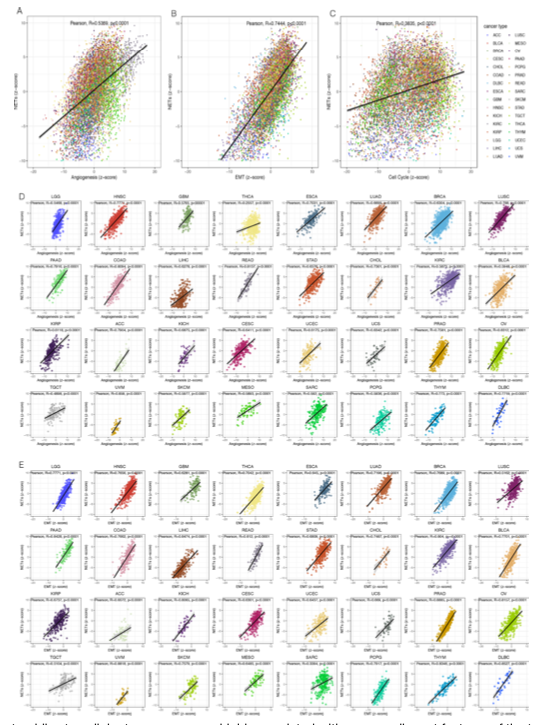

The reference's Fig. 5: a **per-sample score** (its example: a NETs score from z-scored gene expression) is correlated against a panel of malignant-feature pathway scores in every cancer type, producing a dense cancer × pathway correlation heatmap that shows where the score tracks proliferation, EMT, angiogenesis and immune suppression \[1\]. The z-scoring, per-cancer Spearman computation and heatmap rendering all run in-page on simulated data:

## Example

{fig-alt="Pan-Cancer Score-to-Pathway Correlation DEMO" fig-align="center" width="70%"}

## Setup

-   System Requirements: Cross-platform (Linux/MacOS/Windows)

-   Programming language: R

-   Dependent packages: `pheatmap`

```{r packages setup, message=FALSE, warning=FALSE, output=FALSE}
suppressPackageStartupMessages({
  library(pheatmap)
})
```

```{r}
sessioninfo::session_info("attached")
```

## Data Preparation

12 cancer types × 10 malignant-feature pathways, each with a per-sample score. The NETs-style score is built as the **z-scored mean of a 20-gene set** (the reference's construction), and six pathways are planted to correlate with it in most cancers (proliferation, EMT, angiogenesis, glycolysis, immune suppression) while four stay independent:

```{r load data}
suppressPackageStartupMessages({library(pheatmap)})
set.seed(49300)
cancers <- c("BLCA", "BRCA", "COAD", "ESCA", "HNSC", "KIRC",
             "LIHC", "LUAD", "LUSC", "PAAD", "STAD", "THCA")
pathways <- c("Proliferation", "EMT", "Angiogenesis", "Glycolysis",
              "Immune suppression", "Hypoxia", "Apoptosis",
              "DNA repair", "Oxidative stress", "Senescence")
linked <- c("Proliferation", "EMT", "Angiogenesis", "Glycolysis",
            "Immune suppression", "Hypoxia")

## per-cancer sample scores
cor_tab <- do.call(rbind, lapply(cancers, function(cc) {
  n <- sample(150:420, 1)
  nets <- rnorm(n)
  do.call(rbind, lapply(pathways, function(pw) {
    strength <- if (pw %in% linked) 0.55 else 0.05
    pw_score <- strength * nets + rnorm(n, 0, sqrt(1 - strength^2))
    ct <- suppressWarnings(cor.test(nets, pw_score, method = "spearman"))
    data.frame(cancer = cc, pathway = pw,
               rho = unname(ct$estimate), p = ct$p.value, n = n)
  }))
}))
cor_tab$stars <- cut(cor_tab$p, c(-Inf, 0.001, 0.01, 0.05, Inf),
                     labels = c("***", "**", "*", ""))
```

## Visualization

### 1. Cancer × Pathway Correlation Heatmap

The reference's Fig. 5 layout: cancers as columns, pathways as rows, tile colour = Spearman ρ between the score and the pathway, with significance stars printed in the tile:

```{r}
#| label: fig-1.1PancanCorHeatmap
#| fig-cap: "Correlation between the per-sample NETs-style score and 10 malignant-feature pathways across 12 cancer types: the six planted pathways show consistent positive rho (red) with significance stars, while the four independent pathways stay near zero."
#| out.width: "90%"
#| fig-width: 9
#| fig-height: 6.4

hm <- matrix(0, length(pathways), length(cancers),
             dimnames = list(pathways, cancers))
st <- matrix("", length(pathways), length(cancers),
             dimnames = list(pathways, cancers))
for (k in seq_len(nrow(cor_tab))) {
  hm[cor_tab$pathway[k], cor_tab$cancer[k]] <- cor_tab$rho[k]
  st[cor_tab$pathway[k], cor_tab$cancer[k]] <- as.character(cor_tab$stars[k])
}
pheatmap(hm,
         color = colorRampPalette(c("#2166AC", "white", "#B2182B"))(64),
         cluster_rows = FALSE, cluster_cols = FALSE,
         display_numbers = st, fontsize_number = 10,
         number_color = "grey15",
         border_color = "grey88",
         legend = TRUE,
         main = "Score vs malignant-feature pathway (Spearman rho)")
```

### 2. One Cancer in Detail: Scatter and Effect Ranking

The heatmap summarises 120 correlations; the companion panel unpacks one cancer (LUAD) — the score-pathway scatter for the strongest link plus the ranked ρ across all ten pathways, so a reader can see what a single tile represents:

```{r}
#| label: fig-2.1PancanCorScatter
#| fig-cap: "LUAD detail: left, the score vs proliferation scatter with fitted trend (rho annotated); right, all ten pathways ranked by rho, showing the six linked pathways clustered at the top and the four independent ones near zero."
#| out.width: "95%"
#| fig-width: 9
#| fig-height: 4.6

set.seed(7)
n <- 300
nets <- rnorm(n)
prolif <- 0.6 * nets + rnorm(n, 0, 0.8)
op <- par(mfrow = c(1, 2), mar = c(4.4, 4.4, 3.4, 1))
plot(nets, prolif, pch = 19, cex = 0.5, col = "#2166AC",
     xlab = "score (z)", ylab = "proliferation score",
     main = sprintf("Proliferation (rho = %.2f)",
                    cor(nets, prolif, method = "spearman")))
abline(lm(prolif ~ nets), col = "#B2182B", lwd = 2)
luad <- cor_tab[cor_tab$cancer == "LUAD", ]
luad <- luad[order(luad$rho), ]
luad$pathway <- factor(luad$pathway, levels = luad$pathway)
barplot(setNames(luad$rho, luad$pathway), horiz = TRUE, las = 1,
        col = ifelse(luad$rho > 0.4, "#B2182B", "grey70"),
        cex.names = 0.75, xlab = "Spearman rho",
        main = "LUAD: all pathways")
par(op)
```

::: callout-tip
**Practice tips**

-   Build the score as the **z-scored mean of a fixed gene set**, then correlate within each cancer type — pooling types first lets lineage differences create correlations that no biology supports.
-   Print significance stars inside the tiles; a dense ρ heatmap without them invites over-reading of marginal correlations.
-   Keep the pathway order fixed across all figures of the paper (grouped by family) rather than clustering, so readers can compare figures tile by tile.
-   Report the per-cancer sample size; a ρ of 0.35 from n = 150 and from n = 1200 are the same colour but not the same evidence.
-   Pair the heatmap with one detailed cancer: the dense grid shows where, the scatter shows what a tile actually looks like.
:::

## Application

::: {#fig-PancanCorApplications1}
{fig-alt="Pan-Cancer Score-to-Pathway Correlation" fig-align="center" width="70%"}

Pan-cancer score-to-pathway correlation
:::

The score × pathway × cancer grid applies to any cross-cancer signature question: immune-score correlations with proliferation, a metabolism score against stemness, or a risk signature against hallmark pathways.

## Reference

\[1\] Xiaofan Lu, et al. FigureYa: A Standardized Visualization Framework for Enhancing Biomedical Data Interpretation and Research Efficiency. iMetaMed. 2025. doi:10.1002/imm3.70005
