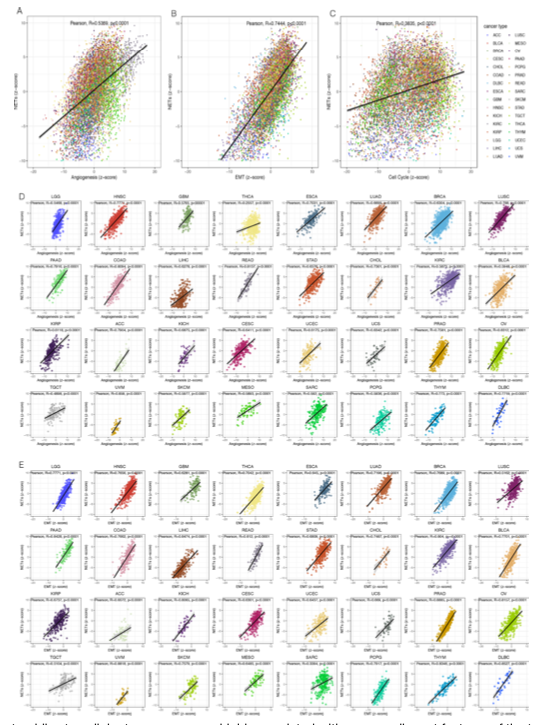

参考的 Fig. 5：将**逐样本评分**（其示例为 z 标度基因表达的 NETs 评分）与每个癌种中的一组恶性特征通路评分做相关，产出致密的 癌种 × 通路 相关热图，展示该评分在哪追踪增殖、EMT、血管生成与免疫抑制 \[\1\]。z 标度、逐癌种 Spearman 计算与热图渲染全部在页内对模拟数据运行：

## Example

{fig-alt="泛癌评分-通路相关 DEMO" fig-align="center" width="60%"}

## Setup

-   系统要求：跨平台（Linux/MacOS/Windows）

-   编程语言：R

-   依赖包：`pheatmap`

```{r packages setup, message=FALSE, warning=FALSE, output=FALSE}
suppressPackageStartupMessages({
  library(pheatmap)
})
```

```{r}
sessioninfo::session_info("attached")
```

## 数据准备

12 个癌种 × 10 条恶性特征通路、各带逐样本评分。NETs 式评分构建为**20 基因集的 z 标度均值**（参考的构造），并有六条通路植入为在多数癌种中与其相关（增殖、EMT、血管生成、糖酵解、免疫抑制），另四条保持独立：

```{r load data}
suppressPackageStartupMessages({library(pheatmap)})
set.seed(49300)
cancers <- c("BLCA", "BRCA", "COAD", "ESCA", "HNSC", "KIRC",
             "LIHC", "LUAD", "LUSC", "PAAD", "STAD", "THCA")
pathways <- c("Proliferation", "EMT", "Angiogenesis", "Glycolysis",
              "Immune suppression", "Hypoxia", "Apoptosis",
              "DNA repair", "Oxidative stress", "Senescence")
linked <- c("Proliferation", "EMT", "Angiogenesis", "Glycolysis",
            "Immune suppression", "Hypoxia")

## per-cancer sample scores
cor_tab <- do.call(rbind, lapply(cancers, function(cc) {
  n <- sample(150:420, 1)
  nets <- rnorm(n)
  do.call(rbind, lapply(pathways, function(pw) {
    strength <- if (pw %in% linked) 0.55 else 0.05
    pw_score <- strength * nets + rnorm(n, 0, sqrt(1 - strength^2))
    ct <- suppressWarnings(cor.test(nets, pw_score, method = "spearman"))
    data.frame(cancer = cc, pathway = pw,
               rho = unname(ct$estimate), p = ct$p.value, n = n)
  }))
}))
cor_tab$stars <- cut(cor_tab$p, c(-Inf, 0.001, 0.01, 0.05, Inf),
                     labels = c("***", "**", "*", ""))
```

## Visualization

### 癌种 × 通路相关热图

参考的 Fig. 5 版式：癌种为列、通路为行、格子颜色 = 评分与通路的 Spearman ρ、格内印刷显著性星号：

```{r}
#| label: fig-1.1PancanCorHeatmap
#| fig-cap: "逐样本 NETs 式评分与 10 条恶性特征通路在 12 个癌种中的相关：六条植入通路呈现一致的正 ρ（红）与显著性星号、而四条独立通路近零。"
#| out.width: "90%"
#| fig-width: 9
#| fig-height: 6.4

hm <- matrix(0, length(pathways), length(cancers),
             dimnames = list(pathways, cancers))
st <- matrix("", length(pathways), length(cancers),
             dimnames = list(pathways, cancers))
for (k in seq_len(nrow(cor_tab))) {
  hm[cor_tab$pathway[k], cor_tab$cancer[k]] <- cor_tab$rho[k]
  st[cor_tab$pathway[k], cor_tab$cancer[k]] <- as.character(cor_tab$stars[k])
}
pheatmap(hm,
         color = colorRampPalette(c("#2166AC", "white", "#B2182B"))(64),
         cluster_rows = FALSE, cluster_cols = FALSE,
         display_numbers = st, fontsize_number = 10,
         number_color = "grey15",
         border_color = "grey88",
         legend = TRUE,
         main = "Score vs malignant-feature pathway (Spearman rho)")
```

### 单癌种细节：散点与效应排序

热图汇总了 120 个相关；伴生面板解包一个癌种（LUAD）——最强连接的 评分-通路 散点加全部十通路 ρ 的排序，让读者看到单个格子实际代表什么：

```{r}
#| label: fig-2.1PancanCorScatter
#| fig-cap: "LUAD 细节：左，评分与增殖的散点并拟合趋势（标注 ρ）；右，全部十通路按 ρ 排序，六条连接通路聚在顶部、四条独立通路近零。"
#| out.width: "95%"
#| fig-width: 9
#| fig-height: 4.6

set.seed(7)
n <- 300
nets <- rnorm(n)
prolif <- 0.6 * nets + rnorm(n, 0, 0.8)
op <- par(mfrow = c(1, 2), mar = c(4.4, 4.4, 3.4, 1))
plot(nets, prolif, pch = 19, cex = 0.5, col = "#2166AC",
     xlab = "score (z)", ylab = "proliferation score",
     main = sprintf("Proliferation (rho = %.2f)",
                    cor(nets, prolif, method = "spearman")))
abline(lm(prolif ~ nets), col = "#B2182B", lwd = 2)
luad <- cor_tab[cor_tab$cancer == "LUAD", ]
luad <- luad[order(luad$rho), ]
luad$pathway <- factor(luad$pathway, levels = luad$pathway)
barplot(setNames(luad$rho, luad$pathway), horiz = TRUE, las = 1,
        col = ifelse(luad$rho > 0.4, "#B2182B", "grey70"),
        cex.names = 0.75, xlab = "Spearman rho",
        main = "LUAD: all pathways")
par(op)
```


## 应用场景

::: {{#fig-PancanCorApplications1}}
{fig-alt="泛癌评分-通路相关" fig-align="center" width="60%"}

泛癌评分-通路相关
:::

评分 × 通路 × 癌种 网格适用于任何跨癌种签名问题：免疫评分与增殖的相关、代谢评分对照干性、或风险签名对照 hallmark 通路。

## 参考文献

\[1\] Xiaofan Lu, et al. FigureYa: A Standardized Visualization Framework for Enhancing Biomedical Data Interpretation and Research Efficiency. iMetaMed. 2025. doi:10.1002/imm3.70005
