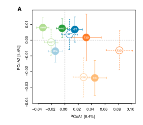

样本量一上来，朴素的 PCoA 散点图就糊成一团。参考文档把它重画成**每个分组一个带标签的圆圈**——组均值坐标加横向/纵向 ± SD 误差线，一个队列实心圆、配对队列空心圆，亚型的跨队列配对一眼可见 \[1\]。参考用 `vegan::vegdist`/`adonis2`；本教程用 `cmdscale()`（base stats）+ `ape::pcoa()`（已入锁）得到同样的投影，并用页内置换伪 F 检验替代仅 vegan 提供的 PERMANOVA：

## Example

{fig-alt="PCoA 组均值圆圈图 DEMO" fig-align="center" width="60%"}

## Setup

-   系统要求：跨平台（Linux/MacOS/Windows）

-   编程语言：R

-   依赖包：`ape`; `RColorBrewer`

```{r packages setup, message=FALSE, warning=FALSE, output=FALSE}
suppressPackageStartupMessages({
  library(RColorBrewer)
})
```

```{r}
sessioninfo::session_info("attached")
```

## 数据准备

5 个模拟 PAM50 类亚型 × 2 个队列（TCGA 式 discovery、Yau 式 validation），500 个基因带植入的亚型质心结构。参考对非负物种丰度用 Bray-Curtis；log 尺度表达谱有负值，欧氏距离才是诚实的替代——且当距离为欧氏距离时 PCoA *就是* PCA，轴的含义不变：

```{r load data}
suppressPackageStartupMessages({library(RColorBrewer)})
set.seed(39229)
n_sub <- 5; n_coh <- 2; n_per <- 60; n_gene <- 500
subtypes <- c("Basal", "Her2", "LumA", "LumB", "Normal")
cohorts  <- c("TCGA", "Yau")
sinfo <- expand.grid(sub = rep(subtypes, each = n_per), cohort = factor(cohorts, levels = cohorts))
sinfo <- sinfo[order(sinfo$cohort, sinfo$sub), ]
sinfo$sample <- sprintf("S%03d", seq_len(nrow(sinfo)))
rownames(sinfo) <- sinfo$sample
## planted subtype centroids: each subtype is a direction in gene space
centroids <- matrix(rnorm(n_sub * n_gene, 0, 1.4), n_sub, n_gene)
rownames(centroids) <- subtypes
## one centroid row per sample (keeps sample/centroid alignment explicit)
expr <- centroids[as.character(sinfo$sub), ] +
  matrix(rnorm(nrow(sinfo) * n_gene, 0, 1), nrow(sinfo), n_gene) +
  matrix(rnorm(nrow(sinfo) * n_gene, ifelse(sinfo$cohort == "Yau", 1.2, 0), 0.08),
         nrow(sinfo), n_gene)
rownames(expr) <- sinfo$sample
## distance matrix (rows = samples) and PCoA coordinates
sam.dist <- dist(expr)                  # Euclidean: PCoA == PCA here
pc <- cmdscale(sam.dist, eig = FALSE)
eig <- ape::pcoa(sam.dist)
rel <- eig$values$Relative_eig
pct <- round(rel[1:2] / sum(rel) * 100, 1)
xlab.text <- sprintf("PCoA1 [%.1f%%]", pct[1])
ylab.text <- sprintf("PCoA2 [%.1f%%]", pct[2])
```

## Visualization

### 问题所在：朴素 PCoA 散点

每个样本一个点、按亚型着色：亚型结构可见但五个云团在样本量下严重重叠——正是参考文档要解决的过度绘制问题：

```{r}
#| label: fig-1.1PcoaScatter
#| fig-cap: "600 个模拟样本（5 亚型 × 2 队列）的朴素 PCoA 散点图、按亚型着色：云团重叠、单个点难以分辨。"
#| out.width: "80%"
#| fig-width: 5.5
#| fig-height: 5

mycol <- setNames(brewer.pal(n_sub, "Set1"), subtypes)
plot(pc[, 1], pc[, 2],
     col = mycol[sinfo$sub], pch = 19, cex = 0.6,
     xlab = xlab.text, ylab = ylab.text,
     las = 1)
legend("topright", legend = subtypes, col = mycol, pch = 19,
       cex = 0.8, bty = "n")
```

### 解决之道：组均值圆圈 + ± SD 误差线

把每个 亚型 × 队列 单元聚合为均值 ± SD：误差线**先画**（随后被圆圈盖住）、再画实心圆（discovery 队列）与空心圆（validation 队列），圆内放短标签。配对色（同色相深/浅）把同一亚型的两个队列视觉绑定：

```{r}
#| label: fig-2.1PcoaCircles
#| fig-cap: "PCoA 重画为逐组均值 ± SD 误差线与带标签圆圈：实心 = TCGA 式队列、空心 = Yau 式队列；配对颜色链接同一亚型的两个队列。"
#| out.width: "80%"
#| fig-width: 5.5
#| fig-height: 5

plotinfo <- data.frame(x = pc[, 1], y = pc[, 2],
                       Sub = sinfo$sub, Cohort = sinfo$cohort)
plotinfo$Class <- factor(paste(plotinfo$Sub, plotinfo$Cohort, sep = "_"),
                         levels = as.vector(t(cbind(paste0(subtypes, "_TCGA"),
                                                    paste0(subtypes, "_Yau")))))
## paired palette: dark = TCGA, light = Yau for the same subtype
pal <- setNames(as.vector(t(cbind(brewer.pal(n_sub, "Set1"),
                                  paste0(brewer.pal(n_sub, "Set1"), "77")))),
                levels(plotinfo$Class))
plotinfo$color <- pal[plotinfo$Class]

## aggregate
agg <- do.call(rbind, lapply(levels(plotinfo$Class), function(cl) {
  tmp <- plotinfo[plotinfo$Class == cl, ]
  data.frame(Class = cl, color = unique(tmp$color),
             shape = ifelse(unique(tmp$Cohort) == "TCGA", "closed", "opened"),
             label = paste0(switch(as.character(unique(tmp$Sub)),
                                   Basal = "Ba", Her2 = "He", LumA = "LA",
                                   LumB = "Lb", Normal = "No"),
                            ifelse(unique(tmp$Cohort) == "TCGA", "T", "Y")),
             avgx = mean(tmp$x), avgy = mean(tmp$y),
             sdx = sd(tmp$x), sdy = sd(tmp$y))
}))

xr <- range(c(plotinfo$x, agg$avgx + agg$sdx, agg$avgx - agg$sdx))
yr <- range(c(plotinfo$y, agg$avgy + agg$sdy, agg$avgy - agg$sdy))
op <- par(mar = c(4.1, 4.1, 5.5, 2.1))
plot(NULL, NULL, xlim = xr, ylim = yr,
     xlab = xlab.text, ylab = ylab.text, las = 1)
## error bars first (they get covered by the circles)
for (i in seq_len(nrow(agg))) {
  t1 <- agg[i, ]
  lty <- ifelse(t1$shape == "closed", 1, 2)
  segments(t1$avgx - t1$sdx, t1$avgy, t1$avgx + t1$sdx, t1$avgy,
           lty = lty, col = t1$color, lwd = 2)             # horizontal
  segments(t1$avgx, t1$avgy - t1$sdy, t1$avgx, t1$avgy + t1$sdy,
           lty = lty, col = t1$color, lwd = 2)             # vertical
}
## circles on top
points(agg$avgx, agg$avgy,
       pch = ifelse(agg$shape == "closed", 19, 21),
       bg = ifelse(agg$shape == "closed", agg$color, "white"),
       col = agg$color, lwd = 2, cex = 5)
text(agg$avgx, agg$avgy, agg$label,
     col = ifelse(agg$shape == "closed", "white", agg$color), cex = 0.85)
par(xpd = TRUE)
u <- par("usr")
legend(x = u[1], y = u[4] + 0.10 * (u[4] - u[3]),
       legend = c("TCGA-like (closed)", "Yau-like (open)"),
       pch = c(19, 21), pt.bg = c("grey40", "white"),
       col = "grey30", cex = 0.85, bty = "n", horiz = TRUE)
par(xpd = FALSE); par(op)
```

### 分组是真的吗？置换伪 F（PERMANOVA）

参考用 vegan 的 `adonis2`；同一统计量手写约 20 行即可：按分组对距离矩阵的总平方和分解、构造伪 F 比值、置换组标签 1000 次。在每个队列内部各跑一次，让各队列的亚型分离在自己的样本上检验：

```{r}
#| label: fig-3.1Permanova
#| fig-cap: "逐队列手写 PERMANOVA（伪 F、1000 次标签置换）：两个队列都强烈分离模拟亚型（p < 0.001），与可见的簇结构一致。"
#| out.width: "80%"
#| fig-width: 6.5
#| fig-height: 4.6

permanova <- function(d, group, n_perm = 1000) {
  group <- factor(group)
  n <- length(group); k <- nlevels(group)
  ss_total <- sum(d^2) / n
  ss_within <- sum(tapply(d^2, group, sum) /
                   tapply(group, group, length))
  ss_between <- ss_total - ss_within
  f_obs <- (ss_between / (k - 1)) / (ss_within / (n - k))
  f_perm <- replicate(n_perm, {
    gp <- sample(group)
    ssw <- sum(tapply(d^2, gp, sum) / tapply(gp, gp, length))
    ssb <- ss_total - ssw
    (ssb / (k - 1)) / (ssw / (n - k))
  })
  c(F = f_obs, p = (sum(f_perm >= f_obs) + 1) / (n_perm + 1))
}

res <- do.call(rbind, lapply(cohorts, function(cc) {
  idx <- sinfo$cohort == cc
  r <- permanova(as.dist(as.matrix(sam.dist)[idx, idx]), sinfo$sub[idx])
  data.frame(cohort = cc, F = round(r[["F"]], 1),
             p = format.pval(r[["p"]], digits = 2))
}))
op <- par(mar = c(4, 2.5, 2.5, 1))
bp <- barplot(res$F, names.arg = res$cohort, col = c("#4472C4", "#9DC3E6"),
              ylim = c(0, max(res$F) * 1.3), las = 1,
              main = "PERMANOVA pseudo-F within cohort")
text(bp, res$F * 0.5, labels = sprintf("F = %.1f\np = %s", res$F, res$p),
     col = "white", cex = 0.9)
par(op)
```


## 应用场景

::: {{#fig-PcoaApplications1}}
{fig-alt="PCoA 组均值圆圈图" fig-align="center" width="60%"}

PCoA 组均值圆圈图
:::

组均值 ± SD 圆圈版式适用于任何点云过密的降维：表达队列的 PCA、UMAP/t-SNE 嵌入、或微生物组 beta 多样性排序。手写伪 F 检验接受任意 dist 对象，同样覆盖这些场景。

## 参考文献

\[1\] Xiaofan Lu, et al. FigureYa: A Standardized Visualization Framework for Enhancing Biomedical Data Interpretation and Research Efficiency. iMetaMed. 2025. doi:10.1002/imm3.70005
