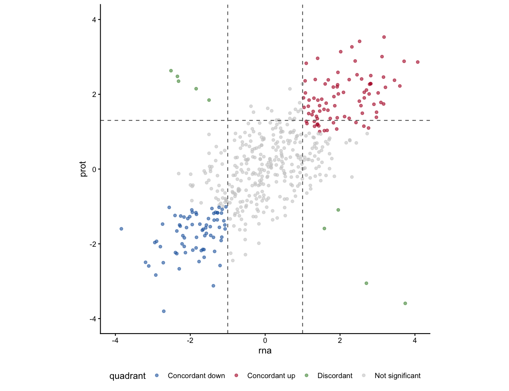

A quadrant (or nine-grid) scatter plot displays two measurements for the same set of features, overlays quadrant threshold lines, and highlights named features of interest with `ggrepel` labels \[1\]. It is the standard figure for multi-omics concordance (RNA vs protein, RNA vs ATAC) or for showing genes in biologically meaningful regions (up/up, up/down, etc.).

## Example

{fig-alt="QuadrantPlot DEMO" fig-align="center" width="60%"}

## Setup

-   System Requirements: Cross-platform (Linux/MacOS/Windows)

-   Programming Language: R

-   Dependent packages: `ggplot2`; `ggrepel`; `dplyr`

```{r packages setup, message=FALSE, warning=FALSE, output=FALSE}
if (!requireNamespace("ggplot2", quietly = TRUE)) install.packages("ggplot2")
if (!requireNamespace("ggrepel", quietly = TRUE)) install.packages("ggrepel")
if (!requireNamespace("dplyr", quietly = TRUE)) install.packages("dplyr")

library(ggplot2)
library(ggrepel)
library(dplyr)
```

```{r}
sessioninfo::session_info("attached")
```

## Data Preparation

We simulate log2 fold changes for 500 genes measured by RNA-seq and proteomics, with a subset of concordant and discordant genes, plus named highlights.

```{r load data, message=FALSE, warning=FALSE}
set.seed(2101)
n <- 500
genes <- paste0("Gene", sprintf("%04d", 1:n))
rna <- rnorm(n, sd = 1.5)
prot <- rna * 0.7 + rnorm(n, sd = 0.8)
# make a few discordant genes
disc <- sample(1:n, 15)
prot[disc] <- -rna[disc] + rnorm(15, sd = 0.3)
df_q <- data.frame(gene = genes, rna = rna, prot = prot)

# genes to label
label_genes <- c("Gene0001", "Gene0002", "Gene0015", "Gene0020",
                 "Gene0005", "Gene0008", "Gene0003")
```

## Visualization

### 1. Nine-Grid Quadrant Scatter with Labels

```{r}
#| label: fig-1.1Quadrant
#| fig-cap: "Quadrant scatter: RNA-seq vs proteomics log2FC. Vertical and horizontal lines mark fold-change thresholds (±1). Named genes are labelled with ggrepel."
#| out.width: "85%"
#| warning: false
#| message: false
#| fig-width: 7.5
#| fig-height: 6.5

threshold <- 1
ggplot(df_q, aes(rna, prot)) +
  geom_point(alpha = 0.4, size = 1.5, colour = "grey50") +
  geom_vline(xintercept = c(-threshold, threshold), linetype = "dashed", colour = "grey40") +
  geom_hline(yintercept = c(-threshold, threshold), linetype = "dashed", colour = "grey40") +
  geom_point(data = subset(df_q, gene %in% label_genes),
             colour = "#B2182B", size = 2.5) +
  ggrepel::geom_text_repel(
    data = subset(df_q, gene %in% label_genes),
    aes(label = gene), size = 3, colour = "#B2182B",
    box.padding = 0.4, max.overlaps = 20) +
  coord_equal(xlim = c(-4, 4), ylim = c(-4, 4)) +
  labs(x = "RNA-seq log2FC", y = "Proteomics log2FC",
       title = "RNA vs protein concordance") +
  theme_classic(base_size = 11)
```

### 2. Coloured Quadrant Regions

```{r}
#| label: fig-1.2ColouredQuadrant
#| fig-cap: "Genes colour-coded by quadrant: concordant up (red), concordant down (blue), discordant (green), and non-significant (grey)."
#| out.width: "85%"
#| warning: false
#| message: false
#| fig-width: 7.5
#| fig-height: 6.5

df_q <- df_q |>
  mutate(quadrant = case_when(
    rna > threshold & prot > threshold ~ "Concordant up",
    rna < -threshold & prot < -threshold ~ "Concordant down",
    abs(rna) > threshold & abs(prot) > threshold ~ "Discordant",
    TRUE ~ "Not significant"))

quad_cols <- c("Concordant up" = "#B2182B", "Concordant down" = "#2166AC",
               "Discordant" = "#4D9342", "Not significant" = "grey80")

ggplot(df_q, aes(rna, prot, colour = quadrant)) +
  geom_point(size = 1.5, alpha = 0.6) +
  geom_vline(xintercept = c(-threshold, threshold), linetype = "dashed", colour = "grey40") +
  geom_hline(yintercept = c(-threshold, threshold), linetype = "dashed", colour = "grey40") +
  scale_colour_manual(values = quad_cols) +
  geom_point(data = subset(df_q, gene %in% label_genes),
             colour = "black", size = 2.5, shape = 21, fill = "gold") +
  ggrepel::geom_text_repel(
    data = subset(df_q, gene %in% label_genes),
    aes(label = gene), size = 3, colour = "black",
    box.padding = 0.4, max.overlaps = 20) +
  coord_equal(xlim = c(-4, 4), ylim = c(-4, 4)) +
  labs(x = "RNA-seq log2FC", y = "Proteomics log2FC", colour = "Quadrant") +
  theme_classic(base_size = 11) +
  theme(legend.position = "bottom")
```

::: callout-tip
**Practice tips**

-   Adjust the `threshold` to match your data's fold-change cutoff; the default ±1 corresponds to |log2FC| > 1.
-   Use `geom_text_repel()` with `max.overlaps = 20` for readable labels even with many highlighted genes.
-   The quadrant assignment via `case_when()` can be adapted for any number of regions by adding more conditions.
:::

## Application

Quadrant scatter plots are the standard figure for multi-omics concordance, drug-response screens, and CRISPR screen comparisons.

## Reference

\[1\] Xiaofan Lu, et al. FigureYa: A Standardized Visualization Framework for Enhancing Biomedical Data Interpretation and Research Efficiency. iMetaMed. 2025. doi:10.1002/imm3.70005
